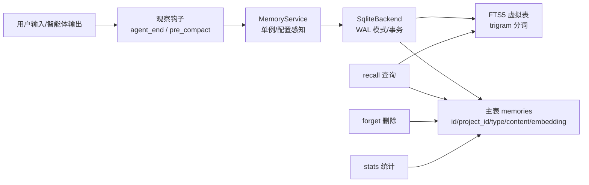
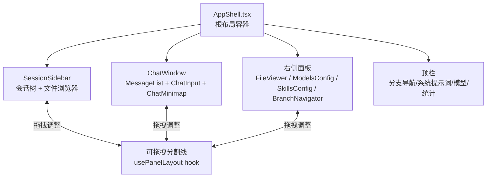
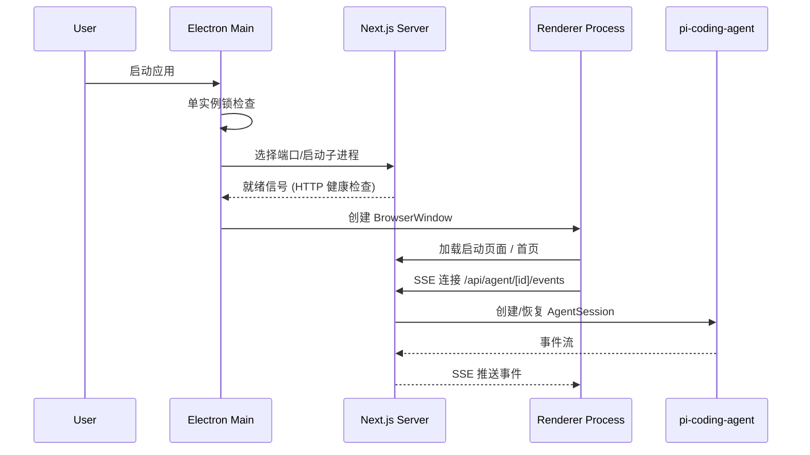

Pi Agent Desktop 是一个基于 Electron 构建的原生桌面客户端，面向 [Pi 编程智能体](https://github.com/badlogic/pi-mono)。它从 [pi-web](https://github.com/agegr/pi-web) 衍生而来，专注于桌面端体验的打磨与功能增强，提供比浏览器更原生、更流畅的开发体验。项目采用 **Next.js 16 + React 19 + TypeScript** 作为前端栈，**Electron 43** 作为桌面运行时，通过 **SSE (Server-Sent Events)** 实现与后端智能体的实时流式通信。

Sources: [README.zh-CN.md](README.zh-CN.md#L1-L50), [package.json](package.json#L1-L30)

## 核心定位与设计目标

| 维度 | 说明 |
|------|------|
| **目标用户** | 需要原生桌面体验的 Pi 智能体使用者 |
| **核心价值** | 系统托盘、最小化到托盘、原生菜单、自动更新、Apple 风格布局、液态思考球动画 |
| **架构模式** | 双模式运行：浏览器开发模式 (`npm run dev`) 与 Electron 桌面模式 (`npm run dev:electron`) |
| **上游依赖** | `@earendil-works/pi-coding-agent` (核心智能体), `@earendil-works/pi-ai` (模型抽象层) |

Sources: [README.zh-CN.md](README.zh-CN.md#L50-L120), [electron/main.ts](electron/main.ts#L1-L100)

## 整体架构概览

下图展示了 Pi Agent Desktop 的四层分离架构与核心数据流：

```mermaid
flowchart TB
    subgraph ElectronMain[Electron 主进程]
        EMain[main.ts<br/>窗口管理/子进程托管/系统托盘/自动更新]
        EPreload[preload.ts<br/>contextBridge 安全边界]
        EServer[server-process.ts<br/>Next.js 服务器生命周期管理]
        ECSP[csp.ts<br/>内容安全策略]
    end

    subgraph NextJSLayer[Next.js 应用层 (浏览器/渲染进程)]
        AppRouter[App Router (app/)]
        APIRoutes[API 路由 (app/api/*)]
        Components[React 组件]
        Hooks[自定义 Hooks]
    end

    subgraph SDKLayer[SDK / 核心库层 (lib/)]
        RPCManager[rpc-manager.ts<br/>AgentSession 生命周期/RPC 代理]
        SessionReader[session-reader.ts<br/>.jsonl 解析/路径缓存/树构建]
        ApprovalPolicy[approval-policy.ts<br/>AgentMode/ToolPreset 策略]
        LTM[ltm/ 目录<br/>SQLite 后端/FTS5/观察钩子]
        MCPConfig[mcp-config.ts<br/>全局/项目 MCP 服务器]
        Extensions[extensions-config.ts<br/>扩展/Skill 安装/诊断]
        Trust[project-trust-desktop.ts<br/>409 握手/授权决策]
    end

    subgraph PersistenceLayer[持久化层]
        SessionsDir[(~/.pi/agent/sessions/*.jsonl)]
        LTMDB[(项目级 SQLite<br/>.pi/ltm/memory.db)]
        MCPGlobal[(~/.pi/agent/mcp.json)]
        MCPProject[(<cwd>/.pi/mcp.json)]
        Settings[(settings.json / .pi/settings.json)]
    end

    EMain -->|启动/监控| EServer
    EServer -->|HTTP/SSE| APIRoutes
    APIRoutes -->|命令/事件流| RPCManager
    RPCManager -->|创建/管理| AgentSession[(pi-coding-agent<br/>AgentSession)]
    AgentSession -->|读写| SessionsDir
    AgentSession -->|工具调用| LTM
    AgentSession -->|工具调用| MCPConfig
    LTM -->|SQLite/FTS5| LTMDB
    RPCManager -->|策略决策| ApprovalPolicy
    APIRoutes -->|配置读写| MCPConfig
    APIRoutes -->|配置读写| Extensions
    APIRoutes -->|信任决策| Trust
    Trust -->|持久化决策| Settings
    Components -->|SSE 连接| APIRoutes
    Components -->|Hooks 调用| Hooks
    Hooks -->|API 请求| APIRoutes
    EPreload -.->|原生 API 暴露| Components
```

Sources: [electron/main.ts](electron/main.ts#L1-L200), [lib/rpc-manager.ts](lib/rpc-manager.ts#L1-L100), [lib/session-reader.ts](lib/session-reader.ts#L1-L100), [lib/approval-policy.ts](lib/approval-policy.ts#L1-L86), [lib/ltm/service.ts](lib/ltm/service.ts#L1-L100), [lib/mcp-config.ts](lib/mcp-config.ts#L1-L100), [lib/project-trust-desktop.ts](lib/project-trust-desktop.ts#L1-L100)

## 四大核心功能域

### 1. 会话与对话系统

会话系统采用 **树状结构** 存储，支持分支、分叉、克隆与导出，所有历史保存在单个 `.jsonl` 文件中。

| 功能 | 技术实现 | 关键文件 |
|------|----------|----------|
| **会话浏览** | 按工作目录分组，支持搜索与过滤 | `components/SessionSidebar.tsx`, `lib/session-reader.ts` |
| **流式对话** | SSE 事件流，心跳保活，断线重连 | `app/api/agent/[id]/events/route.ts`, `hooks/useAgentSession.ts` |
| **消息队列** | Enter 立即 steer，Alt+Enter 入队，支持拖拽重排 | `lib/follow-up-queue.ts`, `components/ChatInput.tsx` |
| **会话分支** | 树状节点回退，同一文件多叶子节点 | `lib/session-branch-clone.ts`, `components/BranchNavigator.tsx` |
| **分叉与克隆** | Branch 保留历史，Clone 可创建 Git worktree | `lib/session-branch-clone.ts`, `lib/git-worktree.ts` |
| **会话导出** | HTML/Markdown 一键导出 | `components/SessionExportModal.tsx`, `lib/session-export.ts` |
| **模型切换** | 中途动态切换，动态加载 Provider | `components/ModelsConfig.tsx`, `app/api/models/route.ts` |

Sources: [lib/types.ts](lib/types.ts#L1-L150), [lib/session-reader.ts](lib/session-reader.ts#L100-L200), [lib/session-branch-clone.ts](lib/session-branch-clone.ts#L1-L100), [app/api/agent/[id]/events/route.ts](app/api/agent/[id]/events/route.ts#L1-L143)

### 2. 智能体能力与安全策略

三层安全模式与工具预设系统，配合 Extension UI Bridge 实现原生交互。

| 模式 | 启用工具 | 确认机制 | 适用场景 |
|------|----------|----------|----------|
| **Plan** | `read`, `grep`, `find`, `ls` (只读) | 无 | 规划阶段，仅读取代码库 |
| **Ask** | `read`, `bash`, `edit`, `write` + 配置工具 | `bash`/`write`/`edit`/`memory_save`/`memory_forget` 需确认 | 日常开发，关键操作需人工批准 |
| **Full** | 所有工具 | 无 | 完全自主，可信环境 |

**Extension UI Bridge** 将扩展的 `confirm`/`select`/`input`/`editor`/`notify` 请求桥接为原生 Electron 对话框。

Sources: [lib/approval-policy.ts](lib/approval-policy.ts#L1-L86), [lib/desktop-approval-extension.ts](lib/desktop-approval-extension.ts), [lib/extension-ui-bridge.ts](lib/extension-ui-bridge.ts), [components/ExtensionUiDialog.tsx](components/ExtensionUiDialog.tsx)

### 3. 长期记忆 (LTM) 系统

项目级持久化记忆，支持跨会话检索，中文/日韩文本通过 FTS5 trigram 索引。



**核心特性**：
- `memory_save` / `memory_recall` / `memory_forget` 三大工具
- 自动观察：`agent_end` 与 compaction 前触发
- CJK 语言走 FTS5 trigram，英文走标准分词
- HMR 安全的单例模式 (`globalThis.__piLtmService`)

Sources: [lib/ltm/service.ts](lib/ltm/service.ts#L1-L200), [lib/ltm/sqlite-backend.ts](lib/ltm/sqlite-backend.ts), [lib/ltm/observe-hooks.ts](lib/ltm/observe-hooks.ts), [lib/ltm/config.ts](lib/ltm/config.ts)

### 4. 配置与扩展管理

统一的配置管理界面，支持全局与项目级双作用域。

| 配置类型 | 全局路径 | 项目路径 | 管理界面 |
|----------|----------|----------|----------|
| **MCP 服务器** | `~/.pi/agent/mcp.json` | `<cwd>/.pi/mcp.json` | `McpConfigModal.tsx` |
| **扩展/技能** | `~/.pi/agent/settings.json` | `<cwd>/.pi/settings.json` | `ExtensionsConfigModal.tsx` |
| **模型配置** | `~/.pi/agent/models.json` | — | `ModelsConfig.tsx` |
| **桌面设置** | `~/.pi/agent/desktop-settings.json` | — | AppShell 状态栏 |
| **项目信任** | `~/.pi/agent/trust.json` | — | `ProjectTrustDialog.tsx` |

Sources: [lib/mcp-config.ts](lib/mcp-config.ts#L1-L150), [lib/extensions-config.ts](lib/extensions-config.ts#L1-L150), [components/McpConfigModal.tsx](components/McpConfigModal.tsx), [components/ExtensionsConfigModal.tsx](components/ExtensionsConfigModal.tsx)

## 前端 UI 架构

### 布局系统

`AppShell` 采用三栏可调布局：左侧会话/文件边栏、中间聊天区、右侧文件查看器/配置面板。



### 关键 UI 组件

| 组件 | 职责 | 特色技术 |
|------|------|----------|
| `ChatWindow` | 消息流渲染、分支导航、执行计划条 | 虚拟化列表、ChatMinimap 缩略导航 |
| `ChatInput` | 多模态输入、队列管理、思考层级选择 | `AttachmentPreview`、`ModelSelector`、`PresetSelector` |
| `LiquidOrbCanvas` | 思考状态可视化动画 | **WebGPU 优先，Canvas 降级**，WGSL 着色器 |
| `AgentThinkingOrb` | 状态指示器 (空闲/思考/工具调用) | CSS 动画 + Canvas 粒子 |
| `StatsBar` | Token 用量、缓存、上下文容量、Provider 额度 | 实时计算、上游配额查询 |
| `SessionSidebar` | 会话树、工作目录切换、文件图标 | 虚拟化渲染、`FileIcons` 组件 |

Sources: [components/AppShell.tsx](components/AppShell.tsx#L1-L200), [components/ChatWindow.tsx](components/ChatWindow.tsx#L1-L150), [components/LiquidOrbCanvas.tsx](components/LiquidOrbCanvas.tsx#L1-L150), [components/ChatMinimap.tsx](components/ChatMinimap.tsx)

## Electron 桌面集成

### 启动流程与进程模型



**关键机制**：
- **端口选取**: 随机端口 + 端口冲突重试 (`port-selection.ts`)
- **服务器等待**: 指数退避健康检查 (`server-wait.ts`)
- **崩溃恢复**: 进程树清理 + 重启策略 (`crash-recovery.ts`, `restart-policy.ts`)
- **CSP 策略**: 严格的 `script-src`/`style-src`/`connect-src` (`csp.ts`)
- **自动更新**: `electron-updater` + GitHub Releases (`main.ts`)

Sources: [electron/main.ts](electron/main.ts#L200-L500), [electron/server-wait.ts](electron/server-wait.ts), [electron/crash-recovery.ts](electron/crash-recovery.ts), [electron/restart-policy.ts](electron/restart-policy.ts), [electron/csp.ts](electron/csp.ts)

### 打包与分发

| 平台 | 打包格式 | 关键配置 |
|------|----------|----------|
| **Windows** | NSIS Installer (`.exe`) | `electron-builder.yml` |
| **macOS** | Universal DMG + ZIP (Intel + Apple Silicon) | `ensure-standalone-macos-universal-runtimes.mjs` |
| **Linux** | DEB 包 (`.deb`) | `electron-builder.yml` |

**Standalone 构建流程**：
1. `next build` 生成 standalone 输出
2. 注入 Turbopack / Pi 运行时 / macOS Sharp 双架构运行时
3. 解引用符号链接
4. 冒烟测试 standalone 服务器
5. `electron-builder` 打包
6. 打包后冒烟测试

Sources: [package.json](package.json#L15-L45), [scripts/ensure-standalone-next-runtimes.mjs](scripts/ensure-standalone-next-runtimes.mjs), [scripts/ensure-standalone-pi-runtime.mjs](scripts/ensure-standalone-pi-runtime.mjs), [scripts/smoke-standalone-server.mjs](scripts/smoke-standalone-server.mjs), [electron-builder.yml](electron-builder.yml)

## 项目目录结构速览

```
pi-agent-desktop/
├── app/                          # Next.js App Router
│   ├── api/                      # 39 条 API 路由
│   │   ├── agent/                # 智能体命令与 SSE 事件流
│   │   ├── sessions/             # 会话列表/读取/分支/克隆/导出
│   │   ├── memory/               # LTM recall/remember/forget/stats
│   │   ├── mcp/                  # MCP 服务器配置管理
│   │   ├── extensions/           # 扩展/Skill 安装/切换/诊断
│   │   ├── trust/                # 项目信任 409 握手
│   │   └── ...                   # models, skills, auth, files 等
│   ├── layout.tsx                # 根布局 (I18nProvider, 全局错误捕获)
│   └── page.tsx                  # 入口页面
├── components/                   # React 组件 (40+ 文件)
│   ├── AppShell.tsx              # 三栏布局根组件
│   ├── ChatWindow.tsx            # 聊天主窗口
│   ├── SessionSidebar.tsx        # 会话边栏 + 文件浏览器
│   ├── ChatInput.tsx             # 消息输入 (多模态/队列/模型选择)
│   ├── LiquidOrbCanvas.tsx       # WebGPU/Canvas 液态动画
│   └── ...                       # Modals, MessageView, FileViewer 等
├── electron/                     # Electron 主进程
│   ├── main.ts                   # 入口: 窗口/托盘/更新/子进程
│   ├── preload.ts                # contextBridge 安全暴露
│   ├── server-process.ts         # Next.js 服务器进程封装
│   ├── tray.ts                   # 系统托盘菜单
│   └── *.test.ts                 # 主进程单测
├── hooks/                        # 自定义 React Hooks
│   ├── useAgentSession.ts        # 会话核心状态机 (800+ 行)
│   ├── agent-session/            # 会话子模块 (事件/滚动/加载器/命令)
│   ├── usePanelLayout.ts         # 面板布局/分割线状态
│   └── useTheme.ts / useI18n.ts  # 主题/国际化
├── lib/                          # 核心库 (纯 TS, 可服务端/客户端共用)
│   ├── rpc-manager.ts            # AgentSession 生命周期/RPC 代理
│   ├── session-reader.ts         # .jsonl 解析/路径缓存/树构建
│   ├── approval-policy.ts        # AgentMode/ToolPreset 策略
│   ├── ltm/                      # 长期记忆系统
│   ├── mcp-config.ts             # MCP 配置读写
│   ├── extensions-config.ts      # 扩展/Skill 管理
│   ├── project-trust-desktop.ts  # 信任决策
│   ├── git-worktree.ts           # Git worktree 创建/清理
│   └── types.ts                  # 共享类型定义
├── scripts/                      # 构建/打包/测试脚本
└── docs/                         # 文档站 (GitHub Pages)
```

Sources: [目录树](.), [app/api/](app/api/), [components/](components/), [electron/](electron/), [hooks/](hooks/), [lib/](lib/), [scripts/](scripts/)

## 开发工作流速览

| 命令 | 用途 |
|------|------|
| `npm run dev` | 浏览器开发模式 (http://localhost:30141) |
| `npm run dev:electron` | Electron 桌面窗口开发模式 |
| `npm run lint` | ESLint 9 + TypeScript 类型检查 |
| `npm test` | 全量单测 (Node 原生 test runner) |
| `npm run test:windows` / `test:macos` | 平台相关子集测试 |
| `npm run dist` | 当前平台构建安装包 |
| `npm run dist:mac` | macOS Universal 构建 |

Sources: [package.json](package.json#L15-L45), [README.zh-CN.md](README.zh-CN.md#L150-L200)

## 学习路径建议

根据文档目录结构，建议按以下顺序深入学习：

### 入门基础
1. **[快速开始](2-kuai-su-kai-shi)** — 环境要求、启动命令、首次运行
2. **[环境搭建与开发命令](3-huan-jing-da-jian-yu-kai-fa-ming-ling)** — 详细开发环境配置
3. **[项目结构导览](4-xiang-mu-jie-gou-dao-lan)** — 目录职责、模块边界

### 架构深度解析
4. **[双模式运行架构](5-shuang-mo-shi-yun-xing-jia-gou-liu-lan-qi-kai-fa-yu-electron-zhuo-mian)** — 浏览器 vs Electron 双模式设计
5. **[四层分离架构](6-si-ceng-fen-chi-jia-gou-liu-lan-qi-ceng-fu-wu-duan-ceng-sdk-ceng-chi-jiu-ceng)** — 浏览器/服务端/SDK/持久层边界
6. **[AgentSession 生命周期与 RPC 管理器](7-agentsession-sheng-ming-zhou-qi-yu-rpc-guan-li-qi)** — 核心状态机与进程间通信
7. **[会话与分支模型](8-hui-hua-yu-fen-zhi-mo-xing-shu-zhuang-jie-gou-fen-cha-ke-long-yu-dao-chu)** — 树状结构、分叉、克隆、导出
8. **[流式响应与 SSE 事件流设计](9-liu-shi-xiang-ying-yu-sse-shi-jian-liu-she-ji)** — 实时通信、心跳、断线重连

### 核心功能模块
9. **[长期记忆 (LTM) 系统](10-chang-qi-ji-yi-ltm-xi-tong-sqlite-hou-duan-fts5-jian-suo-guan-cha-gou-zi)** — SQLite、FTS5、观察钩子
10. **[Agent 模式与审批策略](11-agent-mo-shi-yu-shen-pi-ce-lue-plan-ask-full-yu-gong-ju-yu-she)** — Plan/Ask/Full、工具预设
11. **[MCP 服务器管理](12-mcp-fu-wu-qi-guan-li-quan-ju-yu-xiang-mu-ji-pei-zhi)** — 全局/项目配置
12. **[扩展与 Skills 系统](13-kuo-zhan-yu-skills-xi-tong-an-zhuang-sou-suo-ui-bridge-yu-ce-lue-xiao-yan)** — 安装、搜索、UI Bridge
13. **[项目信任机制](14-xiang-mu-xin-ren-ji-zhi-409-wo-shou-yu-shou-quan-dui-hua-kuang)** — 409 握手、授权对话框

### 前端 UI 与状态管理
14. **[AppShell 与面板布局系统](15-appshell-yu-mian-ban-bu-ju-xi-tong-ce-bian-lan-you-ce-mian-ban-ke-diao-fen-ge-xian)** — 三栏布局、分割线
15. **[ChatWindow 与消息流](16-chatwindow-yu-xiao-xi-liu-liu-shi-xuan-ran-fen-zhi-dao-hang-zhi-xing-ji-hua-tiao)** — 流式渲染、分支导航
16. **[ChatInput 与跟进队列](17-chatinput-yu-gen-jin-dui-lie-enter-alt-enter-dong-zuo-pan-ding-zhong-pai-duo-mo-tai-fu-jian)** — 动作判定、重排、多模态
17. **[SessionSidebar 与文件浏览器](18-sessionsidebar-yu-wen-jian-liu-lan-qi-hui-hua-shu-gong-zuo-mu-lu-qie-huan-wen-jian-tu-biao)** — 会话树、目录切换
18. **[虚拟化消息列表与 ChatMinimap](19-xu-ni-hua-xiao-xi-lie-biao-yu-chatminimap-da-wen-jian-cha-kan-yu-gun-dong-suo-lue-dao-hang)** — 大文件、缩略导航
19. **[Liquid Orb 动画](20-liquid-orb-dong-hua-webgpu-canvas-xuan-ran-guan-xian-yu-si-kao-zhuang-tai-ke-shi-hua)** — WebGPU/Canvas 渲染管线
20. **[国际化与主题系统](21-guo-ji-hua-i18n-yu-zhu-ti-xi-tong-yu-yan-pian-hao-shen-se-mo-shi-css-bian-liang)** — 语言偏好、深色模式

### 后端 API 与数据层
21. **[API 路由概览](22-api-lu-you-gai-lan-39-tiao-lu-you-de-fen-lei-yu-zhi-ze)** — 39 条路由分类职责
22. **[会话读取器与路径缓存](23-hui-hua-du-qu-qi-yu-lu-jing-huan-cun-jsonl-jie-xi-zheng-fu-huan-cun-hmr-an-quan)** — .jsonl 解析、正负缓存
23. **[工具调用归一化与类型安全](24-gong-ju-diao-yong-gui-hua-yu-lei-xing-an-quan-normalize-ts-yu-pi-types)** — normalize.ts、pi-types
24. **[会话锁与级联加载](25-hui-hua-suo-yu-ji-lian-jia-zai-bing-fa-kong-zhi-yu-shang-xia-wen-gou-jian)** — 并发控制、上下文构建

### Electron 桌面集成与打包
25. **[Electron 主进程](26-electron-zhu-jin-cheng-chuang-kou-guan-li-zi-jin-cheng-tuo-guan-xi-tong-tuo-pan-zi-dong-geng-xin)** — 窗口、子进程、托盘、更新
26. **[启动流程与崩溃恢复](27-qi-dong-liu-cheng-yu-beng-kui-hui-fu-duan-kou-xuan-qu-fu-wu-qi-deng-dai-zhong-qi-ce-lue-csp)** — 端口选取、等待、重启、CSP
27. **[Standalone 构建与跨平台打包](28-standalone-gou-jian-yu-kua-ping-tai-da-bao-nsis-universal-dmg-deb-yun-xing-shi-zhu-ru)** — NSIS/DMG/DEB、运行时注入
28. **[Preload 脚本与安全边界](29-preload-jiao-ben-yu-an-quan-bian-jie-contextbridge-bao-lu-de-yuan-sheng-api)** — contextBridge API 暴露

### 测试、发布与工程化
29. **[测试策略](30-ce-shi-ce-lue-dan-yuan-ce-shi-ping-tai-zi-ji-electron-jin-cheng-ce-shi)** — 单测、平台子集、Electron 进程测试
30. **[发布流水线](31-fa-bu-liu-shui-xian-github-actions-ban-ben-biao-qian-smoke-ce-shi-geng-xin-qing-dan)** — GitHub Actions、版本标签、Smoke 测试
31. **[代码规范与工具链](32-dai-ma-gui-fan-yu-gong-ju-lian-eslint-9-typescript-strict-tailwind-4-prettier)** — ESLint 9、TS Strict、Tailwind 4

---

> **提示**: 本文档为项目概览，重点在于建立整体认知框架。各专题的实现细节、代码级设计决策、边界条件处理等，请参考对应的深度解析文档。