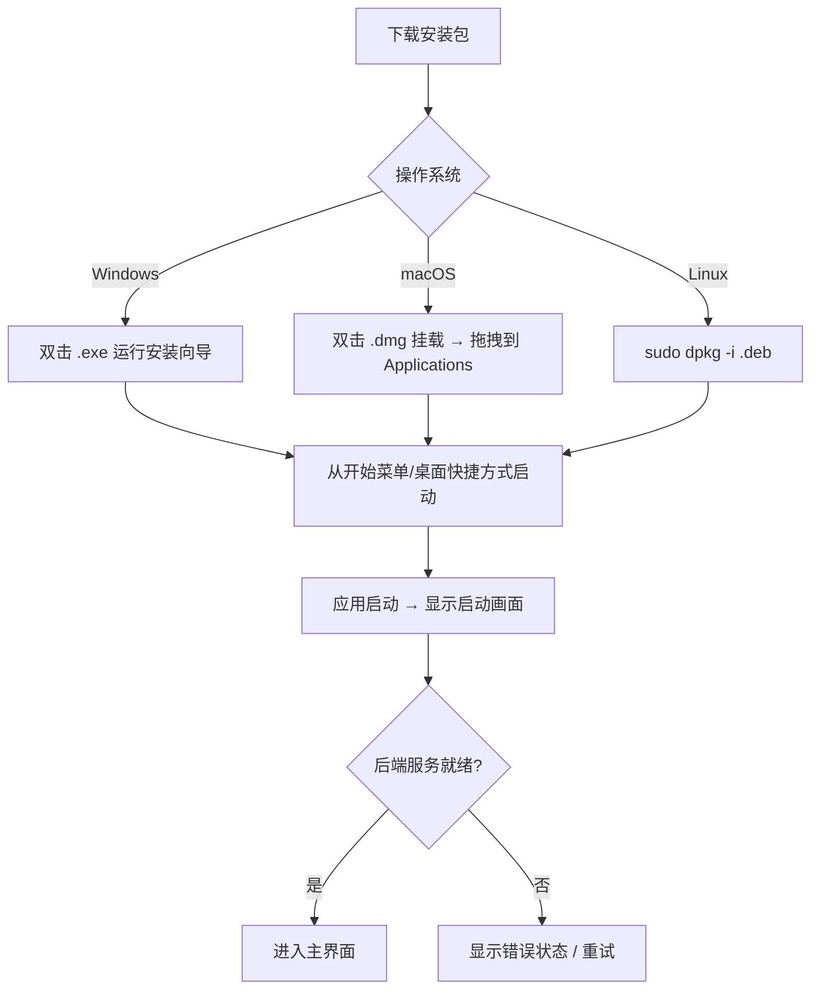
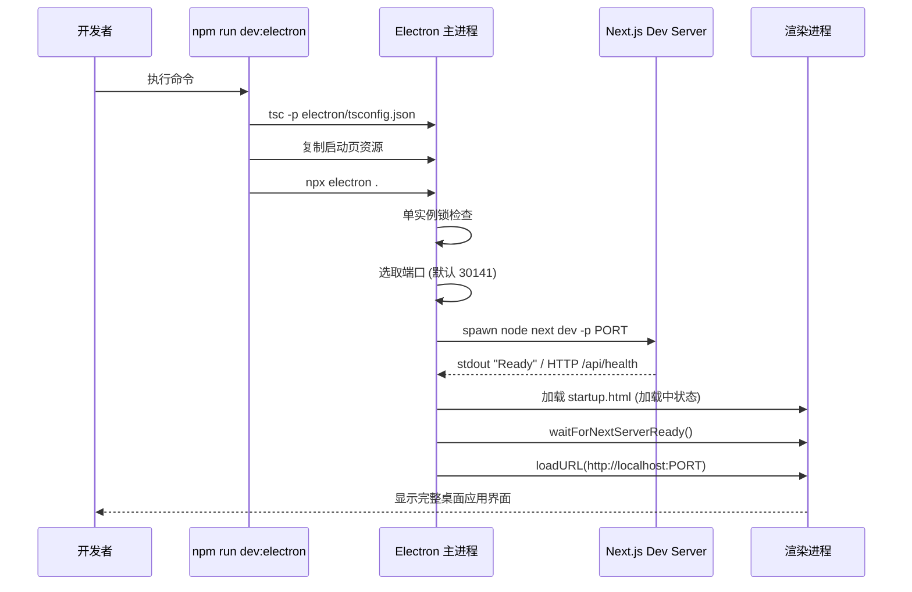
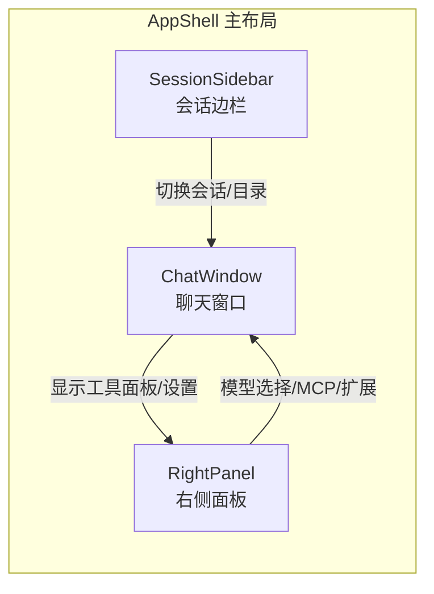

**Pi Agent Desktop** 是 [Pi 编程智能体](https://github.com/badlogic/pi-mono) 的原生桌面客户端，基于 Electron + Next.js 构建，提供比浏览器更原生的开发体验。本指南面向初学者，帮助你在几分钟内完成安装、首次运行与基础配置。

---

## 目录

- [先决条件](#先决条件)
- [安装方式对比](#安装方式对比)
- [方式一：下载预构建安装包（推荐）](#方式一下载预构建安装包推荐)
- [方式二：从源码开发运行](#方式二从源码开发运行)
- [首次启动与初始化](#首次启动与初始化)
- [基础使用指引](#基础使用指引)
- [常见问题排查](#常见问题排查)
- [后续学习路径](#后续学习路径)

---

## 先决条件

在开始之前，请确认你的环境满足以下要求：

| 要求 | 详情 |
|------|------|
| **操作系统** | Windows 10+ / macOS 12+ (Intel & Apple Silicon) / Linux x64 (glibc 2.28+) |
| **Node.js** | ≥ 20.x（仅开发模式需要） |
| **包管理器** | npm ≥ 10.x（随 Node.js 安装） |
| **Git** | 用于克隆仓库与版本控制 |
| **Pi 智能体核心** | 自动随桌面应用安装，无需手动配置 |

> **注意**：如果你使用的是**下载安装包**方式，无需安装 Node.js，应用已打包完整运行时。

---

## 安装方式对比

| 维度 | 下载预构建安装包 | 源码开发运行 |
|------|------------------|--------------|
| **适用人群** | 普通用户、快速体验 | 开发者、贡献者、定制需求 |
| **准备时间** | ~1 分钟 | ~5-10 分钟 |
| **Node.js 依赖** | ❌ 不需要 | ✅ 必须 |
| **自动更新** | ✅ 内置 electron-updater | ❌ 手动拉取更新 |
| **调试能力** | 有限（开发者工具可用） | 完整（热重载、断点、类型检查） |
| **修改代码** | ❌ 不可 | ✅ 即时生效 |

---

## 方式一：下载预构建安装包（推荐）

### 1. 下载对应平台的安装包

前往 [GitHub Releases](https://github.com/Chasen-Liao/pi-agent-desktop/releases) 页面，下载最新版本的安装包：

| 平台 | 文件名示例 | 说明 |
|------|------------|------|
| **Windows** | `Pi-Agent-Desktop-Setup-0.8.9.exe` | NSIS 安装程序，支持自定义目录、桌面快捷方式 |
| **macOS (Universal)** | `Pi-Agent-Desktop-0.8.9-mac-universal.dmg` | 同时支持 Intel 与 Apple Silicon，拖拽安装 |
| **Linux (x64)** | `Pi-Agent-Desktop-0.8.9-linux-amd64.deb` | Debian/Ubuntu 系发行版，`sudo dpkg -i` 安装 |

> **提示**：macOS 还提供 `.zip` 格式供自动更新使用，普通安装请用 `.dmg`。

### 2. 安装与首次运行



**Windows 特别说明**：安装包未代码签名，SmartScreen 可能弹窗提示“Windows 保护了你的电脑”，点击“更多信息” → “仍要运行”即可。

**macOS 特别说明**：应用未公证，首次运行需在“系统设置 → 隐私与安全性”中允许运行，或右键点击应用选择“打开”。

### 3. 验证安装

启动应用后，你应看到：
- **启动画面**：带有液态动画的加载指示器（约 3-10 秒）
- **主界面**：左侧会话边栏、中央聊天区、右侧面板
- **系统托盘图标**：Windows/Linux 显示托盘，支持最小化到托盘

---

## 方式二：从源码开发运行

适合想要参与开发、调试或自定义功能的用户。

### 1. 克隆仓库

```bash
git clone https://github.com/Chasen-Liao/pi-agent-desktop.git
cd pi-agent-desktop
```

### 2. 安装依赖

```bash
npm install
```

> 该项目使用 `package-lock.json` 锁定版本，`npm install` 会确保可复现的依赖树。

### 3. 选择运行模式

#### 浏览器开发模式（仅前端热重载）

```bash
npm run dev
# 输出: http://localhost:30141
```

- Next.js 开发服务器启动在 `localhost:30141`
- 支持 React 组件热重载、TypeScript 类型检查
- **无** Electron 原生能力（系统托盘、文件选择器、自动更新等）

#### Electron 桌面开发模式（完整体验）

```bash
npm run dev:electron
```

内部执行流程：
1. `npm run build:electron` — 编译 Electron 主进程 TypeScript 到 `electron/dist/`
2. 复制 `startup.html` / `startup.js` 到 `electron/dist/`
3. `npx electron .` — 启动 Electron，主进程再拉起 Next.js dev 服务器



> **关键点**：Electron 主进程会轮询 `/api/health` 端点（`electron/server-wait.ts`）确认 Next.js 就绪，再切换到真实应用页面。

### 4. 常用开发命令

| 命令 | 用途 |
|------|------|
| `npm run lint` | ESLint 9 代码规范检查 |
| `npx tsc --noEmit` | TypeScript 类型检查（全项目） |
| `npx tsc -p electron/tsconfig.json --noEmit` | Electron 主进程类型检查 |
| `npm test` | 单元测试（含 `--test-force-exit`） |
| `npm run test:windows` | Windows CI 子集测试 |
| `npm run test:macos` | macOS CI 子集测试 |

> ⚠️ **重要**：不要在开发机直接运行 `next build` 或 `npm run build`，会污染 `.next/` 缓存导致 `npm run dev` 失效。生产构建交给 CI 或 `npm run dist`。

---

## 首次启动与初始化

无论哪种安装方式，首次启动都会经历以下流程：

### 启动阶段详解

```mermaid
flowchart TD
    A[用户点击启动] --> B[Electron 主进程启动]
    B --> C{单实例锁获取成功?}
    C -->|否| D[激活已有窗口并退出]
    C -->|是| E[创建主窗口 + 加载 startup.html]
    E --> F[选取可用端口 (默认 30141)]
    F --> G[启动 Next.js 服务器子进程]
    G --> H[轮询 /api/health + 监听 stdout 'Ready']
    H --> I{服务就绪?}
    I -->|是| J[loadURL 切换到真实应用]
    I -->|超时/失败| K[显示错误状态页]
    J --> L[渲染进程挂载 React 应用]
    L --> M[I18nProvider 初始化语言]
    M --> N[AppShell 渲染主布局]
    N --> O[SessionSidebar 加载会话列表]
    O --> P[就绪 - 可开始对话]
```

**Sources**: [electron/main.ts](electron/main.ts#L1-L200), [electron/server-wait.ts](electron/server-wait.ts#L1-L100), [app/layout.tsx](app/layout.tsx#L1-L48), [app/page.tsx](app/page.tsx#L1-L11)

### 配置文件位置

应用会在以下位置创建/读取配置（`lib/desktop-settings.ts`）：

| 配置文件 | 路径 | 说明 |
|----------|------|------|
| **桌面设置** | `~/.pi/agent/desktop-settings.json` | Agent 模式、工具预设、LTM 选项 |
| **Pi 认证** | `~/.pi/agent/auth.json` | API Key / OAuth 凭证 |
| **模型配置** | `~/.pi/agent/models.json` | 模型列表、默认模型 |
| **MCP 全局配置** | `~/.pi/agent/mcp.json` | 全局 MCP 服务器定义 |
| **项目级 MCP** | `<cwd>/.pi/mcp.json` | 项目专用 MCP 配置 |

**Sources**: [lib/desktop-settings.ts](lib/desktop-settings.ts#L1-L50), [.mcp.json](.mcp.json#L1-L14)

---

## 基础使用指引

### 1. 界面布局概览



**快捷键**：
- `Ctrl/Cmd + B`：切换左侧边栏
- `Ctrl/Cmd + Alt + B`：切换右侧面板

**Sources**: [components/AppShell.tsx](components/AppShell.tsx), [components/SessionSidebar.tsx](components/SessionSidebar.tsx), [components/ChatWindow.tsx](components/ChatWindow.tsx)

### 2. 创建/选择工作目录

1. 点击左侧边栏顶部的**目录选择器**（或 `Ctrl/Cmd + Shift + P`）
2. 选择一个现有项目目录，或创建新目录
3. 应用会自动扫描该目录下的 `.pi/sessions/` 文件夹，列出所有会话

### 3. 开始第一次对话

1. 在底部输入框输入任务描述
2. 按 **Enter** 发送（立即 steer）或 **Alt+Enter** 加入队列
3. 观察中央 **Liquid Orb** 动画指示思考状态
4. 实时流式响应渲染在消息列表中

### 4. 核心功能入口

| 功能 | 入口位置 | 说明 |
|------|----------|------|
| **Agent 模式切换** | 顶部工具栏 / 右侧面板 | Plan / Ask / Full 三种安全模式 |
| **模型选择** | 右侧面板 → Models | 动态加载本机扩展注册的 provider |
| **MCP 服务器管理** | 右侧面板 → MCP | 全局/项目级配置，支持 stdio/SSE |
| **扩展与 Skills** | 右侧面板 → Extensions | 安装、启用、诊断扩展 |
| **长期记忆 (LTM)** | 右侧面板 → Memory | SQLite 存储，跨会话检索 |
| **会话分支/导出** | 消息右键 / 顶部操作栏 | Branch、Fork、Clone、Export HTML/MD |
| **项目信任授权** | 首次访问新目录时弹窗 | 409 握手机制，确认授权 |

---

## 常见问题排查

| 现象 | 可能原因 | 解决方案 |
|------|----------|----------|
| **启动卡在"正在启动..."** | 端口被占用 / Next.js 启动失败 | 检查 30141 端口；查看 `~/Library/Logs/Pi Agent Desktop/main.log` (macOS) 或 `%APPDATA%\Pi Agent Desktop\logs\main.log` (Windows) |
| **白屏 / 界面不渲染** | GPU 加速冲突 / CSP 策略 | 尝试 `--disable-gpu` 启动；检查 `electron/csp.ts` 配置 |
| **无法连接到 Pi 智能体** | 上游依赖版本不匹配 / 网络问题 | 确认 `package.json` 中 `@earendil-works/pi-coding-agent` 版本；检查网络连通性 |
| **自动更新失败** | GitHub Release 资产缺失 / 签名问题 | 手动下载最新安装包覆盖安装；查看 Release Notes 的已知问题 |
| **中文输入法异常** | Electron IME 兼容性 | 更新到最新版本；或在输入框右键切换输入法模式 |

**日志文件位置**：
- Windows: `%APPDATA%\Pi Agent Desktop\logs\main.log`
- macOS: `~/Library/Logs/Pi Agent Desktop/main.log`
- Linux: `~/.config/Pi Agent Desktop/logs/main.log`

**Sources**: [electron/log-format.ts](electron/log-format.ts), [electron/main.ts](electron/main.ts#L100-L150)

---

## 后续学习路径

完成快速开始后，建议按以下顺序深入了解：

### 必读：核心架构篇

| 顺序 | 文档 | 核心内容 |
|------|------|----------|
| 1 | [双模式运行架构：浏览器开发与 Electron 桌面](5-shuang-mo-shi-yun-xing-jia-gou-liu-lan-qi-kai-fa-yu-electron-zhuo-mian) | 理解 dev / 打包 / 运行时的三种模式差异 |
| 2 | [四层分离架构：浏览器层、服务端层、SDK 层、持久层](6-si-ceng-fen-chi-jia-gou-liu-lan-qi-ceng-fu-wu-duan-ceng-sdk-ceng-chi-jiu-ceng) | 清晰的分层边界与数据流向 |
| 3 | [AgentSession 生命周期与 RPC 管理器](7-agentsession-sheng-ming-zhou-qi-yu-rpc-guan-li-qi) | 会话创建、事件流、工具调用全链路 |

### 进阶：功能模块篇

| 文档 | 适用场景 |
|------|----------|
| [会话与分支模型](8-hui-hua-yu-fen-zhi-mo-xing-shu-zhuang-jie-gou-fen-cha-ke-long-yu-dao-chu) | 需要理解 Branch/Fork/Clone 机制时 |
| [流式响应与 SSE 事件流设计](9-liu-shi-xiang-ying-yu-sse-shi-jian-liu-she-ji) | 调试流式输出、自定义事件处理时 |
| [长期记忆 (LTM) 系统](10-chang-qi-ji-yi-ltm-xi-tong-sqlite-hou-duan-fts5-jian-suo-guan-cha-gou-zi) | 配置跨会话记忆、排查检索问题时 |
| [MCP 服务器管理](12-mcp-fu-wu-qi-guan-li-quan-ju-yu-xiang-mu-ji-pei-zhi) | 集成外部工具、配置 MCP 时 |
| [项目信任机制](14-xiang-mu-xin-ren-ji-zhi-409-wo-shou-yu-shou-quan-dui-hua-kuang) | 理解 409 握手、处理授权弹窗问题时 |

### 前端专项

| 文档 | 适用场景 |
|------|----------|
| [AppShell 与面板布局系统](15-appshell-yu-mian-ban-bu-ju-xi-tong-ce-bian-lan-you-ce-mian-ban-ke-diao-fen-ge-xian) | 自定义布局、拆分线拖拽行为 |
| [ChatWindow 与消息流](16-chatwindow-yu-xiao-xi-liu-liu-shi-xuan-ran-fen-zhi-dao-hang-zhi-xing-ji-hua-tiao) | 消息渲染、分支导航、执行计划条 |
| [ChatInput 与跟进队列](17-chatinput-yu-gen-jin-dui-lie-enter-alt-enter-dong-zuo-pan-ding-zhong-pai-duo-mo-tai-fu-jian) | 输入动作判定、多模态附件、队列重排 |
| [Liquid Orb 动画](20-liquid-orb-dong-hua-webgpu-canvas-xuan-ran-guan-xian-yu-si-kao-zhuang-tai-ke-shi-hua) | WebGPU/Canvas 渲染管线、思考状态可视化 |

### 打包与发布

| 文档 | 适用场景 |
|------|----------|
| [Standalone 构建与跨平台打包](28-standalone-gou-jian-yu-kua-ping-tai-da-bao-nsis-universal-dmg-deb-yun-xing-shi-zhu-ru) | 打包构建原理、跨平台产物差异 |
| [发布流水线](31-fa-bu-liu-shui-xian-github-actions-ban-ben-biao-qian-smoke-ce-shi-geng-xin-qing-dan) | CI/CD 流程、版本标签、Smoke 测试 |

---

## 快速参考：关键命令速查表

```bash
# 开发
npm run dev              # 浏览器模式 (http://localhost:30141)
npm run dev:electron     # Electron 桌面模式

# 质量检查
npm run lint             # ESLint
npx tsc --noEmit         # TS 类型检查
npm test                 # 单测 (含 --test-force-exit)

# 构建与打包
npm run build:standalone # 生成 .next/standalone
npm run build:electron   # 编译 electron/main.ts
npm run pack             # 打包未签名目录 (含 smoke 测试)
npm run dist             # 构建安装包 (当前平台)
npm run dist:mac         # macOS Universal DMG + ZIP

# 工具脚本
npm run check:electron-deps  # 检查 electron-updater 运行时依赖
```

---

## 获取帮助

- **GitHub Issues**：[Bug 报告](https://github.com/Chasen-Liao/pi-agent-desktop/issues/new?template=bug.yml) / [功能请求](https://github.com/Chasen-Liao/pi-agent-desktop/issues/new?template=feature.yml)
- **Discussions**：[GitHub Discussions](https://github.com/Chasen-Liao/pi-agent-desktop/discussions) 适合提问与交流
- **上游项目**：[pi-mono](https://github.com/badlogic/pi-mono) / [pi-web](https://github.com/agegr/pi-web)

---

> **下一步建议**：阅读 [环境搭建与开发命令](3-huan-jing-da-jian-yu-kai-fa-ming-ling) 了解完整的开发环境配置细节，或直接跳转到 [双模式运行架构](5-shuang-mo-shi-yun-xing-jia-gou-liu-lan-qi-kai-fa-yu-electron-zhuo-mian) 理解核心架构设计。