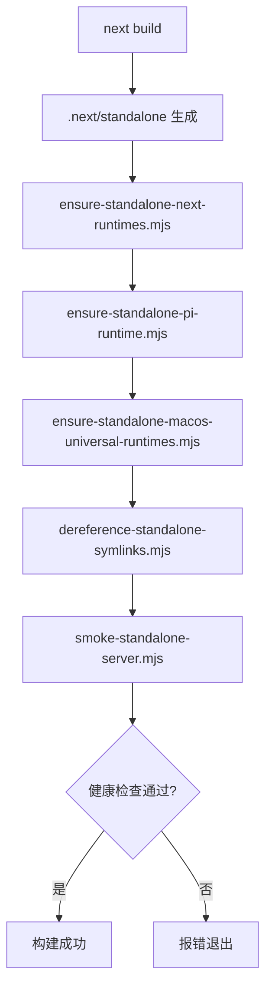

本页面面向初学者，系统梳理 Pi Agent Desktop 的**环境准备**、**日常开发命令**、**构建打包流程**与**测试策略**。掌握这些基础后，建议继续阅读 [项目结构导览](4-xiang-mu-jie-gou-dao-lan) 理解代码组织，或进入 [双模式运行架构](5-shuang-mo-shi-yun-xing-jia-gou-liu-lan-qi-kai-fa-yu-electron-zhuo-mian) 深入架构原理。

---

## 一、环境准备

### 1.1 必需工具链

| 工具 | 版本要求 | 用途 | 验证命令 |
|------|----------|------|----------|
| **Node.js** | ≥ 20（推荐 LTS） | 运行时、包管理、构建脚本 | `node --version` |
| **npm** | ≥ 10（随 Node 安装） | 依赖安装、脚本执行 | `npm --version` |
| **Git** | 任意现代版本 | 版本控制、CI 集成 | `git --version` |
| **TypeScript** | 5.x（项目内置） | 类型检查 | `npx tsc --version` |

> **Windows 开发者注意**：建议在 PowerShell 或 Git Bash 中运行命令；CMD 部分跨平台脚本可能表现不一致。

### 1.2 克隆与安装依赖

```bash
# 克隆仓库
git clone https://github.com/Chasen-Liao/pi-agent-desktop.git
cd pi-agent-desktop

# 安装依赖（使用 npm ci 确保锁文件一致性）
npm ci
```

**关键依赖说明**（来源：`package.json`）：

| 类别 | 核心包 | 说明 |
|------|--------|------|
| **框架** | `next@16.3.6` | App Router、Server Components、Turbopack |
| **UI** | `react@19`、`react-dom@19` | 最新并发特性 |
| **桌面** | `electron@43.4.1` | 主进程、原生窗口、自动更新 |
| **打包** | `electron-builder@26.15.3` | NSIS / DMG / DEB 多平台产物 |
| **样式** | `tailwindcss@4.2.2`、 `@tailwindcss/postcss` | 原子化 CSS、PostCSS 插件 |
| **上游 SDK** | `@earendil-works/pi-coding-agent@0.99.1`、 `@earendil-works/pi-ai@0.99.1` | Pi 智能体核心运行时 |
| **类型** | `typescript@5`、 `@types/node@24`、 `@types/react@19` | 严格模式类型定义 |

Sources: [package.json](package.json#L1-L80)

---

## 二、核心开发命令速查表

下表汇总 `package.json` 中定义的所有 `scripts`，按**使用频度**分组：

### 2.1 日常开发（高频）

| 命令 | 作用 | 端口/产物 | 典型场景 |
|------|------|-----------|----------|
| `npm run dev` | 启动 Next.js 开发服务器（Turbopack） | `http://localhost:30141` | 浏览器端 UI 调试、热重载 |
| `npm run dev:electron` | 编译 Electron TS → 启动 Electron 窗口加载 `dev` 服务 | 桌面窗口 | 原生菜单、托盘、文件系统 API 联调 |
| `npx tsc --noEmit` | 全项目类型检查（含 Next.js 插件） | 无产物 | 提交前守门、CI 门禁 |
| `npx tsc -p electron/tsconfig.json --noEmit` | 仅检查 Electron 主进程类型 | 无产物 | Electron 专用类型收敛 |
| `npm run lint` | ESLint 9 + Next.js core-web-vitals + TS 规则 | 报告输出 | 代码风格统一、潜在 Bug 捕获 |

### 2.2 测试相关（中频）

| 命令 | 作用 | 覆盖范围 | 备注 |
|------|------|----------|------|
| `npm test` | 全量单测（Node 原生 `--test`） | `lib/**/*.test.ts`、`electron/**/*.test.ts`、`app/**/*.test.ts`、`hooks/**/*.test.ts`、`components/**/*.test.ts`、`scripts/**/*.test.mjs`、根目录测试文件 | **必须保留 `--test-force-exit`** 防止挂起 |
| `npm run test:windows` | Windows CI 子集 | 路径策略、Electron、会话锁、Git worktree 等平台相关测试 | CI Windows 任务专用 |
| `npm run test:macos` | macOS CI 子集 | 同上 + 打包配置测试 | CI macOS 任务专用 |

### 2.3 构建与打包（低频、发布前）

| 命令 | 产物 | 适用平台 | 说明 |
|------|------|----------|------|
| `npm run build` / `npm run build:standalone` | `.next/standalone/` 目录 | 全平台 | **核心构建管线**，见下节详解 |
| `npm run build:electron` | `electron/dist/` | 全平台 | 编译 `electron/*.ts` + 复制 `startup.html/js` |
| `npm run pack` | `release/win-unpacked/` 或 `linux-unpacked/` | 当前 OS | 仅打包目录，**不生成安装程序** |
| `npm run pack:mac` | `release/mac-universal/` | macOS | Universal 双架构目录包 |
| `npm run dist` | `release/*.exe` / `*.deb` | Windows / Linux | 生成安装程序，**不发布** |
| `npm run dist:mac` | `release/*.dmg` / `*.zip` | macOS | Universal DMG + ZIP，**不发布** |
| `npm run release` | npm 包 | 全平台 | `version patch` + `build:standalone` + `npm publish`，**仅用于 CLI 包发布** |

### 2.4 辅助检查

| 命令 | 作用 |
|------|------|
| `npm run check:electron-deps` | 校验 `electron-updater` 运行时依赖完整性 |

Sources: [package.json](package.json#L10-L45)

---

## 三、Standalone 构建管线深度解析

`npm run build:standalone` 是**桌面端分发的核心**。它将 Next.js 应用编译为自包含的 `standalone` 目录，再经一系列补齐脚本修正依赖闭包，最终供 Electron 打包或 `smoke` 测试使用。



### 3.1 各阶段职责对照表

| 阶段 | 脚本 | 核心问题 | 关键动作 |
|------|------|----------|----------|
| **1. 基础编译** | `next build` | Next.js 输出 `standalone` 追踪依赖不全 | 生成 `.next/standalone/{server.js, node_modules/, .next/static/}` |
| **2. Turbopack 运行时补齐** | `ensure-standalone-next-runtimes.mjs` | 生产构建漏拷 `*turbo*.runtime.prod.js` | 从 `node_modules/next/dist/compiled/next-server/` 复制所有匹配文件 |
| **3. Pi 运行时依赖闭包补齐** | `ensure-standalone-pi-runtime.mjs` | NFT 追踪无法捕获外部包的 `optionalDependencies` / `peerDependencies` | BFS 遍历 `@earendil-works/pi-coding-agent` 与 `pi-ai` 的完整依赖树，保持 `node_modules` 目录结构原样复制 |
| **4. macOS Universal 双架构 Sharp** | `ensure-standalone-macos-universal-runtimes.mjs` | 单架构构建仅包含宿主架构的 `@img/sharp-darwin-*` | 若缺失另一架构，通过 `npm pack` 下载 tarball 解压注入；校验版本一致性 |
| **5. 符号链接实体化** | `dereference-standalone-symlinks.mjs` | `@electron/universal` 合并时，相同目标在 x64/arm64 临时目录深度不同导致相对路径冲突 | 递归收集 `.next/standalone` 下所有 symlink，按路径长度倒序替换为实体拷贝 |
| **6. 冒烟测试** | `smoke-standalone-server.mjs` | 验证 standalone 服务器真正可启动、健康端点、核心 API 可达 | 隔离临时目录启动 `server.js`（Node 或 Electron Runtime），轮询 `/api/health`、获取 `/api/sessions` 与 `/api/auth/providers` 列表 |

Sources: [scripts/ensure-standalone-next-runtimes.mjs](scripts/ensure-standalone-next-runtimes.mjs#L1-L49), [scripts/ensure-standalone-pi-runtime.mjs](scripts/ensure-standalone-pi-runtime.mjs#L1-L93), [scripts/ensure-standalone-macos-universal-runtimes.mjs](scripts/ensure-standalone-macos-universal-runtimes.mjs#L1-L198), [scripts/dereference-standalone-symlinks.mjs](scripts/dereference-standalone-symlinks.mjs#L1-L78), [scripts/smoke-standalone-server.mjs](scripts/smoke-standalone-server.mjs#L1-L179)

### 3.2 关键配置点

- **`next.config.ts`** 设定 `output: "standalone"` 并声明 `serverExternalPackages: ["@earendil-works/pi-coding-agent", "@earendil-works/pi-ai"]`，阻止 Next.js 将上游 SDK 打包进 server chunk，改由运行时 `require` 解析。
- **`outputFileTracingIncludes`** 显式纳入 `pi-ai` 全量文件，防止 NFT 遗漏。
- **`env` 注入** `NEXT_PUBLIC_APP_VERSION` 与 `NEXT_PUBLIC_PI_VERSION` 供前端显示。

Sources: [next.config.ts](next.config.ts#L1-L40)

---

## 四、Electron 主进程编译与开发模式差异

### 4.1 编译产物

```bash
npm run build:electron
# 等价于：
tsc -p electron/tsconfig.json
cp electron/startup.html electron/dist/
cp electron/startup.js electron/dist/
```

- **目标**：`ES2022`、CommonJS、输出 `electron/dist/`
- **严格模式**：`strict: true`、启用 `sourceMap`
- **排除测试文件**：`exclude: ["./dist", "./*.test.ts"]`

Sources: [electron/tsconfig.json](electron/tsconfig.json#L1-L18)

### 4.2 两种开发模式对比

| 维度 | `npm run dev`（浏览器模式） | `npm run dev:electron`（Electron 模式） |
|------|----------------------------|----------------------------------------|
| **入口** | Next.js `dev` 服务器 | Electron 主进程 → 加载 `http://localhost:30141` |
| **主进程代码** | 不运行 | `electron/main.ts` 编译后运行 |
| **原生能力** | 无（受浏览器沙箱限制） | 完整：文件系统、系统托盘、原生菜单、自动更新、窗口控制 |
| **端口** | 固定 `30141` | 动态选取（`choosePort` 从 30141 起试） |
| **热重载** | Next.js Fast Refresh | 前端同 Fast Refresh；主进程修改需重启 Electron |
| **调试工具** | 浏览器 DevTools | Electron DevTools（主进程 + 渲染进程） |

**Electron 启动流程简述**（来源：`electron/main.ts`）：

1. `app.requestSingleInstanceLock()` 防多开
2. `choosePort()` 选取可用端口（默认 30141）
3. **开发模式**：`spawn('node', [nextBin, 'dev', '-p', port])` 启动 Next.js 子进程
4. `waitForNextServerReady()` 轮询 `/api/health` 确认就绪
5. 创建 `BrowserWindow` 加载 `http://localhost:<port>`
6. 注册 IPC、托盘、自动更新、CSP、标题栏覆盖等

Sources: [electron/main.ts](electron/main.ts#L1-L200)

---

## 五、测试策略与运行细节

### 5.1 测试运行器

项目采用 **Node.js 原生测试运行器**（`node --test`），**不依赖 Jest/Vitest**，优势：零配置、原生 ESM 支持、CI 启动快。

```bash
# 全量测试
npm test

# 仅运行特定文件（示例）
node --test lib/ltm/sqlite-backend.test.ts
```

### 5.2 测试文件命名与组织

| 模式 | 示例 | 说明 |
|------|------|------|
| `*.test.ts` | `lib/ltm/sqlite-backend.test.ts` | 标准单测 |
| `*.test.mjs` | `scripts/ensure-standalone-next-runtimes.test.mjs` | ESM 脚本测试 |
| 目录同级 | `components/FileViewer.test.ts` | 与被测文件同目录 |

### 5.3 平台子集测试（CI 专用）

| 命令 | 目的 | 包含模式 |
|------|------|----------|
| `npm run test:windows` | Windows 路径、Electron、锁、worktree | `electron/**/*.test.ts`、`lib/file-paths.test.ts`、`lib/path-policy.test.ts`、`lib/session-lock.test.ts`、`lib/git-worktree.test.ts` 等 |
| `npm run test:macos` | macOS 同 Windows + 打包配置 | 同上 + `lib/electron-builder-config.test.mjs`、`lib/electron-icon-assets.test.mjs` 等 |

> **设计意图**：CI 三平台并行时，避免全量重复跑单测，仅跑平台敏感路径。

Sources: [package.json](package.json#L28-L38), [docs/RELEASING.md](docs/RELEASING.md#L1-L47)

---

## 六、跨平台打包与产物矩阵

### 6.1 目标平台与安装包格式

| 平台 | 构建命令 | 产物格式 | 关键配置 |
|------|----------|----------|----------|
| **Windows x64** | `npm run dist` | NSIS `.exe` + `.blockmap` | `win.target.nsis`、安装目录可选、创建快捷方式 |
| **macOS Universal** | `npm run dist:mac` | DMG + ZIP（均含 arm64/x64） | `mac.target.universal`、`x64ArchFiles` 保护 Sharp 双架构原生模块 |
| **Linux x64** | `npm run dist` | `.deb` | `linux.target.deb`、Category: Development |

### 6.2 electron-builder 资源映射（关键）

`extraResources` 将以下目录打包进 `resources/standalone/`：

| 源路径 | 目标路径 | 说明 |
|--------|----------|------|
| `.next/standalone` | `standalone/` | Next.js 服务器入口 + 追踪到的依赖 |
| `.next/standalone/node_modules` | `standalone/node_modules/` | 生产依赖（已补齐 Pi 运行时闭包） |
| `.next/static` | `standalone/.next/static` | 静态资源（JS/CSS/字体） |
| `public` | `standalone/public` | 图标、favicon 等公共资源 |
| `node_modules/electron-updater` 等 | `app/node_modules/...` | 运行时所需的 Node 原生模块 |

**asar: true** 启用归档压缩，**npmRebuild: true** 确保原生模块针对 Electron 版本重建。

Sources: [electron-builder.yml](electron-builder.yml#L1-L133)

### 6.3 macOS Universal 双架构特殊处理

- **问题**：`@electron/universal` 合并 x64 与 arm64 临时 `.app` 时，`node_modules` 内同名文件若为 symlink 指向不同深度的真实路径，相对路径不一致导致合并失败。
- **解决**：`dereference-standalone-symlinks.mjs` 在合并前将所有 symlink 实体化。
- **Sharp 双架构**：`ensure-standalone-macos-universal-runtimes.mjs` 保证 `@img/sharp-darwin-{arm64,x64}` 与 `@img/sharp-libvips-darwin-{arm64,x64}` 并存；`x64ArchFiles` 告诉 `@electron/universal` **不要**对这些原生模块执行 `lipo` 瘦身。

Sources: [scripts/dereference-standalone-symlinks.mjs](scripts/dereference-standalone-symlinks.mjs#L1-L78), [scripts/ensure-standalone-macos-universal-runtimes.mjs](scripts/ensure-standalone-macos-universal-runtimes.mjs#L1-L198), [electron-builder.yml](electron-builder.yml#L90-L110)

---

## 七、代码规范与工具链配置

### 7.1 TypeScript 配置要点

| 选项 | 值 | 影响 |
|------|-----|------|
| `strict` | `true` | 严格空检查、函数类型协变等 |
| `moduleResolution` | `bundler` | 兼容 Next.js 路径别名、包导出 |
| `paths.@/*` | `["./*"]` | 统一 `@/components` 等别名 |
| `target` | `ES2017` | 输出兼容性基线 |
| `plugins: [{ name: "next" }]` | - | 启用 Next.js 类型增强（路由、Server Actions 等） |

Sources: [tsconfig.json](tsconfig.json#L1-L45)

### 7.2 ESLint 9 扁平配置

```js
// eslint.config.mjs 核心结构
export default [
  { ignores: [".next/**", "electron/dist/**", "release/**", ...] },
  ...coreWebVitals,   // Next.js 推荐规则（React、a11y、Web Vitals）
  ...typescript,      // TS 专用规则
  { rules: { "react-hooks/immutability": "off", ... } } // 项目级放宽
]
```

**忽略目录**：构建产物、Electron 编译输出、发布产物、覆盖率报告。

Sources: [eslint.config.mjs](eslint.config.mjs#L1-L27)

### 7.3 Tailwind CSS v4 + PostCSS

- **Tailwind v4** 以 CSS 优先设计，通过 `@tailwindcss/postcss` 插件接入 PostCSS 管线。
- **配置极简**：`content` 覆盖 `app/`、`components/`、页面目录；`theme.extend` 留空，依赖 CSS 变量与 `@theme` 指令（见 `app/globals.css`）。

Sources: [tailwind.config.ts](tailwind.config.ts#L1-L16), [postcss.config.mjs](postcss.config.mjs#L1-L9)

---

## 八、常见问题排查速查

| 现象 | 可能原因 | 定位与解决 |
|------|----------|------------|
| `npm run dev` 端口占用 | 30141 被占用 | `lsof -i:30141` / `netstat -ano | findstr 30141` 杀进程，或改 `PORT` 环境变量 |
| `npm run dev:electron` 白屏 | Next.js 未就绪 Electron 已加载 | 检查 `waitForNextServerReady` 超时日志；确认 `/api/health` 可达 |
| `npm run build:standalone` 失败于 Pi 运行时补齐 | `node_modules` 内依赖不全或版本不匹配 | `npm ci` 重装；检查 `pi-coding-agent` 与 `pi-ai` 版本是否为 `0.99.1` |
| macOS `dist:mac` 报 `EBADPLATFORM` | x64 可选依赖无法在 arm64 安装 | 运行 `ensure-standalone-macos-universal-runtimes.mjs` 通过 `npm pack` 离线获取 |
| `@electron/universal` 合并报相对路径冲突 | symlink 深度不一致 | 确认 `dereference-standalone-symlinks.mjs` 已在 `build:standalone` 末尾执行 |
| 单测挂起不退出 | 异步资源未释放（数据库连接、定时器） | 所有测试文件需正确 `afterEach` 清理；保留 `--test-force-exit` 兜底 |

---

## 九、后续阅读建议

| 目标 | 推荐页面 | 核心收获 |
|------|----------|----------|
| 理解代码目录与模块职责 | [项目结构导览](4-xiang-mu-jie-gou-dao-lan) | 顶层目录、API 分层、核心库映射 |
| 掌握双模式架构原理 | [双模式运行架构](5-shuang-mo-shi-yun-xing-jia-gou-liu-lan-qi-kai-fa-yu-electron-zhuo-mian) | 浏览器开发与 Electron 生产的统一与差异 |
| 深入四层分离设计 | [四层分离架构](6-si-ceng-fen-chi-jia-gou-liu-lan-qi-ceng-fu-wu-duan-ceng-sdk-ceng-chi-jiu-ceng) | 浏览器层/服务端层/SDK层/持久层边界 |
| 学习会话与分支模型 | [会话与分支模型](8-hui-hua-yu-fen-zhi-mo-xing-shu-zhuang-jie-gou-fen-cha-ke-long-yu-dao-chu) | `.jsonl` 存储、树状分支、克隆与导出 |
| 探索 Electron 主进程细节 | [Electron 主进程](26-electron-zhu-jin-cheng-chuang-kou-guan-li-zi-jin-cheng-tuo-guan-xi-tong-tuo-pan-zi-dong-geng-xin) | 窗口管理、子进程托管、系统托盘、自动更新 |

---

## 十、版本与兼容性基线（速查卡）

| 组件 | 版本 | 备注 |
|------|------|------|
| Node.js | ≥ 20 LTS | 引擎基线 |
| Next.js | 16.3.6 | App Router、Turbopack、standalone |
| React | 19.2.4 | 并发特性、Server Components |
| Electron | 43.4.1 | Electron 30+ 系列 |
| TypeScript | 5.x | Strict 模式 |
| Tailwind CSS | 4.2.2 | CSS-first、PostCSS 插件 |
| electron-builder | 26.15.3 | NSIS / Universal DMG / DEB |
| Pi SDK | 0.99.1 | `@earendil-works/pi-coding-agent`、`pi-ai` |

> **提示**：版本锁定在 `package-lock.json`，团队协作请使用 `npm ci` 而非 `npm install`。