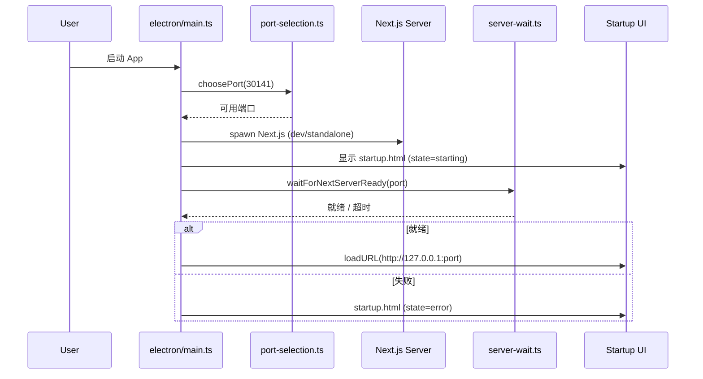

**Pi Agent Desktop** 是一个基于 Electron 的原生桌面客户端，为 [Pi 编码代理](https://github.com/badlogic/pi-mono) 提供类原生体验。本文档面向初级开发者，系统梳理项目的目录组织、核心架构分层、关键模块职责与代码流向，帮助你快速建立心智模型，定位修改入口。

---

## 整体架构概览

项目采用 **双模式运行架构**：浏览器开发模式（Next.js dev server）与 Electron 桌面模式（Standalone 打包）共享同一套 Next.js 应用代码。架构呈现 **四层分离** 模式：

| 层级 | 职责 | 关键目录/文件 |
|------|------|---------------|
| **浏览器层** | React UI、客户端状态、SSE 事件消费 | `app/`, `components/`, `hooks/` |
| **服务端层** | Next.js API 路由、请求处理、权限校验 | `app/api/`, `middleware.ts` |
| **SDK 层** | 核心业务逻辑、RPC 管理、策略计算、会话解析 | `lib/`, `lib/ltm/` |
| **持久层** | `.jsonl` 会话文件、SQLite LTM、MCP 配置、Skills 索引 | `~/.pi/`, `<cwd>/.pi/` |

```mermaid
graph TD
    subgraph Browser["浏览器层 / Electron Renderer"]
        UI[React Components<br/>AppShell, ChatWindow, SessionSidebar]
        Hooks[Client Hooks<br/>useAgentSession, usePanelLayout]
        SSE[SSE EventStream<br/>/api/agent/[id]/events]
    end

    subgraph Server["服务端层 / Next.js Server"]
        API[API Routes<br/>39 个端点]
        MW[Middleware<br/>Origin Check + CSP]
    end

    subgraph SDK["SDK 层 / 共享库"]
        RPC[RpcManager<br/>AgentSession 生命周期]
        Policy[Approval Policy<br/>Plan/Ask/Full + Tool Presets]
        SessionReader[Session Reader<br/>.jsonl 解析 + 路径缓存]
        LTM[Long-Term Memory<br/>SQLite + FTS5 + 观察钩子]
        Normalize[Tool Call Normalize<br/>类型安全归一化]
    end

    subgraph Persistence["持久层 / 文件系统"]
        Sessions[(~/.pi/agent/sessions/*.jsonl)]
        LTMDB[(<cwd>/.pi/memory.sqlite)]
        MCPConfig[(~/.pi/agent/mcp.json<br/><cwd>/.pi/mcp.json)]
        SkillsIdx[(~/.pi/skills/)]
    end

    ElectronMain[Electron Main Process<br/>electron/main.ts] -->|Spawns| Server
    ElectronMain -->|Manages| Tray[System Tray]
    ElectronMain -->|Loads| Startup[Startup HTML/JS]

    UI -->|fetch / SSE| API
    API -->|Delegates| RPC
    API -->|Reads| SessionReader
    API -->|Reads/Writes| LTM
    RPC -->|Wraps| PiSDK[@earendil-works/pi-coding-agent]
    PiSDK -->|Persists| Sessions
    LTM -->|Persists| LTMDB
```

Sources: [package.json](package.json#L1-L81), [next.config.ts](next.config.ts#L1-L40), [electron/main.ts](electron/main.ts#L1-L200), [lib/rpc-manager.ts](lib/rpc-manager.ts#L1-L200), [lib/session-reader.ts](lib/session-reader.ts#L1-L100), [middleware.ts](middleware.ts#L1-L64)

---

## 目录结构详解

### 根目录配置文件

| 文件 | 用途 |
|------|------|
| `package.json` | 项目元数据、依赖、脚本（dev/build/test/pack/dist）、electron-builder 配置入口 |
| `tsconfig.json` | TypeScript 严格模式、路径别名 `@/*`、`jsx: react-jsx`、ES2017 目标 |
| `next.config.ts` | `output: "standalone"`、外部包、Turbopack、环境变量注入版本号 |
| `electron-builder.yml` | 跨平台打包配置（NSIS、Universal DMG、DEB）、图标、文件包含规则 |
| `eslint.config.mjs` | ESLint 9 flat config、Next.js/React/TypeScript 规则集 |
| `tailwind.config.ts` / `postcss.config.mjs` | Tailwind CSS v4 配置 |
| `.github/workflows/` | CI（ci.yml）、发布打包（desktop-packages.yml） |

Sources: [package.json](package.json#L1-L81), [tsconfig.json](tsconfig.json#L1-L45), [next.config.ts](next.config.ts#L1-L40), [electron-builder.yml](electron-builder.yml), [eslint.config.mjs](eslint.config.mjs)

### `app/` — Next.js App Router 页面与 API

```
app/
├── api/                    # 39 个 API 路由，按功能域分组
│   ├── agent/              # Agent 会话创建、SSE 事件流
│   ├── sessions/           # 会话列表、上下文、分支、克隆、导出
│   ├── memory/             # LTM recall/remember/forget/stats/health
│   ├── models/             # 模型列表、默认模型
│   ├── models-config/      # models.json 读写、测试
│   ├── mcp/                # MCP 服务器配置管理
│   ├── extensions/         # 扩展安装/启用/禁用/诊断
│   ├── skills/             # Skills 搜索与安装
│   ├── auth/               # 登录、API Key、提供商列表
│   ├── trust/              # 项目信任 409 握手
│   ├── files/              # 文件内容读取（虚拟化支持）
│   ├── desktop-settings/   # 桌面端设置持久化
│   ├── select-directory/   # 原生目录选择对话框
│   ├── default-cwd/        # 默认工作目录
│   ├── statusline/         # 状态栏数据聚合
│   ├── home/               # 首页聚合数据
│   ├── health/             # 健康检查
│   └── usage/              # 上游使用量配额
├── layout.tsx              # 根布局：字体、主题、I18nProvider、全局错误上报
├── page.tsx                # 入口页面 → 渲染 AppShell
├── globals.css             # CSS 变量、Tailwind 导入、全局样式
└── middleware.ts           # Origin 检查 + CSP 注入（见上表）
```

**关键设计点**：
- 所有 `/api/*` 路由均走 middleware Origin 检查（防 DNS 重绑定），页面请求注入 CSP
- `output: "standalone"` 产物仅包含运行时必需文件，配合 `scripts/ensure-standalone-*.mjs` 注入 Pi 运行时依赖闭包
- API 路由大多为薄适配层，核心逻辑下沉至 `lib/`

Sources: [app/api](app/api), [app/layout.tsx](app/layout.tsx#L1-L48), [middleware.ts](middleware.ts#L1-L64), [next.config.ts](next.config.ts#L1-L40)

### `components/` — React UI 组件库

```
components/
├── AppShell.tsx                    # 顶层布局：侧边栏、主聊天区、右侧面板、分割线、TabBar
├── SessionSidebar.tsx              # 左侧：会话树（按 cwd 分组）、文件浏览器、新建会话
├── ChatWindow.tsx                  # 中央：消息流、流式渲染、分支导航、执行计划条
├── ChatInput.tsx                   # 底部：输入框、附件、模型选择、思考等级、跟进队列
├── FileViewer.tsx                  # 右侧：文件查看器（虚拟化、语法高亮）
├── FileExplorer.tsx                # 侧边栏文件树
├── BranchNavigator.tsx             # 分支可视化导航
├── ModelsConfig.tsx                # 模型配置面板
├── SkillsConfig.tsx                # Skills 管理面板
├── ExtensionsConfigModal.tsx       # 扩展管理模态框
├── StatsBar.tsx                    # 状态栏：Token、缓存、上下文容量
├── LiquidOrbCanvas.tsx             # 液态思考球（WebGPU/Canvas）
├── AgentModeSelector.tsx           # Plan/Ask/Full 模式切换
├── ModalSurface.tsx                # 模态框基础容器
├── I18nProvider.tsx                # 国际化上下文
├── chat-input/                     # ChatInput 子模块
├── message-content/                # 消息内容渲染（Markdown、代码块、工具调用）
├── models-config/                  # ModelsConfig 子组件
├── session-sidebar/                # SessionSidebar 子组件
├── file-viewer-virtualization.ts   # 大文件虚拟化滚动引擎
├── liquid-orb-source.ts            # WebGPU 着色器源码
└── *.test.ts                       # 单元测试
```

**组件层级关系**：
```
AppShell
├── SessionSidebar (左)
│   ├── SidebarHeader (cwd 选择、新建会话)
│   ├── SessionTree (会话树、分支、克隆、导出)
│   └── FileExplorer (文件树、打开文件)
├── ChatWindow (中)
│   ├── TabBar (会话标签、分支切换)
│   ├── MessageList (虚拟化消息列表)
│   │   └── MessageView (单条消息、流式、工具调用展开)
│   ├── BranchNavigator (分支概览)
│   ├── ExecutePlanBar (Plan 模式执行确认)
│   └── ChatInput (底部输入)
│       ├── AttachmentPreview
│       ├── ModelSelector
│       ├── PresetSelector
│       └── QueuedMessageList (跟进队列)
└── 右侧面板
    ├── FileViewer (文件查看、虚拟化)
    ├── ModelsConfig
    ├── SkillsConfig
    └── StatsBar
```

Sources: [components/AppShell.tsx](components/AppShell.tsx#L1-L200), [components/SessionSidebar.tsx](components/SessionSidebar.tsx#L1-L200), [components/ChatWindow.tsx](components/ChatWindow.tsx), [components/ChatInput.tsx](components/ChatInput.tsx), [components/FileViewer.tsx](components/FileViewer.tsx)

### `hooks/` — 客户端状态与行为逻辑

```
hooks/
├── useAgentSession.ts                 # 核心：会话状态机、流式处理、分支、跟进队列
├── useAgentSession.test.ts
├── usePanelLayout.ts                  # 面板宽度、拖拽分割线、持久化
├── useTheme.ts                        # 深/浅色切换、localStorage 同步
├── useFileTabs.ts                     # 右侧文件标签页管理
├── useDragDrop.ts                     # 拖拽上传/排序
├── useDismissOnOutsideClick.ts        # 点击外部关闭下拉/模态框
├── useAudio.ts                        # 通知音效
├── useUpstreamUsage.ts                # 上游配额轮询
└── agent-session/                     # useAgentSession 拆分的子模块
    ├── agent-event-apply.ts           # 事件→状态归约（纯函数）
    ├── agent-events-manager.ts        # SSE 事件分发、Extension UI 请求处理
    ├── agent-phase.ts                 # Agent 阶段推进
    ├── prompt-dispatch-gate.ts        # 提示词分发闸门
    ├── session-command-target.ts      # 会话命令目标解析
    ├── session-lifecycle-reset.ts     # 会话加载/分支/克隆时的状态重置
    ├── session-loader-api.ts          # 会话加载 API 封装
    ├── session-stats.ts               # Token/上下文统计计算
    ├── stream-state.ts                # 流式状态 Reducer
    ├── use-agent-events.ts            # SSE 连接管理
    ├── use-chat-scroll.ts             # 自动滚动、锚点
    ├── use-session-commands.ts        # /命令 解析执行
    ├── use-session-loader.ts          # 会话加载、分支切换
    ├── use-session-model-tools.ts     # 模型/工具状态同步
    └── user-message-reconciliation.ts # 待发送用户消息去重/合并
```

**数据流向**：
```
SSE EventStream (/api/agent/[id]/events)
       │
       ▼
useAgentEvents (hooks/agent-session/use-agent-events.ts)
       │
       ├─▶ agent-events-manager.ts: 分发 → Extension UI Bridge / 状态更新
       │
       └─▶ applyAgentEvent (agent-event-apply.ts): 纯归约函数
              │
              ▼
       streamReducer (stream-state.ts) → useReducer 状态
              │
              ▼
       ChatWindow / MessageList 订阅渲染
```

Sources: [hooks/useAgentSession.ts](hooks/useAgentSession.ts#L1-L200), [hooks/agent-session/stream-state.ts](hooks/agent-session/stream-state.ts), [hooks/agent-session/agent-event-apply.ts](hooks/agent-session/agent-event-apply.ts), [hooks/agent-session/use-agent-events.ts](hooks/agent-session/use-agent-events.ts)

### `lib/` — 核心共享库（SDK 层）

```
lib/
├── rpc-manager.ts                    # AgentSession 生命周期、RPC 包装、工具策略应用
├── session-reader.ts                 # .jsonl 解析、会话列表、路径缓存（HMR 安全）
├── session-path-cache.ts             # 正/负缓存、TTL、globalThis 持久化
├── approval-policy.ts                # Plan/Ask/Full + Tool Preset 策略纯函数
├── normalize.ts                      # toolCall 字段名归一化（camelCase/snake_case）
├── pi-types.ts                       # 与 pi-coding-agent 类型契约
├── types.ts                          # 会话、消息、树节点、RPC 类型定义
├── follow-up-queue.ts                # 跟进队列数据结构
├── agent-mode-persistence.ts         # desktop_agent_mode 自定义节点读写
├── session-branch-clone.ts           # 分支/克隆参数与 Header 构建
├── git-worktree.ts                   # Git worktree 创建、身份校验、清理
├── desktop-approval-extension.ts     # Ask 模式内联确认扩展
├── desktop-ltm-extension.ts          # LTM 工具注入、观察钩子
├── desktop-runtime-tools.ts          # 运行时工具集合（读/写/编辑/执行等）
├── extension-ui-bridge.ts            # Extension confirm/select/input/editor/notify
├── extensions-config.ts              # 扩展配置读写
├── mcp-config.ts                     # MCP 配置读写（全局/项目）
├── desktop-settings.ts               # 桌面设置持久化
├── trust-types.ts / trust-fetch.ts   # 409 信任握手类型与 fetch 封装
├── path-policy.ts / allowed-roots.ts # 路径策略、允许根目录
├── file-browser.ts / file-paths.ts   # 文件浏览、路径规范化
├── ltm/                              # 长期记忆子系统
│   ├── backend.ts                    # MemoryBackend 接口
│   ├── sqlite-backend.ts             # SQLite + FTS5 实现
│   ├── service.ts                    # MemoryService 业务封装
│   ├── observe-hooks.ts              # agent_end/pre_compact 观察钩子
│   ├── jaccard.ts                    # Jaccard 相似度去重
│   ├── config.ts                     # LTM 配置
│   └── http.ts                       # HTTP 远程后端（可选）
├── upstream-usage/                   # 上游使用量聚合
├── skills-policy.ts                  # Skills 安装/启用策略校验
├── slash-commands.ts                 # /命令 定义
├── api-error.ts / csp.ts             # 统一错误、CSP 头构建
└── *.test.ts                         # 单元测试
```

**关键模块职责速查**：

| 模块 | 核心职责 | 关键导出 |
|------|----------|----------|
| `rpc-manager.ts` | AgentSession 创建/销毁、模式切换、工具集应用、事件桥接 | `RpcManager`, `AgentSessionWrapper` |
| `session-reader.ts` | `.jsonl` 解析、会话树构建、路径缓存（正/负） | `listAllSessions`, `resolveSessionPath`, `buildSessionContext` |
| `approval-policy.ts` | 模式+预设→生效工具集、Ask 确认判定、工具调用摘要 | `effectiveToolsForMode`, `needsAskConfirm`, `summarizeToolCall` |
| `normalize.ts` | `toolCall`/`tool_call` 字段统一、参数类型安全 | `normalizeToolCalls` |
| `ltm/sqlite-backend.ts` | SQLite FTS5 存储、trigram 分词（CJK）、向量检索准备 | `SqliteBackend` |
| `extension-ui-bridge.ts` | 原生对话框实现 Extension UI 协议 | `ExtensionUiBridge` |
| `session-branch-clone.ts` | 分支/克隆参数验证、Header 构建、Git worktree 集成 | `branchSession`, `cloneSession` |

Sources: [lib/rpc-manager.ts](lib/rpc-manager.ts#L1-L200), [lib/session-reader.ts](lib/session-reader.ts#L1-L100), [lib/approval-policy.ts](lib/approval-policy.ts#L1-L86), [lib/normalize.ts](lib/normalize.ts), [lib/ltm/backend.ts](lib/ltm/backend.ts#L1-L20), [lib/extension-ui-bridge.ts](lib/extension-ui-bridge.ts), [lib/session-branch-clone.ts](lib/session-branch-clone.ts)

### `electron/` — Electron 主进程与原生集成

```
electron/
├── main.ts                     # 入口：单实例锁、窗口、Next.js 子进程、托盘、自动更新
├── preload.ts                  # contextBridge 暴露原生 API（文件选择、剪贴板、Shell 等）
├── tray.ts                     # 系统托盘：显示/隐藏、退出
├── startup.html / startup.js   # 启动等待页（端口就绪前展示）
├── server-wait.ts              # 轮询 Next.js 就绪
├── port-selection.ts           # 端口冲突检测与自动选取
├── restart-policy.ts           # 重启策略（指数退避、最大次数）
├── crash-recovery.ts           # 崩溃恢复状态机
├── process-tree.ts             # 子进程树终结
├── server-process.ts           # 统一 ChildProcess/UtilityProcess 封装
├── navigation.ts               # 页面导航重试、错误页
├── csp.ts                      # Electron 侧 CSP 头构建
├── update-install-gate.ts      # 更新安装时机控制
├── title-bar-overlay.ts        # Windows 标题栏覆盖层主题同步
├── app-icon.ts                 # 应用图标解析
├── log-format.ts               # 结构化日志格式
├── env-filter.ts               # API Key 环境变量过滤传递
└── *.test.ts                   # 单元测试
```

**启动流程时序**：


Sources: [electron/main.ts](electron/main.ts#L1-L200), [electron/port-selection.ts](electron/port-selection.ts), [electron/server-wait.ts](electron/server-wait.ts), [electron/startup.html](electron/startup.html), [electron/restart-policy.ts](electron/restart-policy.ts)

### `scripts/` — 构建与打包工具链

| 脚本 | 用途 |
|------|------|
| `ensure-standalone-next-runtimes.mjs` | 将 Turbopack 运行时注入 standalone 产物 |
| `ensure-standalone-pi-runtime.mjs` | 解析并复制 `@earendil-works/pi-*` 依赖闭包 |
| `ensure-standalone-macos-universal-runtimes.mjs` | 注入双架构 Sharp 原生模块 |
| `dereference-standalone-symlinks.mjs` | 解引用符号链接（打包前） |
| `smoke-standalone-server.mjs` | 独立服务器冒烟测试 |
| `smoke-packaged-standalone.mjs` | 打包后应用冒烟测试 |
| `sync-landing-orb.mjs` | 同步 Liquid Orb 着色器到文档站点 |

Sources: [scripts/](scripts)

### `docs/` — 文档与调研

```
docs/
├── ARCHITECTURE.md                 # 架构总览
├── ARCHITECTURE-REVIEW.md          # 架构评审记录
├── ARCHITECTURE-OPTIMIZATION-REVIEW-2026-06-26.md
├── RELEASING.md                    # 发布流程
├── investigations/                 # 问题排查记录
├── research/                       # 深度调研（白屏、启动周期、核心升级）
├── releases/                       # 版本发布说明 v0.8.0~v0.8.9
├── superpowers/                    # SDD 规格与计划
└── assets/                         # 文档站静态资源
```

Sources: [docs/](docs)

---

## 核心数据流与模块交互

### 1. 会话创建与加载流程

```mermaid
flowchart TD
    A[用户点击新建会话 / 选择现有会话] --> B{是否有 sessionId?}
    B -- 无 --> C[AppShell: setNewSessionCwd(cwd)]
    B -- 有 --> D[AppShell: setSelectedSession(session)]
    C --> E[useAgentSession: isNew=true]
    D --> F[useAgentSession: isNew=false]
    E --> G[useSessionLoader: POST /api/agent/new {cwd}]
    F --> H[useSessionLoader: GET /api/sessions/[id]/context]
    G --> I[rpc-manager: startRpcSession]
    H --> J[session-reader: buildSessionContext]
    I --> K[Pi AgentSession 启动]
    J --> L[返回 messages, entryIds, thinkingLevel, model]
    K --> M[SSE 连接建立 /api/agent/[id]/events]
    L --> N[streamReducer 初始化状态]
    M --> O[useAgentEvents 消费事件]
    N --> P[ChatWindow 渲染]
    O --> P
```

Sources: [hooks/useAgentSession.ts](hooks/useAgentSession.ts#L1-L200), [hooks/agent-session/use-session-loader.ts](hooks/agent-session/use-session-loader.ts), [lib/rpc-manager.ts](lib/rpc-manager.ts#L1-L200), [lib/session-reader.ts](lib/session-reader.ts#L1-L100), [app/api/agent/new/route.ts](app/api/agent/new/route.ts), [app/api/sessions/[id]/context/route.ts](app/api/sessions/[id]/context/route.ts)

### 2. Agent 事件流与状态归约

```
SSE Event (agent_token, tool_call, tool_result, agent_end, agent_settled, ...)
        │
        ▼
useAgentEvents (建立 EventSource, 处理重连)
        │
        ▼
agentEventsManager (分发器)
        ├─▶ Extension UI 请求 (confirm/select/input/editor/notify)
        └─▶ applyAgentEvent (纯函数归约)
                │
                ▼
         streamReducer (useReducer)
                │
                ├─▶ messages: AssistantMessage 流式累加
                ├─▶ phases: thinking → tool_calling → executing → settled
                ├─▶ contextUsage: token 统计
                ├─▶ followUpQueue: 跟进队列快照
                └─▶ retryInfo / agentPhase / extensionUiRequest
```

Sources: [hooks/agent-session/use-agent-events.ts](hooks/agent-session/use-agent-events.ts), [hooks/agent-session/agent-events-manager.ts](hooks/agent-session/agent-events-manager.ts), [hooks/agent-session/agent-event-apply.ts](hooks/agent-session/agent-event-apply.ts), [hooks/agent-session/stream-state.ts](hooks/agent-session/stream-state.ts)

### 3. 长期记忆 (LTM) 写入路径

```
Agent 执行 memory_save 工具
        │
        ▼
desktop-ltm-extension.ts (内联扩展)
        │
        ├─▶ MemoryService.remember() → SqliteBackend.remember()
        │       └─▶ SQLite INSERT + FTS5 索引更新
        │
        └─▶ observe-hooks.ts: safeLtmAgentEndObserve()
                │
                ▼
         agent_end 事件触发 → 自动提取用户/助手文本 → 后台 observe()
                │
                ▼
         Jaccard 去重 → 存入长期记忆
```

Sources: [lib/desktop-ltm-extension.ts](lib/desktop-ltm-extension.ts), [lib/ltm/service.ts](lib/ltm/service.ts), [lib/ltm/sqlite-backend.ts](lib/ltm/sqlite-backend.ts), [lib/ltm/observe-hooks.ts](lib/ltm/observe-hooks.ts), [lib/ltm/jaccard.ts](lib/ltm/jaccard.ts)

---

## 关键设计模式速览

| 模式 | 应用位置 | 说明 |
|------|----------|------|
| **单例锁 + 二次实例激活** | `electron/main.ts` | `app.requestSingleInstanceLock()` 防多开，二次启动聚焦主窗口 |
| **Standalone 输出 + 运行时注入** | `next.config.ts` + `scripts/*.mjs` | 仅打包必要文件，构建时注入 Pi 运行时依赖闭包 |
| **正/负缓存 + globalThis 持久化** | `lib/session-path-cache.ts` | HMR 热重载不丢失路径缓存，短 TTL 防止假阴性 |
| **纯函数归约 + Reducer** | `hooks/agent-session/stream-state.ts` | 状态转移可测试、可回放、无副作用 |
| **内联扩展** | `lib/desktop-approval-extension.ts`, `lib/desktop-ltm-extension.ts` | 直接注入 Pi AgentSession，无需进程间通信 |
| **ContextBridge 预加载** | `electron/preload.ts` | 安全暴露原生 API（文件选择、Shell、剪贴板）给渲染进程 |
| **分支即树节点** | `lib/types.ts`, `components/session-sidebar/SessionTree.tsx` | 会话内分叉复用同一 `.jsonl`，父子关系由 `parentId` 维护 |
| **跟进队列** | `lib/follow-up-queue.ts`, `components/chat-input/QueuedMessageList.tsx` | Enter 立即执行，Alt+Enter 入队，支持拖拽重排 |

Sources: [electron/main.ts](electron/main.ts#L1-L50), [next.config.ts](next.config.ts#L1-L40), [lib/session-path-cache.ts](lib/session-path-cache.ts), [hooks/agent-session/stream-state.ts](hooks/agent-session/stream-state.ts), [lib/desktop-approval-extension.ts](lib/desktop-approval-extension.ts), [electron/preload.ts](electron/preload.ts), [lib/types.ts](lib/types.ts#L1-L200), [lib/follow-up-queue.ts](lib/follow-up-queue.ts)

---

## 开发调试入口指引

| 任务 | 入口文件 | 说明 |
|------|----------|------|
| 启动开发服务器 (浏览器) | `npm run dev` | `http://localhost:30141` |
| 启动 Electron 开发窗口 | `npm run dev:electron` | 先编译 `electron/` 再启动 |
| 类型检查 | `npx tsc --noEmit` | 严格模式、无输出 |
| 代码检查 | `npm run lint` | ESLint 9 flat config |
| 运行全部测试 | `npm test` | Node.js 原生 test runner |
| 仅 Windows 相关测试 | `npm run test:windows` | 路径、Electron、打包配置 |
| 仅 macOS 相关测试 | `npm run test:macos` | 路径、Electron、打包配置 |
| 构建当前平台安装包 | `npm run dist` | NSIS / DEB / Universal DMG |
| 构建 macOS 通用包 | `npm run dist:mac` | Intel + Apple Silicon |

Sources: [package.json](package.json#L10-L45)

---

## 进阶阅读路线

按认知负荷递增顺序推荐：

1. **双模式运行架构** → [`[双模式运行架构：浏览器开发与 Electron 桌面](5-shuang-mo-shi-yun-xing-jia-gou-liu-lan-qi-kai-fa-yu-electron-zhuo-mian)`]
2. **四层分离架构** → [`[四层分离架构：浏览器层、服务端层、SDK 层、持久层](6-si-ceng-fen-chi-jia-gou-liu-lan-qi-ceng-fu-wu-duan-ceng-sdk-ceng-chi-jiu-ceng)`]
3. **AgentSession 生命周期与 RPC 管理器** → [`[AgentSession 生命周期与 RPC 管理器](7-agentsession-sheng-ming-zhou-qi-yu-rpc-guan-li-qi)`]
4. **会话与分支模型** → [`[会话与分支模型：树状结构、分叉、克隆与导出](8-hui-hua-yu-fen-zhi-mo-xing-shu-zhuang-jie-gou-fen-cha-ke-long-yu-dao-chu)`]
5. **流式响应与 SSE 事件流设计** → [`[流式响应与 SSE 事件流设计](9-liu-shi-xiang-ying-yu-sse-shi-jian-liu-she-ji)`]
6. **长期记忆 (LTM) 系统** → [`[长期记忆 (LTM) 系统：SQLite 后端、FTS5 检索、观察钩子](10-chang-qi-ji-yi-ltm-xi-tong-sqlite-hou-duan-fts5-jian-suo-guan-cha-gou-zi)`]
7. **Agent 模式与审批策略** → [`[Agent 模式与审批策略：Plan / Ask / Full 与工具预设](11-agent-mo-shi-yu-shen-pi-ce-lue-plan-ask-full-yu-gong-ju-yu-she)`]
8. **前端 UI 与状态管理专题** → 目录中 15-21 号文档
9. **后端 API 与数据层专题** → 目录中 22-25 号文档
10. **Electron 桌面集成与打包专题** → 目录中 26-29 号文档
11. **测试、发布与工程化专题** → 目录中 30-32 号文档

---

## 结语

本文档以**目录拓扑 → 架构分层 → 核心模块 → 数据流 → 设计模式 → 调试入口**的顺序，为初级开发者建立了可导航的知识地图。建议先跑通 `npm run dev:electron` 体验完整流程，再对照「核心数据流」章节在代码中设置断点，逐层验证心智模型。遇到具体模块疑问，请跳转对应深度文档（见上表「进阶阅读路线」）。