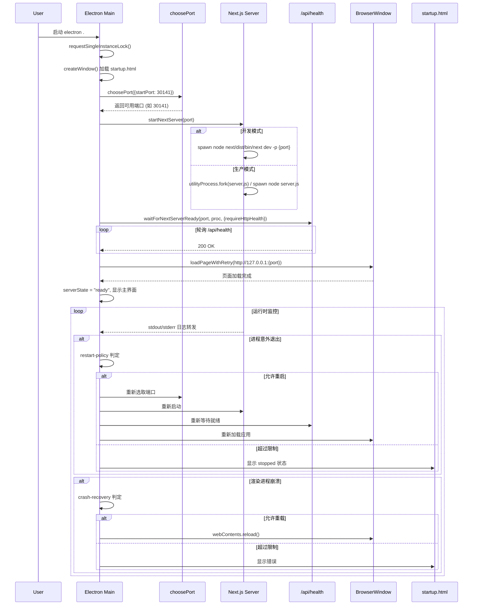

Pi Agent Desktop 采用**单一代码库、双运行时模式**的架构设计：同一个 Next.js 应用既可以在浏览器中作为开发服务器运行，也可以被 Electron 主进程托管为原生桌面应用。两种模式共享全部前端组件、API 路由、状态管理逻辑，仅在**进程托管方式、安全边界、原生能力访问、构建产物**上存在差异。这种设计实现了开发调试的便利性（浏览器 DevTools、热重载）与桌面分发的原生体验（系统托盘、自动更新、文件系统访问）的统一。

Sources: [package.json](package.json#L1-L81), [next.config.ts](next.config.ts#L1-L40), [electron/main.ts](electron/main.ts#L1-L736)

---

## 架构总览

```mermaid
graph TB
    subgraph "共享层"
        APP[Next.js App Router\napp/, components/, hooks/, lib/]
        API[API Routes\napp/api/**]
        CSP_SHARED[lib/csp.ts\n共享 CSP 构建器]
        AUTH_POLICY[lib/auth-policy.ts\nOrigin 校验]
    end

    subgraph "模式 A: 浏览器开发"
        DEV_CMD[npm run dev\nnext dev -p 30141]
        DEV_SERVER[Next.js Dev Server\n端口固定 30141]
        BROWSER[浏览器\nChrome/Edge/Firefox]
        DEV_CSP[CSP: connect-src 127.0.0.1:*\n允任意回环端口]
    end

    subgraph "模式 B: Electron 桌面"
        ELECTRON_MAIN[electron/main.ts\n主进程]
        PRELOAD[electron/preload.ts\ncontextBridge]
        STARTUP_UI[electron/startup.html\n启动加载页]
        TRAY[electron/tray.ts\n系统托盘]
        AUTO_UPDATE[electron-updater\n自动更新]
        
        subgraph "Next.js 服务器托管"
            DEV_MODE[开发模式\nspawn node next/dev]
            PROD_MODE[生产模式\nstandalone server.js]
            MAC_UTILITY[macOS: utilityProcess\n避免第二个 Dock 图标]
            WIN_LINUX_NODE[Win/Linux: ELECTRON_RUN_AS_NODE=1]
        end
        
        PORT_SELECT[electron/port-selection.ts\n动态端口选取 + 预留]
        HEALTH_WAIT[electron/server-wait.ts\n/api/health 轮询就绪]
        RESTART_POLICY[electron/restart-policy.ts\n3次/60s 重启限流]
        CRASH_RECOVERY[electron/crash-recovery.ts\n渲染进程崩溃恢复]
        NAVIGATION[electron/navigation.ts\n带重试的页面加载]
        ELECTRON_CSP[CSP: connect-src 固定端口\nelectron/csp.ts]
    end

    APP --> DEV_CMD
    APP --> ELECTRON_MAIN
    API --> DEV_SERVER
    API --> DEV_MODE
    API --> PROD_MODE
    CSP_SHARED --> DEV_CSP
    CSP_SHARED --> ELECTRON_CSP
    AUTH_POLICY --> DEV_SERVER
    AUTH_POLICY --> ELECTRON_MAIN
    
    ELECTRON_MAIN --> PRELOAD
    ELECTRON_MAIN --> STARTUP_UI
    ELECTRON_MAIN --> TRAY
    ELECTRON_MAIN --> AUTO_UPDATE
    ELECTRON_MAIN --> PORT_SELECT
    ELECTRON_MAIN --> HEALTH_WAIT
    ELECTRON_MAIN --> RESTART_POLICY
    ELECTRON_MAIN --> CRASH_RECOVERY
    ELECTRON_MAIN --> NAVIGATION
    ELECTRON_MAIN --> DEV_MODE
    ELECTRON_MAIN --> PROD_MODE
    PROD_MODE --> MAC_UTILITY
    PROD_MODE --> WIN_LINUX_NODE
```



---

## 两种模式的对比

| 维度 | 浏览器开发模式 (`npm run dev`) | Electron 桌面模式 (`npm run dev:electron` / 打包后) |
|------|-------------------------------|-----------------------------------------------------|
| **入口命令** | `next dev -p 30141` | `electron .` (主进程 `electron/main.ts`) |
| **端口策略** | 固定 30141 | 动态选取 (`choosePort` 从 30141 递增尝试) |
| **进程管理** | 终端直接运行，Ctrl+C 退出 | Electron 主进程托管，子进程/UtilityProcess 管理 |
| **就绪检测** | 控制台输出 "Ready" 触发打开浏览器 | HTTP `/api/health` 2xx + (dev) stdout "Ready" 双重校验 |
| **CSP connect-src** | `http://127.0.0.1:* ws://127.0.0.1:*` (通配符) | `http://127.0.0.1:{port} ws://127.0.0.1:{port}` (精确端口) |
| **安全边界** | 浏览器同源策略 | Electron `sandbox: true` + `contextIsolation: true` + 预加载脚本 |
| **原生能力** | 无 | `electronAPI` (选择目录、文件路径解析、更新、主题) |
| **窗口管理** | 浏览器标签页 | 原生窗口、隐藏标题栏覆盖层、最小化到托盘 |
| **单实例锁** | 无 (可开多标签) | `app.requestSingleInstanceLock()` 强制单实例 |
| **崩溃恢复** | 刷新页面 | 渲染进程崩溃自动重载 (3次/60s 限流) |
| **服务器重启** | 手动重启 | 自动重启策略 (3次/60s 限流，`restart-policy.ts`) |
| **自动更新** | 无 | `electron-updater` 集成，下载后 `quitAndInstall` |
| **环境变量隔离** | 继承终端完整环境 | `env-filter.ts` 仅放行白名单 (API_KEY、PI_* 等) |
| **构建产物** | `.next` 开发缓存 | `.next/standalone` + 运行时依赖闭包注入 |
| **macOS 特殊处理** | 无 | `utilityProcess.fork` 避免第二个 Dock 图标 |

Sources: [package.json](package.json#L1-L81), [electron/main.ts](electron/main.ts#L1-L400), [electron/port-selection.ts](electron/port-selection.ts#L1-L19), [electron/server-wait.ts](electron/server-wait.ts#L1-L229), [electron/restart-policy.ts](electron/restart-policy.ts#L1-L23), [electron/crash-recovery.ts](electron/crash-recovery.ts#L1-L28), [electron/navigation.ts](electron/navigation.ts#L1-L137), [electron/csp.ts](electron/csp.ts#L1-L22), [lib/csp.ts](lib/csp.ts#L1-L63), [electron/env-filter.ts](electron/env-filter.ts#L1-L28), [electron/preload.ts](electron/preload.ts#L1-L37), [electron/tray.ts](electron/tray.ts#L1-L54), [electron/title-bar-overlay.ts](electron/title-bar-overlay.ts#L1-L26)

---

## Electron 主进程生命周期

Electron 启动时执行以下关键步骤，形成**启动 → 端口预留 → 服务器启动 → 就绪等待 → 页面加载 → 运行监控**的完整链路：



Sources: [electron/main.ts](electron/main.ts#L1-L400), [electron/port-selection.ts](electron/port-selection.ts#L1-L19), [electron/server-wait.ts](electron/server-wait.ts#L1-L229), [electron/restart-policy.ts](electron/restart-policy.ts#L1-L23), [electron/crash-recovery.ts](electron/crash-recovery.ts#L1-L28), [electron/navigation.ts](electron/navigation.ts#L1-L137), [electron/startup.html](electron/startup.html#L1-L330)

### 启动页状态机

`startup.html` 通过 URL hash 接收状态参数，提供视觉反馈：

| 状态 | Hash | 视觉表现 |
|------|------|----------|
| `starting` | `#state=starting` | 金橘色呼吸圆点 + 环境光动画 |
| `error` | `#state=error&message=...` | 红色静止圆点 + 错误文案 |
| `stopped` | `#state=stopped` | 红色静止圆点 + "服务已停止" |

状态切换由主进程通过 `mainWindow.loadURL(startupPageUrl(state, message))` 驱动，实现零闪烁过渡。

Sources: [electron/main.ts](electron/main.ts#L130-L150), [electron/startup.html](electron/startup.html#L1-L330)

---

## Next.js 服务器托管差异

### 开发模式 (`!app.isPackaged`)

```typescript
// electron/main.ts#L165-L185
const nextBin = require.resolve("next/dist/bin/next", { paths: [app.getAppPath()] });
const proc = spawn("node", [nextBin, "dev", "-p", String(port)], {
  cwd: app.getAppPath(),
  env: {
    ...pickApiKeys(process.env),
    NODE_ENV: "development",
    PORT: String(port),
    NEXT_TELEMETRY_DISABLED: "1",
  },
  stdio: "pipe",
});
```

- 直接调用 `next dev`，支持 Turbopack 热重载
- 标准输出捕获 "Ready" 字样作为辅助就绪信号
- 环境变量经 `pickApiKeys` 过滤，仅透传 API Key 与 `PI_*` 前缀

### 生产模式 (`app.isPackaged`)

```typescript
// electron/main.ts#L190-L215
const standaloneDir = path.join(process.resourcesPath, "standalone");
const serverScript = path.join(standaloneDir, "server.js");

const proc = process.platform === "darwin"
  ? utilityProcess.fork(serverScript, [], {  // macOS: 避免第二个 Dock 图标
      cwd: standaloneDir,
      env: serverEnv,
      stdio: "pipe",
      serviceName: "Pi Agent Next Server",
    })
  : spawn(process.execPath, [serverScript], {  // Win/Linux: ELECTRON_RUN_AS_NODE=1
      cwd: standaloneDir,
      env: { ...serverEnv, ELECTRON_RUN_AS_NODE: "1" },
      stdio: "pipe",
    });
```

- 使用 `next build --output standalone` 产物
- macOS 采用 `utilityProcess` 以服务身份运行，不出现在 Dock
- Windows/Linux 复用 Electron 自带 Node (`ELECTRON_RUN_AS_NODE=1`)
- **必须**通过 HTTP `/api/health` 校验就绪，不再依赖 stdout "Ready"

Sources: [electron/main.ts](electron/main.ts#L165-L220), [electron/server-wait.ts](electron/server-wait.ts#L180-L229), [scripts/ensure-standalone-next-runtimes.mjs](scripts/ensure-standalone-next-runtimes.mjs#L1-L49), [scripts/ensure-standalone-pi-runtime.mjs](scripts/ensure-standalone-pi-runtime.mjs#L1-L93)

---

## 安全边界与 CSP 策略

### 共享 CSP 构建器 (`lib/csp.ts`)

```typescript
// lib/csp.ts
export function buildCspHeader(mode: CspConnectMode): string {
  const connect = buildConnectSrc(mode);
  return [
    "default-src 'self'",
    connect,
    "script-src 'self' 'unsafe-inline' 'unsafe-eval'",
    "style-src 'self' 'unsafe-inline'",
    "img-src 'self' data: blob:",
    "font-src 'self' data:",
    "frame-src 'self'",
    "media-src 'self' data:",
  ].join("; ");
}
```

| 运行时 | `connect-src` 指令 | 设计意图 |
|--------|-------------------|----------|
| **Web (浏览器开发)** | `http://127.0.0.1:* ws://127.0.0.1:*` | 适配 `next dev` 可能的端口变动、HMR WebSocket |
| **Electron** | `http://127.0.0.1:{port} ws://127.0.0.1:{port}` | 最小权限原则，锁定唯一活动端口，防 DNS 重绑定 |

### Electron 侧动态注入

```typescript
// electron/main.ts#L280-L300
mainWindow.webContents.session.webRequest.onHeadersReceived((details, callback) => {
  const port = activePort ?? 0;
  const csp = buildElectronCspHeader(port);
  callback({
    responseHeaders: {
      ...details.responseHeaders,
      "Content-Security-Policy": [csp],
    },
  });
});
```

- 每次响应头拦截时读取当前 `activePort`，自动适配端口切换/重启
- `startup.html` 自带更严格的内联 CSP (`default-src 'none'`)，不受主进程 CSP 影响

### 中间件层 Origin 校验 (双模式共享)

```typescript
// middleware.ts
export function middleware(request: NextRequest): NextResponse {
  if (shouldApplyOriginCheck(pathname, request.method)) {
    const origin = request.headers.get("origin");
    if (origin !== null && !isAllowedOrigin(origin)) {
      return new NextResponse(JSON.stringify({ error: "forbidden origin" }), { status: 403 });
    }
  }
  // 页面请求注入 CSP
  const response = NextResponse.next();
  response.headers.set("Content-Security-Policy", CSP_HEADER); // buildWebCspHeader()
  return response;
}
```

- `/api/*` 所有方法均校验 `Origin` 头，阻断 DNS 重绑定攻击
- 允许列表：`http(s)://localhost(:port)?`、`http(s)://127.0.0.1(:port)?`
- 页面请求注入 Web 版 CSP，API 响应不注入 (JSON 无需 CSP)

Sources: [lib/csp.ts](lib/csp.ts#L1-L63), [electron/csp.ts](electron/csp.ts#L1-L22), [electron/main.ts](electron/main.ts#L280-L300), [middleware.ts](middleware.ts#L1-L64), [lib/auth-policy.ts](lib/auth-policy.ts#L1-L45)

---

## Preload 脚本与原生 API 暴露

Electron 渲染进程运行在 **sandbox + contextIsolation** 环境中，仅通过 `contextBridge` 暴露最小必要的原生能力：

```typescript
// electron/preload.ts
contextBridge.exposeInMainWorld("electronAPI", {
  selectDirectory: () => ipcRenderer.invoke("select-directory"),
  getPathForFile: (file: File) => webUtils.getPathForFile(file),
  onUpdateAvailable: (callback) => { /* ... */ },
  onUpdateDownloaded: (callback) => { /* ... */ },
  quitAndInstall: () => ipcRenderer.invoke("quit-and-install"),
  setTheme: (isDark: boolean) => ipcRenderer.send("set-theme", isDark),
});

// 启动时将平台写入 document.dataset.electronPlatform
preloadPage.addEventListener?.("DOMContentLoaded", () => {
  const dataset = preloadPage.document?.documentElement?.dataset;
  if (dataset) dataset.electronPlatform = process.platform;
});
```

| API | 用途 | 调用方式 |
|-----|------|----------|
| `selectDirectory()` | 原生目录选择对话框 | `invoke` (双向) |
| `getPathForFile(File)` | 拖拽文件获取绝对路径 | 同步函数 |
| `onUpdateAvailable(callback)` | 监听更新可用事件 | `on` / 返回取消函数 |
| `onUpdateDownloaded(callback)` | 监听更新下载完成 | `on` / 返回取消函数 |
| `quitAndInstall()` | 触发安装重启 | `invoke` |
| `setTheme(isDark)` | 通知主进程更新标题栏颜色 | `send` (单向) |

**设计原则**：
- 仅暴露 **不可通过 Web API 实现** 的能力
- 所有 IPC 通过 `invoke`/`send`，无直接 `require('electron')` 泄露
- `sandbox: true` 禁用 `nodeIntegration`，渲染进程无 Node.js 访问权

Sources: [electron/preload.ts](electron/preload.ts#L1-L37), [electron/main.ts](electron/main.ts#L240-L260)

---

## 进程管理与容错设计

### ServerProcess 抽象层

```typescript
// electron/server-process.ts
export class ServerProcess extends EventEmitter {
  readonly stdout: NodeJS.ReadableStream | null;
  readonly stderr: NodeJS.ReadableStream | null;
  get pid(): number | undefined;
  get exitCode(): number | null;
  get killed(): boolean;
  terminate(): Error | null;
}

export function wrapChildServerProcess(child: ChildProcess, terminateChild: ...): ServerProcess
export function wrapUtilityServerProcess(utility: UtilityProcess, terminateUtility: ...): ServerProcess
```

- 统一接口屏蔽 `ChildProcess` 与 `UtilityProcess` 差异
- `terminate()` 封装跨平台进程树清理 (`process-tree.ts`)

### 重启限流策略 (`restart-policy.ts`)

```typescript
const RESTART_LIMIT = 3;
const RESTART_WINDOW_MS = 60_000;

export function getNextRestartState({ now, attempts, serverState, isQuitting }) {
  if (isQuitting || serverState !== "ready") return { shouldRestart: false, attempts };
  const recent = attempts.filter(t => now - t < RESTART_WINDOW_MS);
  if (recent.length >= RESTART_LIMIT) return { shouldRestart: false, attempts: recent };
  return { shouldRestart: true, attempts: [...recent, now] };
}
```

- 仅在 `serverState === "ready"` (已成功服务过) 时才计入重启
- 启动阶段失败直接进入 `stopped` 状态，不消耗重启额度
- 60 秒滑动窗口内最多 3 次，防止故障风暴

### 渲染进程崩溃恢复 (`crash-recovery.ts`)

```typescript
const RELOAD_LIMIT = 3;
const RELOAD_WINDOW_MS = 60_000;

export function getNextCrashReloadState({ now, reason, attempts, isQuitting }) {
  if (isQuitting || reason === "clean-exit") return { shouldReload: false, attempts };
  const recent = attempts.filter(t => now - t < RELOAD_WINDOW_MS);
  if (recent.length >= RELOAD_LIMIT) return { shouldReload: false, attempts: recent };
  return { shouldReload: true, attempts: [...recent, now] };
}
```

- `render-process-gone` 事件触发，排除 `clean-exit` (正常关闭)
- 同滑动窗口限流，避免 GPU 驱动故障导致的无限重载循环

### 导航重试 (`navigation.ts`)

```typescript
export async function loadPageWithRetry(url, loadPage, options) {
  for (let attempt = 0; attempt <= delays.length; attempt++) {
    try {
      await loadPageWithTimeout(url, loadPage, attemptTimeoutMs, ...);
      return;
    } catch (error) {
      if (!shouldRetry(error) || attempt === delays.length) throw new NavigationLoadError(...);
      await sleep(delays[attempt]); // 100, 250, 500ms
    }
  }
}
```

- 指数退避式重试 (100→250→500ms)，最多 4 次尝试
- 单次导航超时 15s，支持 `AbortSignal` 取消
- 最终抛出 `NavigationLoadError` 保留完整错误链

Sources: [electron/server-process.ts](electron/server-process.ts#L1-L103), [electron/restart-policy.ts](electron/restart-policy.ts#L1-L23), [electron/crash-recovery.ts](electron/crash-recovery.ts#L1-L28), [electron/navigation.ts](electron/navigation.ts#L1-L137), [electron/process-tree.ts](electron/process-tree.ts#L1-L75)

---

## 打包与分发流水线

### Standalone 构建 (`npm run build:standalone`)

```bash
# package.json
"build:standalone": "next build && \
  node scripts/ensure-standalone-next-runtimes.mjs && \
  node scripts/ensure-standalone-pi-runtime.mjs && \
  node scripts/ensure-standalone-macos-universal-runtimes.mjs && \
  node scripts/dereference-standalone-symlinks.mjs && \
  node scripts/smoke-standalone-server.mjs"
```

| 脚本 | 作用 |
|------|------|
| `next build` | 输出 `.next/standalone` (Next.js 服务器最小依赖集) |
| `ensure-standalone-next-runtimes.mjs` | 补全 Turbopack 运行时文件 (`*turbo*.runtime.prod.js`) |
| `ensure-standalone-pi-runtime.mjs` | 递归拷贝 `@earendil-works/pi-*` 完整依赖闭包 |
| `ensure-standalone-macos-universal-runtimes.mjs` | macOS 通用二进制原生模块处理 |
| `dereference-standalone-symlinks.mjs` | 解引用符号链接，适配 electron-builder |
| `smoke-standalone-server.mjs` | 启动服务器冒烟测试，验证 `/api/health` 可达 |

### Electron 构建 (`npm run build:electron`)

```bash
"build:electron": "tsc -p electron/tsconfig.json && \
  node -e \"fs.copyFileSync('electron/startup.html', 'electron/dist/startup.html'); fs.copyFileSync('electron/startup.js', 'electron/dist/startup.js')\""
```

- TypeScript 编译 `electron/` 目录到 `electron/dist/`
- 复制启动页资源 (不参与 Next.js 构建管线)

### 打包与分发 (`electron-builder.yml`)

```yaml
# electron-builder.yml (关键字段)
appId: com.chasen-liao.pi-agent-desktop
productName: Pi Agent Desktop
directories:
  output: release
  buildResources: build
files:
  - electron/dist/**/*
  - .next/standalone/**/*
  - .next/static/**/*
  - public/**/*
  - node_modules/@earendil-works/**/*
  - package.json
extraResources:
  - from: .
    to: pi-runtime
    filter: ["**/*"]
```

- `files` 包含编译后的 Electron 主进程、Next.js standalone 产物、静态资源、Pi 运行时依赖
- `extraResources` 将额外运行时文件打包到 `resources/pi-runtime/`
- 支持 NSIS (Windows)、Universal DMG (macOS)、DEB (Linux)

Sources: [package.json](package.json#L1-L81), [scripts/ensure-standalone-next-runtimes.mjs](scripts/ensure-standalone-next-runtimes.mjs#L1-L49), [scripts/ensure-standalone-pi-runtime.mjs](scripts/ensure-standalone-pi-runtime.mjs#L1-L93), [electron-builder.yml](electron-builder.yml)

---

## 环境变量隔离策略

Electron 托管 Next.js 服务器时，通过 `env-filter.ts` 严格控制传递给子进程的环境变量：

```typescript
// electron/env-filter.ts
const ENV_ALLOWLIST = [
  "PATH", "Path", "NODE_ENV", "HOME", "USERPROFILE", "TEMP", "TMP",
  "ANTHROPIC_API_KEY", "OPENAI_API_KEY", "GEMINI_API_KEY", "GOOGLE_AI_API_KEY",
];
const ENV_PREFIX_ALLOWLIST = ["PI_"];

export function pickApiKeys(env): Record<string, string | undefined> {
  const out = {};
  for (const [k, v] of Object.entries(env)) {
    if (ENV_ALLOWLIST.includes(k)) out[k] = v;
    else if (ENV_PREFIX_ALLOWLIST.some(p => k.startsWith(p))) out[k] = v;
  }
  return out;
}
```

**设计动机**：
- 防止 Electron 主进程环境变量 (如 `ELECTRON_RUN_AS_NODE`、内部调试标志) 泄露到 Next.js 服务器
- 仅透传运行时必需的 API Key 与项目配置前缀 `PI_*`
- 开发模式与生产模式复用同一过滤逻辑

Sources: [electron/env-filter.ts](electron/env-filter.ts#L1-L28), [electron/main.ts](electron/main.ts#L170-L190)

---

## 开发工作流建议

| 场景 | 推荐命令 | 说明 |
|------|----------|------|
| **日常前端开发** | `npm run dev` | 浏览器访问 `http://localhost:30141`，热重载、React DevTools 完整支持 |
| **Electron 集成调试** | `npm run dev:electron` | 编译 Electron TS → 启动 Electron，主进程日志输出到终端，渲染进程可用 DevTools (`Cmd+Opt+I`) |
| **生产构建验证** | `npm run pack` | 完整打包为未签名应用目录，运行冒烟测试 |
| **跨平台分发** | `npm run dist` / `npm run dist:mac` | 签名、生成安装包、发布到 GitHub Releases |

**调试技巧**：
- Electron 主进程日志：终端标准输出 + `~/Library/Logs/Pi Agent Desktop/main.log` (macOS) / `%APPDATA%/Pi Agent Desktop/logs/main.log` (Windows)
- 渲染进程 DevTools：`mainWindow.webContents.openDevTools()` 或菜单项
- 启动页状态：观察 `startup.html` 动画颜色判断启动阶段 (金橘=启动中、红=错误)

Sources: [package.json](package.json#L1-L81), [electron/main.ts](electron/main.ts#L100-L150), [electron/startup.html](electron/startup.html#L1-L330)

---

## 关键文件速查表

| 文件 | 职责 | 核心导出 |
|------|------|----------|
| `electron/main.ts` | Electron 主进程入口，窗口/托盘/服务器/更新/安全策略 | `createWindow`, `startNextServer`, `restartNextServer`, `showApp` |
| `electron/preload.ts` | 渲染进程预加载，`contextBridge` 暴露 `electronAPI` | `electronAPI` (全局注入) |
| `electron/port-selection.ts` | 端口探测与预留 | `choosePort` |
| `electron/server-wait.ts` | 服务器就绪等待 (HTTP + stdout 双重校验) | `waitForNextServerReady`, `waitForHttpServerReady` |
| `electron/restart-policy.ts` | 服务器进程重启限流 | `getNextRestartState` |
| `electron/crash-recovery.ts` | 渲染进程崩溃重载限流 | `getNextCrashReloadState` |
| `electron/navigation.ts` | 页面加载重试与超时控制 | `loadPageWithRetry`, `NavigationLoadError` |
| `electron/csp.ts` | Electron 侧 CSP 构建 (精确端口) | `buildElectronCspHeader` |
| `lib/csp.ts` | 共享 CSP 指令构建器 | `buildCspHeader`, `buildWebCspHeader`, `buildElectronCspHeader` |
| `middleware.ts` | Next.js 中间件：Origin 校验 + 页面 CSP 注入 | `middleware`, `shouldApplyOriginCheck`, `isAllowedOrigin` |
| `lib/auth-policy.ts` | Origin 白名单校验、Provider 名称校验 | `isAllowedOrigin`, `validateProviderName` |
| `electron/env-filter.ts` | 子进程环境变量白名单过滤 | `pickApiKeys` |
| `electron/process-tree.ts` | 跨平台进程树终止 | `killProcessTree`, `killProcessDescendants` |
| `electron/server-process.ts` | 统一 ServerProcess 接口 (ChildProcess/UtilityProcess) | `ServerProcess`, `wrapChildServerProcess`, `wrapUtilityServerProcess` |
| `electron/startup.html` | 启动/错误/停止状态页 (含 CSS 动画) | — |
| `bin/pi-web.js` | `pi-web` CLI 入口：启动 standalone 服务器并打开浏览器 | — |

---

## 后续阅读建议

根据架构层级，建议按以下顺序深入：

1. **Electron 主进程详细实现** → [Electron 主进程：窗口管理、子进程托管、系统托盘、自动更新](26-electron-zhu-jin-cheng-chuang-kou-guan-li-zi-jin-cheng-tuo-guan-xi-tong-tuo-pan-zi-dong-geng-xin)
2. **启动流程与崩溃恢复细节** → [启动流程与崩溃恢复：端口选取、服务器等待、重启策略、CSP](27-qi-dong-liu-cheng-yu-beng-kui-hui-fu-duan-kou-xuan-qu-fu-wu-qi-deng-dai-zhong-qi-ce-lue-csp)
3. **Standalone 构建与跨平台打包** → [Standalone 构建与跨平台打包：NSIS、Universal DMG、DEB、运行时注入](28-standalone-gou-jian-yu-kua-ping-tai-da-bao-nsis-universal-dmg-deb-yun-xing-shi-zhu-ru)
4. **Preload 与安全边界** → [Preload 脚本与安全边界：contextBridge 暴露的原生 API](29-preload-jiao-ben-yu-an-quan-bian-jie-contextbridge-bao-lu-de-yuan-sheng-api)
5. **四层分离架构全貌** → [四层分离架构：浏览器层、服务端层、SDK 层、持久层](6-si-ceng-fen-chi-jia-gou-liu-lan-qi-ceng-fu-wu-duan-ceng-sdk-ceng-chi-jiu-ceng)