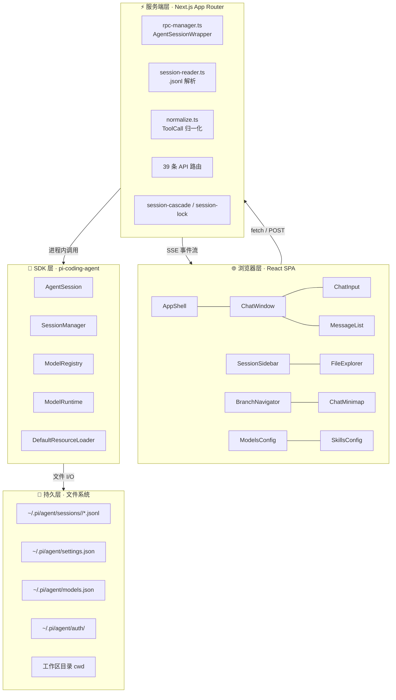
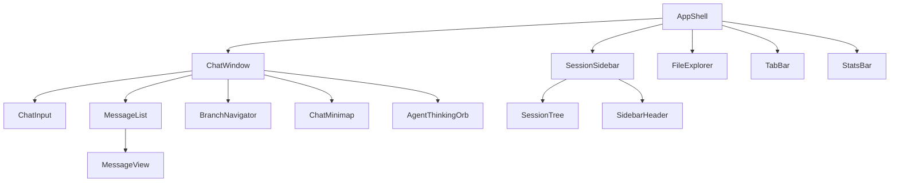
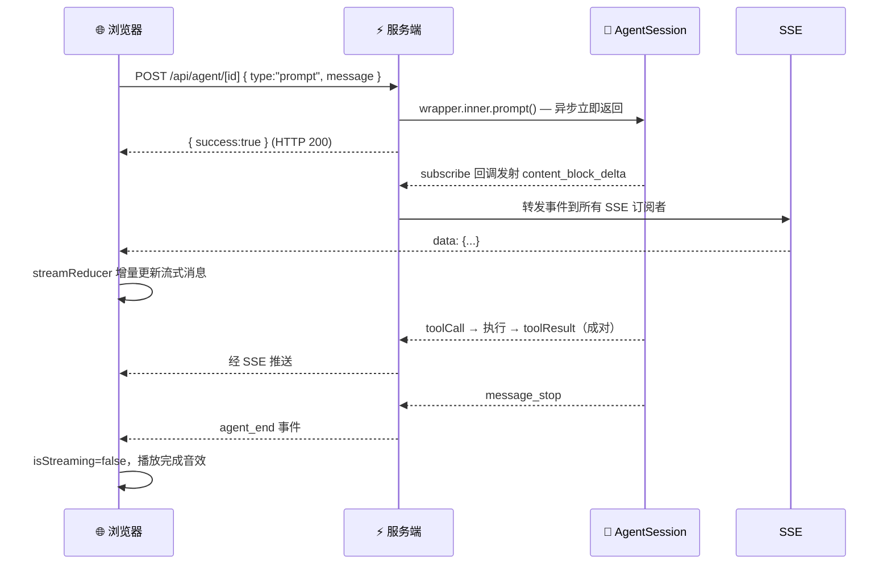
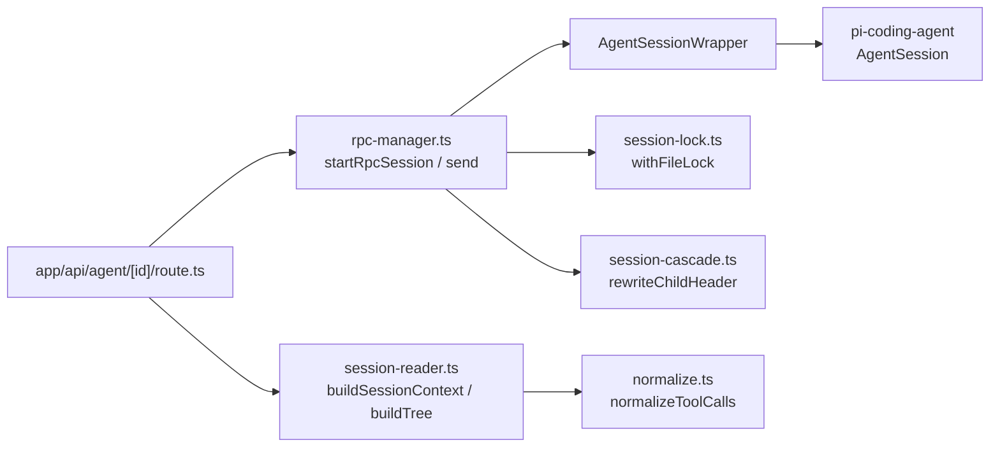
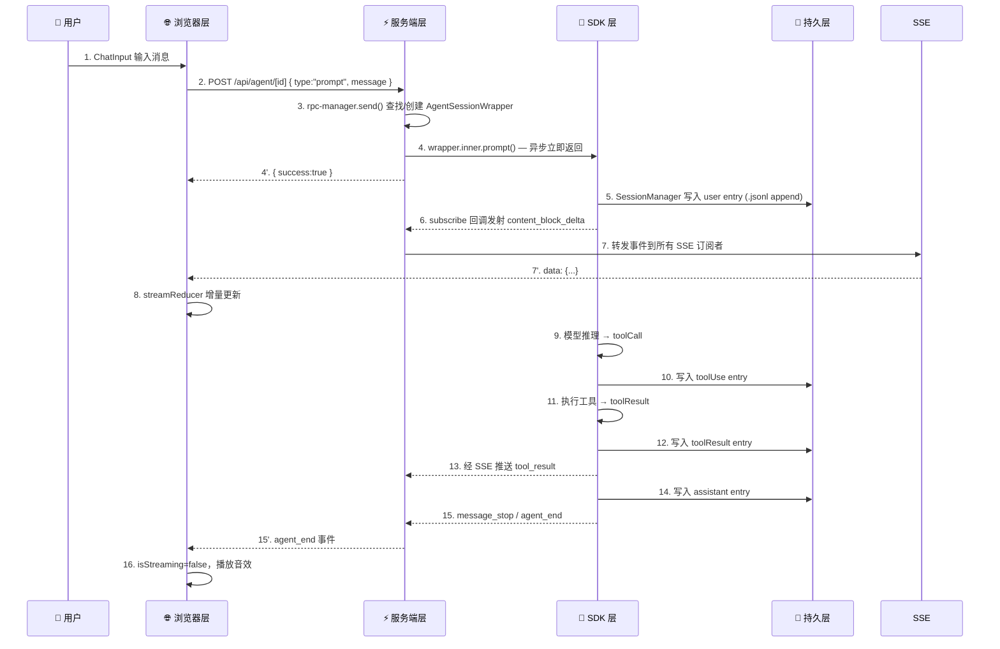

Pi Agent Desktop 采用 **四层分离架构**，将关注点清晰地划分为：浏览器层（UI 渲染与交互）、服务端层（API 路由与会话包装）、SDK 层（上游 AI 对话引擎）、持久层（文件系统存储）。这种分层保证了开发模式与桌面模式的代码复用、热重载安全、以及状态的单向流动。

---

## 架构总览



| 层 | 职责 | 关键约束 | 核心文件 |
| --- | --- | --- | --- |
| **浏览器层** | UI 渲染、用户交互、SSE 消费、URL 状态管理 | 零状态库；流式消息由 `streamReducer` 增量更新 | `components/*.tsx`, `hooks/*.ts` |
| **服务端层** | API 路由、AgentSession 包装、文件解析、归一化 | 活跃 session 必须存 `globalThis`（HMR 安全） | `lib/rpc-manager.ts`, `lib/session-reader.ts`, `app/api/*` |
| **SDK 层** | 真正的 AI 对话引擎、模型调度、工具执行 | 由 `@earendil-works/pi-coding-agent` 提供 | `lib/pi-runtime.ts`, `lib/pi-types.ts` |
| **持久层** | 所有状态最终落到磁盘 `.jsonl` 文件 | append-only；header 含 `parentSession` 显示元数据 | `~/.pi/agent/`, `lib/session-lock.ts` |

Sources: [docs/ARCHITECTURE.md](docs/ARCHITECTURE.md#L50-L120), [lib/rpc-manager.ts](lib/rpc-manager.ts#L1-L100), [lib/session-reader.ts](lib/session-reader.ts#L1-L50), [lib/pi-types.ts](lib/pi-types.ts#L1-L69)

---

## 浏览器层：React SPA 与零状态库设计

浏览器层是用户直接交互的界面，完全基于 React 内置能力（`useReducer` / `useState` / `useRef`）构建，**不引入任何外部状态管理库**。

### 核心组件层级



### 状态管理模式

- **`useAgentSession`**：Agent 交互主 hook，组合 15 个子 hook，管理会话加载、SSE 连接、流式状态、命令分发
- **`streamReducer`**：流式消息状态机（`idle → streaming → done`），仅增量更新当前流式消息，避免重渲染整列表
- **`usePanelLayout` / `useFileTabs`**：面板宽度与文件标签的本地持久化

Sources: [hooks/useAgentSession.ts](hooks/useAgentSession.ts#L1-L100), [hooks/agent-session/stream-state.ts](hooks/agent-session/stream-state.ts), [components/AppShell.tsx](components/AppShell.tsx#L1-L100), [components/ChatWindow.tsx](components/ChatWindow.tsx#L1-L100)

### SSE 事件消费与渲染流水线



**关键点**：
- `AgentSession.prompt()` 是**异步**的，调用立即返回；真正的内容由 `subscribe` 回调推送
- SSE 是**单向推送**（服务端 → 浏览器），30 秒心跳防止代理超时
- `agent_events-manager.ts` 将原始 SDK 事件归约为 UI 状态操作，`agent-event-apply.ts` 再应用到 React 状态

Sources: [hooks/agent-session/use-agent-events.ts](hooks/agent-session/use-agent-events.ts), [hooks/agent-session/agent-events-manager.ts](hooks/agent-session/agent-events-manager.ts), [hooks/agent-session/agent-event-apply.ts](hooks/agent-session/agent-event-apply.ts)

---

## 服务端层：Next.js App Router 与 AgentSessionWrapper

服务端层运行在 Next.js 进程内，承担 **API 路由**、**AgentSession 生命周期管理**、**会话文件解析**、**工具调用归一化** 四大职责。

### 核心模块交互



### AgentSessionWrapper：SDK 的进程内壳

`AgentSessionWrapper`（`lib/rpc-manager.ts`）封装上游 `AgentSession`，提供：
- **事件广播**：`onEvent(listener)` / `emitEvent()` 将 SDK 事件转发给 SSE 订阅者
- **生命周期**：`start()` 订阅 SDK 事件流，`destroy()` 优雅关闭（先 unsubscribe 再 abort）
- **空闲回收**：10 分钟无操作自动 `destroy()`
- **Follow-up Queue**：`FollowUpQueue` 维护可重排的后续任务队列，`revision` 防止陈旧重排覆盖新消息
- **AgentMode / ToolPreset 状态机**：`applyAgentMode()` 同步模式与工具集

```typescript
// 关键方法签名
class AgentSessionWrapper {
  readonly inner: AgentSessionLike;
  start(): void;
  onEvent(listener: EventListener): () => void;
  emitEvent(event: AgentEvent): void;
  async send(command: Record<string, unknown>): Promise<unknown>;
  async destroy(): Promise<void>;
  peekState(): Record<string, unknown>;  // 只读快照，不重置空闲计时器
  keepAlive(): void;  // SSE 心跳调用
}
```

### 进程级注册表与 HMR 安全

Next.js 热重载（HMR）会丢弃模块级变量。所有**进程级状态**必须存入 `globalThis`：

| 全局变量 | 用途 | 定义位置 | 回收策略 |
| --- | --- | --- | --- |
| `__piSessions` | `Map<sessionId, AgentSessionWrapper>` 活跃会话注册表 | `lib/rpc-manager.ts` | `wrapper.destroy()` 时 delete；`process.once("exit")` 全清 |
| `__piStartLocks` | `Map<sessionId, Promise>` 并发启动共享锁 | `lib/rpc-manager.ts` | `startRpcSession` finally 块自动清 |
| `__piSessionPathCacheState` | `sessionId → .jsonl` 路径与 miss 缓存 | `lib/session-reader.ts` | `invalidateSessionPathEntry` 单条删；TTL 自动过期 |
| `__piWriteLocks` | `Map<filePath, Promise>` per-file 写入锁 | `lib/session-lock.ts` | `withFileLock` finally 块自动清 |
| `__piAllowedRootsCache` | 文件访问白名单缓存（5s TTL） | `lib/allowed-roots.ts` | 5s TTL 自动过期 |
| `__piLtmService` | 长期记忆 `MemoryService` 单例 | `lib/ltm/service.ts` | 配置 key 变化时重建 |

Sources: [lib/rpc-manager.ts](lib/rpc-manager.ts#L700-L850), [lib/session-reader.ts](lib/session-reader.ts#L1-L50), [lib/session-lock.ts](lib/session-lock.ts#L1-L42), [lib/allowed-roots.ts](lib/allowed-roots.ts)

### 两种会话访问模式：只读浏览 vs 交互对话

会话浏览和交互对话走**完全不同的路径**，避免为只读操作创建重量级的 `AgentSession`：

| | 📖 只读浏览 | ⚡ 交互对话 |
| --- | --- | --- |
| **触发** | 侧边栏点击会话 | 发送消息 / 恢复流式 |
| **路径** | `app/api/sessions/*` → `session-reader.ts` | `app/api/agent/*` → `rpc-manager.ts` |
| **是否创建 AgentSession** | ❌ 否 | ✅ 是 |
| **核心函数** | `buildSessionContext()` / `buildTree()` | `startRpcSession()` |
| **开销** | 零内存、零启动延迟 | `AgentSessionWrapper` + 10 分钟空闲超时 |
| **并发控制** | 文件锁 `session-lock.ts` | `globalThis.__piStartLocks` Promise 锁 |

Sources: [docs/ARCHITECTURE.md](docs/ARCHITECTURE.md#L350-L400), [lib/session-reader.ts](lib/session-reader.ts#L50-L150), [lib/rpc-manager.ts](lib/rpc-manager.ts#L750-L850)

### 会话文件解析与路径缓存

`session-reader.ts` 使用 `SessionManager.listAll()` 扫描 `~/.pi/agent/sessions/`，构建：
- **正向缓存**：`sessionId → 绝对路径`
- **负向缓存**：记录 miss，TTL 过期后重试扫描
- **活跃会话保护**：若负向缓存命中但存在活跃 RPC wrapper，说明文件刚创建（fork/clone），丢弃 miss 重新扫描

`buildSessionContext()` 复用上游 `buildSessionProjection`，将 `compactionSummary` 转为 `role: "user"` 便于前端统一渲染。

Sources: [lib/session-reader.ts](lib/session-reader.ts#L50-L200), [lib/session-path-cache.ts](lib/session-path-cache.ts)

### 归一化层：ToolCall 字段统一

`normalize.ts` 解决上游版本差异导致的字段不一致：
- 统一 `toolUse` / `tool_call` → `toolCall`
- 统一 `toolResult` / `tool_result` → `toolResult`
- 保证 `MessageView` 只处理一种结构

Sources: [lib/normalize.ts](lib/normalize.ts), [lib/pi-types.ts](lib/pi-types.ts#L1-L69)

---

## SDK 层：pi-coding-agent 核心引擎

SDK 层由上游 `@earendil-works/pi-coding-agent` 提供，是**真正的 AI 对话引擎**。本项目通过**薄适配层**与之交互，不修改上游代码。

### 核心类职责

| 类 | 职责 | 本项目交互方式 |
| --- | --- | --- |
| `AgentSession` | 对话循环、流式事件发射、工具执行编排 | `AgentSessionWrapper.inner` 直接调用 |
| `SessionManager` | `.jsonl` 文件读写、分支管理、Header 元数据 | `startRpcSession` 中 `open()` / `create()` |
| `ModelRuntime` | 模型提供商管理、认证、能力查询 | `pi-runtime.ts` 封装 `createPiRuntime()` |
| `ModelRegistry` | 模型列表刷新、Thinking Level 映射 | `/api/models` 路由调用 `registry.refresh()` |
| `DefaultResourceLoader` | 扩展工厂注册、工具发现、MCP 加载 | `startRpcSession` 中构建，注入 desktop 扩展 |

### 桌面端扩展注入

`startRpcSession` 构建 `DefaultResourceLoader` 时注入四个桌面专用扩展：

```typescript
const resourceLoader = new DefaultResourceLoader({
  cwd,
  agentDir,
  extensionFactories: [
    createCodemodeExtension({ mode: "on" }),
    createToolSearchExtension(),
    createMcpExtension({ loadConfig: ... }),  // MCP 服务器
    desktopApprovalInlineExtension(modeRef),   // Ask 模式拦截
    desktopLtmInlineExtension({ getCwd }),     // 长期记忆工具
  ],
});
await resourceLoader.reload();
```

这些扩展在 SDK 层运行，但通过 `modeRef`、`getCwd()` 等回调与桌面层状态联动。

Sources: [lib/pi-runtime.ts](lib/pi-runtime.ts#L1-L116), [lib/rpc-manager.ts](lib/rpc-manager.ts#L750-L850), [lib/desktop-approval-extension.ts](lib/desktop-approval-extension.ts), [lib/desktop-ltm-extension.ts](lib/desktop-ltm-extension.ts)

### 类型契约：AgentSessionLike

`lib/pi-types.ts` 定义 `AgentSessionLike` 接口，作为**本项目与上游 SDK 的结构契约**。上游版本升级时，仅需更新此接口与 `normalize.ts`，不波及业务代码。

```typescript
export interface AgentSessionLike {
  readonly sessionId: string;
  readonly sessionFile: string | undefined;
  readonly isStreaming: boolean;
  readonly model: ModelLike | undefined;
  readonly sessionManager: SessionManager;
  readonly agent: { state?: { systemPrompt?: string; thinkingLevel?: string } };
  subscribe(listener: (event: AgentSessionEvent) => void): () => void;
  prompt(text: string, options?: { images?: ... }): Promise<void>;
  abort(): Promise<void>;
  setModel(model: ModelLike): Promise<void>;
  setThinkingLevel(level: string): void;
  getAllTools(): ToolInfo[];
  setActiveToolsByName(names: string[]): void;
  // ...
}
```

Sources: [lib/pi-types.ts](lib/pi-types.ts#L1-L69)

---

## 持久层：文件系统与 Append-Only 语义

持久层是**唯一的真实来源**。所有状态最终落盘为 `.jsonl` 文件，采用 append-only 语义，天然支持分支、回溯、导出。

### 目录布局

```
~/.pi/agent/
├── sessions/
│   └── <encoded-cwd>/           # 工作目录哈希编码
│       ├── <session-id>.jsonl   # 主会话文件
│       └── <fork-id>.jsonl      # Fork 产生的子会话（header 含 parentSession）
├── settings.json                # 全局桌面默认配置
├── models.json                  # 模型配置（API Key、Thinking Level 映射）
├── auth/                        # OAuth / API Key 凭证
├── mcp.json                     # 全局 MCP 服务器配置
└── ltm/                         # 长期记忆 SQLite 数据库
    └── memories.db
```

### 会话文件格式（.jsonl）

每行一个 JSON 对象，**第一行为 Header**：

```json
{"type":"session","id":"abc123","cwd":"/home/user/proj","parentSession":"/abs/path/to/parent.jsonl","created":1700000000000}
{"type":"user","id":"msg1","parentId":null,"timestamp":1700000001000,"message":{"role":"user","content":"Hello"}}
{"type":"assistant","id":"msg2","parentId":"msg1","timestamp":1700000002000,"message":{"role":"assistant","content":"Hi!"}}
{"type":"toolUse","id":"tool1","parentId":"msg2","timestamp":1700000003000,"toolCall":{...}}
{"type":"toolResult","id":"tool1","parentId":"tool1","timestamp":1700000004000,"toolResult":{...}}
```

**Header 关键字段**：
- `id`：会话唯一标识
- `cwd`：工作目录绝对路径
- `parentSession`：父会话文件路径（Fork 时写入，用于构建会话树）
- `created`：创建时间戳

### Fork 与 Clone 的持久化差异

| 机制 | 文件操作 | Header 变化 | 侧边栏表现 |
| --- | --- | --- | --- |
| **Fork** | 创建新 `.jsonl` | `parentSession` 指向父文件 | 父会话下的子节点 |
| **Clone** | 复制整个会话文件到新目录 | `cwd` 变更，`parentSession` 保留或清空 | 独立会话树 |

Fork 执行顺序（`rpc-manager.ts` `case "fork"`）：
1. `SessionManager.createBranchedSession(entry.parentId)` 在磁盘创建新文件
2. `startRpcSession(newSessionId, newFile, cwd)` 预注册新 wrapper
3. 销毁旧 wrapper（`destroy()` 释放文件锁）

Sources: [lib/session-cascade.ts](lib/session-cascade.ts#L1-L54), [lib/session-branch-clone.ts](lib/session-branch-clone.ts), [lib/rpc-manager.ts](lib/rpc-manager.ts#L500-L600)

### 并发控制：文件锁与启动锁

```mermaid
graph TD
    subgraph "写入锁 session-lock.ts"
        WL1[withFileLock(filePath, fn)] --> WL2[globalThis.__piWriteLocks]
        WL2 --> WL3[同一文件串行化]
    end

    subgraph "启动锁 rpc-manager.ts"
        SL1[startRpcSession] --> SL2[globalThis.__piStartLocks]
        SL2 --> SL3[同一 sessionId 并发请求共享 Promise]
    end
```

- **写入锁**：per-file 粒度，不同路径不互斥；`SessionManager.appendEntry()` 内部调用
- **启动锁**：防止同一 `sessionId` 并发创建多个 `AgentSessionWrapper`

Sources: [lib/session-lock.ts](lib/session-lock.ts#L1-L42), [lib/rpc-manager.ts](lib/rpc-manager.ts#L750-L800)

### 长期记忆 (LTM) 持久化

LTM 使用 **SQLite + FTS5** 独立于会话 `.jsonl`：
- `lib/ltm/sqlite-backend.ts`：`DatabaseSync` 同步 API，WAL 模式，`busy_timeout=5000ms` + 有界重试
- `lib/ltm/backend.ts`：`MemoryBackend` 接口，`remember`/`recall`/`forget`/`stats`
- `lib/ltm/service.ts`：`MemoryService` 单例（存 `globalThis.__piLtmService`），观察钩子在 `agent_end` / `pre_compact` 自动写入

Sources: [lib/ltm/sqlite-backend.ts](lib/ltm/sqlite-backend.ts#L1-L200), [lib/ltm/service.ts](lib/ltm/service.ts), [lib/ltm/observe-hooks.ts](lib/ltm/observe-hooks.ts)

---

## 跨层数据流：一次对话的完整旅程



**关键不变量**：
- **单向流动**：浏览器 → 服务端 → SDK → 持久层；反向仅通过 SSE 事件流
- **零共享内存**：各层通过明确接口通信，便于测试与替换
- **进程内调用**：服务端 ↔ SDK 无 IPC 开销，SSE 零延迟

Sources: [docs/ARCHITECTURE.md](docs/ARCHITECTURE.md#L250-L350), [lib/rpc-manager.ts](lib/rpc-manager.ts#L100-L300), [hooks/agent-session/use-agent-events.ts](hooks/agent-session/use-agent-events.ts)

---

## 关键设计决策与权衡

| 决策 | 背景 | 权衡 | 替代方案 |
| --- | --- | --- | --- |
| **globalThis 存会话注册表** | HMR 会丢弃模块变量 | 需手动管理清理；进程退出时需 await destroy | 使用外部进程管理器（增加复杂度） |
| **进程内 new AgentSession()** | 避免 IPC/RPC 延迟 | 服务端内存随活跃 session 增长 | 子进程隔离（启动慢、通信复杂） |
| **Append-only .jsonl** | 天然支持分支、审计、导出 | 文件体积随时间增长；需定期 compaction | 数据库存储（失去人类可读性） |
| **两套会话访问路径** | 只读浏览不应创建重量级 AgentSession | 代码重复：session-reader 与 rpc-manager 部分逻辑重叠 | 统一走 RPC（浏览延迟高、内存压力大） |
| **SSE 而非 WebSocket** | 单向推送、HTTP/2 复用、代理友好 | 需心跳维持；无法双工 | WebSocket（需额外协议、代理穿透难） |

Sources: [docs/ARCHITECTURE.md](docs/ARCHITECTURE.md#L600-L750), [lib/rpc-manager.ts](lib/rpc-manager.ts#L700-L850)

---

## 相关页面导航

| 页面 | 说明 |
| --- | --- |
| [双模式运行架构：浏览器开发与 Electron 桌面](5-shuang-mo-shi-yun-xing-jia-gou-liu-lan-qi-kai-fa-yu-electron-zhuo-mian) | Web 模式与 Desktop 模式的进程模型差异 |
| [AgentSession 生命周期与 RPC 管理器](7-agentsession-sheng-ming-zhou-qi-yu-rpc-guan-li-qi) | Wrapper 状态机、空闲回收、Fork 注册顺序 |
| [会话与分支模型：树状结构、分叉、克隆与导出](8-hui-hua-yu-fen-zhi-mo-xing-shu-zhuang-jie-gou-fen-cha-ke-long-yu-dao-chu) | Fork/Clone 语义、Header 元数据、侧边栏树构建 |
| [流式响应与 SSE 事件流设计](9-liu-shi-xiang-ying-yu-sse-shi-jian-liu-she-ji) | streamReducer、事件归约、心跳、重连策略 |
| [长期记忆 (LTM) 系统：SQLite 后端、FTS5 检索、观察钩子](10-chang-qi-ji-yi-ltm-xi-tong-sqlite-hou-duan-fts5-jian-suo-guan-cha-gou-zi) | LTM 架构、去重、向量检索、观察钩子集成 |

---

## 附录：层间接口速查表

| 调用方向 | 接口 | 协议 | 关键文件 |
| --- | --- | --- | --- |
| 浏览器 → 服务端 | `POST /api/agent/[id]` | HTTP + JSON | `app/api/agent/[id]/route.ts` |
| 服务端 → 浏览器 | `GET /api/agent/[id]/events` | SSE (`text/event-stream`) | `app/api/agent/[id]/events/route.ts` |
| 服务端 → SDK | `AgentSession.prompt()` / `steer()` / `compact()` | 进程内 TypeScript 调用 | `lib/rpc-manager.ts` `send()` |
| SDK → 持久层 | `SessionManager.appendEntry()` | 文件系统 append | `@earendil-works/pi-coding-agent` |
| 浏览器 → 服务端(只读) | `GET /api/sessions/[id]/context` | HTTP + JSON | `app/api/sessions/[id]/context/route.ts` |