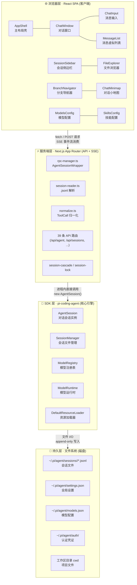
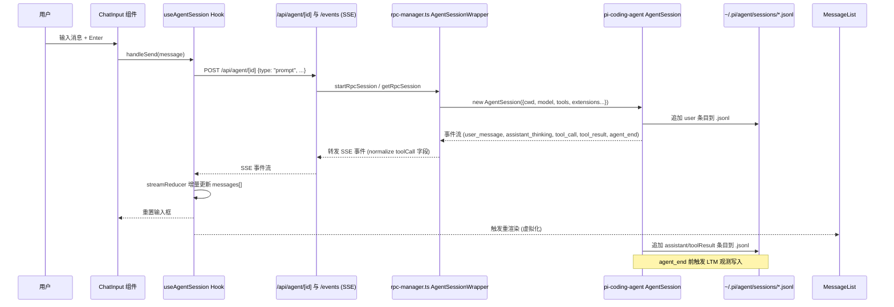

Pi Agent Desktop 是一个面向个人开发者的**极简版 Codex 桌面客户端**，基于 Electron 构建，为 [Pi 编程智能体](https://github.com/badlogic/pi-mono) 提供原生桌面体验。项目衍生自上游 [pi-web](https://github.com/agegr/pi-web)，专注于桌面端交互打磨与功能增强，目标是让 AI 编程助手在桌面环境下获得比浏览器更流畅、更原生的使用感受。

本文档面向初级开发者，提供项目整体架构的**全景视图**，帮助你在 10 分钟内建立心智模型，随后可按目录顺序深入各专题。

Sources: [README.zh-CN.md](README.zh-CN.md#L1-L50), [docs/ARCHITECTURE.md](docs/ARCHITECTURE.md#L1-L60)

---

## 核心定位与设计目标

| 维度 | 说明 |
|------|------|
| **产品定位** | 个人极简版 Codex —— Pi 编程智能体的原生桌面客户端 |
| **上游依赖** | `@earendil-works/pi-coding-agent` (SDK 核心)、`@earendil-works/pi-ai` (模型抽象) |
| **运行模式** | **双模式**：浏览器开发模式 (`npm run dev`) + Electron 桌面模式 (`npm run dev:electron`) |
| **架构原则** | 零状态库、零 UI 库、进程内持有 AgentSession、SSE 零延迟推流 |
| **桌面特性** | 独立窗口、系统托盘、自动更新、原生目录选择器、跨平台打包 |

Sources: [README.zh-CN.md](README.zh-CN.md#L1-L30), [docs/ARCHITECTURE.md](docs/ARCHITECTURE.md#L30-L55)

---

## 整体架构全景图

下图展示了项目的**四层分离架构**，这是理解代码组织与数据流向的核心骨架：



**层级职责对照表：**

| 层级 | 核心职责 | 关键约束 | 典型文件 |
|------|----------|----------|----------|
| **浏览器层** | UI 渲染、用户交互、SSE 消费、URL 状态管理 | 零外部状态库；流式消息由 `streamReducer` 增量更新 | `components/*`, `hooks/*` |
| **服务端层** | API 路由、AgentSession 生命周期包装、会话文件解析 | 活跃 session 必须存 `globalThis`（HMR 安全） | `app/api/*`, `lib/rpc-manager.ts`, `lib/session-reader.ts` |
| **SDK 层** | 真正的 AI 对话引擎、模型调度、工具执行、权限控制 | 由上游 `@earendil-works/pi-coding-agent` 提供 | 依赖包，非本仓库代码 |
| **持久层** | 所有状态最终落盘：`.jsonl` 会话文件、配置、认证 | append-only；header 含 `parentSession` 支持分支元数据 | `~/.pi/agent/` 目录结构 |

Sources: [docs/ARCHITECTURE.md](docs/ARCHITECTURE.md#L60-L130), [lib/rpc-manager.ts](lib/rpc-manager.ts#L1-L50), [lib/session-reader.ts](lib/session-reader.ts#L1-L50)

---

## 双模式运行架构

项目的一大特色是**同一份 Next.js/React 代码库**同时服务于两种运行模式：

### Web 模式（浏览器开发）
```text
Browser (React SPA) ←HTTP/SSE→ Next.js Server (:30141) ←进程内→ AgentSession
```
- 启动：`npm run dev` → 访问 `http://localhost:30141`
- 适合：前端 UI 开发、热重载调试、快速迭代

### Desktop 模式（Electron 生产）
```text
Electron Main Process
  ├─ 托管 Next.js standalone server (127.0.0.1:端口，从 30141 起顺序探测)
  │    ├─ macOS: utilityProcess (UIElement，不占 Dock)
  │    └─ Windows/Linux: spawn with ELECTRON_RUN_AS_NODE=1
  ├─ BrowserWindow → loadURL("http://127.0.0.1:PORT")
  ├─ 系统托盘 + 自动更新
  └─ Preload 暴露 electronAPI (selectDirectory, getPathForFile, onUpdateAvailable, onUpdateDownloaded, quitAndInstall, setTheme)
```
- 启动：`npm run dev:electron` (开发) / `npm run dist` (打包)
- 适合：最终用户分发、原生桌面体验验证

**关键差异点：**
| 特性 | Web 模式 | Desktop 模式 |
|------|----------|--------------|
| 进程模型 | 单一 Node 进程 | Electron 主进程 + Next.js 子进程 |
| 窗口管理 | 浏览器标签页 | 原生窗口 (标题栏、最小化、托盘) |
| 文件系统访问 | 受限 (文件浏览经 /api/files 后端路由) | 完整 Node.js `fs` 权限 |
| 原生对话框 | 浏览器原生 | Electron `dialog` / 自定义模态框 |
| 自动更新 | 不支持 | `electron-updater` + GitHub Releases |

Sources: [docs/ARCHITECTURE.md](docs/ARCHITECTURE.md#L60-L110), [electron/main.ts](electron/main.ts#L1-L80), [electron/preload.ts](electron/preload.ts#L1-L37)

---

## 核心功能模块速览

### 会话与对话管理
- **会话浏览器**：按工作目录分组展示所有 Pi 会话，支持搜索、筛选、排序
- **实时流式对话**：SSE 事件流推送，`streamReducer` 增量渲染，零感知延迟
- **消息队列**：`Enter` 立即 steer，`Alt+Enter` 排队 Follow-up，支持拖拽/键盘重排
- **会话内分支**：任意节点回退并继续，分支保存在同一 `.jsonl` 文件内
- **分支导航器**：可视化树形结构切换同一会话的不同分支
- **Fork & Clone**：从任意节点分叉新会话，或克隆到普通目录 / Git Worktree 新分支
- **会话导出**：一键导出 HTML / Markdown，便于归档分享

Sources: [README.zh-CN.md](README.zh-CN.md#L50-L80), [components/ChatWindow.tsx](components/ChatWindow.tsx#L1-L50), [hooks/useAgentSession.ts](hooks/useAgentSession.ts#L1-L80)

### Agent 智能体能力
- **三种安全模式**：Plan（仅规划）、Ask（工具需确认）、Full（完全自主）
- **Extension UI Bridge**：原生弹窗支持 `confirm`/`select`/`input`/`editor`/`notify` 五种交互类型
- **项目信任机制**：409 握手 + 授权弹窗，防止未受信项目执行敏感操作
- **工具面板**：可视化控制 Agent 可用工具集合
- **长期记忆 (LTM)**：项目级 SQLite 存储，`memory_save`/`memory_recall`/`memory_forget`，跨会话检索，CJK 支持 FTS5 trigram

Sources: [README.zh-CN.md](README.zh-CN.md#L80-L110), [lib/rpc-manager.ts](lib/rpc-manager.ts#L100-L200), [lib/desktop-ltm-extension.ts](lib/desktop-ltm-extension.ts#L1-L50)

### 配置与管理
- **MCP 双级配置**：全局 (`~/.pi/agent/mcp.json`) + 项目 (`<cwd>/.pi/mcp.json`)，UI 统一管理
- **扩展与 Skill 管理**：全局/项目扩展启用、诊断、安装一体化界面
- **AgentMode 持久化**：自动写入 `.jsonl` 自定义 `desktop_agent_mode` 节点，重载恢复历史模式
- **多语言**：中/英跟随系统或手动切换
- **文件浏览器**：侧边栏内置文件树与查看器，支持大文件虚拟化

Sources: [README.zh-CN.md](README.zh-CN.md#L110-L130), [components/ExtensionsConfigModal.tsx](components/ExtensionsConfigModal.tsx#L1-L50), [components/ModelsConfig.tsx](components/ModelsConfig.tsx#L1-L50)

---

## 目录结构与关键入口

```
pi-agent-desktop/
├── app/                          # Next.js App Router
│   ├── api/                      # 39 条 API 路由 (REST + SSE)
│   │   ├── agent/                # Agent 命令发送、SSE 事件流
│   │   ├── sessions/             # 会话列表、读取、分支、导出
│   │   ├── memory/               # LTM recall/remember/forget/stats
│   │   ├── models/               # 模型列表、默认模型
│   │   ├── models-config/        # models.json 读写
│   │   ├── skills/               # Skill 搜索安装
│   │   ├── auth/                 # 登录、API Key 管理
│   │   ├── mcp/                  # MCP 服务器配置
│   │   ├── extensions/           # 扩展管理
│   │   ├── trust/                # 项目信任握手
│   │   └── ...                   # desktop-settings, files, health 等
│   ├── layout.tsx                # 根布局：字体、主题、I18nProvider
│   └── page.tsx                  # 入口：Suspense 包裹 AppShell
├── components/                   # React UI 组件 (65 个文件，顶层 .tsx 30 个)
│   ├── AppShell.tsx              # 主壳：三栏布局、面板拖拽、快捷键
│   ├── ChatWindow.tsx            # 对话主窗口：消息列表、输入、分支、小地图
│   ├── ChatInput.tsx             # 消息输入：附件、模型选择、思考等级
│   ├── SessionSidebar.tsx        # 会话侧边栏：树形列表、文件浏览
│   ├── MessageList.tsx           # 虚拟化消息列表
│   ├── MessageView.tsx           # 单条消息渲染：Markdown、代码高亮
│   ├── BranchNavigator.tsx       # 分支导航器：树形可视化
│   ├── LiquidOrbCanvas.tsx       # 液态思考球：WebGPU/Canvas 渲染
│   └── ...                       # ModelsConfig, SkillsConfig, Modals 等
├── electron/                     # Electron 主进程
│   ├── main.ts                   # 入口：窗口、子进程、托盘、更新、CSP
│   ├── preload.ts                # 预加载：暴露 electronAPI 到 renderer
│   ├── server-wait.ts            # Next.js 就绪检查：dev 为 stdout "Ready" 或 HTTP /api/health 任一通过 (Promise.any)，打包模式仅 HTTP
│   ├── restart-policy.ts         # 重启策略：60 秒滑动窗口内最多 3 次重启
│   ├── crash-recovery.ts         # 崩溃恢复：状态持久化与恢复
│   ├── tray.ts                   # 系统托盘菜单
│   └── *.test.ts                 # Electron 专用单测
├── hooks/                        # React Hooks (按领域拆分)
│   ├── useAgentSession.ts        # 总入口 Hook，组合 5 个子 Hook
│   ├── usePanelLayout.ts         # 面板宽度、拖拽、持久化
│   ├── useFileTabs.ts            # 文件标签页状态
│   ├── useTheme.ts               # 主题切换、系统跟随
│   ├── useDragDrop.ts            # 拖拽文件/路径处理
│   └── agent-session/            # 会话相关子 Hook 拆分
│       ├── stream-state.ts       # streamReducer 流式状态机
│       ├── agent-event-apply.ts  # Agent 事件应用到 UI 状态
│       ├── use-agent-events.ts   # SSE 连接与事件分发
│       ├── use-session-loader.ts # 会话加载、分支解析
│       └── ...                   # session-commands, agent-phase 等
├── lib/                          # 共享工具库 (服务端+客户端通用)
│   ├── rpc-manager.ts            # AgentSessionWrapper 生命周期管理
│   ├── session-reader.ts         # .jsonl 解析、会话列表、路径缓存
│   ├── pi-types.ts               # 类型定义：SessionEntry, AgentMessage 等
│   ├── approval-policy.ts        # AgentMode/ToolPreset 策略
│   ├── extension-ui-bridge.ts    # Extension UI RPC 响应队列
│   ├── desktop-ltm-extension.ts  # LTM 内联扩展 + 观测钩子
│   ├── mcp-config.ts             # MCP 配置读写 (全局+项目)
│   ├── follow-up-queue.ts        # Follow-up 队列 + revision 并发控制
│   ├── git-worktree.ts           # Git worktree 创建/校验/清理
│   ├── session-branch-clone.ts   # Fork/Clone 参数与 Header 构造
│   ├── pi-runtime.ts             # ModelRuntime 适配器
│   ├── ltm/                      # 长期记忆：SQLite 后端、HTTP、FTS5
│   └── i18n/                     # 国际化：en/zh-CN 词典
├── scripts/                      # 构建/打包辅助脚本
│   ├── ensure-standalone-*.mjs   # 补齐 standalone 运行时依赖
│   ├── smoke-*.mjs               # 冒烟测试：standalone server / 打包后应用
│   └── sync-landing-orb.mjs      # 同步液态球资源到 docs/
├── docs/                         # 文档站 (GitHub Pages)
│   ├── ARCHITECTURE.md           # 架构深度解析 (本文档引用源头)
│   ├── RELEASING.md              # 发布流程
│   └── investigations/           # 问题复盘 (white-screen.md)
├── public/                       # 静态资源
├── package.json                  # 依赖、脚本、electron-builder 配置
├── next.config.ts                # output: 'standalone', serverExternalPackages
├── tailwind.config.ts            # Tailwind CSS v4 配置
└── tsconfig.json                 # TypeScript 严格模式
```

Sources: [package.json](package.json#L1-L30), [docs/ARCHITECTURE.md](docs/ARCHITECTURE.md#L130-L200), [get_dir_structure](.)

---

## 技术栈版本基线

| 类别 | 技术 | 版本 | 说明 |
|------|------|------|------|
| **前端框架** | Next.js | 16.3.6 | App Router, output: standalone |
| **UI 库** | React | 19.2.4 | Concurrent Features, Server Components |
| **语言** | TypeScript | 5.x | strict mode, bundler moduleResolution |
| **样式** | Tailwind CSS | 4.2.2 | CSS-first 配置, OKLCH 色彩空间 |
| **桌面壳** | Electron | 43.7.7 | 搭配 electron-builder 26.15.3 |
| **打包** | electron-builder | 26.15.3 | NSIS (Win) / Universal DMG+ZIP (macOS) / DEB (Linux) |
| **上游 SDK** | pi-coding-agent | 0.99.1 | 核心 Agent 运行时 |
| **上游 SDK** | pi-ai | 0.99.1 | 模型抽象、Provider 管理 |
| **上游 SDK** | pi-mcp | 0.99.1 | MCP 协议实现 |
| **测试** | Node.js 原生 test runner | --test-force-exit | 无 Jest 依赖，平台子集测试 |
| **代码规范** | ESLint 9 + eslint-config-next | 16.3.6 | flat config, TypeScript 感知 |

Sources: [package.json](package.json#L40-L70), [next.config.ts](next.config.ts), [tailwind.config.ts](tailwind.config.ts)

---

## 关键数据流：一次用户发送消息的完整旅程



**关键设计点：**
1. **进程内直连**：服务端 API 直接 `new AgentSession()`，无 IPC/RPC 开销
2. **SSE 单向流**：服务端推送，客户端 `EventSource` 消费，`streamReducer` 保证顺序与幂等
3. **Append-only 持久化**：所有状态最终落盘 `.jsonl`，天然支持崩溃恢复与时间旅行
4. **全局注册表**：`globalThis.__piSessions` 存活 wrapper，HMR 热重载不丢会话

Sources: [docs/ARCHITECTURE.md](docs/ARCHITECTURE.md#L200-L280), [lib/rpc-manager.ts](lib/rpc-manager.ts#L200-L400), [hooks/agent-session/stream-state.ts](hooks/agent-session/stream-state.ts), [hooks/agent-session/use-agent-events.ts](hooks/agent-session/use-agent-events.ts)

---

## 新手学习路径建议

按**认知负荷递增**顺序阅读后续文档：

| 阶段 | 文档 | 核心收获 | 预估时间 |
|------|------|----------|----------|
| **入门** | [快速开始](2-kuai-su-kai-shi) | 环境搭建、两种开发模式启动、常用命令 | 10 min |
| **入门** | [双模式开发与运行](3-shuang-mo-shi-kai-fa-yu-yun-xing) | Web vs Desktop 差异、Electron 子进程托管机制 | 15 min |
| **基础** | [目录结构与核心模块](4-mu-lu-jie-gou-yu-he-xin-mo-kuai) | 代码地图、模块职责、查找入口方法 | 15 min |
| **基础** | [技术栈与关键依赖](5-ji-zhu-zhan-yu-guan-jian-yi-lai) | 依赖关系图、版本锁定理由、升级策略 | 10 min |
| **进阶** | [四层分离架构详解](6-si-ceng-fen-chi-jia-gou-xiang-jie) | 架构边界、跨层调用约束、HMR 安全模式 | 20 min |
| **进阶** | [AgentSession 生命周期与进程内注册表](7-agentsession-sheng-ming-zhou-qi-yu-jin-cheng-nei-zhu-ce-biao) | Wrapper 创建、缓存、销毁、HMR 存活 | 20 min |
| **进阶** | [SSE 事件流与流式状态机](8-sse-shi-jian-liu-yu-liu-shi-zhuang-tai-ji) | streamReducer 设计、事件类型、增量渲染 | 25 min |

> **提示**：每个深度文档开头都有「前置知识」与「本文不覆盖内容」声明，可按需跳读。

---

## 常见问题速查

| 问题 | 答案 | 定位文档 |
|------|------|----------|
| 如何在浏览器开发 UI？ | `npm run dev` → `http://localhost:30141`，支持热重载 | [快速开始](2-kuai-su-kai-shi) |
| 如何启动桌面窗口调试？ | `npm run dev:electron`（已内置 `build:electron` 编译步骤） | [双模式开发与运行](3-shuang-mo-shi-kai-fa-yu-yun-xing) |
| 会话文件存在哪里？ | `~/.pi/agent/sessions/--<encoded-cwd>/--/<session-id>.jsonl`（cwd 中正斜杠、反斜杠、冒号均替换为 `-`，前后包裹 `--`） | [Pi 会话文件格式与 .jsonl 解析](13-pi-hui-hua-wen-jian-ge-shi-yu-jsonl-jie-xi) |
| 如何添加新的 API 路由？ | 在 `app/api/<name>/route.ts` 导出 `GET`/`POST`，遵循 Next.js App Router 规范 | [四层分离架构详解](6-si-ceng-fen-chi-jia-gou-xiang-jie) |
| 前端如何发起 Agent 命令？ | `useAgentSession` 返回的 `handleSend` / `handleAbort` / `handleFork` 等 | [useAgentSession 主 Hook 与子 Hook 拆分策略](22-useagentsession-zhu-hook-yu-zi-hook-chai-fen-ce-lue) |
| 如何在 Electron 访问原生 API？ | `preload.ts` 暴露 `electronAPI`，渲染进程通过 `window.electronAPI` 调用 | [Preload、CSP、自动更新与系统托盘](12-preload-csp-zi-dong-geng-xin-yu-xi-tong-tuo-pan) |
| 打包失败常见原因？ | 检查 `scripts/ensure-standalone-*.mjs` 依赖收集、macOS 双架构 Sharp 运行时 | [打包构建流程与 macOS Universal 双架构处理](11-da-bao-gou-jian-liu-cheng-yu-macos-universal-shuang-jia-gou-chu-li) |

---

## 下一步

建议从 **[快速开始](2-kuai-su-kai-shi)** 开始动手跑通两种开发模式，建立「改代码 → 看效果」的最短反馈回路。随后按上表学习路径逐层深入，每篇文档都标注了**前置知识**与**配套源码位置**，便于对照阅读。

---

*文档版本：v0.9.0 对应 | 维护者：Pi Agent Desktop 团队 | 更新日期：2026-09-30*