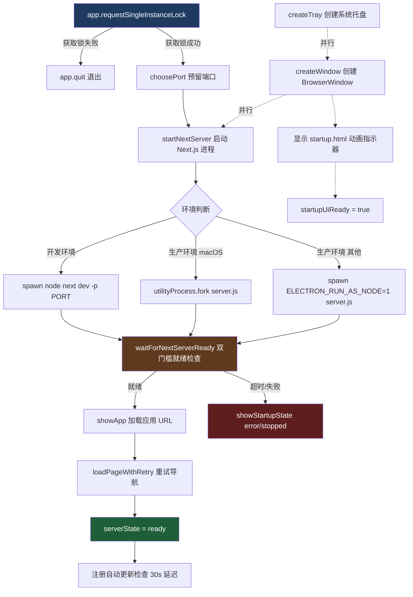

Pi Agent Desktop 的 Electron 主进程采用 **单实例锁 → 端口预留 → 启动 Next.js 服务 → 双门槛就绪检查 → 加载应用界面** 的启动链。核心难点在于：**开发环境与生产环境的就绪判定标准不同**，且需在 Next.js 服务崩溃、渲染进程崩溃、端口冲突等异常场景下保持自愈能力。本文档系统拆解启动全链路、双门槛就绪检查机制、重启/恢复策略，以及与系统托盘、自动更新的协同关系。

Sources: [electron/main.ts](electron/main.ts#L1-L100), [electron/server-wait.ts](electron/server-wait.ts#L1-L50), [electron/startup.html](electron/startup.html#L1-L50)

---

## 启动链总览



**关键状态机**：`serverState` 在 `starting` → `ready` → `stopped` 之间流转，受重启策略与崩溃恢复策略约束。

Sources: [electron/main.ts](electron/main.ts#L100-L200), [electron/main.ts](electron/main.ts#L550-L650)

---

## 单实例锁与进程唯一性

```typescript
const gotLock = app.requestSingleInstanceLock();
if (!gotLock) {
  app.quit();
  process.exit(0);
}

app.on("second-instance", () => {
  if (mainWindow) {
    if (mainWindow.isMinimized()) mainWindow.restore();
    mainWindow.show();
    mainWindow.focus();
  }
});
```

- **作用**：防止用户重复点击图标启动多实例；第二次启动时激活已有窗口。
- **实现细节**：`requestSingleInstanceLock()` 返回 `false` 时直接退出；`second-instance` 事件在 macOS/Windows/Linux 行为一致。

Sources: [electron/main.ts](electron/main.ts#L1-L30)

---

## 端口预留与冲突规避

```typescript
function reservePort(port: number): Promise<number> {
  return new Promise((resolve, reject) => {
    const server = net.createServer();
    server.listen(port, "127.0.0.1", () => {
      const addr = server.address();
      server.close(() => resolve(addr && typeof addr === "object" ? addr.port : port));
    });
    server.on("error", reject);
  });
}

export async function choosePort(input: {
  startPort: number;
  maxAttempts?: number;
  reservePort: (port: number) => Promise<number>;
}): Promise<number> {
  const maxAttempts = input.maxAttempts ?? 10;
  for (let attempt = 0; attempt < maxAttempts; attempt += 1) {
    const port = input.startPort + attempt;
    try {
      return await input.reservePort(port);
    } catch {
      // 尝试下一个端口
    }
  }
  throw new Error(`No free port found after ${maxAttempts} attempts`);
}
```

- **默认起始端口**：`30141`（`DEFAULT_PORT` 常量）
- **重试策略**：线性探测最多 10 个端口（30141~30150），避免固定端口被占用导致启动失败
- **预留机制**：`net.createServer().listen()` 成功即证明端口可用，随即关闭释放，由后续 Next.js 进程复用

Sources: [electron/main.ts](electron/main.ts#L100-L150), [electron/port-selection.ts](electron/port-selection.ts#L1-L19)

---

## Next.js 服务进程启动：开发 vs 生产分道扬镳

### 开发环境

```typescript
const nextBin = require.resolve("next/dist/bin/next", { paths: [app.getAppPath()] });
const proc = spawn("node", [nextBin, "dev", "-p", String(port)], {
  cwd: app.getAppPath(),
  env: {
    ...pickApiKeys(process.env),
    NODE_ENV: process.env.NODE_ENV ?? "development",
    PORT: String(port),
    NEXT_TELEMETRY_DISABLED: "1",
  },
  stdio: "pipe",
});
return monitorNextServerProcess(wrapChildServerProcess(proc, killProcessTree), "Next.js dev server");
```

- 使用 `spawn("node", ...)` 而非 `process.execPath`（后者指向 `electron.exe`）
- 环境变量经过 `pickApiKeys` 过滤，仅透传 `PATH`、`NODE_ENV`、`ANTHROPIC_API_KEY` 等白名单键

### 生产环境

```typescript
const standaloneDir = path.join(process.resourcesPath, "standalone");
const serverScript = path.join(standaloneDir, "server.js");
const serverEnv = { ...pickApiKeys(process.env), NODE_ENV: "production", PORT: String(port), HOSTNAME: "127.0.0.1" };

const proc = process.platform === "darwin"
  ? (() => {
      const utility = utilityProcess.fork(serverScript, [], {
        cwd: standaloneDir,
        env: serverEnv,
        stdio: "pipe",
        serviceName: "Pi Agent Next Server",
      });
      return wrapUtilityServerProcess(utility, (process) => { /* kill descendants + kill */ });
    })()
  : wrapChildServerProcess(
      spawn(process.execPath, [serverScript], {
        cwd: standaloneDir,
        env: { ...serverEnv, ELECTRON_RUN_AS_NODE: "1" },
        stdio: "pipe",
      }),
      killProcessTree,
    );
```

| 平台 | 启动方式 | 关键差异 |
|------|----------|----------|
| **macOS** | `utilityProcess.fork` | 避免 Dock 出现第二个跳动图标；`serviceName` 显示在活动监视器中 |
| **Windows/Linux** | `spawn(process.execPath, ..., { env: { ELECTRON_RUN_AS_NODE: "1" } })` | 复用 Electron 二进制作为 Node 运行时，加载 `standalone/server.js` |

- **standalone 产物**：由 `next.config.ts` 的 `output: "standalone"` 生成，包含最小运行时依赖
- **进程包装**：`ServerProcess` 类统一暴露 `stdout`/`stderr`/`pid`/`exitCode`/`killed`/`terminate()`，屏蔽 `ChildProcess` 与 `UtilityProcess` 差异

Sources: [electron/main.ts](electron/main.ts#L150-L250), [electron/server-process.ts](electron/server-process.ts#L1-L103)

---

## 双门槛就绪检查：核心机制

`waitForNextServerReady` 是启动链的**关键同步点**，其行为随 `requireHttpHealth` 参数切换：

```typescript
export function waitForNextServerReady(
  port: number,
  proc: ReadyProcess,
  options: WaitForNextServerReadyOptions = {}
): Promise<void> {
  const requireHttpHealth = options.requireHttpHealth ?? false;
  
  if (requireHttpHealth) {
    // 生产环境：仅 HTTP /api/health 健康检查通过才算就绪
    return waitForHttpServerReady(port, { ...options, signal: readyAbort.signal });
  }

  // 开发环境：Promise.any([stdout "Ready", HTTP health]) —— 任一达标即通过
  return Promise.any([
    waitForNextReadyOutput(proc, timeoutMs, readyAbort.signal),
    waitForHttpServerReady(port, { ...options, signal: readyAbort.signal }),
  ]);
}
```

### 门槛一：stdout "Ready" 文本（仅开发环境生效）

```typescript
function waitForNextReadyOutput(
  proc: Pick<ReadyProcess, "stdout" | "stderr">,
  timeoutMs: number,
  signal?: AbortSignal
): Promise<void> {
  return new Promise((resolve, reject) => {
    function onData(chunk: Buffer | string) {
      const text = Buffer.isBuffer(chunk) ? chunk.toString("utf8") : chunk;
      if (text.includes("Ready")) {  // Next.js dev 输出 "✓ Ready in xxxms"
        finish(resolve, undefined);
      }
    }
    proc.stdout?.on("data", onData);
    proc.stderr?.on("data", onData);
    // ... timeout & cleanup
  });
}
```

- **触发时机**：Next.js dev server 编译完成、开始监听端口时输出 `✓ Ready in xxxms`
- **优势**：比 HTTP 轮询更早感知就绪，开发体验更流畅

### 门槛二：HTTP `/api/health` 健康检查（开发/生产均生效，生产**唯一**门槛）

```typescript
export function waitForHttpServerReady(
  port: number,
  { timeoutMs = 60_000, requestTimeoutMs = 15_000, getRetryDelayMs = getServerRetryDelayMs, signal }: {}
): Promise<void> {
  // 阶梯式固定间隔重试（非指数退避）：0-5s 每 100ms、5-15s 每 250ms、15s+ 每 500ms
  function getServerRetryDelayMs(elapsedMs: number): number {
    if (elapsedMs < 5_000) return 100;
    if (elapsedMs < 15_000) return 250;
    return 500;
  }
  // 轮询 GET http://127.0.0.1:{port}/api/health，statusCode >= 200 && < 400 即通过（2xx/3xx 均可）
}
```

| 维度 | 开发环境 (`requireHttpHealth=false`) | 生产环境 (`requireHttpHealth=true`) |
|------|--------------------------------------|--------------------------------------|
| **stdout "Ready"** | ✅ 可触发就绪 | ❌ 被忽略 |
| **HTTP /api/health** | ✅ 可触发就绪 | ✅ **唯一**触发就绪 |
| **竞争策略** | `Promise.any` 任一胜出 | 仅 HTTP 健康检查 |
| **设计理由** | 开发期编译完成即可用，HTTP 可能尚未建立连接 | 打包后无 stdout 可靠信号，必须验证真实 HTTP 服务可用性 |

### 为何生产环境必须强制 HTTP 健康检查？

1. **standalone server.js 无 "Ready" 标准输出**：生产构建不输出该文本
2. **防止假就绪**：进程存活 ≠ HTTP 服务就绪（可能仍在初始化中间件、路由注册、数据库连接）
3. **安全基线**：CSP、预加载脚本注入等依赖真实 HTTP 端点响应

Sources: [electron/server-wait.ts](electron/server-wait.ts#L1-L229), [electron/main.ts](electron/main.ts#L550-L580)

---

## 启动界面与状态反馈

### `startup.html`：零依赖、CSP 严格、状态驱动

```html
<meta http-equiv="Content-Security-Policy" content="default-src 'none'; style-src 'unsafe-inline'; script-src 'self' 'unsafe-inline';" />
<!-- 通过 URL hash 传递状态：#state=starting|error|stopped&message=xxx -->
<script src="./startup.js"></script>
```

- **三种状态**：
  - `starting`：蓄势待发的涟漪动画（Ayu 金色 `#ffb454`）
  - `error`：红色警告卡片下滑展开（`#ff3333`）
  - `stopped`：同 error 视觉，文案指向“服务已停止，请重启”
- **动画细节**：核心圆点呼吸缩放、三层全屏涟漪交错、状态切换时 CSS 变量平滑过渡
- **零运行时依赖**：纯 CSS + 25 行 JS，启动极快，无白屏风险

### 主进程侧状态切换

```typescript
function showStartupState(state: "starting" | "error" | "stopped", message?: string) {
  if (!mainWindow || mainWindow.isDestroyed()) return;
  mainWindow.loadURL(startupPageUrl(state, message));
}

function startupPageUrl(state: "starting" | "error" | "stopped", message?: string): string {
  const url = new URL(`file://${path.join(__dirname, "startup.html").replace(/\\/g, "/")}`);
  const hash = new URLSearchParams({ state });
  if (message) hash.set("message", message);
  url.hash = hash.toString();
  return url.toString();
}
```

- **时机**：
  - 窗口创建后立即 `showStartupState("starting")`
  - 就绪检查失败/超时 → `showStartupState("error", message)`
  - 服务进程意外退出且重启耗尽 → ``showStartupState("stopped", `${label} 已退出`)``（label 为 "Next.js dev server" 或 "Packaged Next.js server"）
  - 渲染进程崩溃达上限 → `showStartupState("stopped", "页面多次崩溃，已停止自动恢复")`

Sources: [electron/startup.html](electron/startup.html#L1-L330), [electron/startup.js](electron/startup.js#L1-L26), [electron/main.ts](electron/main.ts#L300-L350)

---

## 应用加载与导航重试

```typescript
async function showApp(port: number): Promise<void> {
  // ... 守卫检查 ...
  await loadPageWithRetry(
    `http://127.0.0.1:${port}`,
    async (url) => { await window.loadURL(url); },
    {
      signal: navigationAbort.signal,
      cancelAttempt: () => { if (!window.isDestroyed()) window.webContents.stop(); },
      shouldRetry: () => { /* 守卫检查：未退出、窗口未变、进程未变、serverState 仍为 starting */ },
    }
  );
  serverState = "ready";
}
```

### `loadPageWithRetry` 策略

```typescript
const DEFAULT_DELAYS_MS = [100, 250, 500];  // 最多 3 次重试，共 4 次尝试
const DEFAULT_ATTEMPT_TIMEOUT_MS = 15_000;  // 单次导航超时 15s

// 重试条件：shouldRetry(error) 返回 true 且未超出重试次数
// 取消机制：AbortSignal + window.webContents.stop()
```

- **守卫检查** (`assertCurrentNavigation`)：导航期间若应用退出、窗口销毁、Next.js 进程更替/退出、serverState 非 `starting`，立即中止
- **成功标志**：`serverState = "ready"`，后续重启逻辑仅在 `ready` 状态下生效

Sources: [electron/main.ts](electron/main.ts#L350-L450), [electron/navigation.ts](electron/navigation.ts#L1-L137)

---

## 服务进程重启策略：有界自愈

```typescript
const RESTART_LIMIT = 3;
const RESTART_WINDOW_MS = 60_000;

export function getNextRestartState(input: {
  now: number;
  attempts: number[];
  serverState: ServerState;
  isQuitting: boolean;
}): { shouldRestart: boolean; attempts: number[] } {
  if (input.isQuitting || input.serverState !== "ready") {
    return { shouldRestart: false, attempts: input.attempts };
  }
  const attempts = input.attempts.filter((startedAt) => input.now - startedAt < RESTART_WINDOW_MS);
  if (attempts.length >= RESTART_LIMIT) {
    return { shouldRestart: false, attempts };
  }
  return { shouldRestart: true, attempts: [...attempts, input.now] };
}
```

- **触发条件**：Next.js 进程在 `serverState === "ready"` 阶段非正常退出（崩溃、OOM、信号杀死）
- **限制**：滑动窗口 60 秒内最多 3 次重启，防止崩溃循环拖垮主进程
- **重启流程**：
  1. `serverState = "starting"`，清空 `activePort`
  2. `showStartupState("starting", "正在重新启动本地服务")`
  3. `choosePort` 重新选端口 → `startNextServer` → `waitForNextServerReady` → `showApp`
  4. 任一步骤失败 → `serverState = "stopped"`，显示 "本地服务重启失败"

- **起始阶段崩溃**：`serverState === "starting"` 时退出，**不重启**，直接 `showStartupState("error", "本地服务启动失败")`

Sources: [electron/restart-policy.ts](electron/restart-policy.ts#L1-L23), [electron/main.ts](electron/main.ts#L200-L280)

---

## 渲染进程崩溃恢复：独立的有界策略

```typescript
const RELOAD_LIMIT = 3;
const RELOAD_WINDOW_MS = 60_000;

export function getNextCrashReloadState(input: {
  now: number;
  reason: string;
  attempts: number[];
  isQuitting: boolean;
}): { shouldReload: boolean; attempts: number[] } {
  if (input.isQuitting || input.reason === "clean-exit") {
    return { shouldReload: false, attempts: input.attempts };
  }
  const attempts = input.attempts.filter((startedAt) => input.now - startedAt < RELOAD_WINDOW_MS);
  if (attempts.length >= RELOAD_LIMIT) {
    return { shouldReload: false, attempts };
  }
  return { shouldReload: true, attempts: [...attempts, input.now] };
}
```

```typescript
window.webContents.on("render-process-gone", (_event, details) => {
  const next = getNextCrashReloadState({ now: Date.now(), reason: details.reason, attempts: reloadAttempts, isQuitting });
  if (!next.shouldReload) {
    if (details.reason !== "clean-exit" && !isQuitting && !window.isDestroyed()) {
      showStartupState("stopped", "页面多次崩溃，已停止自动恢复");
    }
    return;
  }
  window.webContents.reload();
});
```

| 维度 | 服务进程重启 | 渲染进程重载 |
|------|-------------|-------------|
| **触发源** | Next.js 子进程 `exit`/`error` | `render-process-gone` 事件 |
| **判定依据** | `serverState === "ready"` | `reason !== "clean-exit"` |
| **限制窗口** | 60s / 3次 | 60s / 3次 |
| **耗尽动作** | `showStartupState("stopped")` | `showStartupState("stopped")` + 停止 reload |
| **独立性** | 互不影响，各自计数 | 互不影响，各自计数 |

Sources: [electron/crash-recovery.ts](electron/crash-recovery.ts#L1-L28), [electron/main.ts](electron/main.ts#L450-L500)

---

## 进程树清理：彻底终止子进程树

```typescript
// Windows
spawnSync("taskkill.exe", ["/PID", String(proc.pid), "/F", "/T"], { windowsHide: true });

// Unix
function killUnixProcessTree(pid: number, signal = "SIGKILL") {
  const children = getUnixChildren(pid);  // pgrep -P 或 ps --ppid
  for (const childPid of children) killUnixProcessTree(childPid, signal);
  process.kill(pid, signal);
}
```

- **必要性**：Next.js dev server 可能衍生 `webpack`、`turbo` 等孙进程；`utilityProcess` 同样可能产生子进程
- **调用点**：`before-quit`、重启前 `cleanup()`、更新安装前
- **错误处理**：返回 `Error | null`，失败仅记录日志不阻塞主流程

Sources: [electron/process-tree.ts](electron/process-tree.ts#L1-L75), [electron/main.ts](electron/main.ts#L280-L320)

---

## 系统托盘：隐藏而不退出

```typescript
app.on("window-all-closed", () => {
  // Do nothing — keep running in tray
});

mainWindow.on("close", (e) => {
  if (!isQuitting) {
    e.preventDefault();
    mainWindow?.hide();
  }
});
```

- **托盘菜单**：`显示窗口` / `退出`（退出时 `setQuitting(true)` + `app.quit()`）
- **双击托盘图标**：显示并聚焦窗口
- **macOS `activate` 事件**：点击 Dock 图标时同样显示窗口

Sources: [electron/tray.ts](electron/tray.ts#L1-L54), [electron/main.ts](electron/main.ts#L600-L650)

---

## 自动更新：延迟检查、用户确认下载、Gate 守护安装

```typescript
if (app.isPackaged) {
  setTimeout(async () => {
    const { autoUpdater } = await import("electron-updater");
    autoUpdater.autoDownload = false;  // 关键：不自动下载
    // ... 事件监听 ...
    autoUpdater.checkForUpdates();
  }, 30_000);
}
```

### 更新门控 (`update-install-gate.ts`)

```typescript
export function decideQuitAndInstall(state: UpdateInstallState): QuitAndInstallDecision {
  if (!canQuitAndInstall(state)) {
    return { allowed: false, reason: "No update has been downloaded" };
  }
  return { allowed: true, version: state.downloadedVersion };
}
```

- **IPC `quit-and-install`**：渲染进程调用 → 主进程 `decideQuitAndInstall` 校验 → 仅当 `updateDownloaded === true` 时允许
- **防 XSS 劫持**：即使渲染进程被注入恶意代码调用 `quitAndInstall`，也无法在未下载更新时触发重启安装
- **用户确认流程**：
  1. `update-available` → 对话框询问“下载吗？” → 用户确认 → `downloadUpdate()`
  2. `update-downloaded` → 对话框询问“重启安装吗？” → 用户确认 → `quitAndInstall()`

Sources: [electron/main.ts](electron/main.ts#L650-L736), [electron/update-install-gate.ts](electron/update-install-gate.ts#L1-L35), [electron/preload.ts](electron/preload.ts#L1-L37)

---

## 环境变量过滤：最小权限原则

```typescript
const ENV_ALLOWLIST = ["PATH", "Path", "NODE_ENV", "HOME", "USERPROFILE", "TEMP", "TMP", "ANTHROPIC_API_KEY", "OPENAI_API_KEY", "GEMINI_API_KEY", "GOOGLE_AI_API_KEY"];
const ENV_PREFIX_ALLOWLIST = ["PI_"];

export function pickApiKeys(env: Record<string, string | undefined>): Record<string, string | undefined> {
  const out: Record<string, string | undefined> = {};
  for (const [k, v] of Object.entries(env)) {
    if (ENV_ALLOWLIST.includes(k)) out[k] = v;
    else if (ENV_PREFIX_ALLOWLIST.some((p) => k.startsWith(p))) out[k] = v;
  }
  return out;
}
```

- **传递给 Next.js 进程**：开发/生产环境均使用此过滤结果
- **安全考量**：阻断 `ELECTRON_RUN_AS_NODE`、`npm_config_*`、`VSCODE_*` 等敏感变量泄露到子进程

Sources: [electron/env-filter.ts](electron/env-filter.ts#L1-L28)

---

## 关键设计决策速查表

| 决策点 | 选择 | 理由 |
|--------|------|------|
| **单实例锁** | `app.requestSingleInstanceLock()` | 原生 API，跨平台一致，无需文件锁 |
| **端口分配** | 线性探测 30141~30150 | 简单可靠，避免随机端口防火墙拦截 |
| **生产环境 macOS 启动** | `utilityProcess.fork` | 避免 Dock 第二图标，`serviceName` 可识别 |
| **就绪检查双门槛** | 开发：stdout Ready \|\| HTTP health；生产：仅 HTTP health | 平衡开发体验与生产可靠性 |
| **重启窗口** | 60s / 3次 | 够吸收瞬时抖动，防无限循环 |
| **渲染崩溃恢复** | 独立策略，同 60s/3次 | 进程隔离，互不干扰 |
| **窗口关闭行为** | 隐藏到托盘 | 符合桌面端常驻应用预期 |
| **自动下载** | `autoDownload = false` | 避免流量敏感环境静默下载、防 XSS 劫持 |
| **安装门控** | 纯函数 `decideQuitAndInstall` | 可测试、无副作用、防御深度 |
| **CSP 注入** | `webRequest.onHeadersReceived` 动态构建 | 端口变化自适应，启动页不受影响 |

---

## 常见故障与排查指南

| 现象 | 可能原因 | 排查步骤 |
|------|----------|----------|
| **启动卡在 "正在准备本地 Next.js 服务"** | 端口被占用、Next.js 编译失败、健康检查端点未就绪 | 1. 查看 `~/Library/Logs/Pi Agent Desktop/main.log` (macOS) 或 `%APPDATA%/Pi Agent Desktop/logs/main.log` (Windows)<br>2. 检查 30141-30150 端口占用<br>3. 开发环境：终端运行 `npm run dev` 观察编译错误 |
| **启动后显示 "启动失败" / "后端服务已停止"** | Next.js 进程启动即崩溃、重启次数耗尽 | 1. 日志搜索 `Next.js server exited` / `Failed to restart`<br>2. 检查 `standalone/server.js` 是否存在（生产包）<br>3. 验证 Node.js 版本兼容性 |
| **应用界面白屏，托盘图标正常** | 渲染进程崩溃达上限、CSP 阻断资源加载 | 1. `Cmd+Option+I` (macOS) / `Ctrl+Shift+I` (Win) 打开 DevTools 查看 Console<br>2. 日志搜索 `Renderer crash auto-reload skipped` |
| **点击"重启安装更新"无反应** | `updateDownloaded` 状态未置位、IPC 调用被拦截 | 1. 确认日志出现 `autoUpdater update-downloaded`<br>2. 检查 `quit-and-install` IPC 处理器日志 |

---

## 相关页面导航

- **上游依赖**：[打包构建流程与 macOS Universal 双架构处理](11-da-bao-gou-jian-liu-cheng-yu-macos-universal-shuang-jia-gou-chu-li) — 讲解 `standalone` 产物生成、双架构合并、代码签名
- **并行模块**：[Preload、CSP、自动更新与系统托盘](12-preload-csp-zi-dong-geng-xin-yu-xi-tong-tuo-pan) — 深入预加载脚本、CSP 策略、自动更新完整流程、托盘交互
- **架构全景**：[四层分离架构详解](6-si-ceng-fen-chi-jia-gou-xiang-jie) — Electron 主进程在四层架构中的定位与边界

---

## 附录：启动时序关键时间点（典型开发环境）

| 阶段 | 典型耗时 | 关键日志标记 |
|------|----------|--------------|
| `app.whenReady()` | ~50ms | `Startup timing: app ready` |
| 端口预留 + 窗口创建 | ~100ms | `Startup timing: port selected`, `Startup timing: window created` |
| Next.js 进程 spawn | ~200ms | `Startup timing: next process spawned` |
| 编译 + 就绪检查 | 3-15s | `Waiting for Next.js server...` → `Next.js server is ready` |
| `loadPageWithRetry` | ~200ms | `Startup timing: loading app url` → `serverState = "ready"` |
| **总计（冷启动）** | **4-18s** | 视项目规模、机器性能而定 |

> **提示**：生产环境首屏更快（无编译），健康检查未通过时按 100/250/500ms 的阶梯固定间隔重试。