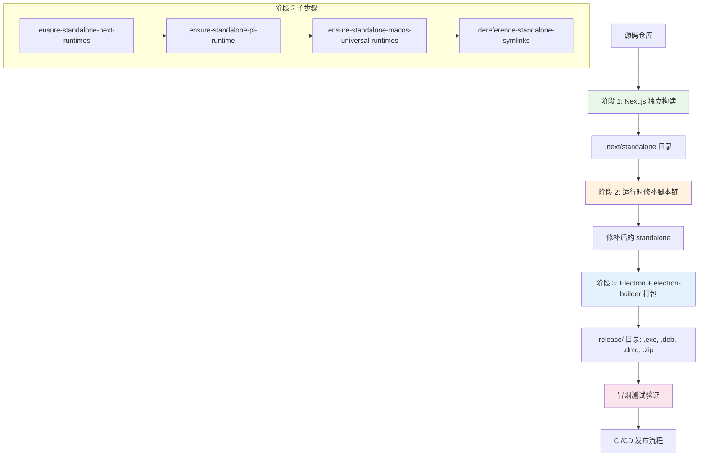
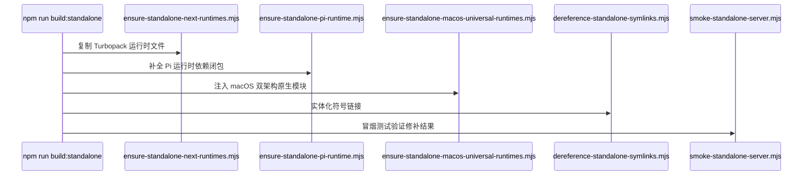
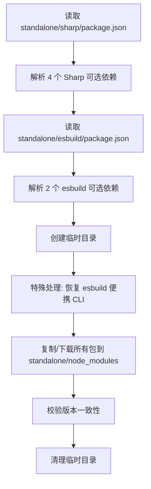
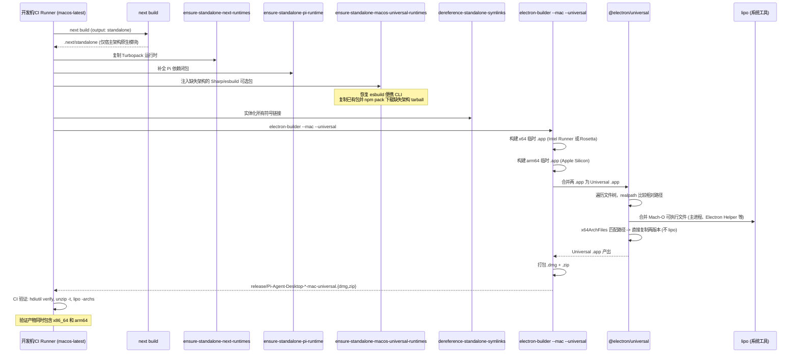
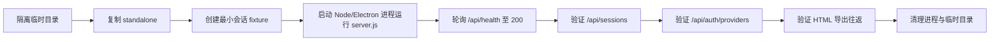

本文档深度解析 Pi Agent Desktop 的打包构建全链路：从 Next.js 独立构建输出，经过一系列运行时修补脚本，到 electron-builder 多平台打包，特别聚焦 macOS Universal（x64 + arm64）双架构合并的核心难点与解决方案。

---

## 架构总览：三阶段构建流水线

构建流程可划分为三个连续阶段，每阶段产出作为下一阶段输入：



**关键设计原则**：Next.js `output: "standalone"` 产出的文件树包含服务端运行所需的最小依赖闭包，但存在四类缺口需在阶段 2 修补：
1. Turbopack 运行时文件缺失
2. Pi 运行时依赖闭包不完整
3. macOS 双架构原生模块缺失
4. 符号链接导致 @electron/universal 合并失败

Sources: [next.config.ts](next.config.ts#L1-L43), [package.json](package.json#L14-L22)

---

## 阶段 1：Next.js 独立构建

### 核心配置

```typescript
// next.config.ts 关键配置
output: "standalone",
serverExternalPackages: ["@earendil-works/pi-coding-agent", "@earendil-works/pi-ai", "@earendil-works/pi-mcp"],
outputFileTracingIncludes: { "/*": ["./node_modules/@earendil-works/pi-ai/**/*"] },
outputFileTracingExcludes: { '*': ['release/**/*', '.git/**/*', '**/*.test.*', ...] },
```

| 配置项 | 作用 | 影响范围 |
|--------|------|----------|
| `output: "standalone"` | 启用 NFT（文件追踪）产出独立运行目录 | 整个构建产出结构 |
| `serverExternalPackages` | 标记为外部包，不打入 bundle，运行时从 node_modules 解析 | Pi 核心包三件套 |
| `outputFileTracingIncludes` | 强制追踪 pi-ai 所有文件（含可选原生依赖） | 保证 Sharp/esbuild 可选依赖被复制 |
| `outputFileTracingExcludes` | 排除测试文件、发布产物等非运行时文件 | 减小打包体积 |

### 产出结构

```
.next/standalone/
├── server.js                    # Next.js 服务器入口
├── .next/
│   └── server/                  # 服务端页面/路由编译产出
├── node_modules/                # NFT 追踪到的最小依赖集
│   ├── next/
│   ├── react/
│   ├── @earendil-works/pi-coding-agent/
│   ├── @earendil-works/pi-ai/
│   ├── sharp/                   # 仅含宿主架构的可选依赖
│   └── esbuild/                 # 仅含宿主架构的可选依赖
└── package.json                 # 标记为 standalone
```

> 注意：Next standalone 产物**不含** `static/` 与 `public/`；打包后的 `standalone/.next/static` 与 `standalone/public` 由 electron-builder `extraResources` 从项目根 `.next/static`、`public/` 复制进包。

Sources: [next.config.ts](next.config.ts#L1-L43), [scripts/ensure-standalone-next-runtimes.mjs](scripts/ensure-standalone-next-runtimes.mjs#L1-L49)

---

## 阶段 2：运行时修补脚本链

四个脚本按严格顺序执行，每个解决特定缺口：



### 2.1 ensure-standalone-next-runtimes.mjs — Turbopack 运行时补全

**问题**：Next.js 16 Turbopack 生产构建常将 `*turbo*.runtime.prod.js` 文件从 NFT 追踪中遗漏，导致打包后 API 路由启动失败：
```
Cannot find module 'next/dist/compiled/next-server/app-route-turbo.runtime.prod.js'
```

**解决**：从 `node_modules/next/dist/compiled/next-server/` 复制所有匹配 `*turbo*.runtime.prod.js` 文件到 standalone 同路径。

```javascript
// 核心逻辑
const names = readdirSync(src).filter(
  (name) => name.includes("turbo") && name.endsWith(".runtime.prod.js")
);
for (const name of names) {
  cpSync(join(src, name), join(dst, name));
}
```

Sources: [scripts/ensure-standalone-next-runtimes.mjs](scripts/ensure-standalone-next-runtimes.mjs#L1-L49)

### 2.2 ensure-standalone-pi-runtime.mjs — Pi 运行时依赖闭包补全

**问题**：NFT 追踪外部包时，可能漏掉其生产依赖的传递闭包（特别是 optionalDependencies 与 peerDependencies）。

**解决**：广度优先遍历 `@earendil-works/pi-coding-agent` 与 `@earendil-works/pi-ai` 的完整依赖图，保持 `node_modules` 目录布局完整复制到 standalone。

```javascript
// 依赖解析队列：required=true 为生产依赖，false 为 optional/peer
const queue = roots.map((name) => ({
  name,
  directory: packageDirectory(name, projectRoot),
  required: true,
}));
// 遍历复制，visited 去重防止循环依赖
```

**关键细节**：
- 使用 `realpathSync` 解析真实路径，避免符号链接干扰
- `relativeDirectory.startsWith("..")` 守卫防止越界访问
- 复制后保持相对 `node_modules` 的相对路径不变

Sources: [scripts/ensure-standalone-pi-runtime.mjs](scripts/ensure-standalone-pi-runtime.mjs#L1-L93)

### 2.3 ensure-standalone-macos-universal-runtimes.mjs — macOS 双架构原生模块注入

**核心难点**：Next.js standalone 仅追踪**宿主架构**的可选原生依赖。Universal 应用需在同一包内同时提供 arm64 与 x64 版本的 `.node` / `.dylib`，运行时由 Node.js 自动选择匹配架构的二进制。

**涉及的原生模块包**（本脚本仅处理 Sharp 与 esbuild 的 darwin 可选包）：
| 包名 | 类型 | 架构变体 |
|------|------|----------|
| `@img/sharp-darwin-arm64` / `x64` | Sharp 图像处理核心 | `.node` |
| `@img/sharp-libvips-darwin-arm64` / `x64` | libvips 运行时库 | `.dylib` |
| `@esbuild/darwin-arm64` / `x64` | esbuild 打包器二进制 | Mach-O 可执行文件 |

`@earendil-works/pi-tui/native/darwin/prebuilds/**` 与 `@mariozechner/clipboard-darwin-{arm64,x64}` 不经本脚本处理：两者由 NFT 追踪自然带入两份中间 .app（见 `electron-builder.yml` 注释），仅靠 `x64ArchFiles` 豁免 lipo 合并。

**算法流程**：



**关键技术点**：

1. **npm pack 而非 npm install**：`npm install` 在 Apple Silicon 上拒绝安装 x64-only 可选包（EBADPLATFORM），`npm pack` 下载 tarball 后本地解压绕过平台检查。

2. **esbuild CLI 恢复**：esbuild 的 `postinstall` 会用宿主架构 Mach-O 替换 JavaScript CLI。Universal 场景下必须恢复上游便携版 JS CLI，让运行时按架构解析对应可选包。

   ```javascript
   // 从上游 tarball 解压便携版 esbuild CLI
   const esbuildArchive = npmPack(`esbuild@${version}`, tempDir, projectRoot);
   extractPackage(esbuildArchive, portableEsbuild);
   cpSync(join(portableEsbuild, "bin", "esbuild"), cliPath);
   ```

3. **版本严格校验**：复制/下载后读取 `package.json` 确认 `name` 与 `version` 完全匹配，防止版本漂移。

4. **失败即停止**：Sharp 可选依赖集合若不等于预期 4 个包，直接抛错——防止上游依赖变更导致静默缺失。

Sources: [scripts/ensure-standalone-macos-universal-runtimes.mjs](scripts/ensure-standalone-macos-universal-runtimes.mjs#L1-L225), [scripts/ensure-standalone-macos-universal-runtimes.test.mjs](scripts/ensure-standalone-macos-universal-runtimes.test.mjs#L1-L53)

### 2.4 dereference-standalone-symlinks.mjs — 符号链接实体化

**问题**：`@electron/universal` 合并 x64 与 arm64 临时 .app 时，会 `realpath()` 每个文件并比较相对路径。若 standalone 内仍含指向构建机 `node_modules` 的符号链接，两架构临时应用深度不同，同一目标文件产生不同相对路径，导致合并中止：
```
uniqueToX64:   ../../../../../../../../Users/runner/.../semver/bin/semver.js
uniqueToArm64: ../../../node_modules/.../semver/bin/semver.js
```

**解决**：递归收集 standalone 树下所有符号链接，**按路径长度降序**处理（先处理深层链接），用 `cpSync(target, link, { dereference: true })` 替换为实体副本。悬空链接直接删除。

```javascript
// 深度优先收集，再按长度倒序替换
const links = collectSymlinks(root).sort((a, b) => b.length - a.length);
for (const link of links) {
  const target = realpathSync(link);
  rmSync(link, { force: true });
  cpSync(target, link, { recursive: true, dereference: true });
}
```

Sources: [scripts/dereference-standalone-symlinks.mjs](scripts/dereference-standalone-symlinks.mjs#L1-L78), [scripts/dereference-standalone-symlinks.test.mjs](scripts/dereference-standalone-symlinks.test.mjs#L1-L37)

---

## 阶段 3：electron-builder 多平台打包

### 3.1 electron-builder.yml 核心配置解析

```yaml
# 关键顶层配置
appId: com.agegr.pi-agent-desktop
directories:
  output: release
  buildResources: build
asar: true                    # 打包主进程/预加载为 asar 压缩包
npmRebuild: true              # 重新编译原生模块匹配 Electron 版本
```

### 3.2 文件收集策略

```yaml
files:
  - package.json
  - build/icon.ico
  - build/icon.icns
  - electron/dist/**/*
  - "!electron/**/*.ts"
  - "!electron/tsconfig.json"
```

| 模式 | 说明 |
|------|------|
| `electron/dist/**/*` | 编译后的 Electron 主进程/预加载代码 |
| 排除 `*.ts` | TypeScript 源码不打包，仅保留编译产出 |

### 3.3 extraResources — 核心运行时资源注入

```yaml
extraResources:
  - from: .next/standalone
    to: standalone
    filter:
      - "**/*"
      - "!node_modules"          # 单独处理
      - "!release"
      - "!.git"
      - "!**/*.test.ts"
      - "!**/*.test.tsx"
      - "!**/*.test.mjs"
      - "!**/*.test.js"
  - from: .next/standalone/node_modules
    to: standalone/node_modules
  - from: .next/static
    to: standalone/.next/static
  - from: public
    to: standalone/public
  # electron-updater 运行时依赖（asar 外部加载）
  - from: node_modules/electron-updater
    to: app/node_modules/electron-updater
  - from: node_modules/builder-util-runtime
    to: app/node_modules/builder-util-runtime
  # ... 共 16 个运行时依赖包
```

**设计理由**：`asar: true` 将主进程代码打包进 `app.asar`，但 `electron-updater` 在运行时需 `require()` 其依赖包，asar 内无法被 Node.js 原生 `require` 解析，故必须作为 `extraResources` 置于 asar 外部的 `app/node_modules/` 下。

**同步校验**：`lib/electron-updater-runtime-deps.mjs` 维护规范清单，CI 测试验证 `electron-builder.yml` 与 `node_modules` 双向一致。

Sources: [electron-builder.yml](electron-builder.yml#L1-L133), [lib/electron-updater-runtime-deps.mjs](lib/electron-updater-runtime-deps.mjs#L1-L98), [lib/electron-builder-config.test.mjs](lib/electron-builder-config.test.mjs#L1-L92)

### 3.4 平台特化配置

#### Windows (NSIS)
```yaml
win:
  target:
    - target: nsis
      arch: [x64]
  icon: build/icon.ico
nsis:
  oneClick: false
  allowToChangeInstallationDirectory: true
  artifactName: "Pi-Agent-Desktop-Setup-${version}.${ext}"
  include: build/installer.nsh
```

#### Linux (deb)
```yaml
linux:
  target:
    - target: deb
      arch: [x64]
  executableName: pi-agent-desktop
  category: Development
  artifactName: "Pi-Agent-Desktop-${version}-linux-${arch}.${ext}"
```

#### macOS Universal — 核心复杂度所在
```yaml
mac:
  target:
    - target: dmg
      arch: [universal]
    - target: zip
      arch: [universal]
  icon: build/icon.icns
  category: public.app-category.developer-tools
  darkModeSupport: true
  # 关键：指定跳过 lipo 合并的架构特异性文件路径
  x64ArchFiles: "Contents/Resources/standalone{,/.next}/**/{@earendil-works/pi-tui/native/darwin/prebuilds/**,@mariozechner/clipboard-darwin-{arm64,x64}/**,@img/sharp-darwin-{arm64,x64}/**,@img/sharp-libvips-darwin-{arm64,x64}/**,@esbuild/darwin-{arm64,x64}/**}"
  artifactName: "Pi-Agent-Desktop-${version}-mac-${arch}.${ext}"
```

### 3.5 x64ArchFiles 机制深度解析

**背景**：`@electron/universal` 通过 `lipo` 合并两架构的 Mach-O 可执行文件生成 Universal Binary。但**原生模块（`.node`/`.dylib`）不能 lipo 合并**——arm64 与 x64 机器码不兼容。必须将两架构版本**并存**在包内，运行时由加载器按进程架构选择。

**x64ArchFiles 作用**：告诉 electron-builder“这些路径下的文件在 x64 构建中存在、arm64 构建中也存在，但内容不同，**不要尝试 lipo 合并**，直接分别保留到对应架构目录”。

**Glob 模式详解**：

```
Contents/Resources/standalone{,/.next}/**
  └── 两个根目录：standalone/ 与 standalone/.next/
      ├── @earendil-works/pi-tui/native/darwin/prebuilds/**     # pi-tui 原生模块
      ├── @mariozechner/clipboard-darwin-{arm64,x64}/**         # 剪贴板模块
      ├── @img/sharp-darwin-{arm64,x64}/**                      # Sharp 核心
      ├── @img/sharp-libvips-darwin-{arm64,x64}/**              # libvips
      └── @esbuild/darwin-{arm64,x64}/**                        # esbuild 二进制
```

**验证测试**：`lib/electron-builder-config.test.mjs` 使用 `minimatch` 逐项校验关键路径匹配，同时确认 Electron 主可执行文件 **不** 匹配（必须 lipo 合并）。

```javascript
// 测试用例片段
assert.ok(minimatch("Contents/Resources/standalone/node_modules/@esbuild/darwin-arm64/bin/esbuild", pattern));
assert.equal(minimatch("Contents/MacOS/Pi Agent Desktop", pattern), false);
```

Sources: [electron-builder.yml](electron-builder.yml#L90-L115), [lib/electron-builder-config.test.mjs](lib/electron-builder-config.test.mjs#L70-L92)

---

## macOS Universal 构建的完整时序图



---

## CI/CD 发布流水线

### 矩阵构建策略

```yaml
# .github/workflows/desktop-packages.yml
strategy:
  fail-fast: false
  matrix:
    include:
      - pack_id: windows
        runner: windows-latest
        dist_script: dist
      - pack_id: linux
        runner: ubuntu-latest
        dist_script: dist
      - pack_id: macos
        runner: macos-latest
        dist_script: dist:mac
```

| 平台 | Runner | 构建脚本 | 产物 |
|------|--------|----------|------|
| Windows | `windows-latest` | `npm run dist` | `.exe` (NSIS), `.blockmap`, `latest.yml` |
| Linux | `ubuntu-latest` | `npm run dist` | `.deb`, `latest-linux.yml` |
| macOS | `macos-latest` | `npm run dist:mac` | `.dmg`, `.zip`, `.blockmap`, `latest-mac.yml` |

**关键点**：
- `fail-fast: false` — 单平台失败不阻塞其他平台
- `CSC_IDENTITY_AUTO_DISCOVERY: "false"` — 禁用代码签名自动发现（未配置证书时避免报错）
- Linux 预装 `fakeroot dpkg` 用于 `.deb` 打包

### macOS 产物验证步骤

```bash
# CI 中自动执行
hdiutil verify release/*.dmg           # 校验 DMG 完整性
unzip -t release/*-mac-universal.zip   # 校验 ZIP 完整性
archs="$(lipo -archs "release/mac-universal/Pi Agent Desktop.app/Contents/MacOS/Pi Agent Desktop")"
echo "${archs}" | grep -q "x86_64"     # 必须包含 x64
echo "${archs}" | grep -q "arm64"      # 必须包含 arm64
```

### 发布流程

1. **标签触发**：推送 `v*` 标签触发工作流
2. **版本一致性检查**：标签名必须等于 `package.json` 版本
3. **三平台并行构建** → 上传制品到 Actions Artifacts
4. **发布作业**（需 `contents: write` 权限）：
   - 下载所有平台制品合并到 `dist-artifacts/`
   - 校验资产数量恰好 10 个（Win 3 + Linux 2 + Mac 5）
   - 创建/更新 GitHub Release，上传资产

Sources: [.github/workflows/desktop-packages.yml](.github/workflows/desktop-packages.yml#L1-L170), [lib/desktop-packages-workflow.test.mjs](lib/desktop-packages-workflow.test.mjs#L1-L37)

---

## 冒烟测试：端到端验证

两层冒烟测试分别验证**开发期 standalone** 与 **打包后产物**：

### 1. smoke-standalone-server.mjs — 独立服务器启动验证



**验证覆盖**：
- 服务器冷启动 < 30s
- 健康检查、会话列表、认证提供者 API 正常
- 会话 HTML 导出数据完整性（Base64 编码 JSON 往返）

Sources: [scripts/smoke-standalone-server.mjs](scripts/smoke-standalone-server.mjs#L1-L202)

### 2. smoke-packaged-standalone.mjs — 打包产物验证

自动定位 `release/` 下各平台解包目录，提取 `standalone` 与可执行文件路径，复用 `smoke-standalone-server.mjs` 逻辑，但改用 **Electron 运行时**（`ELECTRON_RUN_AS_NODE=1`）启动服务器，验证真实打包环境下的行为一致性。

```javascript
// 平台差异路径解析
if (process.platform === "darwin") {
  // 遍历 release/mac*/*.app/Contents/Resources/standalone
  // 可执行文件: Contents/MacOS/<AppName>
}
```

Sources: [scripts/smoke-packaged-standalone.mjs](scripts/smoke-packaged-standalone.mjs#L1-L82)

---

## 常见陷阱与调试指南

| 症状 | 可能原因 | 排查方向 |
|------|----------|----------|
| `Cannot find module '...turbo.runtime.prod.js'` | Turbopack 运行时未复制 | 检查 `ensure-standalone-next-runtimes` 是否执行、输出日志 |
| `Error: The module '.../sharp.node' was compiled against a different Node.js version` | 原生模块版本不匹配 Electron | 确认 `npmRebuild: true`、Node 版本一致、未混用架构 |
| `@electron/universal` 合并失败：`uniqueToX64/uniqueToArm64` 路径不匹配 | 符号链接未实体化 | 确认 `dereference-standalone-symlinks` 在 `electron-builder` 前运行 |
| Universal .app 仅含单架构 | `x64ArchFiles` 模式不匹配或未指定 `--universal` | 检查 `electron-builder.yml` `x64ArchFiles`、构建命令含 `--universal` |
| `EBADPLATFORM` 安装 x64 可选包失败 | 直接 `npm install` 而非 `npm pack` | 仅在 `ensure-standalone-macos-universal-runtimes` 中使用 `npm pack` |
| 冒烟测试超时 | 端口冲突、防火墙、进程未就绪 | 检查 `getFreePort`、健康检查轮询间隔、stderr 输出 |

---

## 本地开发构建命令速查

| 命令 | 用途 | 产出 |
|------|------|------|
| `npm run build:standalone` | 仅执行 Next.js 构建 + 全修补链 | `.next/standalone/` 就绪 |
| `npm run build:electron` | 编译 Electron TypeScript + 复制静态资源 | `electron/dist/` |
| `npm run pack` | 全量构建 + `--dir` 解包目录（不生成安装包） | `release/win-unpacked/` 等 |
| `npm run pack:mac` | macOS Universal 解包目录 | `release/mac-universal/` |
| `npm run dist` | 构建当前宿主 OS 的安装包（不发布；无平台 flag，CI 中仅 Windows/Linux runner 使用，macOS 单独走 `dist:mac`） | Windows: `release/*.exe`；Linux: `release/*.deb` |
| `npm run dist:mac` | 仅 macOS Universal 安装包 | `release/*-mac-universal.*` |

---

## 相关文档导航

| 文档 | 内容关联 |
|------|----------|
| [Electron 主进程启动链与双门槛就绪检查](10-electron-zhu-jin-cheng-qi-dong-lian-yu-shuang-men-jian-jiu-xu-jian-cha) | Electron 主进程如何加载 standalone 服务器 |
| [Preload、CSP、自动更新与系统托盘](12-preload-csp-zi-dong-geng-xin-yu-xi-tong-tuo-pan) | `electron-updater` 运行时依赖的打包必要性 |
| [CI/CD 流水线与三平台桌面包发布](28-ci-cd-liu-shui-xian-yu-san-ping-tai-zhuo-mian-bao-fa-bu) | 完整发布自动化流程 |
| [关键设计决策与已知陷阱速查](29-guan-jian-she-ji-jue-ce-yu-yi-zhi-xian-jing-su-cha) | 架构决策记录与避坑指南 |

---

## 总结：macOS Universal 的核心洞见

1. **问题本质**：Node.js 原生加载器按进程架构解析可选依赖，Universal 应用需**同包并存**两套原生二进制。
2. **工具链限制**：`@electron/universal` 默认对所有文件尝试 `lipo`，需通过 `x64ArchFiles` 显式豁免架构特异性资源。
3. **构建时 vs 运行时**：构建时（Next.js NFT）仅见宿主架构，**必须在打包前注入**缺失架构的原生模块。
4. **符号链接是隐形杀手**：跨架构合并对路径身份极其敏感，彻底实体化是前置条件。
5. **测试即文档**：`minimatch` 单元测试锁定 `x64ArchFiles` 模式覆盖范围，CI 冒烟测试验证端到端可运行性。

这一套机制保证了 Pi Agent Desktop 在 macOS 上**单一安装包原生运行于 Apple Silicon 与 Intel 两代处理器**，无需 Rosetta 2 转译，获得最佳性能与兼容性。