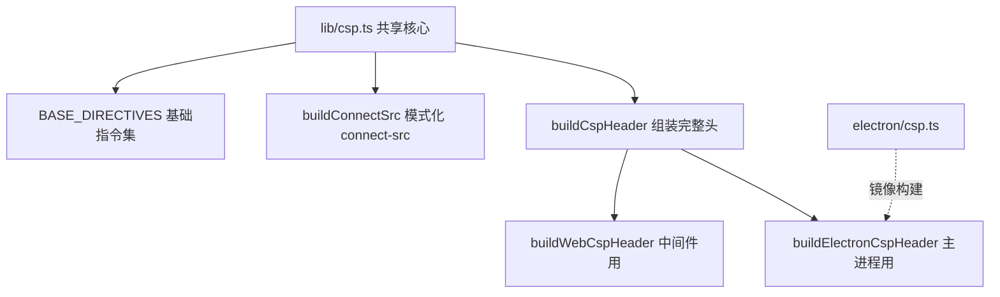
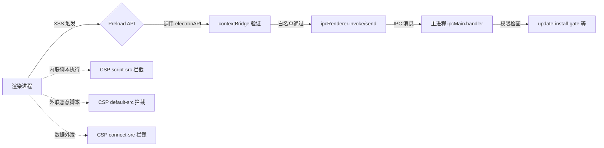
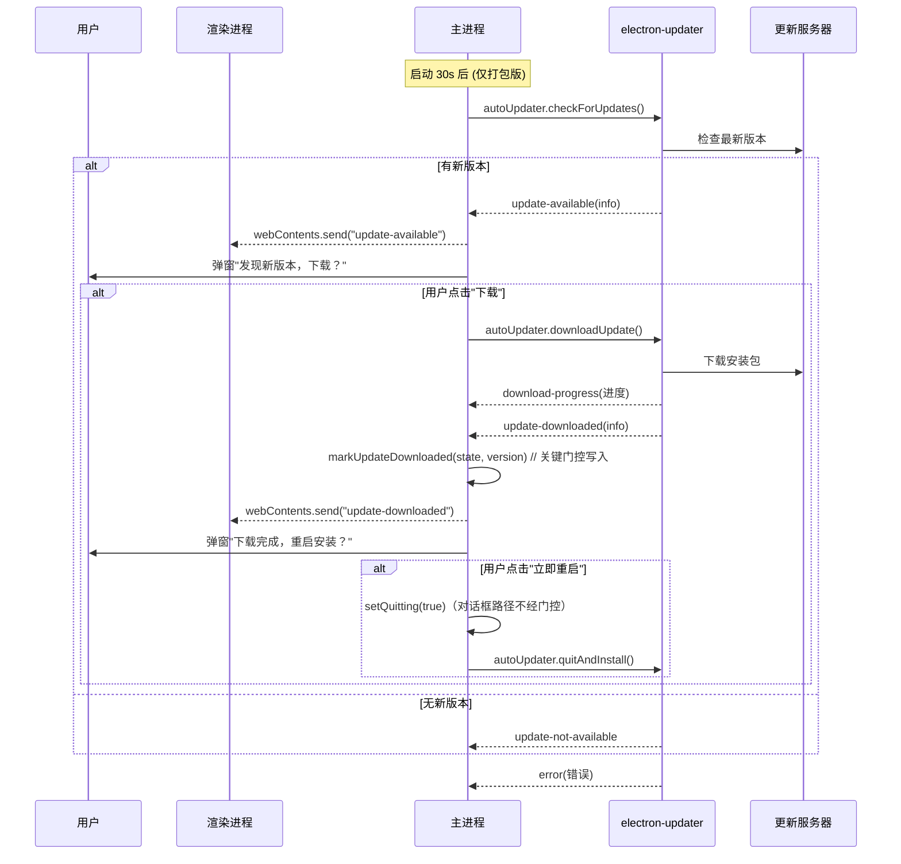
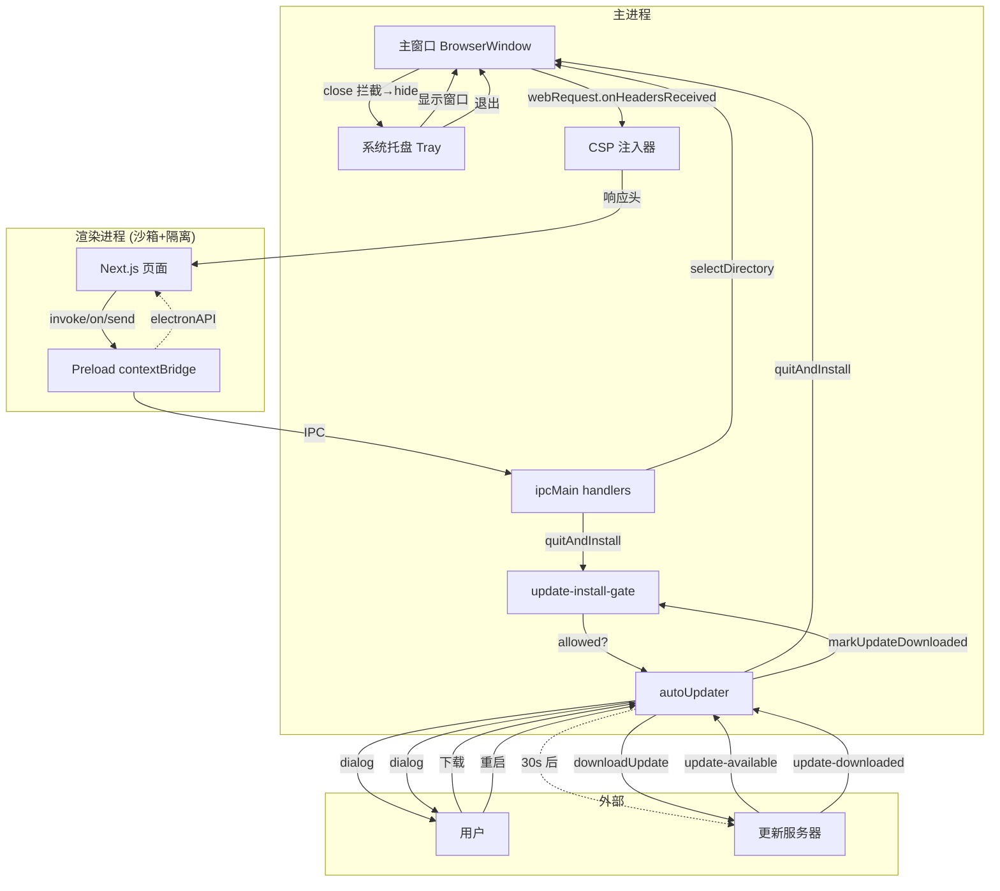

本文档详细阐述 Electron 桌面端的四大核心基础设施：Preload 脚本的安全边界设计、内容安全策略（CSP）的双环境构建与注入、自动更新的分阶段门控机制，以及系统托盘的常驻与交互模型。这四个模块共同构成了桌面应用的安全基线、运行时防护、发布分发管道与用户感知入口。

---

## Preload 脚本：受控的主渲染桥接层

### 设计原则：最小权限暴露与上下文隔离

Preload 脚本运行在渲染进程的**隔离上下文**中，拥有 Node.js 与 Electron API 的访问权限，但通过 `contextBridge` 仅向页面暴露经过严格审计的最小 API 表面。主进程在创建 `BrowserWindow` 时配置：

```typescript
webPreferences: {
  preload: path.join(__dirname, "preload.js"),
  nodeIntegration: false,      // 禁用渲染进程直接 require
  contextIsolation: true,      // 启用上下文隔离（Electron 12+ 默认开启）
  sandbox: true,               // 启用沙箱，进一步缩小攻击面
}
```

`contextIsolation: true` 使 preload 与页面脚本拥有独立的 JavaScript 全局对象，页面无法直接访问 preload 中定义的变量或函数，必须通过 `contextBridge.exposeInMainWorld` 显式桥接。`sandbox: true` 则在操作系统层面限制渲染进程权限（如禁止文件系统直读、子进程生成等），preload 所用的 `ipcRenderer`、`webUtils` 均在沙箱白名单内，功能不受影响。

> **架构定位**：Preload 是**唯一**的主渲染通信入口。主进程通过 `ipcMain.handle/on` 注册处理器，渲染进程仅能调用 preload 暴露的 `electronAPI` 命名空间下的函数，形成“能力清单”式的安全模型。

Sources: [electron/main.ts](electron/main.ts#L240-L260), [electron/preload.ts](electron/preload.ts#L1-L37)

### 暴露 API 清单与语义分类

| API | 类型 | 方向 | 用途 | 安全考量 |
|-----|------|------|------|----------|
| `selectDirectory()` | `invoke` | 渲染→主 | 打开原生目录选择器，返回目录绝对路径 | 仅返回用户主动选择的路径，无任意读取能力 |
| `getPathForFile(File)` | 同步 | 渲染→主 | 将拖拽的 `File` 对象解析为绝对路径 | 依赖 `webUtils`，仅限用户主动拖拽的文件 |
| `onUpdateAvailable(callback)` | `on` 事件订阅 | 主→渲染 | 监听更新可用事件，回传版本号 | 返回取消订阅函数，防止内存泄漏 |
| `onUpdateDownloaded(callback)` | `on` 事件订阅 | 主→渲染 | 监听更新下载完成事件 | 同上 |
| `quitAndInstall()` | `invoke` | 渲染→主 | 请求重启安装更新 | **受更新门控保护**，未下载完成时拒绝 |
| `setTheme(isDark)` | `send` 单向 | 渲染→主 | 同步标题栏叠加层主题色 | 仅影响视觉，无副作用 |

**关键实现细节**：

- 事件类 API（`onUpdateAvailable`、`onUpdateDownloaded`）返回**取消订阅函数**，调用方需在组件卸载时调用，避免重复注册导致的回调风暴
- `quitAndInstall` 并非直接调用 `autoUpdater.quitAndInstall()`，而是经由 `update-install-gate` 纯函数决策，**只有在 `updateDownloaded === true` 时才放行**，防止 XSS 或恶意页面触发未授权重启

Sources: [electron/preload.ts](electron/preload.ts#L1-L37), [electron/update-install-gate.ts](electron/update-install-gate.ts#L1-L35)

### 平台标识注入

```typescript
preloadPage.addEventListener?.("DOMContentLoaded", () => {
  const dataset = preloadPage.document?.documentElement?.dataset;
  if (dataset) {
    dataset.electronPlatform = process.platform;
  }
});
```

在 `DOMContentLoaded` 阶段将 `process.platform`（`win32`/`darwin`/`linux`）写入 `document.documentElement.dataset.electronPlatform`，供前端 CSS/JS 做平台差异化适配（如 macOS 窗口控制按钮位置、快捷键提示符差异）。

Sources: [electron/preload.ts](electron/preload.ts#L8-L16)

---

## 内容安全策略（CSP）：双环境统一策略构建

### 威胁模型与防御目标

Electron 应用加载本地 Next.js 服务（`http://127.0.0.1:<port>`），若渲染进程存在 XSS（如恶意 npm 供应链、路由参数注入），攻击者可执行任意 JS 并调用 preload 暴露的 `electronAPI`（目录读取、退出安装更新等）。**CSP 是第二道防线**：在 preload 隔离之上，限制脚本来源、连接目标、内联执行等。

### 共享策略构建器：`lib/csp.ts` 与 `electron/csp.ts`

为保证 Web 端（中间件注入）与 Electron 端（主进程注入）策略一致，项目采用**共享构建器 + 环境参数化**模式：



**基础指令集（`BASE_DIRECTIVES`）**：
| 指令 | 值 | 说明 |
|------|-----|------|
| `default-src` | `'self'` | 仅允许同源资源 |
| `script-src` | `'self' 'unsafe-inline' 'unsafe-eval'` | Next.js 需要内联脚本与 eval（开发模块热替换、生产 chunk 加载） |
| `style-src` | `'self' 'unsafe-inline'` | Tailwind/情报 CSS-in-JS 需要内联样式 |
| `img-src` | `'self' data: blob:` | 允许 Data URI 与 Blob 图片（头像、预览） |
| `font-src` | `'self' data:` | 字体 Data URI |
| `frame-src` | `'self'` | 仅同源 iframe |
| `media-src` | `'self' data:` | 音视频 Data URI |

**`connect-src` 差异化**：

| 环境 | 策略 | 理由 |
|------|------|------|
| Web（开发/预览） | `connect-src 'self' http://127.0.0.1:* ws://127.0.0.1:*` | 端口不固定，需通配符覆盖所有回环地址 |
| Electron（生产） | `connect-src 'self' http://127.0.0.1:<port> ws://127.0.0.1:<port>` | 端口由主进程动态选定并锁定，**精确钉死**，缩小攻击面 |

`electron/csp.ts` 仅镜像 `lib/csp.ts` 的 `buildElectronCspHeader` 实现（因 Electron 编译根目录限制无法直接引用 `../lib`）。Electron 头钉死 `connect-src 'self' http://127.0.0.1:<port> ws://127.0.0.1:<port>`，`script-src 'self' 'unsafe-inline' 'unsafe-eval'`。`lib/csp.test.ts` 只测试 lib 版 `csp.ts`，未覆盖 `electron/csp.ts`；electron 侧 `main-update-gate.test.ts` 断言 main.ts import 并调用 `buildElectronCspHeader`，并额外断言打包就绪 `requireHttpHealth: app.isPackaged`、macOS 打包走 `utilityProcess.fork`（darwin 分支不含 `ELECTRON_RUN_AS_NODE`）。

Sources: [lib/csp.ts](lib/csp.ts#L1-L63), [electron/csp.ts](electron/csp.ts#L1-L22), [lib/csp.test.ts](lib/csp.test.ts#L1-L43)

### 主进程动态注入机制

在 `createWindow()` 中，通过 `session.webRequest.onHeadersReceived` 拦截**所有**响应头并注入 CSP：

```typescript
mainWindow.webContents.session.webRequest.onHeadersReceived((details, callback) => {
  const port = activePort ?? 0;
  const csp = buildElectronCspHeader(port);
  callback({
    responseHeaders: {
      ...details.responseHeaders,
      "Content-Security-Policy": [csp],
    },
  });
});
```

关键点：
- **每次回调重读 `activePort`**：服务器重启换端口时自动生效，无需重建窗口
- **覆盖而非追加**：`[csp]` 数组替换原有 CSP，防止 Next.js 或中间件残留策略冲突
- **startup.html 例外**：启动页通过 `<meta http-equiv="Content-Security-Policy">` 自带更严格策略（`default-src 'none'`），不受主进程注入影响（main.ts 注释：startup.html "ships its own stricter CSP via a meta tag and is unaffected"）

Sources: [electron/main.ts](electron/main.ts#L280-L298), [electron/startup.html](electron/startup.html#L1-L10)

### CSP 与 Preload 协同的纵深防御



- **Preload** 限制“能调用什么能力”
- **CSP** 限制“能加载/执行什么代码、能连向哪里”
- 两者**独立部署、互不依赖**，单点失效不导致全盘崩塌

---

## 自动更新：分阶段门控与用户知情同意

### 整体流程图



### 核心设计决策

| 决策点 | 选择 | 理由 |
|--------|------|------|
| `autoDownload = false` | **手动确认下载** | 避免流量敏感环境静默下载大文件；阻断“XSS 触发下载+安装”攻击链 |
| 30s 延迟检查 | `setTimeout(..., 30_000)` | 不阻塞启动关键路径；首屏加载完成后再检查 |
| 双弹窗确认 | “下载？”→“重启安装？” | 符合用户知情同意原则；每步均可取消 |
| 门控 `quitAndInstall` | `update-install-gate` 纯函数 | **仅在 `updateDownloaded === true` 时放行**；渲染进程无法伪造绕过 |

### 更新安装门控：`electron/update-install-gate.ts`

纯函数设计，零副作用，便于单元测试与形式化验证：

```typescript
// 状态机：初始 → (markUpdateDownloaded) → 下载完成
type UpdateInstallState = {
  updateDownloaded: boolean;
  downloadedVersion: string | null;
};

// 决策函数：仅当 updateDownloaded===true 返回 allowed=true
function decideQuitAndInstall(state): QuitAndInstallDecision {
  if (!state.updateDownloaded) {
    return { allowed: false, reason: "No update has been downloaded" };
  }
  return { allowed: true, version: state.downloadedVersion };
}
```

**主进程 IPC 处理器** 强制调用门控：

```typescript
ipcMain.handle("quit-and-install", async () => {
  const decision = decideQuitAndInstall(updateInstallState);
  if (!decision.allowed) {
    return { ok: false, error: decision.reason };
  }
  setQuitting(true);
  const { autoUpdater } = await import("electron-updater");
  autoUpdater.quitAndInstall();  // 仅在允许分支执行
  return { ok: true, version: decision.version };
});
```

**结构性测试保障** (`electron/main-update-gate.test.ts`) 以源码静态分析验证：
1. `quit-and-install` 处理器内**必须**调用 `decideQuitAndInstall`
2. 拒绝分支（`!decision.allowed`）**必须**在门控之后、安装调用之前
3. `autoUpdater.quitAndInstall()` **仅出现两处**：拒绝分支后的 IPC 处理器、且 `update-downloaded` 事件处理器内（且前者已 `markUpdateDownloaded`）

Sources: [electron/update-install-gate.ts](electron/update-install-gate.ts#L1-L35), [electron/main.ts](electron/main.ts#L510-L530), [electron/main-update-gate.test.ts](electron/main-update-gate.test.ts#L1-L89)

### 事件完整生命周期与渲染进程对接

| 事件 | 触发时机 | 主进程动作 | 渲染进程通知 |
|------|----------|------------|--------------|
| `checking-for-update` | 开始检查 | 记录日志 | 无 |
| `update-available` | 发现新版 | 弹下载确认框，用户同意则 `downloadUpdate()` | `update-available` (含 version) |
| `download-progress` | 下载中 | 记录进度日志 | 无（可扩展进度条） |
| `update-downloaded` | 下载完成 | `markUpdateDownloaded` 写入门控状态，弹重启确认框 | `update-downloaded` 事件（主进程 send `{version}`，但 preload `onUpdateDownloaded` 回调不带参数，渲染层拿不到 version） |
| `update-not-available` | 已是最新 | 记录日志 | 无 |
| `error` | 任意错误 | 记录错误日志 | 无 |

渲染进程通过 preload 暴露的 `onUpdateAvailable`/`onUpdateDownloaded` 订阅事件，驱动应用内横幅/Toast 提示，形成**系统原生对话框 + 应用内提示**双重保障。

Sources: [electron/main.ts](electron/main.ts#L610-L720), [electron/preload.ts](electron/preload.ts#L20-L30)

### 窗口销毁后的鲁棒性

用户可能将窗口关闭至托盘，此时 `mainWindow` 为 `null` 或 `isDestroyed()`。更新事件处理器均采用**父窗口降级**策略：

```typescript
const parent = mainWindow && !mainWindow.isDestroyed() ? mainWindow : undefined;
const dialogPromise = parent
  ? dialog.showMessageBox(parent, options)
  : dialog.showMessageBox(options);  // 无父窗口模态框
```

确保即使用户隐藏主窗口，更新下载完成的重启提示仍能弹出，避免“更新静默丢失”。

Sources: [electron/main.ts](electron/main.ts#L650-L660), [electron/main.ts](electron/main.ts#L690-L700)

---

## 系统托盘：常驻入口与优雅退出

### 创建与图标加载策略

```mermaid
flowchart TD
    A[createTray(mainWindow)] --> B[getAppIconPath(appPath)]
    B --> C{platform === darwin?}
    C -->|是| D[icon.icns]
    C -->|否| E[icon.ico]
    D --> F[nativeImage.createFromPath]
    E --> F
    F --> G{icon.isEmpty()?}
    G -->|是| H[Base64 透明 PNG 兜底]
    G -->|否| I[使用加载图标]
    H --> I
    I --> J[new Tray(icon)]
    J --> K[setToolTip / setContextMenu / on double-click]
```

- **平台差异**：macOS 用 `.icns`，Windows/Linux 用 `.ico`，均放置于 `build/` 目录（打包时随资源复制）
- **兜底机制**：图标加载失败或为空时，使用内嵌的 16×16 透明 PNG（Base64 硬编码），保证托盘**始终可见**，不因资源缺失导致无法交互

Sources: [electron/tray.ts](electron/tray.ts#L1-L54), [electron/app-icon.ts](electron/app-icon.ts#L1-L7)

### 上下文菜单与交互语义

| 菜单项 | 动作 | 实现 |
|--------|------|------|
| 显示窗口 | `mainWindow.show()` + `focus()` | 恢复隐藏窗口并聚焦 |
| 分隔符 | — | 视觉分组 |
| 退出 | `setQuitting(true)` → `app.quit()` | 设置退出标志，触发正常关闭流程 |

**双击托盘图标** 等同于“显示窗口”，符合桌面应用通用交互习惯。

Sources: [electron/tray.ts](electron/tray.ts#L25-L54)

### 窗口关闭拦截与托盘常驻模型

主窗口 `close` 事件默认**拦截并隐藏**，而非退出应用：

```typescript
mainWindow.on("close", (e) => {
  if (!isQuitting) {
    e.preventDefault();  // 阻止默认关闭
    mainWindow?.hide();  // 最小化到托盘
  }
});
```

- `isQuitting` 由“托盘菜单→退出”或“更新重启”设置为 `true`
- 仅当 `isQuitting === true` 时允许真正关闭窗口并退出进程
- `app.on("window-all-closed", () => { /* 什么都不做 */ })` 禁用 macOS/Windows 默认的“全窗口关闭即退出”行为

**激活恢复**：`app.on("activate")`（macOS 点击 Dock 图标）与托盘“显示窗口”复用同一显示逻辑。

Sources: [electron/main.ts](electron/main.ts#L300-L310), [electron/main.ts](electron/main.ts#L560-L570), [electron/tray.ts](electron/tray.ts#L38-L42)

### 托盘与自动更新的协同

- 更新检查/下载/安装**完全在后台进行**，不依赖主窗口可见性
- `update-downloaded` 弹窗使用**父窗口降级**，窗口隐藏时仍能弹出系统模态框
- 用户点击“立即重启”触发 `setQuitting(true)` → `autoUpdater.quitAndInstall()`，此时 `close` 事件不再拦截，应用正常退出并由更新器接管重启

Sources: [electron/main.ts](electron/main.ts#L690-L720), [electron/main.ts](electron/main.ts#L300-L310)

---

## 四模块协同架构总览



### 关键不变量总结

| 不变量 | 保障机制 | 验证方式 |
|--------|----------|----------|
| 渲染进程无 Node/API 直达 | `contextIsolation + sandbox + nodeIntegration:false` | 代码审查（`main.test.ts` 仅覆盖 `pickApiKeys`，无 webPreferences 断言） |
| Preload 仅暴露白名单 API | `contextBridge.exposeInMainWorld` 显式列表 | 代码审查 + 静态分析 |
| CSP 覆盖所有 HTTP 响应 | `webRequest.onHeadersReceived` 全拦截 | 结构性测试 `main-update-gate.test.ts`（断言 import 并调用 `buildElectronCspHeader`） |
| Electron/ Web CSP 一致 | 共享 `lib/csp.ts`，`electron/csp.ts` 镜像其实现 | `lib/csp.test.ts` 仅测 lib 版 `csp.ts` |
| quitAndInstall 仅下载后放行 | `update-install-gate` 纯函数门控 | 结构性测试 `main-update-gate.test.ts` |
| 托盘图标永不缺失 | Base64 透明 PNG 兜底 | 无测试（`app-icon.test.ts` 仅测 `getAppIconPath` 的 icns/ico 路径选择） |
| 窗口关闭不退出(除非 quitting) | `close` 事件 `preventDefault + hide` | 手验 + 行为测试 |

---

## 相关文档导航

| 文档 | 关联点 |
|------|--------|
| [Electron 主进程启动链与双门槛就绪检查](10-electron-zhu-jin-cheng-qi-dong-lian-yu-shuang-men-jian-jiu-xu-jian-cha) | 主进程启动流程中 `createWindow`、`createTray`、CSP 注入、自动更新检查的串联时序 |
| [打包构建流程与 macOS Universal 双架构处理](11-da-bao-gou-jian-liu-cheng-yu-macos-universal-shuang-jia-gou-chu-li) | `build/` 图标资源打包、`electron-updater` 签名与公证对自动更新的前置要求 |
| [四层分离架构详解](6-si-ceng-fen-chi-jia-gou-xiang-jie) | Preload/IPC 作为“桌面原生能力层”与“Web 应用层”的边界契约 |
| [测试策略：Node.js 原生测试、平台子集与冒烟测试](27-ce-shi-ce-lue-node-js-yuan-sheng-ce-shi-ping-tai-zi-ji-yu-mou-yan-ce-shi) | `main-update-gate.test.ts`、`csp.test.ts` 等结构性测试的设计理念 |

---

## 常见问题排查速查

| 现象 | 可能原因 | 排查方向 |
|------|----------|----------|
| 托盘图标显示为空/默认图标 | `build/icon.ico` 或 `icon.icns` 未打包进资源 | 检查 `electron-builder.yml` `files`/`extraResources`、本地 `build/` 目录是否存在 |
| CSP 报错 `Refused to connect to ws://127.0.0.1:xxxx` | `activePort` 为 0 或未同步更新 | 确认 `showApp` 成功前 `activePort` 已赋值、重启流程中端口变更后 CSP 回调重读 |
| 点击“立即重启”无反应 | `decideQuitAndInstall` 返回 `allowed: false` | 检查 `update-downloaded` 事件是否触发 `markUpdateDownloaded`、主窗口是否销毁导致 dialog 无父窗口报错 |
| 开发模式下 `connect-src` 违规 | 中间件注入的 Web CSP 与 Electron CSP 不一致 | 对比 `lib/csp.ts` 与 `middleware.ts` 中 CSP 构建逻辑、确认 `buildWebCspHeader` 使用 |
| Preload API 在页面上 `undefined` | `contextIsolation: false` 或 preload 路径错误 | 检查 `BrowserWindow` `webPreferences`、控制台 `window.electronAPI` 是否存在 |

---

*本文档基于代码考古与静态分析生成，所有代码引用均指向仓库真实路径与行号。如实现发生变更，请同步更新对应章节。*