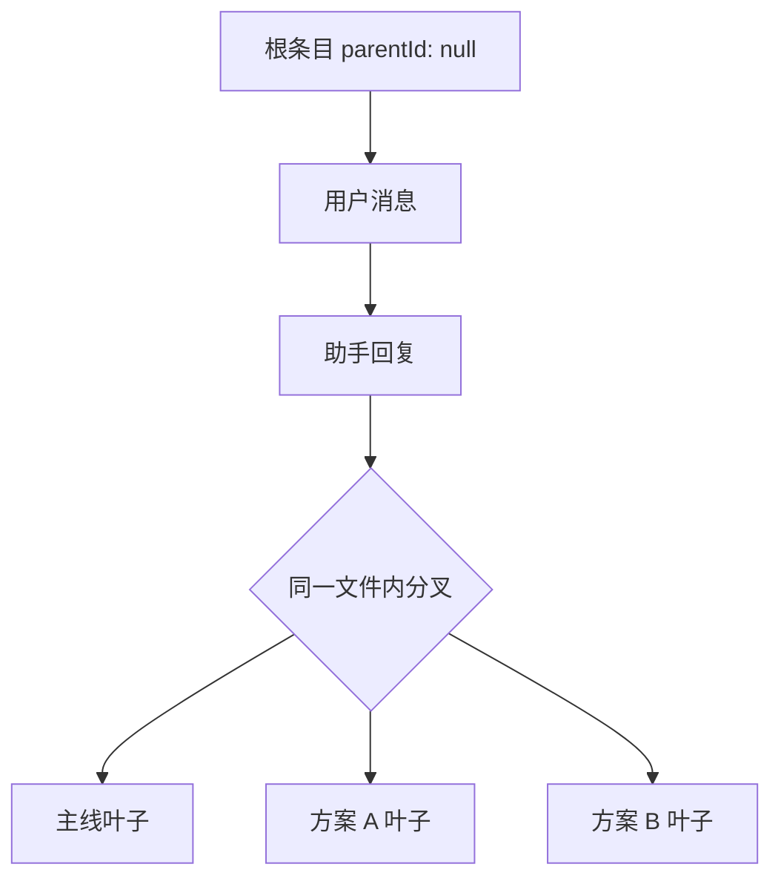
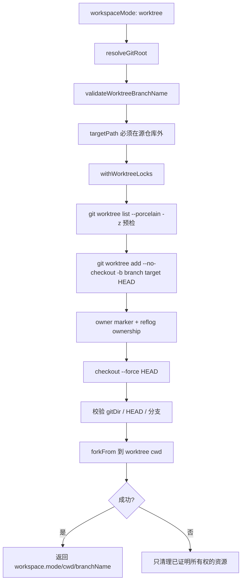

Pi Agent Desktop 有三套**不要混用同一套词**的机制，外加一条与 Fork 同类、但入口不同的跨文件 Branch API。混用后果是改错文件、清错 worktree，或把同文件切叶子当成“新建会话”。

| 机制 | 一句话 | 文件 | 主要 API |
|------|--------|------|----------|
| **Fork** | 消息 Fork 按钮：从某条消息另起炉灶，侧边栏出现子节点 | **新** `.jsonl` | `POST /api/agent/[id]` body `{ type: "fork", entryId }`。**没有** `POST /api/sessions/fork` |
| **会话内分支** | Continue / `BranchNavigator`：同一对话树里换叶子 | **同一** `.jsonl` | `navigate_tree`（同上 agent POST）+ `GET /api/sessions/[id]/context?leafId=`。**不是** `POST /api/sessions/[id]/branch` |
| **跨文件 Branch API** | 侧边栏从某节点分叉出新会话 | **新** `.jsonl` | `POST /api/sessions/[id]/branch` `{ targetEntryId, name? }` |
| **Clone** | 整份会话复制到新 cwd；可选 Git worktree | **新** `.jsonl` | `POST /api/sessions/[id]/clone`；`workspaceMode: "directory"`（默认）或 `"worktree"` |

Fork 与跨文件 Branch 都调用上游 `SessionManager.createBranchedSession()`（Fork 在首条消息前则走 `SessionManager.create` + `newSession({ parentSession })`），header `parentSession` 都是**父文件绝对路径**。Clone 走 `SessionManager.forkFrom()`，不是 Fork 命令。

Sources: [docs/ARCHITECTURE.md](docs/ARCHITECTURE.md#L387-L416), [lib/rpc-manager.ts](lib/rpc-manager.ts#L436-L506), [app/api/sessions/[id]/branch/route.ts](app/api/sessions/%5Bid%5D/branch/route.ts#L1-L87), [app/api/sessions/[id]/clone/route.ts](app/api/sessions/%5Bid%5D/clone/route.ts#L1-L226)

---

## 核心概念对比

| 维度 | Fork | 会话内分支 | 跨文件 Branch API | Clone（directory / worktree） |
|------|------|-----------|-------------------|------------------------------|
| **UI** | 用户消息上的 Fork 按钮 | Continue / `BranchNavigator` | 侧边栏「分支」→ `BranchCloneModal` `mode: "branch"` | 侧边栏「克隆」→ `BranchCloneModal` `mode: "clone"` |
| **数据隔离** | 新文件；复制到 fork 点之前 | 共享同一文件的条目树 | 新文件；复制根→叶（含目标条目） | 新文件；整棵条目树 |
| **文件系统 / Git** | 同一 cwd | 同一 cwd | 同一 cwd | directory：指定 `targetCwd`；worktree：仓库**外**独立 worktree + 专用分支 |
| **会话文件** | 新 `.jsonl`，`parentSession` = 父文件绝对路径 | 不新建文件、不改 header | 新 `.jsonl`，`parentSession` = 父文件绝对路径 | 新 `.jsonl`，`parentSession` = 父文件绝对路径 |
| **运行时** | `startRpcSession(newId)` 预注册后 `destroy()` 旧 wrapper | `inner.navigateTree(targetId)`；再按 `leafId` 投影 | 只写文件并 `cacheSessionPath`，不预注册 wrapper | `forkFrom`；worktree 失败只清理**已证明属于本次创建**的资源 |
| **适用场景** | 对话中途另起炉灶，侧边栏留父子 | 同会话并行探索、对比方案 | 从历史节点抽出一条线性会话 | 模板复用；或代码级隔离的长期并行 |

Sources: [lib/rpc-manager.ts](lib/rpc-manager.ts#L436-L506), [lib/git-worktree.ts](lib/git-worktree.ts#L1-L100), [app/api/sessions/[id]/clone/route.ts](app/api/sessions/%5Bid%5D/clone/route.ts#L100-L226)

---

## Fork（跨文件，消息按钮）

### 架构定位

Fork 是用户在**某条已落盘消息**上点 Fork：磁盘上长出新 `.jsonl`，侧边栏把它挂成父会话的子节点。新会话可立即收命令，因此必须先把新 wrapper 写进 `globalThis.__piSessions`，再拆掉旧 wrapper。

### 数据模型

```typescript
interface SessionHeader {
  type: "session";
  version: 3;
  id: string;              // uuidv7
  timestamp: string;
  cwd: string;
  parentSession: string;   // 父会话 .jsonl 的绝对路径，不是父会话 id
}
```

### API 与执行顺序

**端点**：`POST /api/agent/[id]`，body `{ type: "fork", entryId }`。流式中拒绝（半行 JSONL + `destroy()` 会掐掉正在跑的 loop）。

```text
1. isPersisted / sessionFile / existsSync 守卫；文件已删则 { cancelled: true }
2. getEntry(entryId)；没有则抛错
3. 写新文件
   - entry.parentId == null（首条消息前）：SessionManager.create(cwd, sessionDir) + newSession({ parentSession: currentFile })
   - 否则：open(currentFile).createBranchedSession(entry.parentId)  // 不含 fork 点本身
4. cacheSessionPath(newSessionId, newSessionFile)
5. await startRpcSession(newSessionId, newSessionFile, newCwd)   // 预注册
6. 若 5 失败：invalidateSessionPathCache + unlink 孤儿文件（best-effort）后 rethrow；旧 wrapper 保持可用
7. await this.destroy()                                         // 仅在预注册成功后
8. return { cancelled: false, newSessionId }
```

前端 `handleFork` 经 `sendAgentCommand` 打到同一 POST；`AppShell` 用 `resolveForkedSession()`（退避 50/100/200/400/800ms + 单会话直查）等到列表出现新 ID。

Sources: [lib/rpc-manager.ts](lib/rpc-manager.ts#L436-L501), [hooks/agent-session/use-session-commands.ts](hooks/agent-session/use-session-commands.ts#L384-L408), [lib/fork-session-wait.ts](lib/fork-session-wait.ts#L1-L50)

---

## 会话内分支（同文件）

### 架构定位

最轻量：不复制文件。条目用 `parentId` 成树；当前对话是根到某个叶子的路径。换叶子 = 换投影，JSONL 只追加后续消息，不改 header。

### 切换路径

1. UI：`BranchNavigator` 点节点 → `onLeafChange(leafId)`
2. 命令：`POST /api/agent/[id]` `{ type: "navigate_tree", targetId: leafId }` → `inner.navigateTree`
3. 只读投影：`GET /api/sessions/[id]/context?leafId=` → `buildSessionContext(entries, leafId)`
4. `entryIds[]` 与 `messages[]` 平行，前端用它定位条目

线性链路由 `compress()` 折成 `+N`。`lib/session-branch-clone.ts` 的 `extractAncestryPath()` 无生产调用。



Sources: [lib/rpc-manager.ts](lib/rpc-manager.ts#L503-L506), [app/api/sessions/[id]/context/route.ts](app/api/sessions/%5Bid%5D/context/route.ts), [components/BranchNavigator.tsx](components/BranchNavigator.tsx#L1-L100)

---

## 跨文件 Branch API（侧边栏分叉）

### 架构定位

与 Fork 同类（新 `.jsonl` + `parentSession`），入口是侧边栏而不是消息按钮，且**包含** `targetEntryId` 那条（Fork 交互命令传的是 fork 点的 `parentId`，不含该条）。不预注册 RPC wrapper。

### API

**端点**：`POST /api/sessions/[id]/branch`

```typescript
// 请求
{ targetEntryId: string; name?: string }

// 响应
{ success: true, sessionId: string, sessionFile: string }
```

流程：`resolveSessionPath` → `validateBranchPayload` → `getEntry(targetEntryId)` → `createBranchedSession(targetEntryId)` → 可选 `appendSessionInfo(name)` → `cacheSessionPath`。

`createBranchedSession` 会把打开的 `SessionManager` 切到新文件（`sessionId` / `sessionFile` 被改写），因此随后的 `getSessionId()` 是新 id。

Sources: [app/api/sessions/[id]/branch/route.ts](app/api/sessions/%5Bid%5D/branch/route.ts#L1-L87)

---

## Clone（目录或 Git Worktree）

### 架构定位

Clone 复制**整份**会话（含条目树），不是从叶子抽线性历史。`forkFrom` 一律写 `parentSession` 指向源文件，所以侧边栏仍有父子。`workspaceMode: "worktree"` 时先在源仓库**外**建 worktree，再在新 cwd 上 `forkFrom`。

### 数据模型

新 header：新 uuidv7 `id`、新 `timestamp`、`cwd` 为目标工作目录，`parentSession` 为源文件绝对路径。

### API

**端点**：`POST /api/sessions/[id]/clone`

```typescript
{
  targetCwd?: string;
  name?: string;
  workspaceMode?: "directory" | "worktree";  // 默认 directory
  branchName?: string;                       // 仅 worktree
}
```

directory：`SessionManager.forkFrom(sourceFile, targetCwd, undefined, { id: newUuid })`。后续失败按 `*_${sessionId}.jsonl` 清残留。

worktree：`withGitWorktree({ sourceCwd, targetCwd, branchName }, worktree => cloneSession(worktree.cwd, ...))`。

Sources: [app/api/sessions/[id]/clone/route.ts](app/api/sessions/%5Bid%5D/clone/route.ts#L100-L226)

---

## Git Worktree Clone 细节

### 创建流程



目标路径、分支、`gitDir`、HEAD、branch ownership marker 对不上则**拒绝**（fail closed）。无法证明 branch 所有权时**保留 branch**，避免删外部 Git 资源。Git 没有按 worktree identity 的原子 remove，非协作外部进程仍有极窄 TOCTOU。

### 所有权

1. 随机 `ownerToken` 写入 worktree `.git/pi-agent-desktop-worktree-owner`
2. `commit-tree` + `update-ref` 在 reflog 留下 `pi-agent-desktop worktree owner <uuid>`
3. 清理时 head 与 token 都匹配才删 worktree / 分支

### 进程间锁

`withWorktreeLocks()`：目录锁（`mkdir`）+ heartbeat；锁键 SHA-256，兼容大小写不敏感盘。

### 清理语义

| 场景 | 行为 |
|------|------|
| 业务失败且身份已证明 | 删 worktree、删分支 |
| 未完成所有权记录 | `cleanupUnidentifiedWorktree`：能核验 marker 才动；否则 fail closed，保留无法证明的 branch |
| `removeGitWorktree()` | 双重验证后再删 |
| 崩溃残留锁 | `removeStaleInterprocessLock()`（>30s 且进程不存活） |

Sources: [lib/git-worktree.ts](lib/git-worktree.ts#L200-L1322)

---

## 前端：BranchCloneModal 与 BranchNavigator

`BranchCloneModal` **只覆盖跨文件 Branch + Clone**，不管会话内分支：

```typescript
type BranchCloneMode = "branch" | "clone";
```

- `branch`：名称 + 只读 `targetEntryId` → `POST /api/sessions/[id]/branch`
- `clone`：Directory / Worktree；Worktree 才显示 `branchName`

会话内分支在聊天区 `BranchNavigator`，命令是 `navigate_tree`。

错误码走 `CLONE_ERROR_TRANSLATIONS`。

Sources: [components/BranchCloneModal.tsx](components/BranchCloneModal.tsx#L1-L309), [components/BranchNavigator.tsx](components/BranchNavigator.tsx)

---

## 会话树中的跨文件父子

`SessionTree` 用列表里的 `parentSessionId`（由 `parentSession` **文件路径**反查 id）画会话级树。同文件内的 `parentId` 树不出现在这一层。

每个节点：分支（Branch API）、克隆、导出、重命名、删除。`onBranchSession` 带当前叶子 `targetEntryId`，`onCloneSession` 带完整 `SessionInfo`。

Sources: [components/session-sidebar/SessionTree.tsx](components/session-sidebar/SessionTree.tsx#L1-L100)

---

## 错误码对照

| 错误码 | 场景 | 归属 |
|--------|------|------|
| `INVALID_BRANCH_PAYLOAD` / `INVALID_TARGET_ENTRY_ID` / `TARGET_ENTRY_NOT_FOUND` / `BRANCH_CREATE_FAILED` | branch 载荷或 `createBranchedSession` | 跨文件 Branch API |
| `INVALID_CLONE_PAYLOAD` / `INVALID_TARGET_CWD` / `INVALID_WORKSPACE_MODE` | clone 载荷 | Clone |
| `BRANCH_NAME_REQUIRES_WORKTREE` | directory 却传了 `branchName` | Clone directory |
| `GIT_UNAVAILABLE` / `NOT_GIT_REPOSITORY` / `INVALID_BRANCH` / `TARGET_INSIDE_REPOSITORY` / `TARGET_EXISTS` / `WORKTREE_CREATE_FAILED` / `WORKTREE_CLEANUP_FAILED` | git / 路径 / 身份 | Clone worktree |
| `SESSION_NOT_FOUND` / `INVALID_JSON_PAYLOAD` | 源文件或 JSON | Branch / Clone |
| Fork 流式中 / 无效 `entryId` | `send("fork")` 抛错，经 agent 路由变成错误响应 | Fork |
| `navigate_tree` cancelled | 目标叶子不可用 | 会话内分支 |

Sources: [app/api/sessions/[id]/branch/route.ts](app/api/sessions/%5Bid%5D/branch/route.ts), [app/api/sessions/[id]/clone/route.ts](app/api/sessions/%5Bid%5D/clone/route.ts), [lib/git-worktree.ts](lib/git-worktree.ts#L30-L80)

---

## 选型

```
只要换叶子、不新建会话文件？
  └─ 是 → 会话内分支（BranchNavigator / navigate_tree）
需要新 .jsonl、侧边栏子节点、同一 cwd？
  ├─ 消息上 Fork（不含该条）→ Fork 命令
  └─ 侧边栏从节点抽出（含该条）→ 跨文件 Branch API
需要另一份工作目录或整树副本？
  ├─ 只要会话模板 → Clone directory
  └─ 还要独立 Git 工作区 → Clone worktree（目标必须在源仓库外）
```

---

## 相关页面导航

- **上游依赖**：[Pi 会话文件格式与 .jsonl 解析](13-pi-hui-hua-wen-jian-ge-shi-yu-jsonl-jie-xi) — header、`parentId` 树、`parentSession` 路径
- **下游应用**：[会话导出、AgentMode 持久化与级联删除](15-hui-hua-dao-chu-agentmode-chi-jiu-hua-yu-ji-lian-shan-chu) — 只有跨文件父子才走 `parentSession` 重写
- **UI 集成**：[AppShell 布局系统：面板拖拽、键盘快捷键、主题切换](24-appshell-bu-ju-xi-tong-mian-ban-tuo-zhuai-jian-pan-kuai-jie-jian-zhu-ti-qie-huan) — BranchNavigator 与 SessionTree
