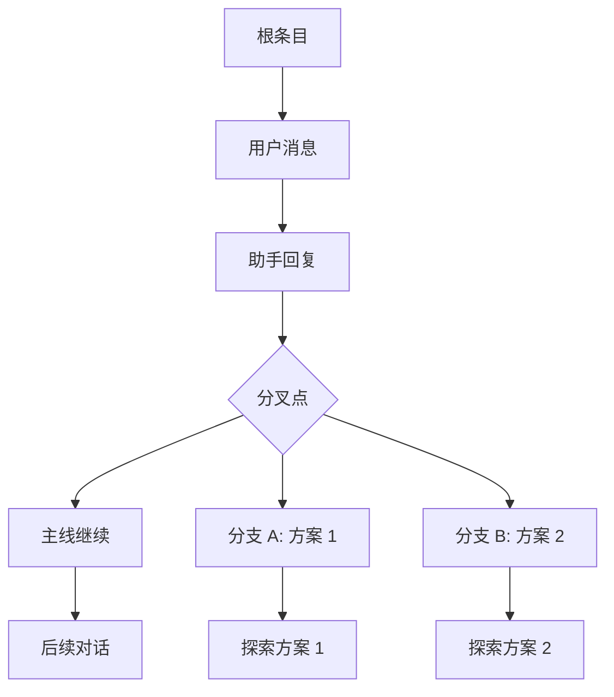
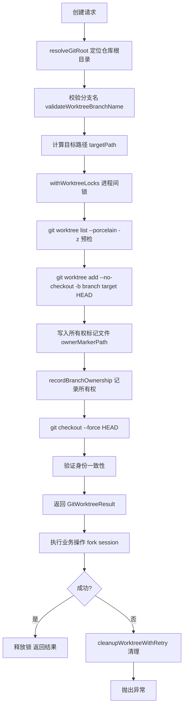
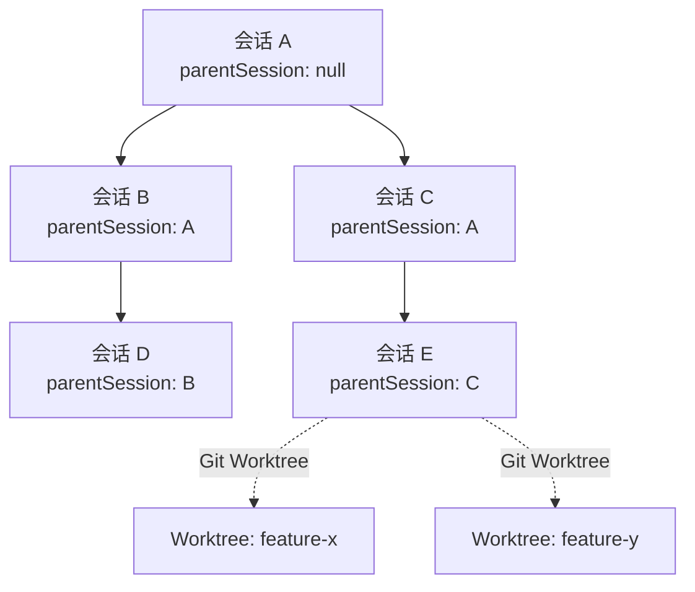

Pi Agent Desktop 提供了三种截然不同的分支/克隆机制，分别服务于不同的工作流场景：**会话内分支** 用于在同一会话历史中探索替代方案，**Fork（目录克隆）** 用于创建完全独立的会话副本，**Git Worktree Clone** 用于在隔离的文件系统工作区中并行开发。三者在数据隔离程度、文件系统占用、Git 集成深度上形成清晰的梯度。

> **术语对应**：本文所称「Fork（目录克隆）」指 `POST /api/sessions/[id]/clone`（`workspaceMode: "directory"`）的克隆操作；代码库（含 wiki 9/13/15）中的 "Fork" 另指 `POST /api/agent/[id]` 的 `{type:"fork"}` 交互式命令——它在同一会话目录内创建带 `parentSession` 的分支会话，行为上更接近本文的「会话内分支」。

Sources: [lib/session-branch-clone.ts](lib/session-branch-clone.ts#L1-L50), [app/api/sessions/[id]/branch/route.ts](app/api/sessions/[id]/branch/route.ts#L1-L87), [app/api/sessions/[id]/clone/route.ts](app/api/sessions/[id]/clone/route.ts#L1-L100)

---

## 核心概念对比

| 维度 | 会话内分支 | Fork（目录克隆） | Git Worktree Clone |
|------|-----------|-----------------|-------------------|
| **数据隔离** | 共享公共历史，分叉点后独立 | 完整复制历史，完全独立 | 完整复制历史，完全独立 |
| **文件系统** | 同一工作目录 | 同一或不同工作目录 | 隔离的 Git worktree 目录 |
| **Git 集成** | 无 | 无 | 原生 `git worktree` + 专用分支 |
| **会话文件** | 新建 `.jsonl`，`parentSession` 指向源会话 | 新建 `.jsonl`，`parentSession` 指向源会话 | 新建 `.jsonl`，`parentSession` 指向源会话 |
| **适用场景** | 探索对话分支、对比方案 | 存档实验、跨项目复用 | 并行功能开发、长期隔离实验 |
| **清理语义** | 删除分支会话文件 | 删除克隆会话文件 | 自动清理 worktree、分支、所有权标记 |

Sources: [lib/session-branch-clone.ts](lib/session-branch-clone.ts#L50-L150), [lib/git-worktree.ts](lib/git-worktree.ts#L1-L100), [app/api/sessions/[id]/clone/route.ts](app/api/sessions/[id]/clone/route.ts#L100-L226)

---

## 会话内分支

### 架构定位

会话内分支是**最轻量**的分叉机制。它不复制整个会话历史，而是在现有会话的特定条目（`targetEntryId`）处创建分叉点。新会话继承分叉点之前的所有历史，随后的对话独立演进。这类似于 Git 的 `git checkout -b` 但在会话层面操作。

### 数据模型

新会话的 header 包含 `parentSession` 字段指向**源会话文件绝对路径**，形成**会话级父子关系树**：

```typescript
interface SessionHeader {
  type: "session";
  id: string;                    // 新会话唯一 ID
  timestamp: string;             // 创建时间
  cwd: string;                   // 工作目录（继承自分叉点所在会话）
  parentSession: string;         // 指向源会话文件绝对路径
}
```

BranchNavigator 的树可视化直接消费 `buildTree` 产物，并用 `compress()` 折叠无分叉的线性链路；`lib/session-branch-clone.ts` 的 `extractAncestryPath()` 为死代码（无生产调用）。

Sources: [components/BranchNavigator.tsx](components/BranchNavigator.tsx#L44-L93), [lib/session-branch-clone.ts](lib/session-branch-clone.ts#L154-L210), [lib/types.ts](lib/types.ts#L1-L30)

### API 实现

**端点**：`POST /api/sessions/[id]/branch`

```typescript
// 请求体
{
  targetEntryId: string;  // 必填：分叉点条目 ID
  name?: string;          // 可选：分支显示名称
}

// 响应
{
  success: true,
  sessionId: string,      // 新会话 ID
  sessionFile: string     // 新会话文件路径
}
```

实现流程：
1. `resolveSessionPath(id)` 定位源会话文件
2. `validateBranchPayload()` 校验 `targetEntryId`
3. `SessionManager.open(sessionFile).getEntry(targetEntryId)` 验证条目存在
4. `sm.createBranchedSession(targetEntryId)` 创建分支会话文件
5. 可选写入 `name` 到 `session_info` 条目
6. 缓存新会话路径并返回

Sources: [app/api/sessions/[id]/branch/route.ts](app/api/sessions/[id]/branch/route.ts#L1-L87), [lib/session-branch-clone.ts](lib/session-branch-clone.ts#L120-L150)

### 可视化与交互

`BranchNavigator` 组件以树状图渲染会话历史，**线性链路压缩**（`compress()` 函数）将无分叉的连续节点折叠为单行显示 `+N` 指示器。活跃路径高亮，支持点击任意节点跳转上下文。



Sources: [components/BranchNavigator.tsx](components/BranchNavigator.tsx#L1-L100), [components/session-sidebar/SessionTree.tsx](components/session-sidebar/SessionTree.tsx#L1-L100)

---

## Fork（目录克隆）

### 架构定位

Fork 创建会话的**完全独立副本**，包括完整历史。新会话的 `parentSession` 仍指向源会话文件路径（`forkFrom` 一律写入），因此同样进入会话树（侧边栏可见父子关系）。适合需要将会话作为模板复用、或在不同上下文中并行推进的场景。

### 数据模型

克隆会话 header 由上游 `forkFrom` 写入：生成新 `id` 和 `timestamp`，`cwd` 为目标工作目录，并**一律写入 `parentSession` 指向源会话文件绝对路径**：

```typescript
interface SessionHeader {
  type: "session";
  id: string;                    // 新会话 ID
  timestamp: string;             // 克隆时间
  cwd: string;                   // 目标工作目录（可自定义）
  parentSession: string;         // 源会话文件绝对路径（forkFrom 一律写入）
}
```

### API 实现

**端点**：`POST /api/sessions/[id]/clone`（`workspaceMode: "directory"` 或省略）

```typescript
// 请求体
{
  targetCwd?: string;     // 目标工作目录，默认同源会话
  name?: string;          // 可选：克隆名称
  workspaceMode?: "directory" | "worktree";  // 必须为 "directory" 或省略
  // branchName 不允许在 directory 模式下使用
}

// 响应
{
  success: true,
  sessionId: string,
  sessionFile: string,
  workspace: { mode: "directory", cwd: string }
}
```

实现流程：
1. 校验载荷（`validateClonePayload` 禁止 `branchName` 与 `directory` 模式共存）
2. `SessionManager.forkFrom(sourceFile, targetCwd, undefined, { id: newUuid })` 复制会话
3. 可选写入 `name`
4. 缓存并返回

**关键实现细节**：`forkFrom` 在 pi-coding-agent 内部逐条目复制 JSONL 内容，生成全新会话文件。若后续操作失败，`removeForkedSessionFiles()` 会按 `*_${sessionId}.jsonl` 模式清理残留文件。

Sources: [app/api/sessions/[id]/clone/route.ts](app/api/sessions/[id]/clone/route.ts#L100-L200), [lib/session-branch-clone.ts](lib/session-branch-clone.ts#L30-L50), [lib/session-reader.ts](lib/session-reader.ts#L1-L50)

### 与分支的本质区别

| 特性 | 会话内分支 | Fork |
|------|-----------|------|
| 历史共享 | 是（分叉点前） | 否（完整复制） |
| `parentSession` | 指向源会话文件路径 | 指向源会话文件路径 |
| 会话树关系 | 父子节点 | 父子节点 |
| 存储增量 | 极小（仅新条目） | 等同源会话大小 |
| 回溯能力 | 可追溯至共同祖先 | 仅自身历史 |

---

## Git Worktree Clone

### 架构定位

Git Worktree Clone 是**最重度**的隔离机制。它利用 Git 原生 `git worktree add` 创建**隔离的文件系统工作区**，包含独立的 `.git` 管理目录、独立的工作树、专用 Git 分支。配合会话 Fork，实现「代码隔离 + 会话隔离」的双重保障，适合长周期并行开发、代码审查前的实验性重构、多任务并行。

### 核心组件：`lib/git-worktree.ts`

该模块约 1300 行，实生产级 worktree 生命周期管理：



### 所有权验证机制

防止并发/崩溃导致的 worktree 泄漏或误删他人 worktree：

1. **创建时**：生成随机 `ownerToken`，写入 worktree 内 `.git/pi-agent-desktop-worktree-owner` 文件
2. **提交标记**：创建临时 commit（`commit-tree`），消息含 `ownerToken`，通过 `update-ref` 原子替换分支指针，再恢复原 HEAD，在 reflog 留下可验证痕迹
3. **清理时**：读取 reflog 与标记文件，**双重验证** `head` 与 `ownerToken` 均匹配才允许删除 worktree 与分支

```typescript
// 所有权标记消息格式
"pi-agent-desktop worktree owner <uuid>"

// reflog 验证逻辑
branchOwnerReflogMatches(stdout, head, ownerToken) {
  const [reflogHead, message] = stdout.trimEnd().split("\0");
  return reflogHead === head && message === branchOwnerMessage(ownerToken);
}
```

### 进程间锁

`withWorktreeLocks()` 基于文件系统目录锁（`mkdir` 原子性）+ heartbeat 机制，跨进程同步对同一 `repoRoot` 和 `targetPath` 的操作。锁键经 SHA-256 哈希规范化，支持 Windows/macOS 大小写不敏感文件系统。

Sources: [lib/git-worktree.ts](lib/git-worktree.ts#L200-L400), [lib/git-worktree.ts](lib/git-worktree.ts#L400-L600), [lib/git-worktree.ts](lib/git-worktree.ts#L800-L1000)

### API 实现

**端点**：`POST /api/sessions/[id]/clone`（`workspaceMode: "worktree"`）

```typescript
// 请求体
{
  targetCwd?: string;     // 可选：worktree 父目录，默认 repo 同级
  name?: string;          // 可选：克隆名称
  workspaceMode: "worktree",  // 必填
  branchName?: string     // 可选：自定义分支名，自动生成 pi-agent/worktree-*
}

// 响应
{
  success: true,
  sessionId: string,
  sessionFile: string,
  workspace: {
    mode: "worktree",
    cwd: string,          // worktree 实际路径
    branchName: string    // 创建的分支名
  }
}
```

实现流程：
1. 校验载荷（`branchName` 要求 `workspaceMode === "worktree"`）
2. `withGitWorktree({ sourceCwd, targetCwd, branchName }, worktree => cloneSession(worktree.cwd, ...))`
3. `cloneSession` 内部调用 `SessionManager.forkFrom()` 在 worktree 目录创建会话
4. 成功返回；失败自动触发 `cleanupUnidentifiedWorktree` 或 `cleanupWorktreeWithRetry`

Sources: [app/api/sessions/[id]/clone/route.ts](app/api/sessions/[id]/clone/route.ts#L100-L226), [lib/git-worktree.ts](lib/git-worktree.ts#L1000-L1200)

### 清理语义

| 清理场景 | 行为 |
|----------|------|
| 正常创建后业务失败 | 删除 worktree、删除分支、验证所有权 |
| 创建 worktree 成功但未完成所有权记录 | `cleanupUnidentifiedWorktree`：仅删除 worktree 目录，保留分支（无法验证所有权） |
| 显式调用 `removeGitWorktree()` | 双重验证后删除 worktree、可选删除分支 |
| 进程崩溃残留 | 下次操作同资源时 `removeStaleInterprocessLock()` 回收过期锁（>30s 且进程不存活） |

Sources: [lib/git-worktree.ts](lib/git-worktree.ts#L1000-L1322)

---

## 前端集成：BranchCloneModal

统一的模态框组件处理三种操作的用户交互：

```typescript
type BranchCloneMode = "branch" | "clone";

interface BranchCloneModalProps {
  mode: BranchCloneMode;
  sessionId: string;
  targetEntryId?: string;  // 仅 branch 模式
  cwd?: string;            // 仅 clone 模式默认值
  onSuccess?: (newSessionId, newSessionFile) => void;
}
```

**分支模式**：只显示名称输入框，`targetEntryId` 只读显示
**克隆模式**：
- 工作区模式单选：Directory / Worktree
- Worktree 模式下显示分支名输入框、目标目录输入框
- Directory 模式下仅显示目标目录

错误码通过 `CLONE_ERROR_TRANSLATIONS` 映射为 i18n 键，统一错误提示。

Sources: [components/BranchCloneModal.tsx](components/BranchCloneModal.tsx#L1-L200), [components/BranchCloneModal.tsx](components/BranchCloneModal.tsx#L200-L309)

---

## 会话树中的分支可视化

`SessionTree` 组件递归渲染 `SessionTreeNode`，通过 `parentSessionId` 重建会话层级：



每个会话节点提供右键菜单：**分支**、**克隆**、**导出**、**重命名**、**删除**。`onBranchSession` 传递 `targetEntryId`（当前叶子条目），`onCloneSession` 传递完整 `SessionInfo`。

Sources: [components/session-sidebar/SessionTree.tsx](components/session-sidebar/SessionTree.tsx#L1-L100), [components/session-sidebar/helpers.ts](components/session-sidebar/helpers.ts#L1-L50)

---

## 错误码完整对照表

| 错误码 | 触发场景 | 归属机制 |
|--------|----------|----------|
| `INVALID_BRANCH_PAYLOAD` | branch 载荷非对象 | 会话内分支 |
| `INVALID_TARGET_ENTRY_ID` | 缺少或空 `targetEntryId` | 会话内分支 |
| `INVALID_BRANCH_NAME` | `name` 非字符串 | 会话内分支 |
| `TARGET_ENTRY_NOT_FOUND` | 分叉点条目不存在 | 会话内分支 |
| `BRANCH_CREATE_FAILED` | `createBranchedSession` 返回 null | 会话内分支 |
| `INVALID_CLONE_PAYLOAD` | clone 载荷非对象 | Fork / Worktree |
| `INVALID_TARGET_CWD` | `targetCwd` 非字符串 | Fork / Worktree |
| `INVALID_CLONE_NAME` | `name` 非字符串 | Fork / Worktree |
| `INVALID_WORKSPACE_MODE` | 非 `directory`/`worktree` | Fork / Worktree |
| `INVALID_BRANCH_NAME` | `branchName` 非字符串 | Worktree |
| `BRANCH_NAME_REQUIRES_WORKTREE` | directory 模式下传了 `branchName` | Fork |
| `GIT_UNAVAILABLE` | 系统无 git 命令 | Worktree |
| `NOT_GIT_REPOSITORY` | `sourceCwd` 不在 Git 仓库内 | Worktree |
| `INVALID_BRANCH` | 分支名不合法（Git 规则） | Worktree |
| `TARGET_INSIDE_REPOSITORY` | worktree 目标在仓库内部 | Worktree |
| `TARGET_EXISTS` | 目标目录已存在或已被注册 | Worktree |
| `WORKTREE_CREATE_FAILED` | `git worktree add` 失败 | Worktree |
| `WORKTREE_CLEANUP_FAILED` | 清理 worktree/分支失败 | Worktree |
| `SESSION_NOT_FOUND` | 源会话文件不存在 | 所有 |
| `INVALID_JSON_PAYLOAD` | 请求体非合法 JSON | 所有 |
| `BRANCH_OPERATION_FAILED` / `CLONE_OPERATION_FAILED` | 未分类异常兜底 | 所有 |

Sources: [components/BranchCloneModal.tsx](components/BranchCloneModal.tsx#L1-L50), [lib/git-worktree.ts](lib/git-worktree.ts#L30-L80), [app/api/sessions/[id]/branch/route.ts](app/api/sessions/[id]/branch/route.ts#L1-L87), [app/api/sessions/[id]/clone/route.ts](app/api/sessions/[id]/clone/route.ts#L1-L100)

---

## 选型决策指南

```
需要在同一对话中探索多个方案、保留共同上下文？
  ├─ 是 → 会话内分支
  └─ 否 → 需要文件系统级隔离（独立代码修改、可提交 Git）？
          ├─ 是 → Git Worktree Clone
          └─ 否 → 仅需会话历史副本模板化复用？
                    ├─ 是 → Fork（目录克隆）
                    └─ 否 → 重新评估需求
```

---

## 相关页面导航

- **上游依赖**：[Pi 会话文件格式与 .jsonl 解析](13-pi-hui-hua-wen-jian-ge-shi-yu-jsonl-jie-xi) — 会话文件结构与 `SessionManager` API
- **下游应用**：[会话导出、AgentMode 持久化与级联删除](15-hui-hua-dao-chu-agentmode-chi-jiu-hua-yu-ji-lian-shan-chu) — 分支/克隆后的生命周期管理
- **UI 集成**：[AppShell 布局系统：面板拖拽、键盘快捷键、主题切换](24-appshell-bu-ju-xi-tong-mian-ban-tuo-zhuai-jian-pan-kuai-jie-jian-zhu-ti-qie-huan) — BranchNavigator 与 SessionTree 的布局容器