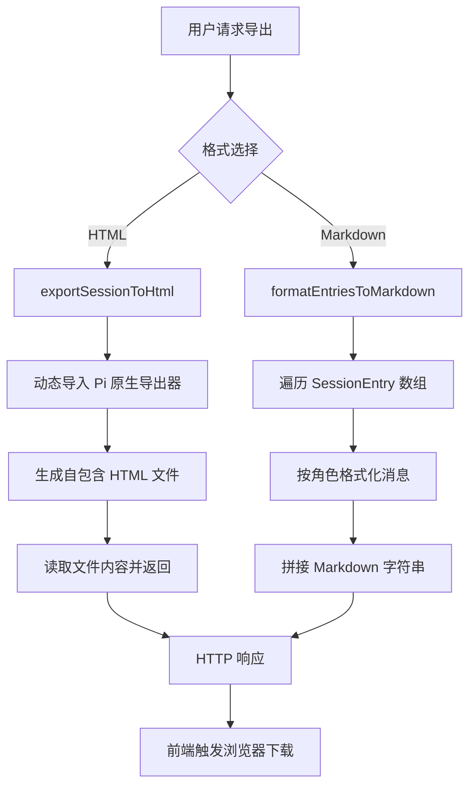

本页面详细介绍 Pi Agent Desktop 中三个相关但独立的会话管理功能：**会话导出**（支持 HTML 与 Markdown 双格式）、**AgentMode 持久化**（会话级 Agent 模式的存储与恢复）、以及 **级联删除**（父会话被删除时子会话的自动重挂载机制）。这三个功能分别对应 `lib/session-export.ts`、`lib/agent-mode-persistence.ts` 与 `lib/session-cascade.ts` 三个核心模块，并通过 API 路由与前端组件集成。

---

## 会话导出

### 架构概览

会话导出功能提供两种输出格式：**HTML**（交互式、自包含、可离线查看）与 **Markdown**（轻量、适合版本控制或文档归档）。两种格式共享同一套会话条目解析逻辑，但渲染管线完全独立。



Sources: [lib/session-export.ts](lib/session-export.ts#L1-L135), [app/api/sessions/[id]/export/route.ts](app/api/sessions/[id]/export/route.ts#L1-L77)

### HTML 导出管线

HTML 导出**不由 Next.js 打包**，而是在运行时动态导入 Pi 编码代理包内置的 `export-html` 模块。这种设计避免了将 Pi 的 Web Workers 与 WASM 依赖打包进 Next.js 客户端包。

```typescript
// lib/session-export.ts
export async function exportSessionToHtml(
  input: string | SessionManager,
  options?: HtmlExportOptions
): Promise<string> {
  const exporterUrl = pathToFileURL(join(getPackageDir(), "dist/core/export-html/index.js")).href;
  const { exportFromFile, exportSessionToHtml: piExportSessionToHtml } = await import(
    /* webpackIgnore: true */ /* turbopackIgnore: true */ exporterUrl
  ) as typeof import("../node_modules/@earendil-works/pi-coding-agent/dist/core/export-html/index.js");
  
  if (typeof input === "string") {
    return exportFromFile(input, options);  // 文件路径模式
  }
  return piExportSessionToHtml(input, undefined, options);  // SessionManager 模式
}
```

- **文件路径模式**：直接读取 `.jsonl` 文件，适合导出归档会话
- **SessionManager 模式**：导出内存中的活跃会话，保留未持久化的增量

生成的 HTML 包含 `<script id="session-data" type="application/json">` 标签，内嵌 Base64 编码的完整会话数据，支持离线交互式浏览。

Sources: [lib/session-export.ts](lib/session-export.ts#L90-L135), [lib/session-export.test.ts](lib/session-export.test.ts#L135-L169)

### Markdown 导出管线

Markdown 导出完全在本地实现，零外部依赖。`formatEntriesToMarkdown` 遍历 `SessionEntry[]`，按条目类型分派格式化逻辑：

| 条目类型 | 输出示例 | 处理函数 |
|----------|----------|----------|
| `user` 消息 | `## User\n\nHello, pi!` | `formatUserContent` |
| `assistant` 消息 | `## Assistant\n\n> *Thinking:*\n> ...\n\n### Tool Call: \`bash\`\n\`\`\`json\n{...}\n\`\`\`` | `formatAssistantContent` |
| `toolResult` 消息 | `### Tool Result: \`bash\`\n\`\`\`\nhello\n\`\`\`` | `formatToolResultContent` |
| `compaction` | `> *Session compacted: Compacted history*` | 直接渲染 |
| `custom_message` | `## Custom (type)\n\ncontent` | 复用 `formatUserContent` |

**多模态内容处理**：
- 用户消息的 `content` 可能是字符串或 `TextContent | ImageContent[]` 数组，图像统一渲染为 `[Image]`
- Assistant 的 `thinking` 块渲染为引用块，`toolCall` 渲染为带 JSON 缩进的代码块
- Tool Result 的 `isError` 标记会在标题后追加 ` (Error)`

Sources: [lib/session-export.ts](lib/session-export.ts#L1-L88), [lib/session-export.test.ts](lib/session-export.test.ts#L1-L133)

### API 端点与前端集成

**路由**：`GET /api/sessions/[id]/export?format=html|markdown&download=true&theme=...`

- `format`：`html`（默认）或 `markdown`
- `download`：`true` 时添加 `Content-Disposition: attachment` 头
- `theme`：仅 HTML 格式生效，传递给 Pi 导出器

前端通过 `SessionExportModal` 组件提供格式选择卡片与下载按钮，点击下载时创建隐藏 `<a>` 标签触发浏览器原生下载。

Sources: [app/api/sessions/[id]/export/route.ts](app/api/sessions/[id]/export/route.ts#L1-L77), [components/SessionExportModal.tsx](components/SessionExportModal.tsx#L1-L147)

---

## AgentMode 持久化

### 设计目标

Agent 模式（`plan` | `ask` | `full`）决定工具可用集合与 Ask 确认行为。用户期望：**同一会话在重新打开时，恢复上次选择的模式**。由于 Pi 核心不感知桌面端的模式概念，持久化由桌面层在 `.jsonl` 文件中以**自定义条目**形式实现。

### 存储格式

会话文件首行是 `type: "session"` 的头部，随后每行一个 `SessionEntry`。模式变更记录为：

```json
{
  "type": "custom",
  "customType": "desktop_agent_mode",
  "id": "entry-uuid",
  "parentId": "previous-entry-id",
  "timestamp": "2026-07-28T00:02:00Z",
  "data": { "mode": "full" }
}
```

- `customType` 固定为 `"desktop_agent_mode"`，便于过滤
- `data.mode` 必须是合法 `AgentMode`（`plan`/`ask`/`full`）

Sources: [lib/agent-mode-persistence.ts](lib/agent-mode-persistence.ts#L1-L23), [lib/approval-policy.ts](lib/approval-policy.ts#L1-L20)

### 写入路径：`AgentSessionWrapper.setAgentMode`

```typescript
// lib/rpc-manager.ts
setAgentMode(mode: AgentMode): void {
  if (!isAgentMode(mode)) throw new Error(`Invalid agent mode: ${String(mode)}`);
  this.applyAgentMode(mode);  // 更新内存状态与工具集
  if (this.inner.sessionManager && typeof this.inner.sessionManager.appendCustomEntry === "function") {
    this.inner.sessionManager.appendCustomEntry("desktop_agent_mode", { mode });
  }
}
```

- 调用 `appendCustomEntry` 追加到 `.jsonl` 末尾，**即时持久化**
- 同一会话可多次切换模式，文件中会记录完整历史

Sources: [lib/rpc-manager.ts](lib/rpc-manager.ts#L120-L135)

### 读取路径：`findLastAgentMode`

```typescript
// lib/agent-mode-persistence.ts
export function findLastAgentMode(entries: SessionEntry[]): AgentMode | undefined {
  if (!Array.isArray(entries)) return undefined;
  for (let i = entries.length - 1; i >= 0; i--) {
    const entry = entries[i];
    if (entry && entry.type === "custom" && entry.customType === "desktop_agent_mode") {
      const data = entry.data as AgentModeCustomData | undefined;
      if (data && isAgentMode(data.mode)) {
        return data.mode;
      }
    }
  }
  return undefined;
}
```

- **逆序扫描**：从文件末尾向前查找，首个合法模式即为“最后选择”
- **容错**：跳过 `mode` 非法的条目（如 `"unknown_mode"`），继续向前查找
- 返回 `undefined` 时，上层按 `storedMode ?? desktop.defaultAgentMode` 回退（`rpc-manager.ts`）；`DEFAULT_AGENT_MODE`（`"full"`）只是 `desktop-settings` 中 `defaultAgentMode` 字段的默认值，用户修改过全局默认后不会回退到 `"full"`

Sources: [lib/agent-mode-persistence.ts](lib/agent-mode-persistence.ts#L1-L23), [lib/agent-mode-persistence.test.ts](lib/agent-mode-persistence.test.ts#L1-L73)

### 会话加载时的模式恢复

1. `useSessionLoader.loadSession` 调用 `fetchSession(sid, true)`（`includeState=true`）
2. 服务端 `GET /api/sessions/[id]?includeState` → `rpcManager.peekState()` → `buildStateSnapshot()` 返回 `agentMode`
3. 前端 `useAgentSession` 的 `fetchAgentState` 副作用中 `setAgentMode(d.state.agentMode)`

Sources: [hooks/agent-session/use-session-loader.ts](hooks/agent-session/use-session-loader.ts#L1-L121), [hooks/useAgentSession.ts](hooks/useAgentSession.ts#L400-L500), [lib/rpc-manager.ts](lib/rpc-manager.ts#L280-L330)

### 前端交互：`AgentModeSelector`

下拉菜单组件，三选一（Plan / Ask / Full），点击触发 `onChange(mode)` → `handleAgentModeChange` → `sendAgentCommand(sid, { type: "set_agent_mode", mode })`。乐观更新：先 `setAgentMode(mode)` 再发请求，失败则回滚。

Sources: [components/AgentModeSelector.tsx](components/AgentModeSelector.tsx#L1-L110), [hooks/agent-session/use-session-commands.ts](hooks/agent-session/use-session-commands.ts#L200-L230)

---

## 级联删除

### 问题背景

跨文件 **Fork**、**Branch API** 与 **Clone** 会在子会话头写入 `parentSession: "/absolute/path/to/parent.jsonl"`（父**文件**绝对路径），侧边栏据此画会话树。**会话内分支**只改同一 `.jsonl` 的 `parentId`，不产生新文件，因此**不进入**这条级联。当用户删除父会话文件时，必须决定那些跨文件子会话的归属：

- **选项 A**：级联删除所有后代（破坏性太强，用户数据丢失）
- **选项 B**：将子会话重挂载到祖父会话（保留历史，维持树结构完整）
- **选项 C**：将子会话变为根会话（丢失祖先上下文）

本项目采用**选项 B**：删除父会话时，同目录下所有 `parentSession` 指向该文件的子会话，其头部 `parentSession` 改写为父会话的 `parentSession`（即祖父会话路径），若父会话本身无父则删除 `parentSession` 键（变为根）。

### 核心纯函数：`rewriteChildHeader`

```typescript
// lib/session-cascade.ts
export interface RewriteResult {
  newContent: string;
  changed: boolean;
}

export function rewriteChildHeader(
  content: string,
  oldParent: string,
  newParent: string | null,
): RewriteResult {
  // 1. 提取首行（头部）
  const newlineIdx = content.indexOf("\n");
  const firstLineRaw = newlineIdx === -1 ? content : content.slice(0, newlineIdx);
  const rest = newlineIdx === -1 ? "" : content.slice(newlineIdx);

  // 2. 解析与校验
  let header: unknown;
  try { header = JSON.parse(firstLineRaw); } catch { return { newContent: content, changed: false }; }
  if (header === null || typeof header !== "object" || Array.isArray(header)) {
    return { newContent: content, changed: false };
  }
  const objHeader = header as Record<string, unknown>;
  if (objHeader.type !== "session" || objHeader.parentSession !== oldParent) {
    return { newContent: content, changed: false };
  }

  // 3. 修改
  if (newParent === null) {
    delete objHeader.parentSession;  // 删除键，而非设为 null
  } else {
    objHeader.parentSession = newParent;
  }

  // 4. 返回新内容（保留首行后的所有原始行）
  return { newContent: JSON.stringify(objHeader) + rest, changed: true };
}
```

**关键设计点**：
- **纯函数**：无 I/O，易测试、易推理、可复用
- **仅改首行**：头部以外的消息条目完全保留
- **幂等**：`parentSession` 不匹配 `oldParent` 时直接返回原内容
- **防御性解析**：`JSON.parse` 成功不代表是对象，需排除 `null`、数组、基本类型
- **删除键而非置 null**：符合 Pi 会话头部 Schema（可选字段）

Sources: [lib/session-cascade.ts](lib/session-cascade.ts#L1-L54), [lib/session-cascade.test.ts](lib/session-cascade.test.ts#L1-L160)

### 删除端点：`DELETE /api/sessions/[id]`

```typescript
// app/api/sessions/[id]/route.ts (DELETE)
export async function DELETE(...) {
  const filePath = await resolveSessionPath(id);
  
  // 1. 读取父会话头部，获取 grandparent 路径
  let parentSessionPath: string | null = null;
  const firstLine = await readFirstLineAsync(filePath);
  if (firstLine) {
    const header = JSON.parse(firstLine) as { type?: string; parentSession?: string };
    if (header.type === "session") parentSessionPath = header.parentSession ?? null;
  }

  // 2. 枚举同目录下所有 .jsonl 文件（候选子会话）
  const siblingFiles = (await readdir(dir))
    .filter(f => f.endsWith(".jsonl"))
    .map(f => join(dir, f))
    .filter(p => p !== filePath);

  // 3. 销毁活跃 RPC 包装器（防止新命令写入半删除会话）
  await getRpcSession(id)?.destroy();

  // 4. 先删除父文件（关键顺序：Task D4）
  await withFileLock(filePath, async () => {
    try { await unlink(filePath); } catch { /* race: already deleted */ }
  });
  invalidateSessionPathCache(id);

  // 5. 重写子会话头部（原子写入 + 文件锁）
  for (const childPath of siblingFiles) {
    let content: string;
    try { content = await readFile(childPath, "utf8"); }
    catch { continue; }  // 竞态：子会话在 readdir 与 read 间被删

    const { newContent, changed } = rewriteChildHeader(content, filePath, parentSessionPath);
    if (!changed) continue;

    await withFileLock(childPath, () => atomicWriteFile(childPath, newContent)); // 进程内文件锁 + 临时文件 rename
  }
  
  return NextResponse.json({ ok: true });
}
```

**操作顺序的竞态条件论证（Task D4 依据）**：

| 顺序 | 风险 |
|------|------|
| 先改子 → 再删父 | 并发 Fork / Branch 在父文件仍存在时 `SessionManager.open(parent)` 成功，读到半改写的子树，新文件 `parentSession` 指向即将被删的父路径 → 孤儿会话 |
| **先删父 → 再改子** | 并发 Fork 在 `existsSync` / `open(parent)` 时失败 → 快速失败，不产生孤儿。剩余窗口只在单个子文件改写 |

**并发安全措施**：
- `withFileLock`：进程级单文件写锁（`globalThis.__piWriteLocks`），防止同一文件并发写入
- `atomicWriteFile`：`app/api/sessions/[id]/route.ts` 内定义的局部函数——异步 `writeFile` + `rename`（临时文件 `.tmp`，rename 失败时清理临时文件后抛出），**无重试、无 Windows `EPERM/EACCES` 兜底**；带重试的 `writeFileAtomic` 位于 `lib/atomic-write.ts`，但 DELETE 路由并未导入使用
- `rewriteChildHeader` 幂等：重复执行安全

Sources: [app/api/sessions/[id]/route.ts](app/api/sessions/[id]/route.ts#L100-L211), [lib/session-lock.ts](lib/session-lock.ts#L1-L42), [lib/atomic-write.ts](lib/atomic-write.ts#L1-L68)

### 前端触发

`SessionTreeItem` 组件右键菜单/悬停操作栏提供“删除”按钮，点击后二次确认，调用 `fetch('/api/sessions/[id]', { method: 'DELETE' })`，成功后回调 `onSessionDeleted(id)` 刷新侧边栏列表。

Sources: [components/session-sidebar/SessionTree.tsx](components/session-sidebar/SessionTree.tsx#L1-L445)

---

## 三功能协作场景

### 场景：导出某分支会话，包含祖先上下文

1. 用户在 SessionSidebar 选择子会话，点击“导出”
2. `SessionExportModal` 打开，选择 HTML 格式
3. `GET /api/sessions/[child-id]/export?format=html` → `exportSessionToHtml(childFilePath)`
4. Pi 导出器读取子会话 `.jsonl`。跨文件 Fork / Branch 在创建时已把根→叶路径**内联复制**进新文件；会话内分支则仍是同一文件，导出器按当前叶子投影
5. 导出 HTML 可离线查看完整对话历史

### 场景：删除父会话后，子会话仍可导出且祖先链完整

1. 用户删除父会话 → 级联删除重写子会话 `parentSession` 指向祖父
2. 子会话文件内容（消息条目）**完全不变**，仅头部 `parentSession` 字段变更
3. 后续导出子会话，Pi 导出器仍能读取完整祖先消息（因分支创建时已内联复制）

### 场景：AgentMode 切换后 Fork / 跨文件 Branch，新文件继承模式

1. 会话 A 模式切为 `"plan"` → `appendCustomEntry("desktop_agent_mode", { mode })`，磁盘条目为 `{ type: "custom", customType: "desktop_agent_mode", data: { mode: "plan" } }`
2. 消息 Fork 或 `POST .../branch` → `createBranchedSession` 把路径上的 custom 条目一并复制
3. 新会话加载时 `findLastAgentMode` 自后向前扫描 `type === "custom" && customType === "desktop_agent_mode"`，取合法 `data.mode`

会话内分支不复制文件；同一 `.jsonl` 里最后一次模式条目对所有叶子可见（投影不剥离 custom 条目的落盘）。

---

## 关键文件索引

| 功能 | 核心实现 | 测试 | API 路由 | 前端组件 |
|------|----------|------|----------|----------|
| 会话导出 | `lib/session-export.ts` | `lib/session-export.test.ts` | `app/api/sessions/[id]/export/route.ts` | `components/SessionExportModal.tsx` |
| AgentMode 持久化 | `lib/agent-mode-persistence.ts`<br>`lib/rpc-manager.ts` (setAgentMode) | `lib/agent-mode-persistence.test.ts` | `app/api/agent/[id]/route.ts` (set_agent_mode) | `components/AgentModeSelector.tsx`<br>`hooks/useAgentSession.ts` |
| 级联删除 | `lib/session-cascade.ts` | `lib/session-cascade.test.ts` | `app/api/sessions/[id]/route.ts` (DELETE) | `components/session-sidebar/SessionTree.tsx` |

---

## 相关页面导航

- 上一页：[四种会话分叉机制：Fork、会话内分支、跨文件 Branch、Clone](14-san-chong-fen-zhi-ji-zhi-fork-hui-hua-nei-fen-zhi-git-worktree-clone) — 只有跨文件 Fork / Branch / Clone 才写 `parentSession`；会话内分支只用 `parentId`
- 下一页：[Agent 模式与 Ask 拦截：Plan / Ask / Full](16-agent-mo-shi-yu-ask-lan-jie-plan-ask-full) — 深入 AgentMode 的运行时行为与工具集合计算