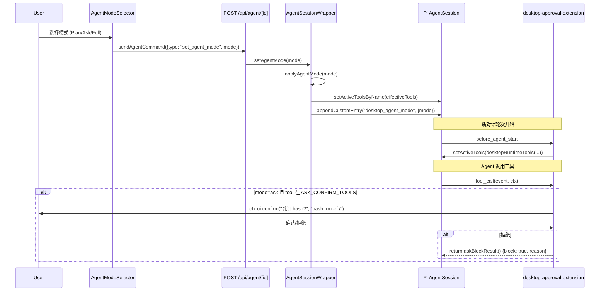

本文档详细解析 Pi Agent Desktop 中的三种 Agent 运行模式（Plan / Ask / Full）及其背后的 Ask 拦截机制。该系统通过 **AgentMode**（运行模式）与 **ToolPreset**（工具预设）的组合，配合桌面端内联扩展在工具调用声明期与执行期的双重策略检查，实现了从「只读探索」到「全自主执行」的细粒度权限控制。

## 核心概念模型

```mermaid
graph TD
    subgraph "Policy Layer (lib/approval-policy.ts)"
        AM[AgentMode: plan | ask | full]
        TP[ToolPreset: none | default | full]
        PLAN_TOOLS[PLAN_TOOLS: read, grep, find, ls]
        ASK_CONFIRM[ASK_CONFIRM_TOOLS: bash, write, edit, memory_save, memory_forget]
        PRESETS[PRESET_NONE/DEFAULT/FULL]
    end

    subgraph "Runtime Enforcement (lib/desktop-approval-extension.ts)"
        BEFORE[before_agent_start: 声明期过滤]
        TOOL_CALL[tool_call: 执行期拦截]
        UI_CONFIRM[ctx.ui.confirm: 用户确认对话框]
    end

    subgraph "Session Persistence (lib/agent-mode-persistence.ts)"
        CUSTOM[custom entry: desktop_agent_mode]
        FIND_LAST[findLastAgentMode: 启动时恢复]
    end

    subgraph "UI Control (components/AgentModeSelector.tsx)"
        SELECTOR[AgentModeSelector: 下拉选择器]
        I18N[i18n: agentMode.plan/ask/full.label/desc]
    end

    AM -->|determines| PLAN_TOOLS
    AM -->|gates| ASK_CONFIRM
    TP -->|provides| PRESETS
    PLAN_TOOLS --> BEFORE
    ASK_CONFIRM --> TOOL_CALL
    PRESETS --> BEFORE
    BEFORE -->|setActiveTools| TOOL_CALL
    TOOL_CALL -->|needsAskConfirm| UI_CONFIRM
    UI_CONFIRM -->|block/allow| TOOL_CALL
    CUSTOM --> FIND_LAST
    FIND_LAST --> AM
    SELECTOR -->|onChange| AM
    I18N --> SELECTOR
```

Sources: [lib/approval-policy.ts](lib/approval-policy.ts#L1-L86), [lib/desktop-approval-extension.ts](lib/desktop-approval-extension.ts#L1-L47), [lib/agent-mode-persistence.ts](lib/agent-mode-persistence.ts#L1-L23), [components/AgentModeSelector.tsx](components/AgentModeSelector.tsx#L1-L110)

---

## 三种 Agent 模式详解

### 模式对比表

| 维度 | Plan (规划) | Ask (询问) | Full (完全自主) |
|------|-------------|------------|-----------------|
| **核心理念** | 只读探索 → 产出计划 | 读写执行 → 关键操作需确认 | 无拦截全自主执行 |
| **可用工具** | 声明期固定 `PLAN_TOOLS`（`read, grep, find, ls`，忽略 preset）；执行期另放行 `memory_recall` | 由 ToolPreset 决定 | 由 ToolPreset 决定 |
| **写入/命令确认** | N/A（无写入工具） | **全部拦截**，需用户逐个确认 | 无拦截 |
| **MCP 工具确认** | 不声明 MCP（`desktopRuntimeTools` 在 plan 提前返回） | **需确认**（`mcp__*` 与 `list_mcp_resources` / `list_mcp_resource_templates` / `read_mcp_resource`） | 无拦截 |
| **Codemode** | 禁用 | 受 `desktop.codemodeEnabled` 与是否已注册 `codemode` 控制 | 受 `desktop.codemodeEnabled` 与是否已注册 `codemode` 控制 |
| **典型场景** | 代码库探索、方案设计、只读分析 | 日常开发、敏感操作需把关 | 信任度高的自动化任务、批量重构 |
| **默认 ToolPreset** | 任意（被忽略） | default | default |

Sources: [lib/approval-policy.ts](lib/approval-policy.ts#L1-L86), [lib/desktop-runtime-tools.ts](lib/desktop-runtime-tools.ts#L1-L23)

### Plan 模式：只读探索与计划生成

Plan 模式的设计目标是让 Agent **仅具备读取能力**，强制输出「计划」而非直接执行。

```typescript
// lib/approval-policy.ts
export const PLAN_TOOLS: readonly string[] = ["read", "grep", "find", "ls"];

// 无论 ToolPreset 为何值，Plan 模式始终只暴露这四个工具
export function effectiveToolsForMode(mode: AgentMode, preset: ToolPreset): string[] {
  if (mode === "plan") return [...PLAN_TOOLS];
  return toolNamesForPreset(preset);
}
```

**关键行为**：
1. **工具集固化**：`read`、`grep`、`find`、`ls` 四个只读工具，**不可通过 ToolPreset 修改**
2. **内存召回可用**：`memory_recall` 在 Plan 模式下被显式允许（只读查询长期记忆）
3. **执行期再次守护**：`desktop-approval-extension.ts` 在 `tool_call` 事件中再次校验，非白名单工具直接拦截返回 `askBlockResult()`
4. **UI 提示文案**："Explore read-only, then propose a plan"（只读探索，然后提出计划）

Sources: [lib/approval-policy.ts](lib/approval-policy.ts#L1-L86), [lib/desktop-approval-extension.ts](lib/desktop-approval-extension.ts#L1-L47), [lib/i18n/dictionaries.ts](lib/i18n/dictionaries.ts#L150-L155)

### Ask 模式：确认式执行

Ask 模式是「读写执行、关键操作拦截」的平衡模式。注意：桌面全局默认 AgentMode 是 `full`（`lib/approval-policy.ts` 的 `DEFAULT_AGENT_MODE`，经 `desktop.defaultAgentMode` 生效），Ask 并非默认开启的模式。

```typescript
// lib/approval-policy.ts
export const ASK_CONFIRM_TOOLS: readonly string[] = [
  "bash",
  "write",
  "edit",
  "memory_save",
  "memory_forget",
];

export function needsAskConfirm(mode: AgentMode, toolName: string): boolean {
  if (mode !== "ask") return false;
  return (ASK_CONFIRM_TOOLS as readonly string[]).includes(toolName);
}
```

**拦截范围**：
| 工具 | 拦截原因 | 确认对话框示例 |
|------|----------|----------------|
| `bash` | 任意命令执行，风险最高 | `允许 bash?` + `bash: npm run build` |
| `write` | 文件创建/覆盖 | `允许 write?` + `write: src/app.ts` |
| `edit` | 文件修改 | `允许 edit?` + `edit: src/app.ts` |
| `memory_save` | 长期记忆写入（持久化） | `允许 memory_save?` + `memory_save: {...}` |
| `memory_forget` | 长期记忆删除（不可逆） | `允许 memory_forget?` + `memory_forget: {...}` |

**放行工具**（无需确认）：`read`、`grep`、`find`、`ls`、`memory_recall`。注意 MCP 资源读取类工具（`list_mcp_resources`、`list_mcp_resource_templates`、`read_mcp_resource`）与 `mcp__*` 前缀工具同属 `isMcpTool` 判定范围，Ask 模式下需确认（见下）

**MCP 工具特殊处理**：Ask 模式下，所有 `mcp__*` 前缀工具及 `list_mcp_resources` 等**均需确认**（`confirmMcp` 逻辑）

Sources: [lib/approval-policy.ts](lib/approval-policy.ts#L1-L86), [lib/desktop-approval-extension.ts](lib/desktop-approval-extension.ts#L1-L47)

### Full 模式：无拦截自主执行

Full 模式移除所有确认拦截，工具可用性完全由 ToolPreset 决定。

```typescript
// lib/desktop-approval-extension.ts
pi.on("tool_call", async (event, ctx) => {
  // ... preset none / plan 检查 ...
  const confirmMcp = modeRef.current === "ask" && isMcpTool(event.toolName);
  if (!confirmMcp && !needsAskConfirm(modeRef.current, event.toolName)) return;
  // 仅 ask 模式才会走到确认逻辑
  const ok = await ctx.ui.confirm(...);
  if (!ok) return askBlockResult();
});
```

**特征**：
- `needsAskConfirm("full", *)` 永远返回 `false`
- MCP 工具无需确认
- 适合高信任度环境或自动化流水线

Sources: [lib/approval-policy.ts](lib/approval-policy.ts#L1-L86), [lib/desktop-approval-extension.ts](lib/desktop-approval-extension.ts#L1-L47)

---

## ToolPreset（工具预设）与模式的组合矩阵

ToolPreset 独立于 AgentMode，但在 Plan 模式下被**强制忽略**。

```typescript
// lib/approval-policy.ts
export const PRESET_NONE: readonly string[] = [];
export const PRESET_DEFAULT: readonly string[] = ["read", "bash", "edit", "write"];
export const PRESET_FULL: readonly string[] = ["bash", "read", "edit", "write", "grep", "find", "ls"];

export function toolNamesForPreset(preset: ToolPreset): string[] {
  if (preset === "none") return [...PRESET_NONE];
  if (preset === "full") return [...PRESET_FULL];
  return [...PRESET_DEFAULT];
}
```

### 有效工具组合矩阵

| AgentMode \ ToolPreset | none | default | full |
|------------------------|------|---------|------|
| **plan** | `read, grep, find, ls` | `read, grep, find, ls` | `read, grep, find, ls` |
| **ask** | *(无工具，仅聊天)* | `read, bash, edit, write` + MCP | `bash, read, edit, write, grep, find, ls` + MCP |
| **full** | *(无工具，仅聊天)* | `read, bash, edit, write` + MCP | `bash, read, edit, write, grep, find, ls` + MCP |

> **注意**：`desktopRuntimeTools` 是**激活名单过滤器**，不是工具注入器。它从 `effectiveToolsForMode` + `withMemoryTools` 得到基础名字，再**仅当已注册**时纳入：
> - MCP 工具（`exposure === "direct"`，或当前 active 且 `exposure` 为 `deferred` / `codemode`）
> - `tool_search`（`registered` 中已有该名）
> - `codemode`（`desktop.codemodeEnabled === true` **且** 已注册）
>
> `plan` 或 `preset === "none"` 时函数提前返回，不扫描 MCP / `tool_search` / `codemode`。记忆工具名由 `withMemoryTools` 写入名单（plan 仅 `memory_recall`；preset 为空数组时不追加任何记忆工具）。

Sources: [lib/approval-policy.ts](lib/approval-policy.ts#L1-L86), [lib/desktop-runtime-tools.ts](lib/desktop-runtime-tools.ts#L1-L23)

---

## 双重策略执行：声明期 + 执行期

桌面端通过 **Inline Extension** 在 Pi Agent 的两个生命周期节点实施策略：



### 声明期：`before_agent_start`

```typescript
// lib/desktop-approval-extension.ts
pi.on("before_agent_start", () => {
  const preset = modeRef.toolPreset ?? "default";
  pi.setActiveTools(desktopRuntimeTools(modeRef.current, preset, modeRef.codemodeEnabled ?? false, pi.getAllTools(), pi.getActiveTools()));
  if (preset === "none" && modeRef.current !== "plan") return { systemPrompt: "" };
});
```

- 根据当前 `modeRef.current` + `toolPreset` 计算有效工具集
- 通过 `pi.setActiveTools()` 向模型声明可用工具
- `preset === "none" && mode !== "plan"` 时返回空 systemPrompt（禁用工具调用）

### 执行期：`tool_call`

```typescript
// lib/desktop-approval-extension.ts
pi.on("tool_call", async (event, ctx) => {
  // 1. preset=none 且非 plan：全拦截
  if (modeRef.toolPreset === "none" && modeRef.current !== "plan") return askBlockResult();
  
  // 2. plan 模式：仅允许 PLAN_TOOLS + memory_recall
  if (modeRef.current === "plan" && ![...PLAN_TOOLS, "memory_recall"].includes(event.toolName)) return askBlockResult();
  
  // 3. codemode 未启用时拦截 codemode 工具
  if (event.toolName === "codemode" && !modeRef.codemodeEnabled) return askBlockResult();
  
  // 4. Ask 模式下的 MCP 工具 & ASK_CONFIRM_TOOLS 需确认
  const confirmMcp = modeRef.current === "ask" && isMcpTool(event.toolName);
  if (!confirmMcp && !needsAskConfirm(modeRef.current, event.toolName)) return;
  
  // 5. 弹出确认对话框
  const ok = await ctx.ui.confirm(`允许 ${event.toolName}?`, summarizeToolCall(event.toolName, event.input));
  if (!ok) return askBlockResult();
});
```

**防御深度设计**：声明期防止模型「看到」不该用的工具；执行期防止模型通过其他途径（如延迟注册的 MCP）绕过声明期调用敏感工具。

Sources: [lib/desktop-approval-extension.ts](lib/desktop-approval-extension.ts#L1-L47), [lib/desktop-runtime-tools.ts](lib/desktop-runtime-tools.ts#L1-L23)

---

## 模式持久化与会话恢复

### 存储格式

模式变更以 **custom entry** 形式追加到 `.jsonl` 会话文件：

```typescript
// lib/agent-mode-persistence.ts
export interface AgentModeCustomData {
  mode: AgentMode;
}

// 记录模式变更
this.inner.sessionManager.appendCustomEntry("desktop_agent_mode", { mode });
```

会话文件片段示例：
```jsonl
{"type":"custom","customType":"desktop_agent_mode","id":"e3","parentId":"e2","timestamp":"2026-07-28T00:02:00Z","data":{"mode":"plan"}}
{"type":"custom","customType":"desktop_agent_mode","id":"e7","parentId":"e6","timestamp":"2026-07-28T00:05:00Z","data":{"mode":"ask"}}
```

### 启动时恢复

```typescript
// lib/rpc-manager.ts (startRpcSession)
const storedMode = findLastAgentMode(sessionManager.getEntries() as never);
const agentMode: AgentMode = isAgentMode(opts.agentMode)
  ? opts.agentMode
  : (storedMode ?? desktop.defaultAgentMode);
```

- `findLastAgentMode` 从后向前扫描 entries，返回**最后一次有效**的模式记录
- 若无记录，回退到桌面全局默认 `desktop.defaultAgentMode`（默认 `"full"`）
- 显式传入的 `opts.agentMode` 优先级最高（用于 Fork/Clone 等场景）

Sources: [lib/agent-mode-persistence.ts](lib/agent-mode-persistence.ts#L1-L23), [lib/rpc-manager.ts](lib/rpc-manager.ts#L800-L944), [lib/agent-mode-persistence.test.ts](lib/agent-mode-persistence.test.ts#L1-L73)

---

## 模式切换的状态机逻辑

### Plan ↔ 非 Plan 切换时的 ToolPreset 保存/恢复

```typescript
// lib/rpc-manager.ts (AgentSessionWrapper)
applyAgentMode(mode: AgentMode): void {
  if (mode === "plan" && this._agentMode !== "plan") {
    this._toolPresetBeforePlan = this._toolPreset;  // 进入 Plan 时保存当前 preset
  }
  if (mode !== "plan" && this._agentMode === "plan" && this._toolPresetBeforePlan) {
    this._toolPreset = this._toolPresetBeforePlan;  // 离开 Plan 时恢复 preset
    this._toolPresetBeforePlan = null;
  }
  this._agentMode = mode;
  this._modeRef.current = mode;
  this._modeRef.toolPreset = this._toolPreset;
  const tools = desktopRuntimeTools(mode, this._toolPreset, this._modeRef.codemodeEnabled ?? false, this.inner.getAllTools(), this.inner.getActiveToolNames());
  this.inner.setActiveToolsByName(tools);
}
```

**行为示例**：
1. 用户在 Full + default 模式下工作
2. 切换到 Plan → 保存 `toolPresetBeforePlan = "default"`，工具集变为 4 个只读工具
3. 完成规划后切回 Ask → 恢复 `toolPreset = "default"`，工具集恢复为 4 个读写工具
4. 再切到 Full → 保持 `toolPreset = "default"`（或用户在 Plan 期间手动改过 preset）

Sources: [lib/rpc-manager.ts](lib/rpc-manager.ts#L1-L200)

### set_agent_mode 命令处理

```typescript
// lib/rpc-manager.ts
case "set_agent_mode": {
  const mode = command.mode;
  if (!isAgentMode(mode)) throw new Error(`Invalid agent mode: ${String(mode)}`);
  this.setAgentMode(mode);
  return { agentMode: this._agentMode, toolPreset: this._toolPreset };
}

// AgentSessionWrapper.setAgentMode
setAgentMode(mode: AgentMode): void {
  if (!isAgentMode(mode)) throw new Error(`Invalid agent mode: ${String(mode)}`);
  this.applyAgentMode(mode);
  if (this.inner.sessionManager && typeof this.inner.sessionManager.appendCustomEntry === "function") {
    this.inner.sessionManager.appendCustomEntry("desktop_agent_mode", { mode });
  }
}
```

- 服务端校验 `isAgentMode`，非法值直接抛错
- 切换成功后持久化到会话文件
- 返回新模式与当前 ToolPreset 供前端同步 UI

Sources: [lib/rpc-manager.ts](lib/rpc-manager.ts#L600-L700)

---

## 前端交互：AgentModeSelector 组件

```tsx
// components/AgentModeSelector.tsx
const MODE_IDS: AgentMode[] = ["plan", "ask", "full"];

const modes = MODE_IDS.map((id) => ({
  id,
  label: t(`agentMode.${id}.label`),   // "Plan" / "Ask" / "Full"
  desc: t(`agentMode.${id}.desc`),     // "Explore read-only..." / "Confirm before writing..." / "Do not confirm..."
}));

<buttons>
  {modes.map((m) => (
    <button onClick={() => { setOpen(false); if (!isActive) onChange(m.id); }}>
      <span>{m.label}</span>
      <span style={{fontSize: 11, color: "var(--text-dim)"}}>{m.desc}</span>
    </button>
  ))}
</buttons>
```

**交互细节**：
- 下拉菜单悬浮在图标上方（`bottom: calc(100% + 6px)`）
- 当前模式高亮（`bg-selected` + `fontWeight: 600`）
- 禁用状态下 `opacity: 0.5`、`cursor: not-allowed`
- 点击外部自动收起（`useDismissOnOutsideClick`）

Sources: [components/AgentModeSelector.tsx](components/AgentModeSelector.tsx#L1-L110), [lib/i18n/dictionaries.ts](lib/i18n/dictionaries.ts#L150-L155)

---

## 关键数据流总结

```mermaid
flowchart TD
    subgraph "初始化"
        START[Session 启动] --> LOAD[读取 session entries]
        LOAD --> FIND[findLastAgentMode]
        FIND -->|有记录| MODE1[恢复上次模式]
        FIND -->|无记录| MODE2[使用 desktop.defaultAgentMode]
        MODE1 --> WRAP[创建 AgentSessionWrapper]
        MODE2 --> WRAP
        WRAP --> INIT[initPolicy(mode, preset, codemode)]
        INIT --> APPLY[applyAgentMode → setActiveToolsByName]
    end

    subgraph "运行时模式切换"
        USER[用户点击 Selector] --> CMD[sendAgentCommand(set_agent_mode)]
        CMD --> WRAP2[Wrapper.setAgentMode]
        WRAP2 --> APPLY2[applyAgentMode]
        APPLY2 --> PERSIST[appendCustomEntry desktop_agent_mode]
        APPLY2 --> TOOLS[desktopRuntimeTools 计算新工具集]
        TOOLS --> SET[setActiveToolsByName]
        SET --> EXT[Extension 重新声明工具]
    end

    subgraph "工具调用拦截"
        AGENT[Agent 发起 tool_call] --> EXT2[desktop-approval-extension]
        EXT2 --> CHECK1{preset=none && !plan?}
        CHECK1 -->|是| BLOCK1[askBlockResult]
        CHECK1 -->|否| CHECK2{plan && !白名单?}
        CHECK2 -->|是| BLOCK2[askBlockResult]
        CHECK2 -->|否| CHECK3{codemode 未启用?}
        CHECK3 -->|是| BLOCK3[askBlockResult]
        CHECK3 -->|否| CHECK4{ask && (MCP || ASK_CONFIRM)?}
        CHECK4 -->|是| CONFIRM[ctx.ui.confirm]
        CONFIRM -->|拒绝| BLOCK4[askBlockResult]
        CONFIRM -->|同意| ALLOW[放行执行]
        CHECK4 -->|否| ALLOW
    end
```

Sources: [lib/rpc-manager.ts](lib/rpc-manager.ts#L1-L944), [lib/desktop-approval-extension.ts](lib/desktop-approval-extension.ts#L1-L47), [lib/approval-policy.ts](lib/approval-policy.ts#L1-L86), [lib/agent-mode-persistence.ts](lib/agent-mode-persistence.ts#L1-L23)

---

## 测试覆盖的关键行为

| 测试文件 | 覆盖场景 |
|----------|----------|
| `approval-policy.test.ts` | Plan 模式工具固化、Ask 模式确认列表（含 memory_save/memory_forget 需确认）、工具调用摘要生成 |
| `agent-mode-persistence.test.ts` | 空 entries、多次模式切换取最后有效、无效模式跳过回退 |

Sources: [lib/approval-policy.test.ts](lib/approval-policy.test.ts#L1-L58), [lib/agent-mode-persistence.test.ts](lib/agent-mode-persistence.test.ts#L1-L73)

---

## 相关页面导航

| 相关主题 | 页面链接 |
|----------|----------|
| Extension UI Bridge 与异步 RPC 响应队列（确认对话框的底层实现） | [Extension UI Bridge 与异步 RPC 响应队列](17-extension-ui-bridge-yu-yi-bu-rpc-xiang-ying-dui-lie) |
| 长期记忆：memory_save/memory_forget 的持久化机制 | [长期记忆：SQLite 后端、观测钩子与检索 API](18-chang-qi-ji-yi-sqlite-hou-duan-guan-ce-gou-zi-yu-jian-suo-api) |
| 会话导出、AgentMode 持久化与级联删除 | [会话导出、AgentMode 持久化与级联删除](15-hui-hua-dao-chu-agentmode-chi-jiu-hua-yu-ji-lian-shan-chu) |
| useAgentSession 主 Hook 与模式切换的前端集成 | [useAgentSession 主 Hook 与子 Hook 拆分策略](22-useagentsession-zhu-hook-yu-zi-hook-chai-fen-ce-lue) |

---

## 设计决策速查

| 决策点 | 选择 | 理由 |
|--------|------|------|
| Plan 模式工具集是否可配置 | **固定不可配** | 语义清晰：Plan = 只读探索，避免配置复杂度 |
| Ask 模式拦截粒度 | **工具级** | 细粒度控制，用户可逐个放行/拒绝 |
| 执行期二次校验 | **保留** | 防御 MCP 延迟注册、插件绕过声明期 |
| 模式持久化粒度 | **每次切换记录一条 custom entry** | 完整审计轨迹，支持分支/回溯场景 |
| Plan 进出时 ToolPreset 保存/恢复 | **自动** | 降低用户心智负担，符合「Plan 是临时只读视图」心智模型 |