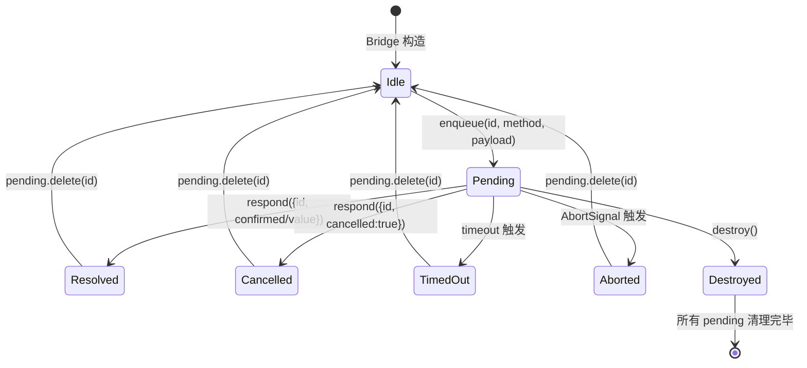

Extension UI Bridge 是 pi-agent-desktop 中**桌面端交互式对话框**的核心基础设施。它将 pi 编码代理（`@earendil-works/pi-coding-agent`）原本为 TUI 设计的 `ExtensionUIContext` 接口，桥接为基于 **HTTP/SSE 的异步 RPC 模式**，使前端 React 组件能够渲染 **confirm / select / input / editor** 四类对话框以及 **notify** 火即忘通知。请求经 SSE `extension_ui_request` 下发；用户决策必须 `POST /api/agent/[id]`，body 为 `{ type: "extension_ui_response", id, ... }`。**不是** `/command`，也**不是** `/api/extensions`（后者只做扩展/技能配置 CRUD）。

本文档深入剖析 Bridge 的内部状态机、超时/中止语义、与 `AgentSessionWrapper` 的生命周期绑定、以及前端 `ExtensionUiDialog` 组件的事件驱动交互模型。

---

## 架构总览

```mermaid
flowchart LR
    subgraph "pi Agent Runtime (Node.js)"
        AgentLoop[Agent Loop\n@earendil-works/pi-coding-agent]
        ExtCtx[ExtensionUIContext\n(uiContext: bridge)]
    end

    subgraph "Desktop RPC Layer (lib/)"
        Bridge[ExtensionUiBridge\npending: Map<id, Deferred>]
        Wrapper[AgentSessionWrapper\n_uiBridge: ExtensionUiBridge]
        RPCMgr[RPC Manager\nsend(command)]
    end

    subgraph "Transport (HTTP/SSE)"
        SSE[SSE Stream\n/events]
        HTTP["POST /api/agent/[id]"]
    end

    subgraph "Frontend (React)"
        EventsMgr[AgentEventsManager\nEventSource]
        Dialog[ExtensionUiDialog\nonRespond(payload)]
    end

    AgentLoop -->|calls ui.confirm/select/...| ExtCtx
    ExtCtx -->|enqueue(id, method, payload)| Bridge
    Bridge -->|emit ExtensionUiRequestEvent| Wrapper
    Wrapper -->|emitEvent| SSE
    SSE -->|onmessage| EventsMgr
    EventsMgr -->|handleAgentEvent| Dialog
    Dialog -->|user clicks| HTTP
    HTTP -->|extension_ui_response{id, confirmed/value/cancelled}| RPCMgr
    RPCMgr -->|_uiBridge.respond()| Bridge
    Bridge -->|resolve Deferred| AgentLoop
```

**核心数据流**：
1. **Agent 侧**：`pi` 调用 `ui.confirm("Allow?", "rm -rf /")` → `ExtensionUiBridge.enqueue()` 生成唯一 `id`，构造 `ExtensionUiRequestEvent`，存入 `pending` Map，返回 `Promise` 挂起
2. **传输层**：`Wrapper.emitEvent()` 将事件推入 SSE 流 → 前端 `AgentEventsManager` 接收 → `ExtensionUiDialog` 渲染
3. **用户侧**：用户点击「允许/拒绝/选项/提交」→ `onRespond(payload)` 发起 `POST /api/agent/[id]`，body `{ type: "extension_ui_response", id, confirmed?/value?/cancelled? }`（`sendAgentCommand`；路径不是 `/command`）
4. **响应侧**：`AgentSessionWrapper.send()` 分发到 `extension_ui_response` 分支 → `bridge.respond(response)` 在 `pending` 中查找 `id`，`resolve` 对应的 `Deferred`，Agent 循环继续。`/api/extensions` 与此桥无关。

---

## ExtensionUiBridge 核心实现

### 类型定义与事件契约

```typescript
// lib/extension-ui-bridge.ts
export type ExtensionUiMethod = "confirm" | "select" | "input" | "editor";

export type ExtensionUiRequestEvent = {
  type: "extension_ui_request";
  id: string;                    // crypto.randomUUID()
  method: ExtensionUiMethod;
  title: string;
  message?: string;              // confirm 专用
  options?: string[];            // select 专用
  placeholder?: string;          // input/editor 专用
  prefill?: string;              // editor 专用
  timeout?: number;              // 毫秒，可选
};

export type ExtensionUiNotifyEvent = {
  type: "extension_ui_notify";
  message: string;
  notifyType: "info" | "warning" | "error";
};

export type ExtensionUiResponse = {
  id: string;
  confirmed?: boolean;           // confirm
  value?: string;                // select/input/editor
  cancelled?: boolean;           // 统一取消语义
};
```

**设计要点**：
- **单一事件类型区分**：`type` 字段作为判别联合，前端 `switch (event.type)` 即可类型收窄，无需 `as` 断言
- **id 由 Bridge 生成**：`crypto.randomUUID()` 保证全局唯一，避免前后端协商 ID 的竞态
- **方法语义正交**：四种 `method` 覆盖所有交互式决策场景，`notify` 为火即忘式通知，不阻塞 Agent

### 内部状态机：pending Map 与 Deferred

```typescript
type Deferred = {
  method: ExtensionUiMethod;
  resolve: (value: unknown) => void;
  timer?: ReturnType<typeof setTimeout>;
};

export class ExtensionUiBridge {
  private pending = new Map<string, Deferred>();
  private destroyed = false;
  private emit: ExtensionUiEmit;

  // ...
}
```

**状态转移图**：



**关键不变量**：
| 不变量 | 保证机制 |
|--------|----------|
| `pending` 中每个 `id` 唯一 | `randomUUID()` 碰撞概率可忽略 |
| `Deferred.resolve` 至多调用一次 | `respond()` / `timeout` / `abort` / `destroy()` 均先 `delete` 再 `resolve` |
| `destroy()` 后不再接受新请求 | `enqueue()` 开头检查 `this.destroyed`，直接返回默认值 Promise |
| 定时器与信号监听器无泄漏 | 每条出路均显式 `clearTimeout` / `removeEventListener` |

### enqueue 核心逻辑

```typescript
private enqueue<T>(
  method: ExtensionUiMethod,
  payload: Omit<ExtensionUiRequestEvent, "type" | "id" | "method">,
  opts?: ExtensionUiDialogOptions
): Promise<T> {
  if (this.destroyed) {
    return Promise.resolve((method === "confirm" ? false : undefined) as T);
  }
  const id = randomUUID();
  const event: ExtensionUiRequestEvent = { type: "extension_ui_request", id, method, ...payload };
  if (opts?.timeout != null) event.timeout = opts.timeout;

  return new Promise<T>((resolve) => {
    const deferred: Deferred = { method, resolve: (v) => resolve(v as T) };
    
    // 超时处理
    if (opts?.timeout != null && opts.timeout > 0) {
      deferred.timer = setTimeout(() => {
        if (!this.pending.has(id)) return;
        this.pending.delete(id);
        resolve((method === "confirm" ? false : undefined) as T);
      }, opts.timeout);
    }
    
    // AbortSignal 支持
    if (opts?.signal) {
      const onAbort = () => {
        if (!this.pending.has(id)) return;
        if (deferred.timer) clearTimeout(deferred.timer);
        this.pending.delete(id);
        resolve((method === "confirm" ? false : undefined) as T);
      };
      if (opts.signal.aborted) { onAbort(); return; }
      opts.signal.addEventListener("abort", onAbort, { once: true });
    }
    
    this.pending.set(id, deferred);
    try { this.emit(event); }
    catch (err) {
      if (deferred.timer) clearTimeout(deferred.timer);
      this.pending.delete(id);
      resolve((method === "confirm" ? false : undefined) as T);
      console.error("extension_ui emit failed:", err);
    }
  });
}
```

**异常安全设计**：
- `emit()` 抛出时：清理定时器、从 `pending` 移除、resolve 默认值、记录错误，**不向上抛出**，保证 Agent 循环不因 UI 发送失败而崩溃
- `timeout` / `abort` / `destroy` 竞态：均以 `if (!this.pending.has(id)) return;` 守卫，确保幂等

### 四大对话方法语义

| 方法 | 签名 | 解析值 | 取消值 | 典型用例 |
|------|------|--------|--------|----------|
| `confirm` | `(title, message, opts?) => Promise<boolean>` | `true`/`false` | `false` | 危险操作确认、权限请求 |
| `select` | `(title, options[], opts?) => Promise<string\|undefined>` | 选中的字符串 | `undefined` | 分支选择、模式切换 |
| `input` | `(title, placeholder?, opts?) => Promise<string\|undefined>` | 输入的字符串 | `undefined` | 简短文本输入 |
| `editor` | `(title, prefill?, opts?) => Promise<string\|undefined>` | 编辑器内容 | `undefined` | 多行代码/文本编辑 |

**默认值策略**：`confirm` 默认 `false`（安全优先），其余默认 `undefined`（表示用户未提供有效输入）。

### notify：火即忘通知通道

```typescript
notify(message: string, type: "info" | "warning" | "error" = "info"): void {
  if (this.destroyed) return;
  this.emit({ type: "extension_ui_notify", message, notifyType: type });
}
```
- 无 `id`、无 `Promise`、无超时，**纯事件广播**
- 前端可渲染为 Toast/通知栏，不阻塞 Agent

### destroy：优雅关闭与资源回收

```typescript
destroy(): void {
  this.destroyed = true;
  for (const [id, d] of this.pending) {
    if (d.timer) clearTimeout(d.timer);
    d.resolve(d.method === "confirm" ? false : undefined);
    this.pending.delete(id);
  }
}
```
- 标记 `destroyed = true` 阻止新请求进入
- 遍历所有 `pending`：清理定时器、按语义 resolve 默认值、清空 Map
- 由 `AgentSessionWrapper.destroy()` 在会话销毁时调用（其先 `await inner.abort()` 终止 Agent 循环，随后销毁 Bridge）

---

## 异步 RPC 响应队列：extension_ui_response

### 服务端命令分发

在 `AgentSessionWrapper.send()` 中，`extension_ui_response` 作为一个标准命令类型处理：

```typescript
// lib/rpc-manager.ts
case "extension_ui_response": {
  if (!this._uiBridge) throw new Error("No extension UI bridge");
  const id = command.id as string;
  if (typeof id !== "string" || !id) throw new Error("extension_ui_response requires id");
  const err = this._uiBridge.respond({
    id,
    confirmed: command.confirmed as boolean | undefined,
    value: command.value as string | undefined,
    cancelled: command.cancelled as boolean | undefined,
  });
  if (err) throw new Error(err);
  return null;
}
```

**验证链**：
1. `_uiBridge` 必须已挂载（`attachUiBridge` 在 `startRpcSession` 中完成）
2. `id` 必须为非空字符串
3. `bridge.respond()` 返回 `null` 表示成功，字符串表示错误信息（如 "Unknown or expired UI request"）

### Bridge.respond 解析逻辑

```typescript
respond(response: ExtensionUiResponse): string | null {
  const d = this.pending.get(response.id);
  if (!d) return "Unknown or expired UI request";
  if (d.timer) clearTimeout(d.timer);
  this.pending.delete(response.id);

  if (response.cancelled) {
    d.resolve(d.method === "confirm" ? false : undefined);
    return null;
  }
  if (d.method === "confirm") {
    d.resolve(response.confirmed === true);
    return null;
  }
  if (typeof response.value === "string") {
    d.resolve(response.value);
    return null;
  }
  d.resolve(undefined);
  return null;
}
```

**语义映射表**：

| 响应字段 | confirm | select | input | editor |
|----------|---------|--------|-------|--------|
| `confirmed: true` | `resolve(true)` | — | — | — |
| `confirmed: false` | `resolve(false)` | — | — | — |
| `value: "foo"` | — | `resolve("foo")` | `resolve("foo")` | `resolve("foo")` |
| `cancelled: true` | `resolve(false)` | `resolve(undefined)` | `resolve(undefined)` | `resolve(undefined)` |
| 字段缺失/类型错 | `resolve(false)` | `resolve(undefined)` | `resolve(undefined)` | `resolve(undefined)` |

**容错原则**：任何不符合预期的响应均按“用户取消/拒绝”处理，绝不 reject Promise，避免 Agent 循环因未捕获异常而中断。

---

## 与 AgentSessionWrapper 的生命周期绑定

### 初始化时序

```typescript
// lib/rpc-manager.ts - startRpcSession 内部
const bridge = new ExtensionUiBridge((event) => {
  wrapper.emitEvent(event);  // 桥接到 SSE 发射器
});
wrapper.attachUiBridge(bridge);

if (typeof inner.bindExtensions === "function") {
  await inner.bindExtensions({
    uiContext: bridge as unknown as ExtensionUIContext,
    mode: "rpc",
  });
}
```

**关键点**：
- `ExtensionUiBridge` 构造时注入 `emit` 回调，直接连接 `Wrapper.emitEvent` → SSE 流
- `bindExtensions({ uiContext: bridge, mode: "rpc" })` 将 Bridge 作为 `ExtensionUIContext` 实现注入 pi 运行时
- `mode: "rpc"` 告诉 pi：该上下文仅支持 dialog/notify 子集，TUI 专有方法（如 `onTerminalInput`）以 no-op 存根实现

### 状态快照中的 pending 计数

```typescript
// lib/rpc-manager.ts - buildStateSnapshot()
pendingUiRequestCount: this._uiBridge?.pendingCount ?? 0,
```
- 前端可通过 `get_state` 状态快照中的 `pendingUiRequestCount` 感知是否有未决对话框（SSE 的 `follow_up_queue_update` 仅携带追问队列快照，不含 UI 未决计数）
- 用于 UI 层面的“等待用户响应”指示器

### 销毁协同

```typescript
// AgentSessionWrapper.destroy() (lib/rpc-manager.ts)
try { await this.inner.abort(); } catch (err) { ... }   // 1. 先终止 Agent 循环
try { this._uiBridge?.destroy(); } catch (err) { ... }  // 2. 再清理 Bridge
this._uiBridge = null;
```
- 顺序与直觉相反：`destroy()` 先 `await this.inner.abort()` 终止 Agent 循环（`lib/rpc-manager.ts`），之后才调用 `_uiBridge.destroy()`，将所有挂起的 UI Promise resolve（返回默认值）
- 挂起的 UI Promise 最终都会在销毁收尾阶段被结算，不会永久悬挂，也不会产生未处理异常

---

## 前端集成：ExtensionUiDialog 组件

### 组件契约

```tsx
// components/ExtensionUiDialog.tsx
interface Props {
  request: ExtensionUiRequestEvent | null;
  onRespond: (payload: ExtensionUiResponsePayload) => void;
}

export type ExtensionUiResponsePayload = {
  id: string;
  confirmed?: boolean;
  value?: string;
  cancelled?: boolean;
};
```

### 渲染策略

```tsx
// 简化版渲染逻辑
if (!request) return null;

const close = (payload) => onRespond(payload);

return (
  <div className="ui-dialog-backdrop" onClick={() => close({ id: request.id, cancelled: true })}>
    <div className="ui-dialog-surface" onClick={e => e.stopPropagation()}>
      <div>{request.title}</div>
      {request.method === "confirm" && <p>{request.message}</p>}
      {request.method === "select" && (
        <div>{request.options?.map(opt => <button onClick={() => close({id, value: opt})}>{opt}</button>)}</div>
      )}
      {request.method === "input" && <input value={text} onChange={...} placeholder={request.placeholder} />}
      {request.method === "editor" && <textarea value={text} onChange={...} placeholder={request.placeholder} rows={8} />}
      <div className="actions">
        <button onClick={() => close({id, cancelled: true})}>取消</button>
        {request.method === "confirm" && (
          <>
            <button onClick={() => close({id, confirmed: false})}>拒绝</button>
            <button onClick={() => close({id, confirmed: true})}>允许</button>
          </>
        )}
        {(request.method === "input" || request.method === "editor") && (
          <button onClick={() => close({id, value: text})}>确定</button>
        )}
      </div>
    </div>
  </div>
);
```

**交互细节**：
- **背景点击取消**：`backdrop.onClick` 触发 `cancelled: true`，语义等同 ESC 键
- **冒泡阻断**：`surface.onClick` 调用 `stopPropagation()`，防止点击对话框内部误触发取消
- **受控输入**：`input`/`editor` 使用本地 `useState` 缓冲，提交时一次性发送 `value`
- **预填充支持**：`editor` 接收 `prefill` 初始化 `textarea`，适配“编辑现有文件”场景

### 事件订阅与分发

```typescript
// hooks/agent-session/agent-events-manager.ts
es.onmessage = (e) => {
  const event = JSON.parse(e.data) as AgentEvent;
  this.handleAgentEvent?.(event);  // 由 useAgentEvents 连接到 setExtensionUiRequest
};
```

```typescript
// hooks/agent-session/agent-event-apply.ts — 事件归一化为 effect（简化）
case "extension_ui_request":
  effects.push({ type: "extensionUiRequest", request: event });
  return { effects };
case "extension_ui_notify":
  effects.push({ type: "extensionUiNotify", message: event.message, notifyType: event.notifyType ?? "info" });
  return { effects };

// hooks/useAgentSession.ts — 状态与应用（简化）
const [extensionUiRequest, setExtensionUiRequest] = useState<ExtensionUiRequestEvent | null>(null);
// applyAgentEvent 的 effect 分发：
case "extensionUiRequest":
  setExtensionUiRequest(effect.request);
  break;
case "extensionUiNotify":
  setExtensionUiNotify({ message: effect.message, notifyType: effect.notifyType }); // 应用内 toast，4s 自动清除
  break;
```

- `extension_ui_request` 以单例状态 `extensionUiRequest` 保存，**同一时刻最多渲染一个对话框**（由 Bridge 单线程 enqueue 保证）
- `extension_ui_notify` 直接走 Toast 系统，不占用对话框槽位

### 响应发送

```typescript
// hooks/useAgentSession.ts
const handleExtensionUiRespond = useCallback(
  async (payload: { id: string; confirmed?: boolean; value?: string; cancelled?: boolean }) => {
    setExtensionUiRequest(null); // 先关闭对话框（乐观更新）
    const sid = sessionIdRef.current;
    if (!sid) return;
    try {
      await sendAgentCommand(sid, { type: "extension_ui_response", ...payload });
    } catch (e) {
      console.error("extension_ui_response failed:", e);
    }
  },
  [],
);
```
- `handleExtensionUiRespond` 位于 `hooks/useAgentSession.ts`，经 `sendAgentCommand` 发送 `POST /api/agent/[id]`，携带 `extension_ui_response` 命令（`use-session-commands.ts` 只承担 `set_agent_mode` 等会话命令，不负责此响应）
- 前端先 `setExtensionUiRequest(null)` 关闭对话框（乐观更新），再发出响应，等待服务端 `bridge.respond()` 解析 Agent 端 Promise

---

## 超时、中止与竞态处理

### 超时机制

```typescript
// enqueue 内部
if (opts?.timeout != null && opts.timeout > 0) {
  deferred.timer = setTimeout(() => {
    if (!this.pending.has(id)) return;
    this.pending.delete(id);
    resolve((method === "confirm" ? false : undefined) as T);
  }, opts.timeout);
}
```
- **默认无超时**：仅当调用方显式传入 `timeout` 时启用
- **超时即拒绝**：`confirm` → `false`，其余 → `undefined`，符合安全优先原则
- **定时器清理**：`respond()` / `abort` / `destroy()` 均显式 `clearTimeout`

### AbortSignal 集成

```typescript
if (opts?.signal) {
  const onAbort = () => {
    if (!this.pending.has(id)) return;
    if (deferred.timer) clearTimeout(deferred.timer);
    this.pending.delete(id);
    resolve((method === "confirm" ? false : undefined) as T);
  };
  if (opts.signal.aborted) { onAbort(); return; }
  opts.signal.addEventListener("abort", onAbort, { once: true });
}
```
- 支持外部取消源（如用户关闭标签页、会话切换）
- `once: true` 确保监听器自动移除，无泄漏
- 已触发 `aborted` 时同步执行，避免微任务延迟

### 并发请求与单槽位保证

**Bridge 层面**：`pending` Map 支持任意数量并发请求，每个 `id` 独立管理

**前端层面**：`extensionUiRequest` 为单值状态，新请求到达直接覆盖旧请求

```typescript
// 理论上的竞态窗口
// 1. Agent 连续调用 ui.confirm() → ui.select()
// 2. SSE 先后推送 request_A, request_B
// 3. 前端状态仅保留 request_B，request_A 的响应若随后到达，bridge.respond() 会报 "Unknown or expired"
```

**缓解措施**：
- pi Agent 侧通常**串行**发起 UI 请求（`await ui.confirm()` 后再 `await ui.select()`）
- 若真并发，前端丢失旧请求视为用户取消，Agent 收到默认值继续执行，**不死锁、不崩溃**

---

## 测试覆盖与契约验证

### ExtensionUiBridge 单元测试

```typescript
// lib/extension-ui-bridge.test.ts
test("confirm resolves true/false from respond", async () => {
  const events = [];
  const bridge = new ExtensionUiBridge((e) => { if (e.type === "extension_ui_request") events.push(e); });
  const p = bridge.confirm("Allow?", "rm -rf /");
  bridge.respond({ id: events[0].id, confirmed: true });
  assert.equal(await p, true);
});

test("timeout auto-resolves confirm to false", async () => {
  const bridge = new ExtensionUiBridge((e) => events.push(e));
  const p = bridge.confirm("t", "m", { timeout: 20 });
  assert.equal(await p, false);
  assert.equal(bridge.pendingCount, 0);
});

test("destroy cancels pending", async () => {
  const bridge = new ExtensionUiBridge(() => {});
  const p = bridge.input("name");
  bridge.destroy();
  assert.equal(await p, undefined);
});
```

**覆盖场景**：
- 正常 resolve：`confirmed`、`value`、`cancelled`
- 错误 ID：返回错误字符串，不抛出
- 超时自动 resolve
- `destroy()` 清理 pending
- `notify` 火即忘事件

### RPC 集成测试

```typescript
// lib/rpc-manager.test.ts
test("extension_ui_response resolves bridge confirm", async () => {
  const w = new AgentSessionWrapper(makeStubInner());
  const bridge = new ExtensionUiBridge((e) => events.push(e));
  w.attachUiBridge(bridge);
  const p = bridge.confirm("t", "m");
  const req = events[0] as { id: string };
  await w.send({ type: "extension_ui_response", id: req.id, confirmed: true });
  assert.equal(await p, true);
});
```

**验证链路**：
`send(extension_ui_response)` → `Wrapper.send()` 分发 → `bridge.respond()` → `Deferred.resolve()` → `Promise` fulfilled

---

## 设计决策与权衡

| 决策点 | 选择 | 权衡理由 |
|--------|------|----------|
| **ID 生成端** | Bridge (Server) | 避免前后端协商、前端生成 UUID 的体积依赖、重放攻击面 |
| **Promise 不 reject** | 永远 resolve 默认值 | Agent 循环无需 try/catch 包裹每个 `ui.*` 调用，简化错误路径 |
| **单槽位前端状态** | `extensionUiRequest: Event \| null` | 简化 UI 状态机，符合“模态对话框一次一个”的心智模型 |
| **notify 无确认** | 火即忘 | 通知非决策，不应阻塞 Agent；网络丢包可接受 |
| **mode: "rpc"** | 显式标记能力子集 | pi 运行时可据此禁用 TUI 专用 API，避免运行期报错 |
| **abort 先于 destroy** | 先终止 Agent 循环，再清理 Bridge | 与 `AgentSessionWrapper.destroy()` 实现顺序一致（先 `await inner.abort()` 再 `_uiBridge.destroy()`）；挂起 Promise 由 destroy 收尾统一 resolve 默认值，不泄漏 |

---

## 常见问题与调试指南

| 现象 | 可能原因 | 排查步骤 |
|------|----------|----------|
| 对话框不弹出 | SSE 连接断开 / `AgentEventsManager` 未连接 | 检查 Network 面板 `/events` 流、控制台 `Failed to parse agent event` |
| 点击按钮无反应 | `onRespond` 未绑定 / 命令 404 | 检查 `useAgentSession` 的 `handleExtensionUiRespond`、`POST /api/agent/[id]` 路由 |
| Agent 卡在 `await ui.confirm()` | `extension_ui_response` 未到达 / `id` 不匹配 | 日志 `bridge.respond()` 返回值，核对 `pending` Map 内容 |
| 超时未生效 | 未传 `timeout` 参数 / 单位错误(ms vs s) | 确认调用处 `opts.timeout` 为毫秒整数 |
| 重复响应报错 | 前端双击 / 重试导致同一 `id` 发两次 | 前端 `onRespond` 后立即 `setExtensionUiRequest(null)` 去重 |

---

## 相关页面导航

- **上游架构**：[四层分离架构详解](6-si-ceng-fen-chi-jia-gou-xiang-jie) — 理解 ExtensionUIContext 在 pi 运行时中的定位
- **会话封装**：[AgentSession 生命周期与进程内注册表](7-agentsession-sheng-ming-zhou-qi-yu-jin-cheng-nei-zhu-ce-biao) — `AgentSessionWrapper` 如何管理 Bridge 生命周期
- **事件流**：[SSE 事件流与流式状态机](8-sse-shi-jian-liu-yu-liu-shi-zhuang-tai-ji) — `extension_ui_request` 如何通过 SSE 抵达前端
- **Agent 模式**：[Agent 模式与 Ask 拦截](16-agent-mo-shi-yu-ask-lan-jie-plan-ask-full) — `desktop-approval-extension` 如何调用 `ui.confirm`
- **长期记忆**：[长期记忆：SQLite 后端、观测钩子与检索 API](18-chang-qi-ji-yi-sqlite-hou-duan-guan-ce-gou-zi-yu-jian-suo-api) — `desktop-ltm-extension` 注册 `memory_*` 内联工具；Ask 拦截走同一套 `ui.confirm`，但工具本身不经 UI Bridge 暴露
- **扩展/技能配置**：`GET/POST /api/extensions` 只做 toggle/add/remove，**不是**对话框响应通道

---

## 源文件索引

| 文件 | 核心职责 | 关键行范围 |
|------|----------|------------|
| `lib/extension-ui-bridge.ts` | Bridge 核心实现、enqueue/respond/destroy、四大 dialog 方法 | [1-221](lib/extension-ui-bridge.ts#L1-L221) |
| `lib/rpc-manager.ts` | `AgentSessionWrapper`、命令分发、`extension_ui_response` 处理、会话注册表 | [1-944](lib/rpc-manager.ts#L1-L944) |
| `lib/desktop-approval-extension.ts` | Ask 模式下的 `ui.confirm` 调用示例 | [1-47](lib/desktop-approval-extension.ts#L1-L47) |
| `components/ExtensionUiDialog.tsx` | 前端对话框渲染、交互、响应发送 | [1-205](components/ExtensionUiDialog.tsx#L1-L205) |
| `hooks/agent-session/agent-events-manager.ts` | SSE 事件类型定义、`ExtensionUiRequestEvent` 判别联合 | [1-186](hooks/agent-session/agent-events-manager.ts#L1-L186) |
| `lib/extension-ui-bridge.test.ts` | Bridge 单元测试：resolve/timeout/destroy/notify | [1-85](lib/extension-ui-bridge.test.ts#L1-L85) |
| `lib/rpc-manager.test.ts` | RPC 集成测试：`extension_ui_response` 端到端验证 | [795-805](lib/rpc-manager.test.ts#L795-L805) |