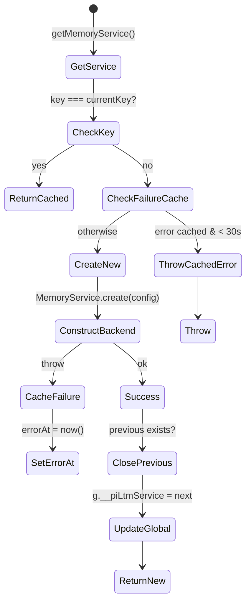

本页面深度解析 pi-agent-desktop 的**长期记忆 (LTM, Long-Term Memory)** 子系统：一个以 SQLite 为存储后端、以 FTS5 + trigram 分词器为检索引擎、具备观测钩子自动采集会话上下文、并通过 HTTP API 与 Agent 内联工具双重暴露的项目级持久化记忆系统。LTM 设计为**进程内单例**、**配置热切换安全**、**写入路径幂等且带有有界重试**、**读写分离无锁**、且对 CJK 文本有专门优化。

Sources: [lib/ltm/types.ts](lib/ltm/types.ts#L1-L52), [lib/ltm/backend.ts](lib/ltm/backend.ts#L1-L20), [lib/ltm/sqlite-backend.ts](lib/ltm/sqlite-backend.ts#L1-L832), [lib/ltm/service.ts](lib/ltm/service.ts#L1-L256)

---

## 核心架构概览

LTM 采用**四层分层**设计，职责边界清晰：

```mermaid
graph TB
    subgraph "API Layer"
        HTTP[HTTP Routes<br/>/api/memory/*]
        TOOLS[Agent Inline Tools<br/>memory_save/recall/forget]
        HOOKS[Observation Hooks<br/>agent_end / pre_compact]
    end

    subgraph "Service Layer"
        SVC[MemoryService<br/>Singleton + Config Gate]
    end

    subgraph "Backend Interface"
        IFACE[MemoryBackend<br/>Interface]
    end

    subgraph "Storage Layer"
        SQLITE[SqliteBackend<br/>WAL + FTS5 trigram]
        NOOP[NoopMemoryBackend<br/>Disabled Fast-path]
    end

    HTTP --> SVC
    TOOLS --> SVC
    HOOKS --> SVC
    SVC --> IFACE
    IFACE --> SQLITE
    IFACE --> NOOP
    SQLITE -.->|projectIdFromCwd| PROJ[Project Identity<br/>SHA-256(cwd)]
    SQLITE -.->|isNearDuplicate| JACCARD[Jaccard/Dice<br/>Supersede Logic]
```

**层级职责：**

| 层级 | 文件 | 核心职责 |
|------|------|----------|
| **类型契约** | `types.ts` | `MemoryType`、`ObserveKind`、输入输出 DTO、召回命中结构 |
| **后端接口** | `backend.ts` | `MemoryBackend` 接口定义：`remember`/`recall`/`observe`/`forget`/`health`/`close` |
| **SQLite 实现** | `sqlite-backend.ts` | Schema、FTS5 trigram、有界 `SQLITE_BUSY` 重试、去重、超集更新、WAL checkpoint |
| **服务门面** | `service.ts` | 进程单例 `getMemoryService()`、配置合并、启用/禁用短路、统计、关闭清理 |
| **HTTP 适配** | `http.ts` | 查询/Body 解析、错误码映射（`ltm_disabled`/`ltm_busy`/`ltm_stats_not_supported`） |
| **观测钩子** | `observe-hooks.ts`、`observe-payload.ts` | `agent_end`/`pre_compact` 零 LLM 负载构建、安全包装 `safeLtm*Observe` |
| **项目标识** | `project-id.ts` | `projectIdFromCwd()`：跨平台规范化 + SHA-256 前 16 hex |
| **相似度判定** | `jaccard.ts` | CJK bigram Dice 0.5 / Latin Jaccard 0.7 阈值，支撑 `remember` 超集更新 |
| **配置系统** | `config.ts` | `desktop-settings.json` 覆盖默认值、部分更新合并、agentDir 解析 |
| **Agent 集成** | `desktop-ltm-extension.ts` | 三个内联工具、`withMemoryTools()` 模式感知注入（Plan 只读） |

Sources: [lib/ltm/types.ts](lib/ltm/types.ts#L1-L52), [lib/ltm/backend.ts](lib/ltm/backend.ts#L1-L20), [lib/ltm/service.ts](lib/ltm/service.ts#L1-L256), [lib/ltm/http.ts](lib/ltm/http.ts#L1-L241), [lib/ltm/observe-hooks.ts](lib/ltm/observe-hooks.ts#L1-L163), [lib/ltm/config.ts](lib/ltm/config.ts#L1-L60), [lib/desktop-ltm-extension.ts](lib/desktop-ltm-extension.ts#L1-L208)

---

## SQLite 后端：存储与检索引擎

### Schema 设计

`SqliteBackend` 在构造函数中以**原子事务单元**完成 PRAGMA 设置、Schema 初始化、FTS 迁移，全部受 `withBusyRetrySync` 保护：

```sql
-- 基础观测表 + 组合去重索引
CREATE TABLE observations (
  id TEXT PRIMARY KEY,
  project_id TEXT NOT NULL,
  session_id TEXT NOT NULL,
  kind TEXT NOT NULL,              -- 'agent_end' | 'pre_compact'
  title TEXT NOT NULL,
  narrative TEXT NOT NULL,
  source_json TEXT,                -- 任意 JSON 负载
  created_at TEXT NOT NULL         -- ISO 8601
);
CREATE INDEX idx_obs_project ON observations(project_id);
CREATE INDEX idx_obs_dedup ON observations(project_id, session_id, kind, title);

-- 记忆表：is_latest 标记当前可见版本，parent_id 形成超集链
CREATE TABLE memories (
  id TEXT PRIMARY KEY,
  project_id TEXT NOT NULL,
  type TEXT NOT NULL,              -- pattern|preference|architecture|bug|workflow|fact
  title TEXT NOT NULL,             -- 内容首行截断 80 字符
  content TEXT NOT NULL,           -- 正文，截断 8000 字符
  concepts_json TEXT,              -- 可选概念标签数组
  files_json TEXT,                 -- 可选关联文件路径数组
  source_observation_ids_json TEXT,-- 溯源观测 ID 数组
  is_latest INTEGER NOT NULL,      -- 1 = 当前可见
  parent_id TEXT,                  -- 被超集的旧版本 ID
  created_at TEXT NOT NULL,
  updated_at TEXT NOT NULL
);
CREATE INDEX idx_mem_project_latest ON memories(project_id, is_latest);

-- FTS5 虚拟表：trigram 分词器原生支持 CJK 子串匹配
CREATE VIRTUAL TABLE observations_fts USING fts5(
  id UNINDEXED, project_id UNINDEXED, title, narrative, tokenize = 'trigram'
);
CREATE VIRTUAL TABLE memories_fts USING fts5(
  id UNINDEXED, project_id UNINDEXED, title, content, tokenize = 'trigram'
);
```

**关键设计决策：**

| 设计点 | 方案 | 理由 |
|--------|------|------|
| **主键生成** | `mem_<base36_ts>_<rand>` / `obs_<base36_ts>_<rand>` | 时间有序 + 熵，无需序列号，分布式友好 |
| **去重键** | `(project_id, session_id, kind, title)` + 60s 窗口 | 同一 session 同类同标题在短窗口内视为重复，忽略 narrative 差异 |
| **超集链** | `is_latest` + `parent_id` | 只保留最新版本可见，旧版本保留溯源，`recall` 仅查 `is_latest=1` |
| **FTS 迁移** | `user_version` 守卫，Drop+Recreate+Repopulate | FTS5 不支持 `REBUILD` 更换 tokenizer；基表为权威源，迁移无损 |
| **WAL 模式** | `PRAGMA journal_mode = WAL` + `busy_timeout=5000` | 读写并发，读不阻塞写，写不阻塞读 |
| **关闭检查点** | `PRAGMA wal_checkpoint(TRUNCATE)` | 折叠 WAL 回主文件，文件自包含，便于备份/迁移 |

Sources: [lib/ltm/sqlite-backend.ts](lib/ltm/sqlite-backend.ts#L200-L350), [lib/ltm/sqlite-backend.ts](lib/ltm/sqlite-backend.ts#L800-L832)

---

### 有界 `SQLITE_BUSY` 重试策略

SQLite 的 `SQLITE_BUSY`（errcode 5/6）在两种场景表现不同，**有界重试**针对性处理：

```typescript
// 重试策略默认值
const DEFAULT_BUSY_RETRY = {
  maxAttempts: 3,        // 总尝试上限
  backoffMs: 250,        // 首次退避
  backoffMaxMs: 500,     // 退避上限（指数回退封顶）
  fastFailMs: 1000,      // <1s 判定为 fast fail（未真正等待 busy_timeout）
  slowRetries: 1,        // slow fail 仅再重试 1 次
} as const;
```

**判定逻辑：**

- **Fast fail**（耗时 `< fastFailMs`）：语句从未进入 `busy_timeout` 等待（如 `journal_mode=WAL` 切换瞬间冲突、即时锁冲突）。**全额重试**，最多 `maxAttempts` 次。
- **Slow fail**（耗时 `≥ fastFailMs`）：已消耗 `busy_timeout`，持有者在长事务中。重试只会叠加延迟，**最多 `slowRetries` 次**（默认 1 次）。

同步版 `withBusyRetrySync` 用于构造函数内的 Schema 初始化，使用 `Atomics.wait` 实现亚毫秒级 park，避免事件循环阻塞。

Sources: [lib/ltm/sqlite-backend.ts](lib/ltm/sqlite-backend.ts#L80-L180), [lib/ltm/sqlite-backend.ts](lib/ltm/sqlite-backend.ts#L182-L220)

---

### 记忆写入：超集更新与去重

`rememberOnce` 实现**原子超集替换**：

```typescript
// 1. 查询当前项目所有 is_latest=1 的记忆
const latest = db.prepare(`SELECT id, content FROM memories
  WHERE project_id = ? AND is_latest = 1`).all(projectId);

// 2. 逐个计算 Jaccard/Dice 相似度，首个高匹配即为 parent
for (const row of latest) {
  if (isNearDuplicate(newContent, row.content)) {
    parentId = row.id;
    db.prepare(`UPDATE memories SET is_latest = 0, updated_at = ? WHERE id = ?`)
      .run(now, row.id);
    break; // 仅超集一个父版本
  }
}

// 3. 插入新版本 is_latest=1，parent_id 指向旧版本
db.prepare(`INSERT INTO memories (..., is_latest, parent_id, ...) VALUES (..., 1, ?, ...)`)
  .run(..., parentId, ...);

// 4. 同步写入 FTS
db.prepare(`INSERT INTO memories_fts(id, project_id, title, content) VALUES (?, ?, ?, ?)`)
  .run(id, projectId, title, content);
```

**去重阈值**（`lib/ltm/jaccard.ts`，**不是**全程 Jaccard）：

导出函数名为 `jaccardSimilarity`，但 `isNearDuplicate` 按脚本文档切换阈值：双方都有 CJK bigram 时实际返回 **Dice**（阈值 **0.5**）；否则走拉丁 **Jaccard**（阈值 **0.7**）。

| 文本特征 | 算法 | 阈值 | 说明 |
|----------|------|------|------|
| 含 CJK（中日韩统一表意文字、平假名、片假名、谚文） | **Dice 系数**（CJK 连续 run 的字符 bigram） | **0.5** | CJK 无词间距，bigram 集合大，Jaccard 严重低估；Dice 分子 `2*|A∩B|` 更宽容。混合中英时只对 CJK bigram 打分，避免一个共享拉丁词把无关中文记忆判成超集 |
| 纯拉丁（含空格分词） | **Jaccard** | **0.7** | 保持 v1 行为，`token.length > 2` 过滤停用词 |

> **单字 CJK 回退**：`"好"` 与 `"好"` 无 bigram，回退精确匹配返回 1.0，防止退化。

Sources: [lib/ltm/jaccard.ts](lib/ltm/jaccard.ts#L1-L74), [lib/ltm/sqlite-backend.ts](lib/ltm/sqlite-backend.ts#L350-L400)

---

### 检索：FTS5 + 短 token 兜底

`recallOnce` 两阶段合并排序：

```typescript
// 阶段 1：FTS5 bm25 排序（分数 = -rank，越小越相关）
SELECT m.id, m.title, m.content, m.type, m.created_at, bm25(memories_fts) AS rank
FROM memories_fts JOIN memories m ON m.id = memories_fts.id
WHERE memories_fts MATCH ? AND m.project_id = ? AND m.is_latest = 1
ORDER BY rank LIMIT ?;

// 阶段 2：短 token（长度 1-2）FTS 无法匹配 → LIKE 兜底，分数置 0
const shortToks = shortTokens(query); // 长度 < 3 的 token
for (const tok of shortToks) {
  SELECT ... FROM memories WHERE project_id = ? AND is_latest = 1
    AND (title LIKE ? OR content LIKE ?) LIMIT ?;
}
// 合并去重，按 score 降序，截取 limit
```

**查询清洗**（`sanitizeFtsQuery`）：
- NFC 归一化 + 小写
- 移除非字母数字空白字符
- 每 token 加双引号 `"token"` 组合，防止 FTS5 操作符注入

Sources: [lib/ltm/sqlite-backend.ts](lib/ltm/sqlite-backend.ts#L400-L550), [lib/ltm/sqlite-backend.ts](lib/ltm/sqlite-backend.ts#L1-L80)

---

### 观测写入：会话级去重

`observeOnce` 在 60 秒窗口内对 `(project_id, session_id, kind, title)` 去重：

```typescript
const dedupCutoff = new Date(Date.now() - 60_000).toISOString();
const existing = db.prepare(`SELECT id FROM observations
  WHERE project_id = ? AND session_id = ? AND kind = ? AND title = ?
    AND created_at >= ? LIMIT 1`).get(projectId, sessionId, kind, title, dedupCutoff);

if (existing) return { deduplicated: true };

// 事务写入基表 + FTS
db.exec("BEGIN");
db.prepare(`INSERT INTO observations (...) VALUES (?, ?, ?, ?, ?, ?, ?, ?)`)
  .run(id, projectId, sessionId, kind, title, narrative, sourceJson, createdAt);
db.prepare(`INSERT INTO observations_fts(...) VALUES (?, ?, ?, ?)`)
  .run(id, projectId, title, narrative);
db.exec("COMMIT");
```

**幂等性保证**：同一 session 同类同标题在 60s 内重复触发（如 `agent_end` 双发）仅记录一次。

Sources: [lib/ltm/sqlite-backend.ts](lib/ltm/sqlite-backend.ts#L550-L620)

---

### 遗忘：级联超集链修复

`forgetOnce` 删除记忆时**自动修复超集链**：

```typescript
for (const id of memoryIds) {
  const row = getRow.get(id, projectId); // { is_latest, parent_id }
  const result = delMem.run(id, projectId);
  if (result.changes > 0) {
    delMemFts.run(id);
    deleted += result.changes;
    // 若删除的是 latest 且有 parent，将 parent 提升为 latest
    if (row && row.is_latest === 1 && row.parent_id) {
      setLatest.run(row.parent_id, projectId);
    }
  }
}
```

删除 observation 无链式影响，直接双表删。

Sources: [lib/ltm/sqlite-backend.ts](lib/ltm/sqlite-backend.ts#L620-L720)

---

## 观测钩子：零 LLM 自动采集

LTM 提供两个**零 LLM 开销**的观测入口，均在 `observe-hooks.ts` 以“尽力而为、绝不抛出”包装：

### `agent_end`：轮次结束采集

**触发时机**：Agent 完成一轮用户-助手交互后。

**负载构建**（`buildAgentEndObservation`）：

```typescript
// 截断策略
const USER_MAX = 500;
const ASSISTANT_MAX = 4000;

title = firstLine(userText).slice(0, 80) || "(empty)";
narrative = `User: ${userText.slice(0, USER_MAX)}\nAssistant: ${assistantText.slice(0, ASSISTANT_MAX)}`;
```

**调用路径**：
```
Agent 事件流 → safeLtmAgentEndObserve(sessionId, cwd, userText, assistantText)
  → getMemoryService().observeFromCwd(cwd, { sessionId, kind: "agent_end", title, narrative })
  → SqliteBackend.observe()
```

Sources: [lib/ltm/observe-payload.ts](lib/ltm/observe-payload.ts#L1-L53), [lib/ltm/observe-hooks.ts](lib/ltm/observe-hooks.ts#L120-L163)

---

### `pre_compact`：压缩前快照

**触发时机**：会话即将被压缩（摘要化）前，保留完整上下文快照。

**负载构建**（`buildPreCompactObservation`）：

```typescript
const PRE_COMPACT_MAX = 6000;

title = firstLine(messagesText).slice(0, 80) || "(empty)";
narrative = messagesText.slice(0, PRE_COMPACT_MAX); // 完整消息流文本
```

**消息文本提取**（`branchEntriesToMessagesText`）：
- 仅保留 `role ∈ {user, assistant, toolResult}` 的分支条目
- 格式：`role: content` 双换行分隔
- `contentToText` 同时提取 `text` 与 `thinking` 块

Sources: [lib/ltm/observe-payload.ts](lib/ltm/observe-payload.ts#L1-L53), [lib/ltm/observe-hooks.ts](lib/ltm/observe-hooks.ts#L60-L120)

---

### 配置门控

两类观测均受 `desktop-settings.json` 独立开关控制：

```json
{
  "ltm": {
    "enabled": true,
    "observeAgentEnd": true,
    "observePreCompact": true,
    "dbPath": "~/.pi/agent/memory/ltm.sqlite"
  }
}
```

`safeLtm*Observe` 先读配置，**任一关闭即静默返回**，不阻塞主流程。

Sources: [lib/ltm/config.ts](lib/ltm/config.ts#L1-L60), [lib/ltm/observe-hooks.ts](lib/ltm/observe-hooks.ts#L120-L163)

---

## 检索 API：HTTP 与 Agent 工具双通道

### HTTP REST Endpoints

| 端点 | 方法 | 参数 | 返回 | 错误码 |
|------|------|------|------|--------|
| `/api/memory/recall` | GET | `cwd`(必填) `q`(必填) `limit?` | `{ hits: RecallHit[] }` | 400/503/500 |
| `/api/memory/remember` | POST | `cwd` `content` `type?` `concepts?` `files?` | `{ id, type }` | 400/503/500 |
| `/api/memory/forget` | POST | `cwd` `memoryIds?` `observationIds?`（至少提供一个，否则 400） | `{ deleted: number }` | 400/503/500 |
| `/api/memory/stats` | GET | `cwd`（必填，`parseStatsQuery`） | **直接** `{ memoryCount, observationCount }`（不包 `{success,data}`）。`memoryCount` 只计 `is_latest=1`；`observationCount` 为该项目全部观测。非 `SqliteBackend` → 501 `ltm_stats_not_supported`；未启用 → 503 `ltm_disabled` | 400/503/501/500 |
| `/api/memory/health` | GET | — | `{ ok, backend, detail?, enabled }`（`health()` 展开后再加 `enabled`） | 503/500 |

**错误码语义：**

| 码 | HTTP | 含义 |
|----|------|------|
| `ltm_disabled` | 503 | LTM 全局禁用或配置未启用 |
| `ltm_busy` | 503 | SQLite 错误 `SQLITE_BUSY/LOCKED`，重试耗尽 |
| `ltm_stats_not_supported` | 501 | 后端不实现 `stats()`（未来非 SQLite 后端可能） |

Sources: [app/api/memory/recall/route.ts](app/api/memory/recall/route.ts#L1-L39), [app/api/memory/remember/route.ts](app/api/memory/remember/route.ts#L1-L45), [app/api/memory/forget/route.ts](app/api/memory/forget/route.ts#L1-L43), [app/api/memory/stats/route.ts](app/api/memory/stats/route.ts#L1-L29), [app/api/memory/health/route.ts](app/api/memory/health/route.ts#L1-L29), [lib/ltm/http.ts](lib/ltm/http.ts#L1-L100)

---

### Agent 内联工具

`desktop-ltm-extension.ts` 向 Agent 注册三个记忆工具。注意 `memory_save` / `memory_forget` 位于 `ASK_CONFIRM_TOOLS`（`lib/approval-policy.ts`，注释明确"与文件系统写入同等 Ask 确认"），Ask 模式下需用户确认；仅 `memory_recall` 完全免确认。`lib/desktop-ltm-extension.ts` 文件头注释 "Not gated by Ask-mode confirm" 已过时：

| 工具 | 参数 | 行为 |
|------|------|------|
| `memory_save` | `content`(必填) `type?` | 调用 `rememberFromCwd`，返回 `id` 与 `type` |
| `memory_recall` | `query`(必填) `limit?` | 调用 `recallFromCwd`，格式化输出标题/片段/分数 |
| `memory_forget` | `memoryIds[]` | 调用 `forgetFromCwd`，返回删除计数 |

**模式感知注入**（`withMemoryTools`）：

```typescript
// Plan 模式：只读，仅注入 memory_recall
// Ask/Full 模式：注入全部三工具
const memoryTools = mode === "plan" ? ["memory_recall"] : MEMORY_TOOL_NAMES;
```

Sources: [lib/desktop-ltm-extension.ts](lib/desktop-ltm-extension.ts#L1-L208)

---

## 项目标识：跨平台稳定哈希

`projectIdFromCwd` 将工作目录规范化为**确定性项目 ID**：

```typescript
export function projectIdFromCwd(cwd: string): string {
  const resolved = path.resolve(cwd.trim());
  // Windows 大小写不敏感 → 统一小写
  const key = process.platform === "win32" ? resolved.toLowerCase() : resolved;
  const hex = createHash("sha256").update(key, "utf8").digest("hex");
  return `proj_${hex.slice(0, 16)}`; // 64-bit 前缀，碰撞概率可忽略
}
```

**特性：**
- 同一物理目录 → 同一 `projectId`（跨会话、跨进程、跨机器同步配置可共享记忆）
- 符号链接已由 `path.resolve` 解析
- Windows 大小写折叠避免 `C:\Proj` 与 `c:\proj` 分桶

Sources: [lib/ltm/project-id.ts](lib/ltm/project-id.ts#L1-L13)

---

## 服务单例：配置热切换与故障缓存

`getMemoryService(agentDir?)` 维护**进程级单例**，键为配置 JSON 序列化：

```typescript
function serviceKey(config: LtmConfig): string {
  return JSON.stringify([config.dbPath, config.enabled, config.observeAgentEnd, config.observePreCompact]);
}
```

**生命周期管理：**



**关键机制：**

| 机制 | 参数 | 行为 |
|------|------|------|
| **配置变更检测** | `serviceKey` 对比 | `dbPath`/`enabled`/`observe*` 任一变化 → 新实例 |
| **故障缓存 TTL** | `LTM_FAILURE_RETRY_MS = 30s` | 构造失败缓存 30s，避免密集重试刷日志；过期后自动重试 |
| **旧实例关闭** | `previous.close()` | 配置切换或构造失败替换时，best-effort 关闭旧 `DatabaseSync`，防 Windows WAL 句柄泄漏 |
| **禁用快速通路** | `NoopMemoryBackend` | `enabled=false` 时完全不打开文件、不建目录、不跑 Schema |

Sources: [lib/ltm/service.ts](lib/ltm/service.ts#L50-L180), [lib/ltm/service.ts](lib/ltm/service.ts#L180-L256)

---

## 配置系统：分层合并

```typescript
// 默认值
defaultLtmConfig(agentDir) = {
  enabled: true,
  dbPath: join(agentDir, "memory", "ltm.sqlite"),
  observeAgentEnd: true,
  observePreCompact: true,
};

// desktop-settings.json 中的 ltm 字段部分覆盖
mergeLtmConfig(agentDir, partial) -> LtmConfig
```

**优先级**：`desktop-settings.json` > 硬编码默认值。`dbPath` 自定义值仅做 trim 后透传（`lib/ltm/config.ts`），**没有**相对 `agentDir` 的解析——相对路径实际相对进程 cwd 打开（`lib/ltm/service.ts` 直接 `new SqliteBackend(config.dbPath)`）；仅默认值 `join(agentDir, "memory", "ltm.sqlite")` 用到 `agentDir`。

Sources: [lib/ltm/config.ts](lib/ltm/config.ts#L1-L60)

---

## 错误处理与可观测性

### 错误分类映射（`http.ts`）

```typescript
export function jsonLtmError(req, error, context, options) {
  if (isLtmDisabledError(error)) return jsonError(req, 503, LTM_DISABLED);
  if (isBusyError(error)) return jsonError(req, 503, LTM_BUSY);
  if (options.statsNotSupported && isStatsNotSupportedError(error))
    return jsonError(req, 501, LTM_STATS_NOT_SUPPORTED);
  // 未预期错误 → 500 + 记录日志
  logApiError({ ...context, error });
  return jsonError(req, 500, errorMessage(error));
}
```

### 健康检查

`GET /api/memory/health` 返回：

```json
{
  "ok": true,
  "backend": "sqlite",
  "enabled": true
}
```

`SqliteBackend.health()` 执行 `SELECT 1` 验证连接可用性。

Sources: [lib/ltm/http.ts](lib/ltm/http.ts#L100-L150), [lib/ltm/sqlite-backend.ts](lib/ltm/sqlite-backend.ts#L780-L800), [app/api/memory/health/route.ts](app/api/memory/health/route.ts#L1-L29)

---

## 数据流总览：从钩子到检索

```mermaid
sequenceDiagram
    participant Agent as Agent 事件循环
    participant Hooks as observe-hooks
    participant Svc as MemoryService
    participant Backend as SqliteBackend
    participant FTS as FTS5 trigram
    participant API as HTTP / Tools

    Note over Agent,Backend: 写入路径：agent_end 观测
    Agent->>Hooks: safeLtmAgentEndObserve(sessionId, cwd, userText, assistantText)
    Hooks->>Hooks: buildAgentEndObservation() → title, narrative
    Hooks->>Svc: observeFromCwd(cwd, {kind:"agent_end", title, narrative})
    Svc->>Svc: projectIdFromCwd(cwd) → proj_xxx
    Svc->>Backend: observe({projectId, sessionId, kind, title, narrative})
    Backend->>Backend: 去重检查 (60s 窗口)
    alt 非重复
        Backend->>Backend: BEGIN; INSERT observations; INSERT observations_fts; COMMIT
    end
    Backend-->>Svc: {observationId} | {deduplicated:true}

    Note over Agent,Backend: 写入路径：memory_save 工具
    API->>Svc: rememberFromCwd(cwd, {content, type, concepts, files})
    Svc->>Backend: remember({projectId, content, type, concepts, files})
    Backend->>Backend: 超集检查 (Jaccard/Dice) → parentId?
    Backend->>Backend: BEGIN; UPDATE old is_latest=0; INSERT new is_latest=1; INSERT memories_fts; COMMIT

    Note over API,Backend: 读取路径：recall
    API->>Svc: recallFromCwd(cwd, {query, limit, kinds})
    Svc->>Backend: recall({projectId, query, limit, kinds})
    Backend->>FTS: MATCH sanitizeFtsQuery(query) → bm25 排名
    Backend->>Backend: 短 token LIKE 兜底
    Backend-->>Svc: RecallHit[] (score 降序, 截限)
    Svc-->>API: JSON 响应
```

---

## 关键设计决策速查表

| 领域 | 决策 | 替代方案及放弃理由 |
|------|------|-------------------|
| **存储引擎** | SQLite + WAL + FTS5 trigram | LevelDB/RocksDB：部署复杂、需原生模块；PostgreSQL：过重、不适合嵌入式桌面应用 |
| **分词器** | FTS5 `trigram` | `unicode61`：不支持 CJK 子串；`porter`：仅拉丁词干 |
| **超集判定** | CJK Dice 0.5 / Latin Jaccard 0.7 | 纯 Jaccard：CJK 召回率极低；纯嵌入向量：需模型推理、延迟高、离线不可用 |
| **去重窗口** | 60 秒 | 更长：跨轮次误判重复；更短：同一事件双发未去重 |
| **单例键** | JSON 序列化配置数组 | 字符串拼接 `|` 分隔：`dbPath` 含 `|` 会导致键冲突 |
| **故障缓存** | 30s TTL | 无缓存：密集报错刷屏；永久缓存：瞬态故障永久禁用 LTM |
| **Plan 模式工具** | 仅 `memory_recall` | 全部注入：Plan 阶段不应_mutate_持久记忆 |
| **关闭检查点** | `wal_checkpoint(TRUNCATE)` | 无检查点：WAL 文件残留、备份不完整、Windows 文件锁残留 |

---

## 相关页面导航

- **上游依赖**：[四层分离架构详解](6-si-ceng-fen-chi-jia-gou-xiang-jie) — 理解 LTM 在整体架构中的定位
- **会话上下文来源**：[SSE 事件流与流式状态机](8-sse-shi-jian-liu-yu-liu-shi-zhuang-tai-ji) — `agent_end` 事件的产生机制
- **压缩触发点**：[会话导出、AgentMode 持久化与级联删除](15-hui-hua-dao-chu-agentmode-chi-jiu-hua-yu-ji-lian-shan-chu) — `pre_compact` 观测的触发时机
- **Agent 工具注入**：[Agent 模式与 Ask 拦截：Plan / Ask / Full](16-agent-mo-shi-yu-ask-lan-jie-plan-ask-full) — `withMemoryTools` 的模式感知行为
- **配置持久化**：[Electron 主进程启动链与双门槛就绪检查](10-electron-zhu-jin-cheng-qi-dong-lian-yu-shuang-men-jian-jiu-xu-jian-cha) — `desktop-settings.json` 的读写路径

---

## 附录：常用类型速查

```typescript
// 记忆类型
type MemoryType = "pattern" | "preference" | "architecture" | "bug" | "workflow" | "fact";

// 观测类型
type ObserveKind = "agent_end" | "pre_compact";

// 召回命中
interface RecallHit {
  kind: "memory" | "observation";
  id: string;
  title: string;
  snippet: string;
  score?: number;        // FTS: -bm25; LIKE兜底: 0
  type?: MemoryType | ObserveKind;
  createdAt: string;     // ISO 8601
}

// 配置
interface LtmConfig {
  enabled: boolean;
  dbPath: string;
  observeAgentEnd: boolean;
  observePreCompact: boolean;
}
```