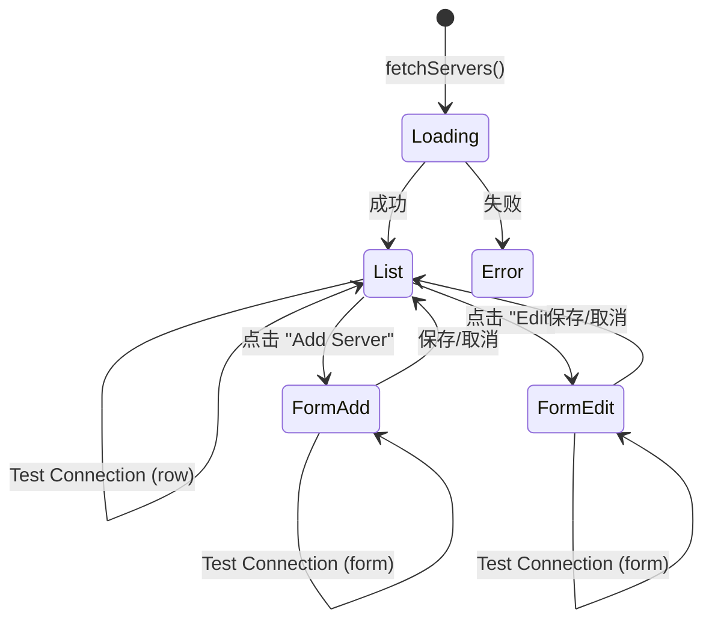
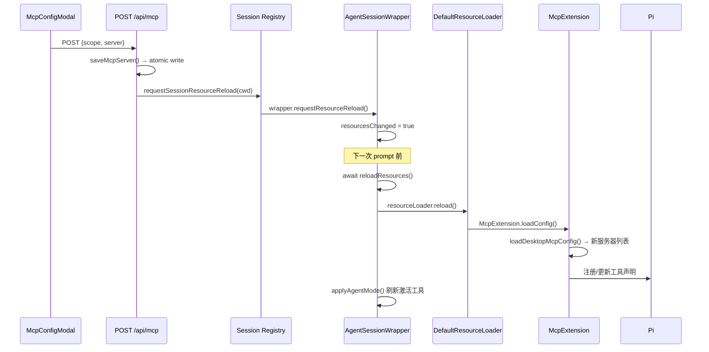

本文档详细解释 Pi Agent Desktop 中 **MCP（Model Context Protocol）服务器的双级配置架构** 与 **可视化管理界面** 的设计与实现。MCP 配置采用 **全局 + 项目** 两级作用域，项目级配置在受信任前提下覆盖全局同名条目，管理 UI 提供直观的增删改查、启用/禁用、连接测试与暴露策略控制。

---

## 架构总览

MCP 配置系统由四层组成：**配置文件持久化**、**核心库函数**、**REST API**、**前端管理模态框**，并在运行时通过 `McpExtension` 注入 Agent 会话。

```mermaid
graph TB
    subgraph Persistence["持久化层"]
        GCF["全局配置<br/>~/.pi/agent/mcp.json"]
        PCF["项目配置<br/>project/.pi/mcp.json"]
    end

    subgraph CoreLib["核心库 lib/mcp-config.ts"]
        RC["readMcpConfig(scope, cwd)"]
        WC["writeMcpConfig(scope, config, cwd)"]
        GS["getMcpServers(cwd) → 合并列表"]
        SS["saveMcpServer(scope, server, cwd)"]
        RS["removeMcpServer(scope, id, cwd)"]
        TS["toggleMcpServer(scope, id, disabled, cwd)"]
        LD["loadDesktopMcpConfig(agentDir, cwd, trusted)"]
        TC["testMcpServerConnection(options)"]
    end

    subgraph API["REST API /api/mcp/*"]
        AG["GET /api/mcp?cwd= → servers[]"]
        AP["POST /api/mcp → save"]
        AD["DELETE /api/mcp → remove"]
        AT["POST /api/mcp/toggle → enable/disable"]
        ATEST["POST /api/mcp/test → probe"]
    end

    subgraph UI["前端组件 components/McpConfigModal.tsx"]
        MC["McpConfigContent(cwd)"]
        MF["表单：新建/编辑"]
        ML["列表：scope badge、transport、status、actions"]
    end

    subgraph Runtime["运行时集成 lib/rpc-manager.ts"]
        SE["startRpcSession → createMcpExtension"]
        ME["McpExtension.loadConfig = loadDesktopMcpConfig"]
        RL["requestSessionResourceReload(cwd)"]
    end

    GCF --> RC
    PCF --> RC
    RC --> GS
    WC <-- SS
    WC <-- RS
    WC <-- TS
    GS --> AG
    SS --> AP
    RS --> AD
    TS --> AT
    TC --> ATEST
    AG --> MC
    AP --> MF
    AD --> ML
    AT --> ML
    ATEST --> MF
    ATEST --> ML
    LD --> ME
    SE --> ME
    AP --> RL
    AD --> RL
    AT --> RL
    RL --> SE
```

**Sources:** [lib/mcp-config.ts](lib/mcp-config.ts#L1-L331), [app/api/mcp/route.ts](app/api/mcp/route.ts#L1-L81), [components/McpConfigModal.tsx](components/McpConfigModal.tsx#L1-L642), [lib/rpc-manager.ts](lib/rpc-manager.ts#L800-L944)

---

## 双级配置模型

### 作用域与文件路径

| 作用域 | 文件路径 | 适用范围 | 优先级 |
|--------|----------|----------|--------|
| **global** | `~/.pi/agent/mcp.json`（或自定义 `agentDir`） | 所有项目 | 基础层 |
| **project** | `<cwd>/.pi/mcp.json` | 仅当前项目，需 **Project Trust** 通过 | 覆盖层 |

`getMcpConfigPath()` 根据 scope 与可选 `cwd`/`agentDir` 解析路径。项目级路径要求必须提供 `cwd`，否则抛出错误。

**Sources:** [lib/mcp-config.ts](lib/mcp-config.ts#L57-L72)

### 合并语义：项目覆盖全局

`getMcpServers(cwd)` 先读取全局，再读取项目（若提供 `cwd`），按 **`mcpServers` 对象的 name 键**（即 server id）合并，项目级同名条目**完全替换**全局条目。返回数组每项带有 `scope: "global" | "project"` 标记，供 UI 展示徽章。注意：管理 API 的 GET 始终合并两级文件；**运行时** `loadDesktopMcpConfig(..., projectTrusted)` 在未信任项目上**只加载 global**，不读项目级 `mcp.json`。

```typescript
// 简化合并逻辑
const serversMap = new Map<string, McpServerStatus>();

// 1. 全局
for (const [id, s] of Object.entries(globalConfig.mcpServers ?? {})) {
  serversMap.set(id, { ...s, id, scope: "global", status: ... });
}

// 2. 项目（后写入，自动覆盖）
if (cwd) {
  for (const [id, s] of Object.entries(projectConfig.mcpServers ?? {})) {
    serversMap.set(id, { ...s, id, scope: "project", status: ... });
  }
}
```

**Sources:** [lib/mcp-config.ts](lib/mcp-config.ts#L92-L134)

### 项目信任门控

`loadDesktopMcpConfig(agentDir, cwd, projectTrusted)` 仅在 `projectTrusted === true` 时读取项目配置。这是与 **[Project Trust 409 握手](21-project-trust-409-wo-shou-yu-yan-chi-session-chuang-jian)** 的集成点：未受信项目的 MCP 服务器不会被加载，避免供应链风险。

**Sources:** [lib/mcp-config.ts](lib/mcp-config.ts#L136-L197), [lib/rpc-manager.ts](lib/rpc-manager.ts#L870-L878)

---

## 配置 Schema 与传输类型

### 统一配置接口

```typescript
export interface McpServerConfig {
  id: string;                    // 唯一键，仅字母数字下划线连字符
  name?: string;                 // 显示名
  transport?: "stdio" | "http" | "sse";  // 旧字段兼容
  type?: "stdio" | "http";       // 新字段，存盘使用
  command?: string;              // stdio 必填
  args?: string[];               // stdio 参数
  env?: Record<string, string>;  // stdio 环境变量
  url?: string;                  // http 必填，必须 http/https
  headers?: Record<string, string>; // http 请求头
  oauth?: Record<string, unknown>;  // http OAuth
  disabled?: boolean;            // 旧字段兼容
  enabled?: boolean;             // 新字段，存盘使用
  exposure?: "direct" | "codemode" | "codemode-deferred" | "deferred" | "hidden";
  toolExposure?: Record<string, string>;
  timeout?: number;
  cwd?: string;
}
```

**字段规范化：**
- 存盘时统一写入 `type` 与 `enabled`，废弃 `transport`/`disabled`
- 读取时兼容两套字段，`disabled = enabled === false || Boolean(disabled)`
- **SSE 传输被显式拒绝**：仅支持 `stdio` 与 Streamable HTTP

**Sources:** [lib/mcp-config.ts](lib/mcp-config.ts#L10-L45), [lib/mcp-config.ts](lib/mcp-config.ts#L200-L230)

### 传输类型对比

| 特性 | stdio | Streamable HTTP |
|------|-------|-----------------|
| 启动方式 | 本地子进程 `command + args` | 远程端点 `url` |
| 环境变量 | 支持 `env` 与 `${VAR}` 替换 | 不适用 |
| 请求头 | 不适用 | 支持 `headers` 与 `${TOKEN}` 替换 |
| OAuth | 不支持 | 支持 `oauth` 字段 |
| 典型场景 | 本地 CLI 工具 (npx, uvx) | 托管 MCP 服务、远程代理 |
| 连接测试 | 启动子进程探测 | HTTP GET/POST 探测 |

**Sources:** [lib/mcp-config.ts](lib/mcp-config.ts#L240-L300), [components/McpConfigModal.tsx](components/McpConfigModal.tsx#L260-L340)

---

## 管理 UI：McpConfigModal

`McpConfigModal.tsx` 导出 `McpConfigContent({ cwd })`，嵌入设置对话框或独立页面。核心状态与交互：

### 状态机



### 列表视图

每行展示：
- **名称/ID** + **Scope 徽章**（Global=靛蓝 / Project=琥珀）
- **Transport 标签**（stdio / http）
- **状态胶囊**：Connected(绿) / Configured(黄) / Error(红) / Disabled(灰)，含工具数
- **命令/URL** 单行截断
- **错误信息** 行内红字
- **操作按钮**：Test / Enable↔Disable / Edit / Delete

**Sources:** [components/McpConfigModal.tsx](components/McpConfigModal.tsx#L430-L590)

### 表单视图

| 字段 | stdio | http | 说明 |
|------|-------|------|------|
| Server ID | ✅ 必填 | ✅ 必填 | `^[A-Za-z0-9_-]+$` |
| Display Name | 可选 | 可选 | 仅 UI 显示 |
| Scope | ✅ | ✅ | Project 需有 `cwd` |
| Transport | ✅ | ✅ | 下拉切换，SSE 灰化禁用 |
| Exposure | ✅ | ✅ | 5 种策略，默认 `direct` |
| Command | ✅ 必填 | 隐藏 | 如 `npx` `node` |
| Arguments | 可选 | 隐藏 | 空格分割，如 `-y @pkg/server` |
| Environment | 可选 | 隐藏 | `KEY=VALUE` 每行一对 |
| Endpoint URL | 隐藏 | ✅ 必填 | HTTP/HTTPS URL |
| Headers | 隐藏 | 可选 | JSON，支持 `${ENV}` 替换 |

**表单内联测试**：点击 "Test Connection" 发起 `/api/mcp/test`，结果即时展示（绿/红）。

**Sources:** [components/McpConfigModal.tsx](components/McpConfigModal.tsx#L200-L420)

### 国际化键（摘录）

| 键 | 默认含义 |
|-----|----------|
| `mcp.servers` | "MCP Servers" |
| `mcp.addServer` | "Add Server" |
| `mcp.serverId` | "Server ID" |
| `mcp.displayName` | "Display Name" |
| `mcp.scope` | "Config Scope" |
| `mcp.transport` | "Transport" |
| `mcp.stdioTransport` | "stdio (Subprocess)" |
| `mcp.httpTransport` | "HTTP (Streamable HTTP)" |
| `mcp.exposure` | "Tool exposure" |
| `mcp.command` | "Command" |
| `mcp.arguments` | "Arguments" |
| `mcp.environment` | "Environment Variables" |
| `mcp.endpoint` | "Streamable HTTP Endpoint URL" |
| `mcp.headers` | "HTTP headers (JSON)" |
| `mcp.testConnection` | "Test Connection" |
| `mcp.saveServer` | "Save Server" |
| `mcp.deleteConfirm` | "Delete MCP server “{name}”?" |
| `scope.global` | "Global Scope" |
| `scope.project` | "Project Scope" |

**Sources:** [components/McpConfigModal.tsx](components/McpConfigModal.tsx#L1-L50), [lib/i18n/dictionaries.ts](lib/i18n/dictionaries.ts)

---

## REST API 契约

### 统一错误格式

```json
{ "error": "message", "errorCode": "..." }
```

`errorCode` 仅在调用方传入时附带；响应体**不含 `requestId` 字段**，`requestId` 只通过 `x-request-id` 响应头传递（`lib/api-error.ts` 的 `jsonError()`）。

所有端点返回 `x-request-id` 头用于追踪。

### 端点详表

| 方法 | 路径 | 用途 | 请求体 | 响应 |
|------|------|------|--------|------|
| GET | `/api/mcp?cwd=` | 列出合并后服务器 | — | `{ servers: McpServerStatus[] }`（**不**包 `{success, data}`） |
| POST | `/api/mcp` | 新建/更新 | `{ scope, cwd?, server: McpServerConfig }` | `{ success: true, server: McpServerStatus }` |
| DELETE | `/api/mcp` | 删除 | `{ id, scope, cwd? }` | `{ success: true }` / 404 `{ success: false, error }` |
| POST | `/api/mcp/toggle` | 启用/禁用 | `{ id, scope, disabled: boolean, cwd? }` | `{ success: true }` / 404 |
| POST | `/api/mcp/test` | 连接探测 | `TestMcpServerOptions` | `{ success, message?, toolsCount? }` |

**关键行为：**
- 写操作（POST / DELETE / toggle）成功后调用 `requestSessionResourceReload(cwd)`，触发活跃会话的 `inner.reload()`，使新 MCP 工具立即生效，无需重启会话
- `/api/mcp/test` 要求同源校验（`validateRequestOrigin`），防止 CSRF

**Sources:** [app/api/mcp/route.ts](app/api/mcp/route.ts#L1-L81), [app/api/mcp/toggle/route.ts](app/api/mcp/toggle/route.ts#L1-L43), [app/api/mcp/test/route.ts](app/api/mcp/test/route.ts#L1-L30), [lib/rpc-manager.ts](lib/rpc-manager.ts#L830-L835)

---

## 运行时集成：从配置到 Agent 会话

### 会话启动时加载

`startRpcSession()` 创建 `DefaultResourceLoader`，注册 `createMcpExtension`，其 `loadConfig` 回调指向 `loadDesktopMcpConfig(agentDir, cwd, ctx.isProjectTrusted())`。

```typescript
// lib/rpc-manager.ts 约 870 行
createMcpExtension({
  loadConfig: (ctx) => loadDesktopMcpConfig(agentDir, ctx.cwd, ctx.isProjectTrusted())
})
```

`loadDesktopMcpConfig` 返回 `LoadedMcpConfig = { servers: LoadedServer[], errors: string[], autoEnableCodemode: false }`，`McpExtension` 据此向 Pi 注册工具。

**Sources:** [lib/rpc-manager.ts](lib/rpc-manager.ts#L870-L878), [lib/mcp-config.ts](lib/mcp-config.ts#L136-L197)

### 配置变更热重载

写操作 API 调用 `requestSessionResourceReload(scope === "project" ? cwd : undefined)` → 遍历注册表，匹配 `cwd` 的 wrapper 调用 `requestResourceReload()` → 标记 `resourcesChanged = true` → 下一次 `prompt` 前 `await reload()` → `inner.reload()` 重新加载扩展 → `McpExtension.loadConfig` 再次执行 → 新工具集生效。



**Sources:** [lib/rpc-manager.ts](lib/rpc-manager.ts#L830-L835), [lib/rpc-manager.ts](lib/rpc-manager.ts#L140-L160), [lib/rpc-manager.ts](lib/rpc-manager.ts#L200-L220)

---

## 关键特性深度解析

### 1. 原子写入与恶性文件保护

`writeMcpConfig()` 使用 `writeFileAtomic`（临时文件 + rename），并在写入前**校验现有文件合法性**：若现有文件不是对象、或 `mcpServers` 不是对象，直接抛错拒绝覆盖，防止损坏配置被静默清空。

```typescript
if (existsSync(path)) {
  const previous = JSON.parse(readFileSync(path, "utf-8"));
  if (!previous || typeof previous !== "object" || Array.isArray(previous))
    throw new Error("MCP configuration must be an object");
  const entries = (previous as McpConfigFile).mcpServers;
  if (entries !== undefined && (!entries || typeof entries !== "object" || Array.isArray(entries)))
    throw new Error("mcpServers must be an object");
}
```

**Sources:** [lib/mcp-config.ts](lib/mcp-config.ts#L74-L90), [lib/atomic-write.ts](lib/atomic-write.ts)

### 2. 环境变量与凭据插值

- **存盘**：原样保存 `${TOKEN}`、`${GITHUB_TOKEN}` 等占位符
- **运行时解析**：`testMcpServerConnection` 与 `McpExtension` 均在建立传输前调用 `resolveValues()`，将 `${VAR}` 替换为 `process.env[VAR]`，`!` 前缀值视为命令凭据，**拒绝在测试 API 中解析**（由 Pi 会话侧处理）

```typescript
const resolveValues = (values?: Record<string, string>) =>
  Object.fromEntries(Object.entries(values ?? {}).map(([key, value]) => {
    if (value.startsWith("!")) throw new Error("Command-valued credentials are resolved by Pi during the session");
    return [key, value.replace(/\$\{([^}]+)\}/g, (_, name) => process.env[name] ?? "")];
  }));
```

**Sources:** [lib/mcp-config.ts](lib/mcp-config.ts#L240-L260), [lib/mcp-config.test.ts](lib/mcp-config.test.ts#L1-L30)

### 3. Exposure 曝光策略

控制工具在 **Codemode**（自动执行模式）下的可用性：

| 值 | 含义 |
|----|------|
| `direct` | 始终可用（桌面端默认；SDK 原生默认为 `codemode`，见下注） |
| `codemode` | 仅 Codemode 可用 |
| `codemode-deferred` | Codemode 可用，但延迟加载 |
| `deferred` | 延迟加载，需显式调用 |
| `hidden` | 完全隐藏，不暴露给模型 |

> **默认值说明**：桌面端存盘默认为 `direct`（`saveMcpServer` 兜底、表单初值同为 `direct`）；但 Pi SDK 原生 `McpServerConfig.exposure` 的默认是 `codemode`，仅在绕过桌面端配置层直接使用 SDK 时生效。

桌面端 **Codemode 开关具备最高优先级**：`loadDesktopMcpConfig` 返回 `autoEnableCodemode: false`，防止 MCP 配置意外开启 Codemode。

**Sources:** [lib/mcp-config.ts](lib/mcp-config.ts#L190-L197), [lib/mcp-config.test.ts](lib/mcp-config.test.ts#L1-L30)

### 4. 遗留字段兼容与迁移

| 旧字段 | 新字段 | 迁移规则 |
|--------|--------|----------|
| `transport` | `type` | 读取兼容，写入统一用 `type` |
| `disabled` | `enabled` | `enabled = !disabled`，写入仅 `enabled` |
| `type: "sse"` | — | 读取时报错，拒绝加载 |

测试用例 `native and legacy disabled fields agree between UI and runtime` 验证四种组合 `(enabled, disabled) ∈ {true,false,undefined}²` 的一致性。

**Sources:** [lib/mcp-config.ts](lib/mcp-config.ts#L92-L134), [lib/mcp-config.test.ts](lib/mcp-config.test.ts#L60-L85)

### 5. 连接测试实现

`testMcpServerConnection()` 创建临时 `McpClient`：有 `url` 则用 `StreamableHttpTransport`，否则 `StdioTransport`。`transport === "sse"` **显式抛错**（不支持 legacy SSE）。7 秒超时赛跑 `client.connect()` 与 `client.listTools()`。成功返回工具数量，失败返回错误信息。

- **不复用会话连接**：每次测试独立建立，避免干扰活跃会话
- **SSE 显式拒绝**：抛错提示改用 Streamable HTTP

**Sources:** [lib/mcp-config.ts](lib/mcp-config.ts#L240-L300), [app/api/mcp/test/route.ts](app/api/mcp/test/route.ts#L1-L30)

---

## 常见操作流程

### 新增 stdio 服务器（如 GitHub MCP）

1. 点击 "Add Server"
2. 填写：ID=`github`、Name=`GitHub MCP`、Scope=`Project`、Transport=`stdio`
3. Command=`npx`、Arguments=`-y @modelcontextprotocol/server-github`
4. Environment：`GITHUB_PERSONAL_ACCESS_TOKEN=ghp_xxx`（或 `${GITHUB_TOKEN}` 占位）
5. Exposure=`direct`（或按需）
6. 点击 "Test Connection" → 显示工具数
7. 点击 "Save Server" → 列表刷新，项目级徽章显示

### 新增 HTTP 服务器（托管 MCP）

1. Transport 切换为 `http`
2. Endpoint URL=`https://mcp.example.com/mcp`
3. Headers JSON：`{"Authorization": "Bearer ${API_TOKEN}"}`
4. 其余同 stdio

### 禁用/启用服务器

列表行 "Disable"/"Enable" 按钮 → `POST /api/mcp/toggle` → 立即生效，状态胶囊切色，工具从会话中移除/恢复（经 `requestSessionResourceReload`）。

### 删除服务器

确认对话框后 `DELETE /api/mcp` → 从对应作用域文件移除键 → 列表移除。

---

## 迁移与升级指南

| 场景 | 处理 |
|------|------|
| 旧版 `mcp.json` 含 `transport` | 读取兼容，下次保存自动迁移为 `type` |
| 旧版含 `disabled: true` | 读取兼容，下次保存迁移为 `enabled: false` |
| 旧版含 `type: "sse"` | 读取报错，需手动改为 `http` + `url` |
| 想把全局服务器改为项目级 | UI 编辑时 Scope 选 Project，保存即写入 `.pi/mcp.json` |
| 多项目共享同一全局配置 | 维护 `~/.pi/agent/mcp.json`，各项目不建 `.pi/mcp.json` 或留空 |

**Sources:** [lib/mcp-config.ts](lib/mcp-config.ts#L200-L230), [lib/mcp-config.test.ts](lib/mcp-config.test.ts#L1-L30)

---

## 故障排查速查

| 现象 | 可能原因 | 排查步骤 |
|------|----------|----------|
| 列表为空但文件存在 | JSON 语法错误 / `mcpServers` 非对象 | 检查文件语法，`readMcpConfig` 静默返回空对象 |
| 项目服务器不生效 | Project Trust 未通过 | 确认项目已信任，或在信任对话框授权 |
| 测试连接超时 | 命令启动慢 / 网络不可达 | 增加超时（代码固定 7s），检查命令/URL 可达性 |
| 环境变量不生效 | `${VAR}` 未替换 | 确认 `process.env[VAR]` 存在，或在 `.env` 设置 |
| 修改后会话工具未更新 | `requestSessionResourceReload` 未触发 | 检查 API 响应，确认会话 `cwd` 匹配 |
| SSE 配置报错 | 仍在使用 legacy SSE | 改为 Streamable HTTP (`type: "http"`) |

**Sources:** [lib/mcp-config.ts](lib/mcp-config.ts#L74-L90), [lib/rpc-manager.ts](lib/rpc-manager.ts#L830-L835), [app/api/mcp/test/route.ts](app/api/mcp/test/route.ts#L1-L30)

---

## 与其他系统的交互

| 系统 | 交互点 | 说明 |
|------|--------|------|
| **Project Trust** | `loadDesktopMcpConfig(..., projectTrusted)` | 未信任项目不加载项目级 MCP |
| **AgentSession 热重载** | `requestSessionResourceReload` → `inner.reload()` | 配置变更无需重启会话 |
| **Codemode 开关** | `autoEnableCodemode: false` | 桌面端开关优先，MCP 不能强制开启 |
| **长期记忆 (LTM)** | `desktopLtmInlineExtension` 同级注册 | MCP 工具与 memory_save/forget 共存 |
| **审批策略** | `desktopApprovalInlineExtension` | MCP 工具执行仍受 Ask/Plan/Full 模式管控 |

**Sources:** [lib/rpc-manager.ts](lib/rpc-manager.ts#L870-L878), [lib/approval-policy.ts](lib/approval-policy.ts#L1-L86)

---

## 设计决策与权衡

| 决策 | 理由 | 替代方案 |
|------|------|----------|
| 双文件而非单文件多作用域 | 文件系统权限隔离，项目配置可提交 Git | 单文件 + `scope` 字段 |
| 项目覆盖而非合并数组 | 语义清晰：同名即替换，避免歧义 | 深度合并字段 |
| 原子写入 + 恶性文件保护 | 防止配置损坏导致全量丢失 | 直接覆盖 |
| 运行时解析 `${VAR}` 而非存盘解析 | 凭据不落盘，环境差异兼容 | 存盘时展开 |
| SSE 彻底移除 | 协议已废弃，Streamable HTTP 更标准 | 兼容 SSE |
| 测试 API 同源校验 | 防止恶意页面探测内网 MCP 端点 | 无校验 |

**Sources:** [lib/mcp-config.ts](lib/mcp-config.ts#L1-L331), [lib/mcp-config.test.ts](lib/mcp-config.test.ts#L1-L252)

---

## 扩展阅读

- **[Project Trust 409 握手与延迟 Session 创建](21-project-trust-409-wo-shou-yu-yan-chi-session-chuang-jian)** — 项目信任如何门控项目级 MCP 加载
- **[Extension UI Bridge 与异步 RPC 响应队列](17-extension-ui-bridge-yu-yi-bu-rpc-xiang-ying-dui-lie)** — MCP 工具若需交互确认，如何通过 UI Bridge 完成
- **[AgentSession 生命周期与进程内注册表](7-agentsession-sheng-ming-zhou-qi-yu-jin-cheng-nei-zhu-ce-biao)** — 会话热重载 `reload()` 的内部机制
- **[四层分离架构详解](6-si-ceng-fen-chi-jia-gou-xiang-jie)** — 整体分层视角下的配置与运行时边界

---

## 变更历史

| 版本 | 日期 | 变更 |
|------|------|------|
| 0.9.0 | 2026-09 | 初版：双级配置、Management UI、热重载、Exposure 策略 |

---

*本文档基于代码考古方法编写，所有实现细节均可追溯至上文引用的源文件行号。*