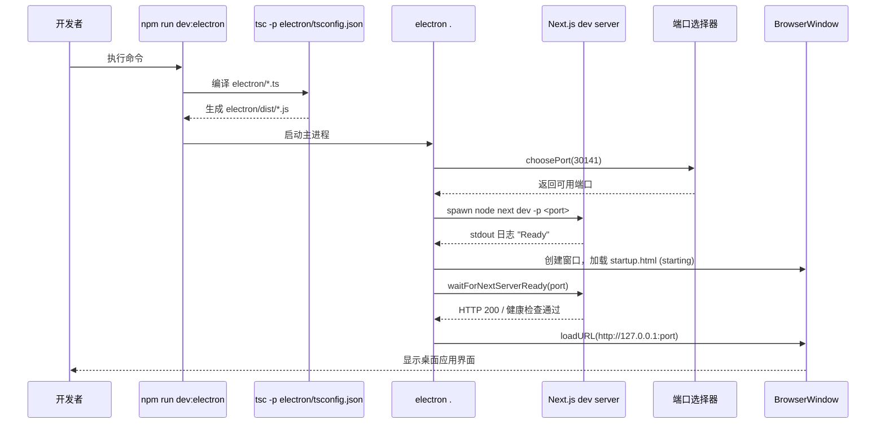
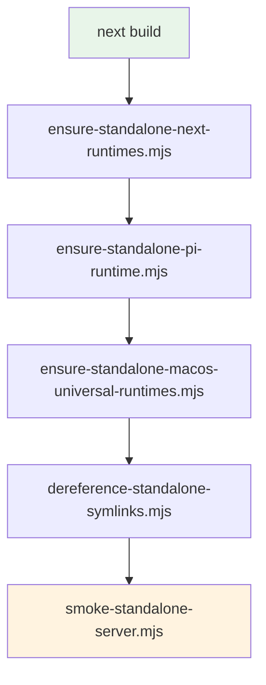

欢迎来到 **Pi Agent Desktop** 的快速开始指南。本文档面向初学者开发者，涵盖从环境准备到运行开发版、构建安装包的完整流程。阅读完本指南后，你将能够在本地启动桌面应用、进行功能开发调试，并理解项目的核心运行机制。

> **项目定位**：Pi Agent Desktop 是 [Pi 编程智能体](https://github.com/badlogic/pi-mono) 的原生桌面客户端，基于 Electron + Next.js 构建，提供比浏览器更原生的使用体验。上游项目为 [pi-web](https://github.com/agegr/pi-web)。

Sources: [README.zh-CN.md](README.zh-CN.md#L1-L50), [package.json](package.json#L1-L30)

---

## 1. 环境准备

在开始之前，请确保你的开发机器满足以下基础要求：

| 工具 | 最低版本 | 用途 | 验证命令 |
|------|----------|------|----------|
| **Node.js** | 20+ | JavaScript 运行时，驱动 Next.js 与 Electron | `node --version` |
| **npm** | 10+ | 包管理器（随 Node.js 安装） | `npm --version` |
| **Git** | 2.30+ | 版本控制，克隆仓库 | `git --version` |
| **Python 3** | 3.8+ | 个别原生依赖 node-gyp 本地编译时的兜底环境 | `python --version` |
| **C++ 构建工具链** | - | Windows: Visual Studio Build Tools；macOS: Xcode Command Line Tools；Linux: `build-essential` | - |

> **提示**：推荐使用 [fnm](https://github.com/Schniz/fnm) 或 [nvm](https://github.com/nvm-sh/nvm) 管理 Node.js 版本。项目在 `package.json` 的 `engines` 字段未显式限制，但 CI 固定使用 Node 24，建议保持一致。

Sources: [package.json](package.json#L50-L60), [.github/workflows/ci.yml](.github/workflows/ci.yml)

---

## 2. 获取代码与安装依赖

```bash
# 1. 克隆仓库
git clone https://github.com/Chasen-Liao/pi-agent-desktop.git
cd pi-agent-desktop

# 2. 安装依赖（推荐使用 npm ci 保证锁文件一致性）
npm ci
```

**依赖安装要点**：

- 项目使用 `package-lock.json` 锁定版本，`npm ci` 会严格按锁文件安装，避免版本漂移
- 首次安装会触发 Electron 等原生模块的下载与编译，可能需要几分钟
- 若在 Windows 上遇到 `node-gyp` 报错，请确认已安装 **Visual Studio Build Tools**（勾选 "Desktop development with C++"）

Sources: [package.json](package.json#L1-L20), [README.zh-CN.md](README.zh-CN.md#L90-L110)

---

## 3. 两种运行模式

Pi Agent Desktop 支持两种开发运行模式，适用于不同场景：

```mermaid
flowchart LR
    A[开发者] --> B{运行模式选择}
    B -->|浏览器模式| C[npm run dev]
    B -->|Electron 桌面模式| D[npm run dev:electron]
    
    C --> E[http://localhost:30141]
    E --> F[热重载<br/>调试 UI/逻辑<br/>无原生能力]
    
    D --> G[原生窗口]
    G --> H[系统托盘<br/>文件系统访问<br/>自动更新 (仅打包模式)<br/>托盘右键菜单]
    
    style C fill:#e1f5fe
    style D fill:#fff3e0
```

### 3.1 浏览器模式（`npm run dev`）

```bash
npm run dev
# 输出示例：
# █ Next.js 16.3.6
# █ Local:        http://localhost:30141
# █ Network:      http://192.168.x.x:30141
```

- **端口固定**：`30141`（在 `package.json` 的 `dev`/`start` 脚本中写死，`next.config.ts` 不涉及端口）
- **热重载**：修改 React 组件、Hook、API 路由即时生效
- **适用场景**：UI 调试、样式调整、API 逻辑开发、不需要 Electron 原生能力的功能
- **限制**：无系统托盘、无文件系统完整访问、无自动更新、无原生菜单栏

### 3.2 Electron 桌面模式（`npm run dev:electron`）

```bash
npm run dev:electron
```

此命令内部执行以下步骤：

1. `npm run build:electron` —— 编译 `electron/` 目录下的 TypeScript 到 `electron/dist/`
2. 复制 `startup.html` 和 `startup.js` 到 `electron/dist/`
3. `npx electron .` —— 启动 Electron 主进程，加载 `http://127.0.0.1:<动态端口>`（从 30141 起探测，被占用则顺延）

**Electron 启动流程**：



**关键实现细节**（`electron/main.ts`）：

- **单实例锁**：`app.requestSingleInstanceLock()` 防止多开
- **端口自动避让**：默认 30141，被占用时自动寻找可用端口（`choosePort`）
- **就绪检查**：
  - 开发模式：Next.js 控制台输出 "Ready"（进程级）**或** HTTP 健康检查 `/api/health` 返回 200（网络级），任一通过即就绪（`Promise.any`）
  - 打包模式：仅 HTTP 健康检查
- **启动过渡页**：`startup.html` 显示 "starting" / "error" / "stopped" 状态
- **开发环境**：使用 `spawn("node", [nextBin, "dev", "-p", port])` 启动 Next.js 子进程

Sources: [package.json](package.json#L15-L20), [electron/main.ts](electron/main.ts#L1-L150), [electron/port-selection.ts](electron/port-selection.ts), [electron/server-wait.ts](electron/server-wait.ts)

---

## 4. 首次运行验证

### 4.1 浏览器模式验证

1. 运行 `npm run dev`
2. 打开浏览器访问 `http://localhost:30141`
3. 应看到 **AppShell** 布局：
   - 左侧：会话边栏（SessionSidebar），显示会话列表与文件浏览器
   - 中央：聊天窗口（ChatWindow），含液态思考球（LiquidOrbCanvas）
   - 右侧：可展开面板（文件查看器、分支导航器、系统提示词等）
   - 顶部：标签栏、模型选择器、状态栏

### 4.2 Electron 模式验证

1. 运行 `npm run dev:electron`
2. 应弹出原生桌面窗口，标题栏显示 "Pi Agent Desktop"
3. 系统托盘区域出现应用图标（右键可显示/退出）
4. 关闭窗口（非退出）时会隐藏到托盘；通过托盘双击或右键"显示窗口"恢复
5. 快捷键测试：
   - `Ctrl+B`：切换左侧边栏
   - `Ctrl+Alt+B`：切换右侧面板

Sources: [components/AppShell.tsx](components/AppShell.tsx#L1-L100), [electron/tray.ts](electron/tray.ts), [electron/main.ts](electron/main.ts#L200-L350)

---

## 5. 核心开发命令速查

| 命令 | 用途 | 典型场景 |
|------|------|----------|
| `npm run dev` | 启动 Next.js 开发服务器（浏览器模式） | UI 开发、API 调试、热重载验证 |
| `npm run dev:electron` | 编译 Electron + 启动桌面窗口 | 端到端功能测试、原生能力验证 |
| `npm run build:standalone` | 生产构立 + 打包 standalone 产物 | 发布前验证、生产构建检查 |
| `npm run build:electron` | 仅编译 Electron 主进程代码 | 修改 `electron/*.ts` 后快速验证 |
| `npx tsc --noEmit` | 全项目类型检查 | 提交前检查、CI 模拟 |
| `npx tsc -p electron/tsconfig.json --noEmit` | Electron 专用类型检查 | Electron 代码变更后验证 |
| `npm run lint` | ESLint 代码规范检查 | 提交前检查、CI 模拟 |
| `npm test` | 运行全量单元测试（含 middleware） | 回归测试、重构验证 |
| `npm run test:windows` | Windows CI 子集测试 | Windows 兼容性验证 |
| `npm run test:macos` | macOS CI 子集测试 | macOS 兼容性验证 |
| `npm run dist` | 构建当前平台安装包 | 本地打包测试、分发准备 |
| `npm run dist:mac` | 构建 macOS Universal 安装包 | macOS 双架构打包 |
| `npm run pack` | 打包未签名目录（`--dir` 模式） | 快速验证打包产物结构 |
| `npm run check:electron-deps` | 校验 electron-updater 运行时依赖 | 打包前依赖校验 |

> **注意**：`npm test` 包含 `middleware.test.ts`，必须保留 `--test-force-exit` 参数（已在 `package.json` 写死），否则测试进程可能挂起。

Sources: [package.json](package.json#L10-L40), [README.zh-CN.md](README.zh-CN.md#L90-L110)

---

## 6. 构建与打包流程

### 6.1 生产构建（Standalone）

```bash
npm run build:standalone
```

此命令串行执行以下子步骤（`package.json` 的 `build:standalone` 脚本）：



| 步骤 | 脚本 | 作用 |
|------|------|------|
| 1 | `next build` | Next.js 编译输出 `.next/standalone` 目录 |
| 2 | `ensure-standalone-next-runtimes.mjs` | 补齐 Turbopack runtime 依赖 |
| 3 | `ensure-standalone-pi-runtime.mjs` | 补齐 `@earendil-works/pi-coding-agent` 运行时依赖闭包 |
| 4 | `ensure-standalone-macos-universal-runtimes.mjs` | 补齐 macOS 双架构 Sharp 运行时（`@img/sharp-darwin-arm64/x64`） |
| 5 | `dereference-standalone-symlinks.mjs` | 解析 standalone 目录下的符号链接，避免打包问题 |
| 6 | `smoke-standalone-server.mjs` | 启动 standalone 服务器冒烟测试，验证 HTTP 200 |

### 6.2 打包安装包

```bash
# Windows / Linux：构建当前平台安装包
npm run dist

# macOS：构建 Universal (Intel + Apple Silicon) 安装包
npm run dist:mac
```

**打包产物输出目录**：`release/`

| 平台 | 产物格式 | 文件命名模式 |
|------|----------|--------------|
| Windows | NSIS 安装程序 | `Pi-Agent-Desktop-Setup-${version}.exe` |
| macOS | Universal DMG + ZIP | `Pi-Agent-Desktop-${version}-mac-universal.dmg/.zip` |
| Linux | DEB 包 | `Pi-Agent-Desktop-${version}-linux-x64.deb` |

**electron-builder 关键配置**（`electron-builder.yml`）：

- `asar: true`：应用代码打包为 asar 压缩包
- `npmRebuild: true`：打包时重新编译原生模块
- `extraResources`：第一项 `.next/standalone` 必须 `filter: ["**/*", "!node_modules", ...]`（`filter:["**/*"]` 会静默排除 `node_modules`）；`node_modules` 是**单独一条** extraResources；另拷 `electron-updater` 及其依赖到 `app/node_modules/`
- macOS `x64ArchFiles`：保护双架构原生模块（`sharp`、`clipboard`、`esbuild`、`pi-tui`）不被 `lipo` 合并

Sources: [package.json](package.json#L25-L35), [electron-builder.yml](electron-builder.yml#L1-L80), [scripts/ensure-standalone-pi-runtime.mjs](scripts/ensure-standalone-pi-runtime.mjs)

---

## 7. 常见问题与排查

### 7.1 依赖安装失败

| 现象 | 可能原因 | 解决方案 |
|------|----------|----------|
| `node-gyp` 报错 `MSBUILD : error MSB3428` | 缺少 Visual Studio Build Tools (Windows) | 安装 VS Build Tools，勾选 "Desktop development with C++" |
| 原生模块 node-gyp 编译失败 | Python 版本不兼容或缺少构建工具 | 确保 Python 3.8+、安装 `build-essential` (Linux) / Xcode CLT (macOS) |
| `npm ci` 提示 `ERESOLVE` | 依赖树冲突 | 删除 `node_modules` 与 `package-lock.json` 后重试 `npm install` |

### 7.2 端口占用

```
Error: listen EADDRINUSE: address already in use :::30141
```

**原因**：30141 端口被其他进程占用（可能是未正常退出的上一次 dev 进程）

**解决**：
```bash
# Windows
netstat -ano | findstr :30141
taskkill /PID <PID> /F

# macOS / Linux
lsof -ti:30141 | xargs kill -9
```

> Electron 的 `choosePort` 会自动寻找可用端口，但在浏览器模式（`npm run dev`）下端口固定为 30141，需手动释放。

Sources: [electron/port-selection.ts](electron/port-selection.ts), [package.json](package.json#L15)

### 7.3 Electron 窗口白屏 / 无法加载

| 现象 | 排查步骤 |
|------|----------|
| 窗口打开但显示白屏 | 1. 检查控制台是否有 CSP 报错（F12 → Console）<br>2. 确认 Next.js dev server 正常启动（终端有 "Ready" 输出）<br>3. 检查 `electron/main.ts` 日志文件：`~/Library/Logs/Pi Agent Desktop/main.log` (macOS) / `%APPDATA%\Pi Agent Desktop\logs\main.log` (Windows) |
| 启动页卡在 "starting" | 1. 确认 `waitForNextServerReady` 健康检查通过<br>2. 检查防火墙是否拦截 localhost 连接<br>3. 尝试在浏览器直接访问 `http://localhost:30141/api/health` |
| 窗口闪退 | 1. 查看 Electron 主进程日志<br>2. 运行 `npm run build:electron` 确认编译无误<br>3. 检查 `preload.ts` 是否正确暴露 API |

Sources: [electron/main.ts](electron/main.ts#L150-L250), [electron/navigation.ts](electron/navigation.ts), [electron/csp.ts](electron/csp.ts)

### 7.4 类型检查失败

```bash
npx tsc --noEmit
```

常见错误类型：
- **路径别名解析失败**：检查 `tsconfig.json` 的 `paths` 配置与 `next.config.ts` 一致性
- **Electron 类型缺失**：运行 `npx tsc -p electron/tsconfig.json --noEmit` 单独检查
- **React 19 类型不匹配**：确认 `@types/react` 版本与 `react` 版本对齐（均为 19.x）

Sources: [tsconfig.json](tsconfig.json), [electron/tsconfig.json](electron/tsconfig.json)

---

## 8. 项目结构速览（开发视角）

```
pi-agent-desktop/
├── app/                    # Next.js App Router 页面与 API 路由
│   ├── api/                # 后端 API（SSE、会话、记忆、MCP、信任等）
│   ├── layout.tsx          # 根布局：字体、主题、I18n、错误边界
│   └── page.tsx            # 入口页面 → <AppShell />
├── components/             # React 组件（AppShell、ChatWindow、SessionSidebar 等）
├── electron/               # Electron 主进程代码
│   ├── main.ts             # 入口：窗口管理、进程生命周期、自动更新
│   ├── preload.ts          # 预加载脚本：Context Bridge 暴露安全 API
│   ├── tray.ts             # 系统托盘
│   └── *.ts                # 启动等待、端口选择、崩溃恢复、CSP 等
├── hooks/                  # 复用 React Hooks（useAgentSession、usePanelLayout 等）
├── lib/                    # 核心库代码（与框架无关的业务逻辑）
│   ├── ltm/                # 长期记忆：SQLite 后端、观测钩子、检索
│   ├── session-reader.ts   # .jsonl 会话文件解析
│   ├── rpc-manager.ts      # AgentSession 生命周期管理
│   ├── git-worktree.ts     # Git Worktree 操作
│   └── types.ts            # 共享类型定义
├── scripts/                # 构建辅助脚本（standalone 补齐、冒烟测试等）
├── public/                 # 静态资源
├── next.config.ts          # Next.js 配置（standalone 输出、外部包、环境变量）
├── electron-builder.yml    # electron-builder 打包配置
└── package.json            # 脚本、依赖、元数据
```

Sources: [README.zh-CN.md](README.zh-CN.md#L120-L170), [get_dir_structure](.)

---

## 9. 下一步阅读建议

根据你的关注点，建议按以下顺序深入阅读：

| 关注方向 | 推荐阅读顺序 |
|----------|--------------|
| **整体架构理解** | [项目概览](1-xiang-mu-gai-lan) → [四层分离架构详解](6-si-ceng-fen-chi-jia-gou-xiang-jie) → [目录结构与核心模块](4-mu-lu-jie-gou-yu-he-xin-mo-kuai) |
| **Electron 桌面端开发** | [双模式开发与运行](3-shuang-mo-shi-kai-fa-yu-yun-xing) → [Electron 主进程启动链与双门槛就绪检查](10-electron-zhu-jin-cheng-qi-dong-lian-yu-shuang-men-jian-jiu-xu-jian-cha) → [Preload、CSP、自动更新与系统托盘](12-preload-csp-zi-dong-geng-xin-yu-xi-tong-tuo-pan) |
| **会话与分支模型** | [Pi 会话文件格式与 .jsonl 解析](13-pi-hui-hua-wen-jian-ge-shi-yu-jsonl-jie-xi) → [四种会话分叉机制](14-san-chong-fen-zhi-ji-zhi-fork-hui-hua-nei-fen-zhi-git-worktree-clone) |
| **Agent 交互能力** | [Agent 模式与 Ask 拦截](16-agent-mo-shi-yu-ask-lan-jie-plan-ask-full) → [Extension UI Bridge](17-extension-ui-bridge-yu-yi-bu-rpc-xiang-ying-dui-lie) → [长期记忆](18-chang-qi-ji-yi-sqlite-hou-duan-guan-ce-gou-zi-yu-jian-suo-api) |
| **前端架构与 UI** | [useAgentSession 主 Hook](22-useagentsession-zhu-hook-yu-zi-hook-chai-fen-ce-lue) → [streamReducer 流式状态机](23-streamreducer-liu-shi-xiao-xi-zhuang-tai-ji-yu-zeng-liang-xuan-ran) → [液态思考球渲染](25-ye-tai-si-kao-qiu-webgpu-you-xian-canvas-jiang-ji-xuan-ran) |
| **工程化与发布** | [测试策略](27-ce-shi-ce-lue-node-js-yuan-sheng-ce-shi-ping-tai-zi-ji-yu-mou-yan-ce-shi) → [CI/CD 流水线](28-ci-cd-liu-shui-xian-yu-san-ping-tai-zhuo-mian-bao-fa-bu) → [打包构建流程](11-da-bao-gou-jian-liu-cheng-yu-macos-universal-shuang-jia-gou-chu-li) |

---

## 10. 关键链接汇总

| 资源 | 链接 |
|------|------|
| GitHub 仓库 | https://github.com/Chasen-Liao/pi-agent-desktop |
| Releases 下载 | https://github.com/Chasen-Liao/pi-agent-desktop/releases |
| 上游 Pi 智能体 | https://github.com/badlogic/pi-mono |
| 上游 pi-web | https://github.com/agegr/pi-web |
| 问题反馈 | https://github.com/Chasen-Liao/pi-agent-desktop/issues |
| 变更日志 | [docs/releases/](docs/releases/) |

---

现在你已具备运行、开发、构建 Pi Agent Desktop 的基础知识。建议先运行 `npm run dev:electron` 体验完整桌面应用，再根据兴趣方向深入阅读对应的深度解析文档。