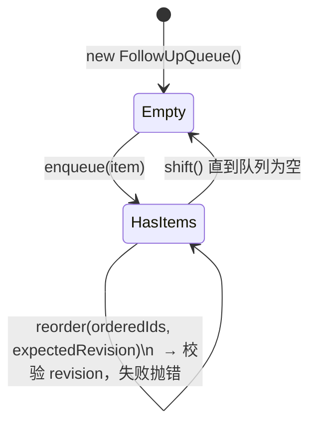
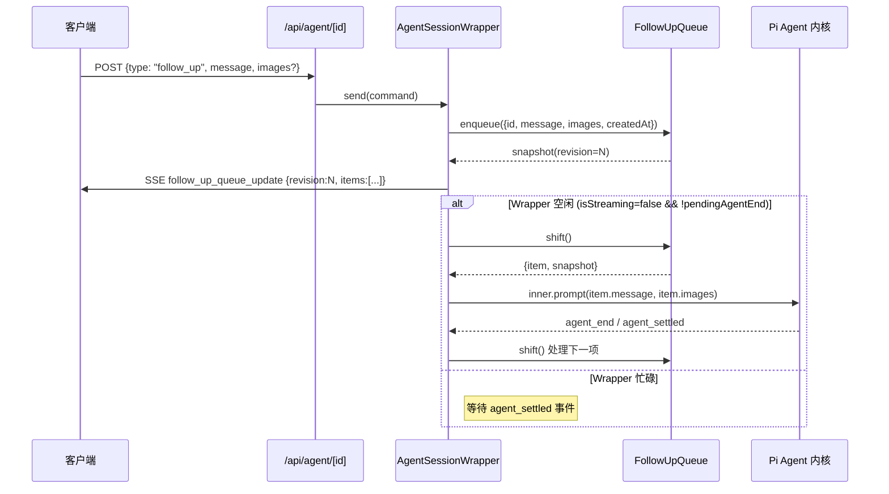

本页面深入解析 π Agent Desktop 中的 **Follow-up Queue（后续追问队列）** 机制，以及基于 **revision（版本号）** 的乐观并发控制如何保证队列操作的原子性与一致性。该机制支撑用户在 Agent 运行期间提交多条后续追问、拖拽重排执行顺序、并在多标签页或并发请求场景下避免竞态条件。

Sources: [lib/follow-up-queue.ts](lib/follow-up-queue.ts#L1-L79), [lib/rpc-manager.ts](lib/rpc-manager.ts#L1-L944), [hooks/useAgentSession.ts](hooks/useAgentSession.ts#L1-L804), [components/chat-input/QueuedMessageList.tsx](components/chat-input/QueuedMessageList.tsx#L1-L146)

## 核心架构概览

Follow-up Queue 是一个**单会话内、进程内**的有序队列，配合单调递增的 revision 实现乐观锁。其生命周期绑定在 `AgentSessionWrapper` 实例上，随会话销毁而销毁，不持久化到磁盘（重启后丢失，符合"会话内临时追问"的语义）。

```mermaid
graph TB
    subgraph Client["客户端 (React)"]
        UI[QueuedMessageList\n拖拽/上下移动按钮]
        Hook[useAgentSession\nfollowUpQueue状态]
        SSE[SSE 事件监听\nfollow_up_queue_update]
    end

    subgraph Server["服务端 (Node.js / RPC)"]
        Wrapper[AgentSessionWrapper]
        Queue[FollowUpQueue\nitems[] + revision]
        Dispatch[dispatchNextFollowUp\nshift → inner.prompt()]
        EventBus[emitEvent\nfollow_up_queue_update]
    end

    UI -->|onReorder(orderedIds)| Hook
    Hook -->|sendAgentCommand(type:reorder_follow_ups)| Server
    UI -->|handleFollowUp(message, images)| Hook
    Hook -->|sendAgentCommand(type:follow_up)| Server
    Server -->|enqueue/reorder| Queue
    Queue -->|revision++| EventBus
    EventBus -->|SSE| SSE
    SSE -->|acceptFollowUpQueue(snapshot)| Hook
    Dispatch -->|agent_settled| Queue
    Dispatch -->|inner.prompt()| Agent[Pi Agent 核心循环]
```

Sources: [lib/follow-up-queue.ts](lib/follow-up-queue.ts#L1-L79), [lib/rpc-manager.ts](lib/rpc-manager.ts#L200-L400), [hooks/useAgentSession.ts](hooks/useAgentSession.ts#L350-L400)

## 数据模型与类型定义

| 类型 | 字段 | 说明 |
|------|------|------|
| `QueuedFollowUp` | `id: string` | UUID v4，入队时生成，全局唯一 |
| | `message: string` | 用户输入的文本内容 |
| | `images?: FollowUpImage[]` | 可选附件图片（base64 + mimeType） |
| | `createdAt: number` | 时间戳，用于调试/排序参考 |
| `FollowUpQueueItem` (快照投影) | `id, message, attachmentCount, createdAt` | 面向 UI 的轻量投影，隐藏 base64 数据 |
| `FollowUpQueueSnapshot` | `revision: number` | **单调递增版本号**，每次变更 +1 |
| | `items: FollowUpQueueItem[]` | 当前队列顺序的只读投影 |

Sources: [lib/follow-up-queue.ts](lib/follow-up-queue.ts#L1-L25)

## FollowUpQueue 核心操作语义

`FollowUpQueue` 类封装了所有变更操作，**每次成功变更都会 `this.revision += 1`**，并返回新的 `FollowUpQueueSnapshot`。



### 1. 入队 `enqueue(item)` — 追加到队尾

- 生成新 `id`（服务端 `randomUUID()`），记录 `createdAt = Date.now()`
- `items.push(item)`，`revision++`，返回快照
- **并发安全**：单线程事件循环内串行执行，无竞态

### 2. 重排 `reorder(orderedIds, expectedRevision)` — 乐观并发控制的核心

```typescript
reorder(orderedIds: string[], expectedRevision: number): FollowUpQueueSnapshot {
  if (expectedRevision !== this.revision) {
    throw new Error("Follow-up queue changed; refresh and try again");
  }
  // 校验：长度一致、无重复 ID、全为现有项
  if (orderedIds.length !== this.items.length ||
      new Set(orderedIds).size !== orderedIds.length ||
      orderedIds.some(id => !this.items.some(item => item.id === id))) {
    throw new Error("Follow-up queue order must contain every queued item exactly once");
  }
  // 重建顺序
  const byId = new Map(this.items.map(item => [item.id, item]));
  this.items = orderedIds.map(id => byId.get(id)!);
  this.revision += 1;
  return this.snapshot();
}
```

**设计要点**：
- `expectedRevision` 由调用方从最近一次快照中读取并传入
- 若中间有其他请求（如另一标签页的 `enqueue` 或另一次 `reorder`）已修改队列，`revision` 已变更，**当前请求直接拒绝**，避免覆盖他人修改
- 客户端收到报错后应**刷新队列状态**（服务端 `reorder` 失败不发射 SSE 快照，需主动发送 `get_state` 命令拉取最新快照）并重试

### 3. 出队 `shift()` — 取出并移除队首

- `items.shift()` 取出首项，`revision++`，返回 `{ item, snapshot }`
- 若队列为空返回 `null`
- **仅由服务端 `dispatchNextFollowUp` 调用**，客户端不直接调用

### 4. 归队 `restoreFront(item)` — 失败时放回队首

- `items.unshift(item)`，`revision++`，返回快照
- 用于 `dispatchNextFollowUp` 中 `prompt()` 抛错时，将失败的项放回队首保证不丢失

Sources: [lib/follow-up-queue.ts](lib/follow-up-queue.ts#L27-L79), [lib/rpc-manager.ts](lib/rpc-manager.ts#L350-L400)

## 服务端调度流程：从入队到执行



### 关键调度逻辑 (`dispatchNextFollowUp`)

```typescript
private dispatchNextFollowUp(completedEvent: AgentEvent | null): FollowUpQueueSnapshot {
  const claimed = this.followUpQueue.shift();
  if (!claimed) {
    if (completedEvent) this.emitEvent(completedEvent);
    return this.followUpQueue.snapshot();
  }

  const snapshot = this.emitFollowUpQueue(claimed.snapshot);
  const { item } = claimed;
  try {
    const run = () => this.inner.prompt(item.message, item.images?.length ? { images: item.images } : undefined);
    const prompt = this.resourcesChanged ? this.reloadResources().then(run) : run();
    void prompt.catch((error) => this.handleQueuedPromptFailure(item, completedEvent, error));
  } catch (error) {
    this.handleQueuedPromptFailure(item, completedEvent, error);
  }
  return snapshot;
}
```

- **串行执行**：同一时刻至多有一个 follow-up 在 Agent 内核中运行
- **错误恢复**：`handleQueuedPromptFailure` 调用 `restoreFront(item)` 放回队首，并发射 `agent_error` 事件通知前端
- **资源变更感知**：若 `resourcesChanged=true`（如 MCP 服务器增删），先 `reloadResources()` 再执行

Sources: [lib/rpc-manager.ts](lib/rpc-manager.ts#L350-L400), [lib/rpc-manager.ts](lib/rpc-manager.ts#L566-L590)

## 客户端状态同步与 revision 单调性检查

前端在 `useAgentSession` 中维护 `followUpQueue` 状态与 `followUpQueueRef`（用于在回调中读取最新 revision）：

```typescript
const acceptFollowUpQueue = useCallback((snapshot: FollowUpQueueSnapshot) => {
  if (snapshot.revision < followUpQueueRef.current.revision) return; // 丢弃旧快照
  followUpQueueRef.current = snapshot;
  setFollowUpQueue(snapshot);
}, []);
```

**单调性检查** `snapshot.revision < current.revision` 防御：
- SSE 事件乱序到达（网络抖动、重连）
- 并发 `reorder` 请求的响应与 SSE 推送竞态
- 只有**版本号不减少**的快照才会被采纳，保证 UI 状态单调前进

Sources: [hooks/useAgentSession.ts](hooks/useAgentSession.ts#L100-L110), [hooks/useAgentSession.ts](hooks/useAgentSession.ts#L355-L360)

## UI 交互：QueuedMessageList 拖拽重排

`QueuedMessageList` 组件提供直观的队列可视化与交互：

- **拖拽排序**：HTML5 Drag & Drop API，`onDragOver` 计算 `dropTarget`（before/after），`onDrop` 生成新 `orderedIds` 调用 `onReorder`
- **键盘辅助**：`Alt+↑/↓` 移动焦点行
- **上下移动按钮**：点击即 `move(id, index±1)` 生成新顺序
- **只读投影**：仅显示 `message` 截断文本、`attachmentCount` 计数徽标，不暴露 base64

```typescript
const move = (id: string, nextIndex: number) => {
  const currentIndex = items.findIndex(item => item.id === id);
  const orderedIds = items.map(item => item.id);
  orderedIds.splice(currentIndex, 1);
  orderedIds.splice(clampedIndex, 0, id);
  onReorder(orderedIds);  // → useAgentSession.handleReorderFollowUps → sendAgentCommand(type:reorder_follow_ups)
};
```

**调用链**：
`QueuedMessageList.onReorder` →（经 `ChatInput` / `ChatWindow` 逐层传入）`useAgentSession.handleReorderFollowUps` → `sendAgentCommand({type: "reorder_follow_ups", orderedIds, expectedRevision})` → 服务端 `reorder()` → SSE `follow_up_queue_update` → `acceptFollowUpQueue`

Sources: [components/chat-input/QueuedMessageList.tsx](components/chat-input/QueuedMessageList.tsx#L1-L146), [hooks/useAgentSession.ts](hooks/useAgentSession.ts#L567-L620), [components/ChatInput.tsx](components/ChatInput.tsx#L402-L406), [components/ChatWindow.tsx](components/ChatWindow.tsx#L69-L209)

## 并发场景分析

| 场景 | 可能冲突 | revision 如何保护 |
|------|----------|-------------------|
| 标签页 A `enqueue`，标签页 B 同时 `enqueue` | 两次入队顺序不定 | 服务端串行处理 HTTP 请求，revision 依次 +1，SSE 广播两次快照，双端最终一致 |
| 标签页 A `reorder`，标签页 B 同时 `enqueue` | A 的 `expectedRevision` 可能过期 | B 先完成 → revision 增加 → A 的 `reorder` 校验失败抛错 → A 端通过 SSE 收到新快照 → 用户重新拖拽重试 |
| 标签页 A `reorder`，标签页 B 同时 `reorder` | 双方 `expectedRevision` 均为旧值 | 先到达者成功，后到达者失败，同上 |
| 网络抖动导致 SSE 乱序到达 | 旧快照覆盖新状态 | 客户端 `acceptFollowUpQueue` 的 `revision < current.revision` 守卫丢弃旧快照 |

**关键不变量**：
- `revision` **严格单调递增**，永不回退
- 任意时刻，**服务端 revision 为真理源头**，客户端仅被动同步
- `reorder` 的 `expectedRevision` 实现**乐观锁**：检测冲突而非阻塞

## 与 Steering/Pending Prompt 队列的区别

代码库中存在三类"待发送"队列，易混淆，在此澄清：

| 队列 | 触发时机 | 持久化 | 并发控制 | 用途 |
|------|----------|--------|----------|------|
| **Follow-up Queue** | Agent 运行中按 Alt+Enter 排队（此时 Enter 为立即 steer；无独立 "Follow-up" 按钮） | 否 (内存) | revision 乐观锁 | 追问、补全、多轮对话排队 |
| **Steering Queue** | Agent 运行中用户点击"Steer" (干预) | 否 | 无 (单条替换) | 打断当前生成、重新引导 |
| **Pending Prompt** | 用户发送新对话 (非运行中) | 否 | 无 (单条) | 普通用户消息发送 |

- `follow_up_queue_update` SSE 事件仅对应 Follow-up Queue
- `queue_update` SSE 事件对应 Steering Queue (`reconcileSteeringQueue`)
- Pending Prompt 由 `onPendingPromptQueued/Failed` 回调管理，不通过 SSE 同步

Sources: [hooks/useAgentSession.ts](hooks/useAgentSession.ts#L350-L370), [hooks/agent-session/use-session-commands.ts](hooks/agent-session/use-session-commands.ts#L400-L480)

## 错误处理与边界情况

### 1. `reorder` 校验失败的错误消息

```typescript
// 版本冲突
throw new Error("Follow-up queue changed; refresh and try again");
// 顺序不合法 (缺项/重复/多余)
throw new Error("Follow-up queue order must contain every queued item exactly once");
```

前端捕获后：`console.error` 记录错误，并主动发送 `get_state` 命令（`POST /api/agent/[id]`）拉取最新队列快照；`get_state` 也失败时，仅在 revision 未变化的情况下回滚到之前的乐观快照。注意服务端 `reorder` 失败不发射任何 SSE 快照（`emitFollowUpQueue` 仅在成功路径调用），不能依赖 SSE 自动刷新。

### 2. `dispatchNextFollowUp` 中的异常处理

```typescript
private handleQueuedPromptFailure(item: QueuedFollowUp, completedEvent: AgentEvent | null, error: unknown): void {
  this.emitFollowUpQueue(this.followUpQueue.restoreFront(item)); // 放回队首
  if (completedEvent) this.emitEvent(completedEvent);
  this.emitAgentError(error instanceof Error ? error.message : String(error));
}
```

- 失败项**不丢失**，回到队首等待重试
- 通过 `agent_error` 事件通知前端（前端对 `agent_error` 仅 `console.error` 记录，无 Toast）
- `handleQueuedPromptFailure` 会把 `completedEvent`（`agent_end` 事件）重新发射给前端，前端收到 `agent_end` 后置 `agentRunning: false`；失败的 prompt 从未启动 Agent 循环，不会有后续 `agent_settled` 自动驱动队列，队列停驻直到下一次入队或手动 prompt

### 3. 会话销毁时的队列清理

`AgentSessionWrapper.destroy()` 中：
- `inner.abort()` 终止 Agent 循环
- `followUpQueue` 随实例销毁 (内存释放)
- 无持久化恢复机制，**会话关闭即队列清空**

Sources: [lib/rpc-manager.ts](lib/rpc-manager.ts#L350-L400), [lib/rpc-manager.ts](lib/rpc-manager.ts#L680-L720)

## 性能与内存考量

| 维度 | 说明 |
|------|------|
| **内存占用** | 每项含 `message` (文本) + 可选 `images[]` (base64)。大量图片追问可能占用显著内存，建议单会话队列长度 < 50 项 |
| **revision 溢出** | `number` 类型 (IEEE 754 安全整数 2^53-1)，极不可能溢出 (需 900 万亿次变更) |
| **SSE 广播频率** | 每次变更发送一次完整快照 (items[] 全量)。项数较多时可考虑增量 diff，但当前规模下全量可接受 |
| **快照投影** | `snapshot()` 将 `images[]` 映射为 `attachmentCount: number`，避免 base64 经由 SSE 重复传输到前端 |

## 扩展点与未来演进

| 方向 | 现状 | 可能增强 |
|------|------|----------|
| **持久化** | 纯内存 | 若需跨重启保留，可在 `sessionManager.appendCustomEntry` 记录队列状态 |
| **优先级** | 严格 FIFO (可重排) | 引入 `priority` 字段，支持"插队"语义 |
| **批量操作** | 单条入队/全量重排 | `enqueueMany`、`moveRange` 等批量 API 减少 SSE 广播次数 |
| **冲突自动合并** | 乐观锁拒绝 + 手工重试 | OT/CRDT 算法实现无锁合并 (复杂度大幅上升，暂不需要) |

## 相关页面导航

- **上游调用入口**：[Extension UI Bridge 与异步 RPC 响应队列](17-extension-ui-bridge-yu-yi-bu-rpc-xiang-ying-dui-lie) — 理解 `sendAgentCommand` 如何到达 `AgentSessionWrapper.send()`
- **下游执行循环**：[SSE 事件流与流式状态机](8-sse-shi-jian-liu-yu-liu-shi-zhuang-tai-ji) — `follow_up_queue_update` 事件如何流经 `streamReducer` 与 `applyAgentEvent`
- **会话生命周期**：[AgentSession 生命周期与进程内注册表](7-agentsession-sheng-ming-zhou-qi-yu-jin-cheng-nei-zhu-ce-biao) — `AgentSessionWrapper` 创建/销毁与 `FollowUpQueue` 生命周期绑定
- **前端队列渲染**：[useAgentSession 主 Hook 与子 Hook 拆分策略](22-useagentsession-zhu-hook-yu-zi-hook-chai-fen-ce-lue) — `followUpQueue` 状态在 `useAgentSession` 中的管理方式