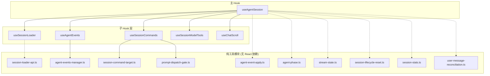
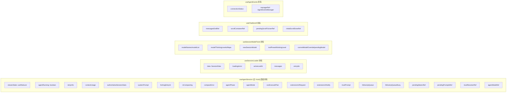
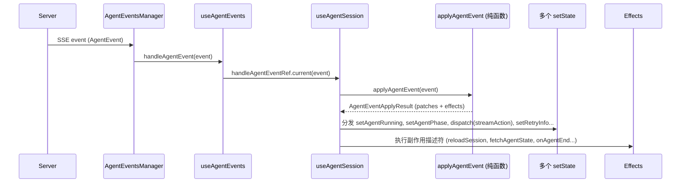
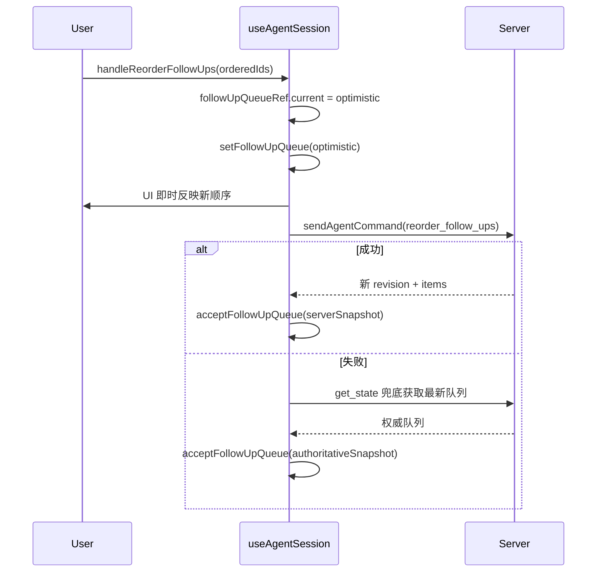

本文档深入解析 `useAgentSession`（`hooks/useAgentSession.ts`，约 803 行）及其子 Hook 的架构设计，重点阐述**职责分离**、**状态所有权**、**纯函数与副作用边界**、**跨 Hook 协作模式**等核心设计决策。该架构采用「主 Hook 编排 + 子 Hook 专用」的分层模式，将原本单一庞大的组件级 Hook 拆分为 5 个职责单一的子 Hook 与 10 个纯工具模块，实现了可测试性、可维护性与并发安全的统一。

Sources: [useAgentSession.ts](hooks/useAgentSession.ts#L1-L50), [agent-session 目录结构](hooks/agent-session)

## 架构总览

### 整体依赖关系图



**图例说明**：
- 实线 = React Hook 依赖（运行时调用）
- 虚线 = 纯函数/类型导入（编译时依赖，无副作用）

Sources: [useAgentSession.ts](hooks/useAgentSession.ts#L50-L150), [use-session-loader.ts](hooks/agent-session/use-session-loader.ts#L1-L30), [use-agent-events.ts](hooks/agent-session/use-agent-events.ts#L1-L30), [use-session-commands.ts](hooks/agent-session/use-session-commands.ts#L1-L50), [use-session-model-tools.ts](hooks/agent-session/use-session-model-tools.ts#L1-L30), [use-chat-scroll.ts](hooks/agent-session/use-chat-scroll.ts#L1-L30)

---

## 核心设计原则

### 1. 单一职责与领域边界

每个子 Hook 封装**一个完整的业务领域**，对外仅暴露该领域所需的「状态 + 动作」元组：

| 子 Hook | 领域职责 | 核心状态 | 核心动作 |
|---------|----------|----------|----------|
| `useSessionLoader` | 会话数据加载、树/叶子切换、上下文刷新 | `data`, `loading`, `error`, `activeLeafId`, `messages`, `entryIds` | `loadSession`, `loadContext`, `setActiveLeafId`, `setMessages`, `setEntryIds` |
| `useAgentEvents` | SSE 连接管理、事件分发、重连策略 | `connectionStatus` | `connectEvents`, `handleAgentEventRef` (setter) |
| `useSessionCommands` | 所有用户发起的命令：发送、分叉、导航、紧凑、执行计划、Abort、Steer、Follow-up | 无自有状态（全靠注入的 setter） | `handleSend`, `handleFork`, `handleNavigate`, `handleCompact`, `handleExecutePlan`, `handleAbort`, `handleSteer`, `handleFollowUp`, `handleAbortCompaction`, `handleAgentModeChange`（`handleReorderFollowUps` 定义在主 Hook 中，不属于本 Hook 返回值） |
| `useSessionModelTools` | 模型列表、思考等级、工具预设的加载与切换 | `modelList`, `modelThinkingLevels`, `toolPreset`, `thinkingLevel`, `currentModelOverride`, `pendingModel` | `handleModelChange`, `handleThinkingLevelChange`, `handleToolPresetChange`, `loadTools` |
| `useChatScroll` | 滚动容器绑定、自动滚动策略、用户手动滚动检测 | `messagesEndRef`, `scrollContainerRef`, `pendingScrollToUserRef`, `initialScrollDoneRef` | `setScrollContainer`, `scrollToBottom` |

Sources: [use-session-loader.ts](hooks/agent-session/use-session-loader.ts#L50-L121), [use-agent-events.ts](hooks/agent-session/use-agent-events.ts#L1-L51), [use-session-commands.ts](hooks/agent-session/use-session-commands.ts#L50-L200), [use-session-model-tools.ts](hooks/agent-session/use-session-model-tools.ts#L50-L159), [use-chat-scroll.ts](hooks/agent-session/use-chat-scroll.ts#L1-L93)

### 2. 纯函数核心 + React 边薄层

**关键架构决策**：所有**业务逻辑、状态转换、事件解释**均下沉至纯 TypeScript 模块（`agent-event-apply.ts`、`agent-phase.ts`、`stream-state.ts`、`session-lifecycle-reset.ts` 等），React Hook 仅负责：

- 状态持有 (`useState`/`useReducer`/`useRef`)
- 副作用调度 (`useEffect`/`useCallback`)
- 依赖注入（将 setter 传递给子 Hook）

这种分离带来三大收益：

1. **可测试性**：纯函数可在 Node.js 环境直接单测，无需 React Testing Library 或 DOM 模拟
2. **并发安全**：纯函数无隐式共享状态，天然免疫闭包陷阱
3. **可移植性**：核心逻辑可复用至非 React 环境（如 Electron 主进程、CLI、Service Worker）

Sources: [agent-event-apply.ts](hooks/agent-session/agent-event-apply.ts#L1-L80), [agent-phase.ts](hooks/agent-session/agent-phase.ts#L1-L18), [stream-state.ts](hooks/agent-session/stream-state.ts#L1-L32), [session-lifecycle-reset.ts](hooks/agent-session/session-lifecycle-reset.ts#L1-L123)

---

## 状态所有权划分

### 状态归属矩阵



**原则**：**状态离产生/消费它的逻辑最近**。主 Hook 只持有「跨领域协调」或「全局单一真相源」性质的状态（如 `agentRunning`、`agentPhase`、`followUpQueue`），领域内部状态下放至对应子 Hook。

Sources: [useAgentSession.ts](hooks/useAgentSession.ts#L150-L300), [use-session-loader.ts](hooks/agent-session/use-session-loader.ts#L50-L121), [use-session-model-tools.ts](hooks/agent-session/use-session-model-tools.ts#L50-L100), [use-chat-scroll.ts](hooks/agent-session/use-chat-scroll.ts#L10-L50), [use-agent-events.ts](hooks/agent-session/use-agent-events.ts#L10-L51)

---

## 关键协作模式

### 1. 事件流水线：SSE → 纯函数 → 状态分发



**关键点**：
- `applyAgentEvent` 返回 **`AgentEventApplyResult`** —— 一个**纯数据结构**，包含：`agentRunning?`, `phaseOp?`, `streamAction?`, `retryInfo?`, `appendMessages?`, `effects[]`
- **零副作用**：纯函数不直接调用 `setState`，而是返回「意图描述」，由主 Hook 统一分发
- **副作用描述符**：`effects` 数组中的每一项都是可序列化的标签联合体（如 `{type: "reloadSession"}`, `{type: "extensionUiRequest", request: ...}`），主 Hook 在 `switch` 中逐个解释执行
- **队列事件不走 reducer**：`handleAgentEvent` 在调用 `applyAgentEvent` **之前**处理 `follow_up_queue_update`（`acceptFollowUpQueue`）与 `queue_update`（`reconcileSteeringQueue`）。这两类以及 `connected` / `agent_settled` / 未知 `type` 在 `applyAgentEvent` 的 `default` 分支均为 no-op（不产生 `streamAction`）

Sources: [agent-event-apply.ts](hooks/agent-session/agent-event-apply.ts#L80-L200), [useAgentSession.ts](hooks/useAgentSession.ts#L300-L500)

### 2. 会话切换的「原子重置」模式

当 `session.id` 变化时，必须**彻底清除**上一会话的所有残留状态，防止状态泄漏。主 Hook 在 `useEffect([session?.id])` 中执行**原子重置序列**：

```mermaid
flowchart TD
    A[session.id 变化] --> B[sessionScopedResetPatch() 生成默认值对象]
    B --> C[并行重置所有 useState: setData, setMessages, setAgentRunning...]
    C --> D[重置所有 Ref: pendingSteersRef, pendingPromptsRef...]
    D --> E[loadSessionFromApi(sid, true, true)]
    E --> F[loadedAgentStatePatch() 解析服务端返回]
    F --> G[条件性恢复: thinkingLevel, agentRunning, isCompacting...]
    G --> H[connectEvents / loadTools]
```

**设计细节**：
- `sessionScopedResetPatch()` 返回**纯对象**，包含所有需重置字段的默认值，避免散落在 effect 中的魔法常量
- `loadedAgentStatePatch()` 从服务端返回的 `LoadedAgentState` 推导 UI 恢复动作（是否连接 SSE、是否加载工具、是否进入 `waiting_model` 等）
- **防御性重挂载**：`AppShell` 仍保留 `sessionKey` 强制 remount，作为双重保险（覆盖子 Hook 内部无法从主 Hook 重置的状态，如 `useChatScroll` 的 `initialScrollDoneRef`）

Sources: [session-lifecycle-reset.ts](hooks/agent-session/session-lifecycle-reset.ts#L1-L123), [useAgentSession.ts](hooks/useAgentSession.ts#L600-L720)

### 3. 乐观更新与服务端权威的协调

#### Follow-up Queue：乐观重排 + 修正回滚

`handleReorderFollowUps` 定义在主 Hook `useAgentSession` 中（不在 `useSessionCommands` 的返回值内），乐观快照通过直接写 `followUpQueueRef.current` + `setFollowUpQueue` 实现：



**并发控制**：`followUpQueueRef.current.revision` 作为**乐观锁**，`acceptFollowUpQueue` 仅接受 `revision >= current` 的快照，防止乱序覆盖。

Sources: [useAgentSession.ts](hooks/useAgentSession.ts#L567-L620), [useAgentSession.ts](hooks/useAgentSession.ts#L100-L150), [useAgentSession.ts](hooks/useAgentSession.ts#L650-L720)

#### 用户消息：pending → canonical 替换

```mermaid
flowchart LR
    A[用户发送消息] --> B[生成 clientMessageId]
    B --> C[onPendingPromptQueued 记录 ref]
    C --> D[setMessages 追加 pending 气泡 deliveryState=pending]
    D --> E[SSE message_end 到达]
    E --> F[applyAgentEvent 返回 appendMessages=canonical]
    F --> G[reconcileOrAppendPendingUserMessage]
    G --> H[用 canonical 替换 pending, 保留 timestamp]
    H --> I[entryIds 追加 undefined 占位]
```



**关键不变量**：`messages` 与 `entryIds` **始终等长并行**。新消息入队时同步 `push(undefined)`，待 `loadSession` 刷新时由服务端回填真实 `entryId`。`MessageList` 的分叉/导航门控是 `canFork = !agentRunning && !isNew && !isFirstUserMessage`、`canNavigate = !agentRunning`，并不检查 `entryIds[idx]` 真值（空 `entryId` 由主 Hook 的 `handleFork` 守卫兜底）；`entryIds[idx]` 在 `MessageList` 中用作 React key 与 forking 状态比对。（注：`useAgentSession.ts` 中「gates fork/navigate on a truthy entryId」的注释是过时描述，本文旧版曾照抄。）

Sources: [user-message-reconciliation.ts](hooks/agent-session/user-message-reconciliation.ts#L1-L50), [useAgentSession.ts](hooks/useAgentSession.ts#L350-L420), [useAgentSession.ts](hooks/useAgentSession.ts#L720-L780)

### 4. Prompt Dispatch Gate：防重入守卫

`useSessionCommands` 内部使用 `promptDispatchStateRef`（`{current: boolean}`）实现**单次派发互斥**：

```typescript
const promptDispatchStateRef = useRef<PromptDispatchState>({ current: false });

const handleSend = useCallback(async (...) => {
  if (!tryStartPromptDispatch(promptDispatchStateRef.current)) return;
  // ... 发送逻辑
}, []);

useEffect(() => {
  if (!agentRunning) finishPromptDispatch(promptDispatchStateRef.current);
}, [agentRunning]);
```

- `tryStartPromptDispatch`：若 `current === true` 直接返回 `false`，拦截并发点击
- `finishPromptDispatch`：在 `agentRunning` 变 `false` 时释放，允许下一轮
- **为什么用 Ref 而非 State**：避免触发重渲染，且需在同步调用栈中即时生效（State 更新是异步批处理的）

Sources: [prompt-dispatch-gate.ts](hooks/agent-session/prompt-dispatch-gate.ts#L1-L12), [use-session-commands.ts](hooks/agent-session/use-session-commands.ts#L50-L120)

---

## 依赖注入与控制反转

### 子 Hook 接收「写权限」而非「读权限」

`useSessionCommands` 的 `options` 中包含 **10 个 setter 与 1 个 `dispatch`**（共 11 个写函数），主 Hook 将自有的 `setXxx` 透传下去：

```typescript
const commands = useSessionCommands({
  // ...
  setMessages,
  setAgentRunning,
  setAgentPhase,
  dispatch,              // streamReducer 的 dispatch
  setPendingModel,
  setIsCompacting,
  setCompactError,
  setForkingEntryId,
  setActiveLeafId,
  setCanExecutePlan,
  // ...
});
```

**优势**：
- 子 Hook **不持有跨领域状态**，仅通过回调修改主 Hook 状态
- 状态变更**集中在主 Hook**，便于调试（React DevTools 只需观察一棵状态树）
- 子 Hook 可在无主 Hook 环境下测试（传入 mock setter 即可）

Sources: [use-session-commands.ts](hooks/agent-session/use-session-commands.ts#L1-L80), [useAgentSession.ts](hooks/useAgentSession.ts#L500-L580)

### Ref 传递打破闭包陷阱

对于**高频变化、不应触发渲染**的值，主 Hook 使用 `useRef` 并在子 Hook 间共享：

| Ref | 用途 | 共享给 |
|-----|------|--------|
| `sessionIdRef` | 当前会话 ID，供异步回调读取最新值 | `useSessionCommands`, `useSessionModelTools`, `useAgentEvents` |
| `pendingSteersRef` / `pendingPromptsRef` | 乐观消息去重键 | `useSessionCommands` (写), `useAgentSession` (读/写) |
| `agentModeRef` | `agentMode` 的同步镜像，供事件处理器读取 | `useAgentSession` (handleAgentEvent 内) |
| `followUpQueueRef` | 队列快照镜像，供乐观锁比对 | `useAgentSession` |
| `trustResolverRef` | Promise resolver，跨事件循环 resolve | `useAgentSession` (promptTrust/resolveTrustPrompt) |
| `promptDispatchStateRef` | 防重入标志 | `useSessionCommands` |

Sources: [useAgentSession.ts](hooks/useAgentSession.ts#L150-L250), [use-session-commands.ts](hooks/agent-session/use-session-commands.ts#L50-L120)

---

## 纯工具模块深度解析

### agent-event-apply.ts：事件解释器

```typescript
export function applyAgentEvent(
  event: AgentEvent,
  options: ApplyAgentEventOptions = {}
): AgentEventApplyResult
```

**输入**：单一 `AgentEvent`（标签联合体，TypeScript 自动窄化）
**输出**：`AgentEventApplyResult` —— 纯数据描述符，包含：
- 状态补丁：`agentRunning?`, `phaseOp?`, `streamAction?`, `retryInfo?`, `isCompacting?`, `compactError?`, `appendMessages?`
- 副作用描述符：`effects: AgentEventSideEffect[]`

**设计亮点**：
- `phaseOp` 使用 **`AgentPhaseOp` 标签联合体**（`set`/`addTool`/`removeTool`/`clear`），配合 `applyPhaseOp` 纯函数实现相位状态机
- `streamAction` 直接复用 `streamReducer` 的 `StreamAction` 类型，统一流式状态转换
- `message_start`/`message_update` 触发 `phaseOp: {type: "clear"}` —— 清除 `waiting_model` 但**保留** `running_tools`（通过 `applyPhaseOp` 内部逻辑实现）
- `default` 分支 no-op：`connected`、`agent_settled`、`queue_update`、`follow_up_queue_update` 及未知类型不产生补丁（队列快照由主 Hook 单独消费）

Sources: [agent-event-apply.ts](hooks/agent-session/agent-event-apply.ts#L100-L200), [agent-phase.ts](hooks/agent-session/agent-phase.ts#L1-L18), [stream-state.ts](hooks/agent-session/stream-state.ts#L1-L32)

### session-lifecycle-reset.ts：会话边界纯逻辑

两个核心纯函数：

1. **`sessionScopedResetPatch()`** —— 返回「会话切换时需重置的所有字段的默认值」
2. **`loadedAgentStatePatch(input)`** —— 从服务端 `LoadedAgentState` 推导「需恢复的 UI 状态」

**为何分离**：
- 逻辑可单测：输入输出确定，无副作用
- 主 Hook 的 `useEffect` 变成**声明式编排**：先重置、再加载、再按 patch 恢复
- 便于未来迁移：若引入 Zustand/Redux，只需替换「分发」层，核心 patch 逻辑复用

Sources: [session-lifecycle-reset.ts](hooks/agent-session/session-lifecycle-reset.ts#L1-L123), [useAgentSession.ts](hooks/useAgentSession.ts#L600-L720)

### agent-events-manager.ts：SSE 连接状态机

`AgentEventsManager` 类封装：
- `EventSource` 生命周期（连接/断开/重连）
- **指数退避重连**：最多 5 次，延迟 1s → 2s → 4s → 8s → 16s（`reconnectDelay * 2^(attempt-1)`）。代码里还有 `Math.min(30000, …)`，但第 6 次（32s→30s）不会发生：`reconnectAttempts > 5` 时直接 `failed`
- `expectRunning` 参数：允许在 `agentRunning` state 尚未生效前**表达意图**，避免早期 `onerror` 误判为「应断开」
- `agentRunning` 标志守护：仅当 `agentRunning === true` 时才重连，否则直接 `disconnected`

Sources: [agent-events-manager.ts](hooks/agent-session/agent-events-manager.ts#L50-L186)

---

## 并发安全与竞态条件处理

### 1. Latest-Request-Wins 守卫

`useSessionLoader` 中的 `loadReqIdRef` / `loadContextReqIdRef`：

```typescript
const loadReqIdRef = useRef(0);

const loadSession = useCallback(async (...) => {
  const stale = latestRequestStale(loadReqIdRef);  // 返回 () => boolean
  const d = await fetchSession(...);
  if (stale()) return null;  // 过期请求静默丢弃
  setData(d);  // 仅最新请求生效
}, []);
```

**原理**：每次调用递增 `ref.current`，捕获当前 `reqId`；异步完成后比较，若已被超越则放弃 `setState`。这比 `AbortController` 更轻量（无需取消网络请求，仅丢弃响应处理）。

Sources: [use-session-loader.ts](hooks/agent-session/use-session-loader.ts#L10-L50)

### 2. 乐观锁保护 Follow-up Queue

```typescript
const acceptFollowUpQueue = useCallback((snapshot) => {
  if (snapshot.revision < followUpQueueRef.current.revision) return;
  followUpQueueRef.current = snapshot;
  setFollowUpQueue(snapshot);
}, []);
```

- `revision` 单调递增，服务端权威
- 客户端乐观更新携带**预期 revision**，服务端拒绝过期请求
- 失败时 `get_state` 兜底拉取最新权威快照

Sources: [useAgentSession.ts](hooks/useAgentSession.ts#L100-L150), [use-session-commands.ts](hooks/agent-session/use-session-commands.ts#L400-L536)

### 3. 纯更新器规避 StrictMode 双调用陷阱

测试强制要求：`setMessages` 更新器**必须是箭头函数表达式体**，禁止块语句体：

```typescript
// ✅ 正确：表达式体，无副作用，可安全双调用
setMessages((prev) => [...prev, ...appended]);

// ❌ 错误：块语句体，内部包含 setCanExecutePlan 等副作用
setMessages((prev) => {
  const next = [...prev, ...appended];
  if (agentModeRef.current === "plan") setCanExecutePlan(true); // 副作用！
  return next;
});
```

**实际代码**：将 `plan` 模式检查移至 `setMessages` **之后**的独立代码块，利用 `agentModeRef.current` 读取最新值。

Sources: [useAgentSession.test.ts](hooks/useAgentSession.test.ts#L1-L55), [useAgentSession.ts](hooks/useAgentSession.ts#L450-L520)

---

## 类型系统设计

### 判别联合贯穿全链路

```typescript
// 服务端事件
type AgentEvent =
  | { type: "agent_start" }
  | { type: "message_update"; message: Partial<AgentMessage> }
  | { type: "tool_execution_start"; toolCallId: string; toolName: string }
  | ...;

// 纯函数返回
type AgentEventApplyResult = {
  agentRunning?: boolean;
  phaseOp?: AgentPhaseOp;      // {type: "set"} | {type: "addTool"} | ...
  streamAction?: StreamAction; // {type: "start"} | {type: "update"} | ...
  effects: AgentEventSideEffect[]; // {type: "reloadSession"} | {type: "extensionUiRequest"} | ...
};

// 相位状态机
type AgentPhase =
  | { kind: "waiting_model" }
  | { kind: "running_tools"; tools: {id, name}[] }
  | null;
```

**收益**：
- `switch (event.type)` / `switch (effect.type)` **自动窄化**，零 `as` 断言
- 扩展新事件类型时，TypeScript 编译错误会提示所有未处理分支
- 纯函数签名即文档，输入输出类型完整描述契约

Sources: [agent-events-manager.ts](hooks/agent-session/agent-events-manager.ts#L1-L50), [agent-event-apply.ts](hooks/agent-session/agent-event-apply.ts#L30-L80), [agent-phase.ts](hooks/agent-session/agent-phase.ts#L1-L18), [stream-state.ts](hooks/agent-session/stream-state.ts#L1-L32)

---

## 测试策略对照表

| 层级 | 测试文件 | 测试重点 | 环境 |
|------|----------|----------|------|
| 纯函数 | `agent-event-apply.test.ts` | 所有 `AgentEvent` 变体的 `applyAgentEvent` 输出 | Node.js (纯 TS) |
| 纯函数 | `agent-phase.test.ts` | `addRunningTool`/`removeRunningTool` 状态机迁移 | Node.js |
| 纯函数 | `stream-state.test.ts` | `streamReducer` 四种 action 的状态迁移 | Node.js |
| 纯函数 | `session-lifecycle-reset.test.ts` | `sessionScopedResetPatch`/`loadedAgentStatePatch` 输出 | Node.js |
| 纯函数 | `session-command-target.test.ts` | `resolveSessionCommandTarget` 三种分支 | Node.js |
| 纯函数 | `session-stats.test.ts` | `calculateSessionStats` 聚合逻辑 | Node.js |
| 纯函数 | `user-message-reconciliation.test.ts` | pending→canonical 替换、entryIds 平行性 | Node.js |
| 纯函数 | `prompt-dispatch-gate.test.ts` | `tryStartPromptDispatch` / `finishPromptDispatch` 互斥 | Node.js |
| 纯函数 | `session-loader-api.test.ts` | `fetchSession` / `fetchContext`（含 `?leafId=`）请求形状 | Node.js |
| Hook 行为 | `use-session-loader.test.ts` | `latestRequestStale` 纯函数直测 + 源码文本匹配 | Node.js (node:test，未渲染 React) |
| 纯逻辑（类） | `agent-events-manager.test.ts` | `AgentEventsManager` 连接/重连/状态机 | Node.js (node:test + mock.timers) |
| Hook 行为 | `use-session-commands.test.ts` | `handleSend`/`handleFork` 等命令流程 | Node.js (node:test + 源码文本匹配) |
| 集成 | `useAgentSession.test.ts` | **静态源码分析**：纯更新器、plan 模式块位置、entryIds 平行、transcript reload 先清 ref | Node.js (文本匹配) |

**注意**：`useAgentSession.test.ts` **不渲染组件**，而是对源码文本做模式匹配，验证关键不变量（纯更新器、代码块顺序、ref 清理时机）。这是「架构守护测试」，防止重构引入副作用回归。

Sources: [hooks/agent-session/*.test.ts](hooks/agent-session), [hooks/useAgentSession.test.ts](hooks/useAgentSession.test.ts#L1-L55)

---

## 扩展指南：新增子 Hook 的检查清单

若需拆分新领域（如「技能调用历史」、「MCP 服务器状态」），遵循以下契约：

1. **创建纯工具模块** `hooks/agent-session/xxx-core.ts`
   - 导出纯函数：`applyXxxEvent`、`calculateXxx`、`xxxStateMachine`
   - 类型定义在同文件或 `xxx-types.ts`
   - 单测覆盖所有分支

2. **创建子 Hook** `hooks/agent-session/use-xxx.ts`
   - `useState`/`useReducer` 持有领域内状态
   - `useCallback` 导出动作函数，**仅接受主 Hook 传入的 setter/Ref**
   - 无 `useEffect` 直接修改主 Hook 状态（改用回调）

3. **主 Hook 集成**
   - 引入子 Hook，解构状态与动作
   - 将主 Hook 的 setter 透传给子 Hook `options`
   - 若子 Hook 需跨领域协调（如需 `sessionIdRef`），显式传入 Ref

4. **架构守护测试**
   - 在 `useAgentSession.test.ts` 增加源码模式匹配，验证新不变量

Sources: [hooks/agent-session 目录](hooks/agent-session), [useAgentSession.ts](hooks/useAgentSession.ts#L500-L580)

---

## 常见反模式与规避

| 反模式 | 后果 | 本架构规避方式 |
|--------|------|----------------|
| 子 Hook 直接 `useState` 共享状态 | 状态分散、竞态、难以追踪 | 状态上收主 Hook，子 Hook 仅持有领域内状态 |
| 纯函数内调用 `setState`/副作用 | 不可测、StrictMode 双调用、并发不安全 | 纯函数仅返回「意图描述符」，主 Hook 统一分发 |
| `useEffect` 依赖数组遗漏 setter | 闭包陷阱、读取陈旧状态 | 传入 `useRef` 打破闭包；setter 本身稳定可进依赖 |
| 乐观更新无版本号/修正机制 | 乱序覆盖、UI 与服务端不一致 | `revision` 乐观锁 + `get_state` 兜底拉取 |
| 事件处理器内嵌业务逻辑 | 单测需模拟完整 React 环境 | 业务逻辑下沉纯函数，事件处理器仅做分发 |

Sources: [useAgentSession.ts](hooks/useAgentSession.ts), [agent-event-apply.ts](hooks/agent-session/agent-event-apply.ts), [use-session-loader.ts](hooks/agent-session/use-session-loader.ts), [use-session-commands.ts](hooks/agent-session/use-session-commands.ts)

---

## 相关页面导航

- **上游架构**：[四层分离架构详解](6-si-ceng-fen-chi-jia-gou-xiang-jie) — 理解整体分层背景
- **核心数据流**：[SSE 事件流与流式状态机](8-sse-shi-jian-liu-yu-liu-shi-zhuang-tai-ji) — `streamReducer` 与 `applyAgentEvent` 的协作细节
- **消息渲染**：[streamReducer 流式消息状态机与增量渲染](23-streamreducer-liu-shi-xiao-xi-zhuang-tai-ji-yu-zeng-liang-xuan-ran) — 流式状态如何驱动 UI
- **会话分支**：[四种会话分叉机制](14-san-chong-fen-zhi-ji-zhi-fork-hui-hua-nei-fen-zhi-git-worktree-clone) — `handleFork`/`handleNavigate` 的业务语义
- **长期记忆**：[长期记忆：SQLite 后端、观测钩子与检索 API](18-chang-qi-ji-yi-sqlite-hou-duan-guan-ce-gou-zi-yu-jian-suo-api) — 另一套 Hook 拆分案例对比