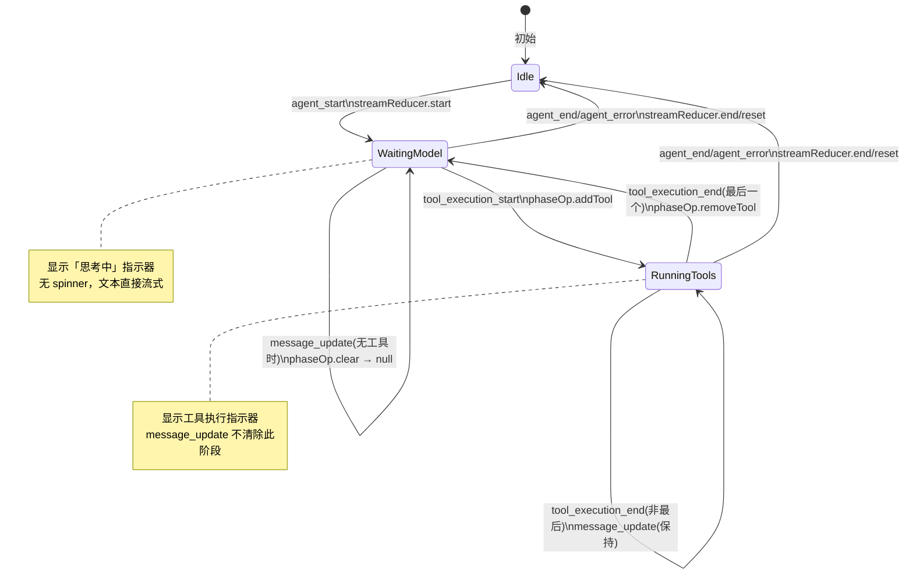

`streamReducer` 是 pi-agent-desktop 中处理 **流式消息** 的核心状态机，负责将服务端通过 SSE 推送的 `message_start` / `message_update` / `message_end` 事件，转化为前端可直接渲染的增量 UI 状态。它与 `agent-event-apply.ts`、`AgentEventsManager`、`useAgentSession` 以及 `MessageView`/`MessageList` 组件形成完整的 **流式渲染管线**。

本文档从状态机定义、事件驱动架构、增量渲染策略、阶段联动、测试契约五个维度系统性剖析该机制。

Sources: [hooks/agent-session/stream-state.ts](hooks/agent-session/stream-state.ts#L1-L32)

---

## 1. 状态机定义与动作集合

### 1.1 状态形态

`StreamingState` 仅包含两个字段，极简且语义明确：

```typescript
export interface StreamingState {
  isStreaming: boolean;          // 是否正在流式接收
  streamingMessage: Partial<AgentMessage> | null;  // 正在接收的部分消息
}
```

- `isStreaming`：全局流式标志，决定 `MessageList` 是否在列表末尾追加渲染「正在流式传输的消息」占位。
- `streamingMessage`：携带助手消息的**部分载荷**（`role`、`content`、`model`、`provider` 等），每次 `message_update` 到达时直接**全量替换**，而非增量合并 —— 客户端 reducer 按全量替换语义处理每次推送。

**初始状态**：`{ isStreaming: false, streamingMessage: null }`

Sources: [hooks/agent-session/stream-state.ts](hooks/agent-session/stream-state.ts#L1-L13)

### 1.2 动作类型

```typescript
export type StreamAction =
  | { type: "start" }                              // agent_start → 开始流式
  | { type: "update"; message: Partial<AgentMessage> }  // message_update → 更新部分消息
  | { type: "end" }                                // message_end / agent_end → 结束流式
  | { type: "reset" };                             // message_end / 显式重置 → 回到初始态
```

| 动作 | 触发事件 | 状态转移 | 典型场景 |
|------|----------|----------|----------|
| `start` | `agent_start` | `isStreaming: false → true`, `streamingMessage: null` | Agent 启动，准备接收第一条消息 |
| `update` | `message_start` / `message_update` | `isStreaming: true`, `streamingMessage = action.message` | 每帧 SSE 推送增量内容 |
| `end` | `agent_end` / `agent_error` | 回到 `initialStreamingState` | 正常/异常结束，清理流式占位 |
| `reset` | `message_end` | 回到 `initialStreamingState` | 单条消息完成，准备下一条 |

Sources: [hooks/agent-session/stream-state.ts](hooks/agent-session/stream-state.ts#L14-L32)

### 1.3 还原器实现

```typescript
export function streamReducer(state: StreamingState, action: StreamAction): StreamingState {
  switch (action.type) {
    case "start":
      return { isStreaming: true, streamingMessage: null };
    case "update":
      return { isStreaming: true, streamingMessage: action.message };
    case "end":
    case "reset":
      return initialStreamingState;
    default:
      return state;
  }
}
```

**关键设计决策**：
- `start` 不携带消息载荷 —— 首帧 `message_start` 会紧接着到达并触发 `update`。
- `update` **全量覆盖**而非合并，避免了客户端做脏弱的 diff 逻辑，服务端负责幂等性。
- `end` 与 `reset` 语义等价，均回初始态；区别仅在上游调用语境：`end` 对应 `agent_end`/`agent_error` 整体结束，`reset` 对应单条 `message_end`。

Sources: [hooks/agent-session/stream-state.ts](hooks/agent-session/stream-state.ts#L14-L32)

---

## 2. 事件驱动架构：从 SSE 到 streamReducer

### 2.1 完整数据流向

```mermaid
flowchart TD
    SSE[SSE 事件流\n/api/agent/:sid/events] --> Manager[AgentEventsManager\n(EventSource)]
    Manager --> Handler[handleAgentEvent\n(useAgentSession 内部)]
    Handler --> Apply[applyAgentEvent\n纯函数]
    Apply --> StreamAction[StreamAction\n{type, message?}]
    StreamAction --> Dispatch[dispatch(streamAction)\nuseReducer(streamReducer)]
    Dispatch --> StreamState[streamState\n{isStreaming, streamingMessage}]
    StreamState --> MessageList[MessageList 组件]
    MessageList --> MessageView[MessageView\nisStreaming={true}]
    MessageView --> Blocks[BlockView\nTextBlock/ThinkingBlock/ToolCallBlock]
    
    style StreamAction fill:#fef3c7,stroke:#f59e0b
    style StreamState fill:#dbeafe,stroke:#3b82f6
    style MessageView fill:#fce7f3,stroke:#ec4899
```

### 2.2 AgentEventsManager：SSE 连接与事件分发

`AgentEventsManager` 封装 `EventSource`，负责：
- 连接管理：`connect(sid, resetAttempts, expectRunning)`、`disconnect()`、指数退避重连（最多 5 次，最大 30s）
- 状态机：`disconnected → connecting → connected → failed`
- 事件解析：`onmessage` → `JSON.parse` → `handleAgentEvent(event)`

**事件类型定义**（`AgentEvent` 判别联合）：

```typescript
export type AgentEvent =
  | { type: "connected"; sessionId: string }
  | { type: "agent_start" }
  | { type: "agent_end" }
  | { type: "agent_settled" }
  | { type: "agent_error"; errorMessage: string }
  | { type: "message_start"; message: Partial<AgentMessage> }
  | { type: "message_update"; message: Partial<AgentMessage> }
  | { type: "message_end"; message: AgentMessage }
  | { type: "tool_execution_start"; toolCallId: string; toolName: string }
  | { type: "tool_execution_end"; toolCallId: string }
  | { type: "auto_retry_start"; ... }
  | { type: "auto_retry_end" }
  | { type: "auto_compaction_start" }
  | { type: "compaction_start" }
  | { type: "auto_compaction_end"; ... }
  | { type: "compaction_end"; ... }
  | { type: "queue_update"; steering: readonly string[]; followUp: readonly string[] }
  | { type: "follow_up_queue_update"; revision: number; items: ... }
  | ExtensionUiRequestEvent
  | ExtensionUiNotifyEvent;
```

Sources: [hooks/agent-session/agent-events-manager.ts](hooks/agent-session/agent-events-manager.ts#L1-L70)

### 2.3 applyAgentEvent：纯函数映射事件 → 状态补丁

`applyAgentEvent` 是 **纯函数**，无副作用，输入 `AgentEvent` 输出 `AgentEventApplyResult`：

```typescript
export type AgentEventApplyResult = {
  agentRunning?: boolean;
  phaseOp?: AgentPhaseOp;
  streamAction?: StreamAction;      // ← 关键：驱动 streamReducer
  retryInfo?: RetryInfo | null;
  isCompacting?: boolean;
  compactError?: string | null;
  appendMessages?: AgentMessage[];  // message_end 产出的完整消息
  effects: AgentEventSideEffect[];  // 副作用描述符：reloadSession、fetchAgentState 等
};
```

**关键映射逻辑**：

| 事件 | `streamAction` | 备注 |
|------|----------------|------|
| `agent_start` | `{ type: "start" }` | 同时置 `agentRunning=true`、`phaseOp={set: waiting_model}` |
| `message_start` / `message_update` | `{ type: "update", message: normalizeToolCalls(msg) }` | 归一化 legacy `toolCall` 字段 |
| `message_end` | `{ type: "reset" }` | 同时 `appendMessages=[normalized]`、`phaseOp={set: waiting_model}` |
| `agent_end` | `{ type: "end" }` | `agentRunning=false`，触发 `reloadSession`/`fetchAgentState` |
| `agent_error` | `{ type: "end" }` | 追加 `custom/agent_error` 消息到 transcript |

Sources: [hooks/agent-session/agent-event-apply.ts](hooks/agent-session/agent-event-apply.ts#L1-L150)

### 2.4 useAgentSession：dispatch 与渲染桥接

```typescript
const [streamState, dispatch] = useReducer(streamReducer, initialStreamingState);

// handleAgentEvent 内部：
const result = applyAgentEvent(event);
if (result.streamAction) dispatch(result.streamAction);
```

`streamState` 直接传递给 `MessageList`：

```typescript
<MessageList
  isStreaming={streamState.isStreaming}
  streamingMessage={streamState.streamingMessage}
  ...
/>
```

Sources: [hooks/useAgentSession.ts](hooks/useAgentSession.ts#L1-L100)

---

## 3. 增量渲染策略

### 3.1 MessageList：双轨渲染

`MessageList` 维护两条渲染轨道：

```tsx
{/* 1. 历史消息：虚拟化 + content-visibility:auto */}
{messages.map((msg, idx) => (
  <div ref={el => messageRefs.current[refIdx++] = el}
       style={{ contentVisibility: "auto", containIntrinsicSize: "auto 150px" }}>
    <MessageView message={msg} ... />
  </div>
))}

/* 2. 流式占位：仅当 isStreaming && streamingMessage 存在 */
{isStreaming && streamingMessage && (
  <MessageView message={streamingMessage as AgentMessage} isStreaming modelNames={modelNames} />
)}
```

- **历史消息**走虚拟化列表（`content-visibility: auto`），减少布局开销。
- **流式消息**作为**额外节点**追加在列表末尾，**不进入 `messages` 数组**，避免污染会话历史；`message_end` 到达后 `applyAgentEvent` 将完整消息 `appendMessages` 到 `messages`，同时 `streamReducer` `reset` 清空占位，实现**无闪烁切换**。

Sources: [components/MessageList.tsx](components/MessageList.tsx#L1-L89)

### 3.2 MessageView：流式感知渲染

`MessageView` 通过 `isStreaming` prop 区分模式：

```tsx
if (message.role === "assistant") {
  return (
    <AssistantMessageView
      message={message as AssistantMessage}
      isStreaming={isStreaming}   // ← 关键标志
      ...
    />
  );
}
```

**AssistantMessageView 流式特化行为**：

| 维度 | 非流式 (`isStreaming=false`) | 流式 (`isStreaming=true`) |
|------|------------------------------|---------------------------|
| **模型标签** | 显示 provider:model | 追加 **预估 token 数**、**实时 t/s 速率** |
| **思考块** | 从文件时间戳推导 `thinkingDurationFromFile` | 实时记录 `blockStartTimesRef`，`streamingDurations` 状态驱动动态计时 |
| **工具调用** | 从文件时间戳推导 `toolCallDurations` | 同上，实时计时 |
| **复制/分支按钮** | 显示 | **隐藏**（避免对不完整消息操作） |
| **用量信息** | 显示 `message.usage` | 隐藏 |

**实时计时实现**（`AssistantMessageView` 内部 `useEffect`）：

```typescript
useEffect(() => {
  if (!isStreaming) {
    // 流结束：补齐未完成块的时长
    const now = Date.now();
    setStreamingDurations(prev => { ... });
    streamStartRef.current = null;
    setTps(null);
    return;
  }

  const now = Date.now();
  // 首次见到块 → 记录开始时间
  blocks.forEach((_, i) => {
    if (!blockStartTimesRef.current.has(i)) blockStartTimesRef.current.set(i, now);
  });
  // 非最后一个块若已有后继块开始时间 → 固化其时长
  setStreamingDurations(prev => { ... });

  // 字符数 / elapsed → tokens/second
  let chars = 0;
  for (const b of blocks) { ... }
  if (streamStartRef.current === null) streamStartRef.current = now;
  const elapsed = (now - streamStartRef.current) / 1000;
  if (elapsed > 0.5) setTps(chars / 4 / elapsed);
}, [blocks, isStreaming]);
```

Sources: [components/MessageView.tsx](components/MessageView.tsx#L200-L450)

### 3.3 BlockView：块级增量渲染

`BlockView` 根据 `block.type` 分发到三种叶子组件，**均直接渲染 `block` 当前快照**：

```tsx
function BlockView({ block, toolResults, streamingDuration, toolCallDurations }) {
  if (block.type === "text") return <TextBlock block={block} />;
  if (block.type === "thinking") return <ThinkingBlock block={block} duration={streamingDuration} />;
  if (block.type === "toolCall") return <ToolCallBlock block={block} ... />;
  return null;
}
```

- **TextBlock**：`ReactMarkdown` 直接渲染 `block.text`，流式更新时 React 仅重渲染文本节点。
- **ThinkingBlock**：`duration` prop 来自 `streamingDurations`（流式）或 `thinkingDurationFromFile`（历史），折叠面板内展示原始思考文本。
- **ToolCallBlock**：输入参数 `JSON.stringify(block.input, null, 2)` 实时展开；结果仅在展开时渲染（`PairedResult`）。

Sources: [components/MessageView.tsx](components/MessageView.tsx#L598-L700)

---

## 4. 阶段联动：streamReducer 与 AgentPhase 的协同

`streamReducer` 并非孤立运行，它与 `AgentPhase`（`agent-phase.ts`）形成**双状态机协同**：



### 4.1 关键规则（`applyAgentEvent` 实现）

1. **`message_start` / `message_update`**：
   - `phaseOp: { type: "clear" }` —— 清除 `waiting_model`，**但保留 `running_tools`**（`applyPhaseOp` 内部实现）。
   - 若当前无工具运行，`clear` 导致 `phase = null`（UI 无 spinner，纯文本流式）。
   - 若有工具运行，`running_tools` 维持，工具指示器持续显示。

2. **`tool_execution_start`**：`phaseOp: { type: "addTool", id, name }` → 进入/维持 `running_tools`。

3. **`tool_execution_end`**：`phaseOp: { type: "removeTool", id }` → 最后一个工具结束时自动回退 `waiting_model`。

4. **`message_end`**：`phaseOp: { type: "set", phase: { kind: "waiting_model" } }` —— 单条消息完成，Agent 仍在运行，等待下一条。

5. **`agent_end` / `agent_error`**：`phaseOp: { type: "set", phase: null }` + `streamAction: { type: "end" }` —— 全部结束。

Sources: [hooks/agent-session/agent-event-apply.ts](hooks/agent-session/agent-event-apply.ts#L100-L150), [hooks/agent-session/agent-phase.ts](hooks/agent-session/agent-phase.ts#L1-L18)

### 4.2 为什么需要双状态机？

| 状态机 | 职责 | 典型 UI 表达 |
|--------|------|--------------|
| `streamReducer` | **消息级**：是否有正在接收的部分消息 | 流式消息占位、token 计数、实时 t/s |
| `AgentPhase` | **任务级**：Agent 当前在做什么 | 「等待模型」、「正在执行工具：bash、read」 |

二者正交：`streamReducer.isStreaming=true` 且 `phase=running_tools` 表示「正在流式输出工具调用参数」；`streamReducer.isStreaming=false` 且 `phase=waiting_model` 表示「上条消息已结束，等待下条消息」。

---

## 5. 测试契约：可验证的状态机行为

测试采用 **契约驱动** 风格：`reduceEvents` 辅助函数将一连串事件通过 `applyAgentEvent` + `streamReducer` 还原，断言最终状态。

### 5.1 核心契约用例

| 测试名 | 事件序列 | 断言重点 |
|--------|----------|----------|
| `agent_start → message_update → message_end → agent_end ends cleanly` | 5 事件 | `stream.isStreaming=false`、`stream.streamingMessage=null`、单条 `appendMessages`、副作用含 `reloadSession`/`fetchAgentState`/`onAgentEnd` |
| `agent_error clears running state` | `agent_start` → `agent_error` | `stream` 回初始态、`appendMessages` 含 `custom/agent_error`、**无** `onAgentEnd` 副作用 |
| `message_update keeps running_tools phase` | `agent_start` → `tool_execution_start` → `message_update`×2 | `phase` 保持 `running_tools`，工具未被清除 |
| `message_update clears waiting_model phase` | `agent_start` → `message_update` | `phase=null`（无 spinner） |
| `message_update normalizes legacy toolCall fields` | 单 `message_update` 携带 legacy `id/name/arguments` | `streamAction.message.content[0]` 含 `toolCallId`/`toolName`/`input` |

Sources: [hooks/agent-session/agent-event-apply.test.ts](hooks/agent-session/agent-event-apply.test.ts#L1-L200)

### 5.2 streamReducer 单元测试

```typescript
test("start marks streaming without a message", () => {
  assert.deepEqual(streamReducer(initialStreamingState, { type: "start" }), {
    isStreaming: true,
    streamingMessage: null,
  });
});

test("update stores partial streaming message", () => {
  const message = { role: "assistant" as const };
  assert.deepEqual(streamReducer(initialStreamingState, { type: "update", message }), {
    isStreaming: true,
    streamingMessage: message,
  });
});

test("end clears streaming state", () => {
  const state = { isStreaming: true, streamingMessage: { role: "assistant" as const } };
  assert.deepEqual(streamReducer(state, { type: "end" }), initialStreamingState);
});

test("reset clears streaming state", () => {
  const state = { isStreaming: true, streamingMessage: { role: "assistant" as const } };
  assert.deepEqual(streamReducer(state, { type: "reset" }), initialStreamingState);
});
```

Sources: [hooks/agent-session/stream-state.test.ts](hooks/agent-session/stream-state.test.ts#L1-L29)

---

## 6. 架构总结与关键设计点回顾

### 6.1 关键设计决策表

| 决策点 | 选择 | 理由 |
|--------|------|------|
| **状态最小化** | 仅 `isStreaming` + `streamingMessage` | 避免冗余派生状态，单一事实来源 |
| **更新策略** | `update` 全量替换 | 服务端幂等推送最新快照，客户端无需 diff/merge |
| **占位与历史分离** | `streamingMessage` 不入 `messages` 数组 | `message_end` 原子替换，无闪烁、无重复 |
| **纯函数映射** | `applyAgentEvent` 无副作用 | 可测试、可复现、便于契约测试 |
| **双状态机正交** | `streamReducer`（消息级）+ `AgentPhase`（任务级） | 职责分离，UI 组合灵活 |
| **实时指标客户端计算** | `tps`、块耗时均前端推导 | 服务端无需额外遥测字段，降低带宽 |

### 6.2 扩展点与演进方向

| 方向 | 现状 | 潜在改进 |
|------|------|----------|
| **增量 Markdown** | 整块 `block.text` 重渲染 | 引入流式 Markdown 解析器（如 `streamdown`）实现字符级增量 |
| **工具调用参数流式** | `toolCall.input` 整体替换 | 支持参数字段级流式（JSON Patch） |
| **回压控制** | 无 | 高频 `message_update` 时可引入 `requestAnimationFrame` 批处理 |
| **离线/断点续传** | 仅依赖 SSE 重连 | 引入 `message_end` 确认机制，支持断点恢复 |

---

## 7. 相关文档导航

| 文档 | 关联点 |
|------|--------|
| [SSE 事件流与流式状态机](8-sse-shi-jian-liu-yu-liu-shi-zhuang-tai-ji) | 服务端事件生成、SSE 连接管理、事件类型完整定义 |
| [useAgentSession 主 Hook 与子 Hook 拆分策略](22-useagentsession-zhu-hook-yu-zi-hook-chai-fen-ce-lue) | `useReducer(streamReducer)` 集成位置、子 Hook 依赖图 |
| [消息虚拟化列表、Markdown 渲染与代码高亮](26-xiao-xi-xu-ni-hua-lie-biao-markdown-xuan-ran-yu-dai-ma-gao-liang) | `MessageList` 虚拟化、`MessageView` Markdown/语法高亮细节 |
| [Agent 模式与 Ask 拦截：Plan / Ask / Full](16-agent-mo-shi-yu-ask-lan-jie-plan-ask-full) | `agent_start` 触发时机与模式差异 |

---

*本文档基于代码考古方法论编写，所有实现细节均可追溯至引用源文件的具体行号。*