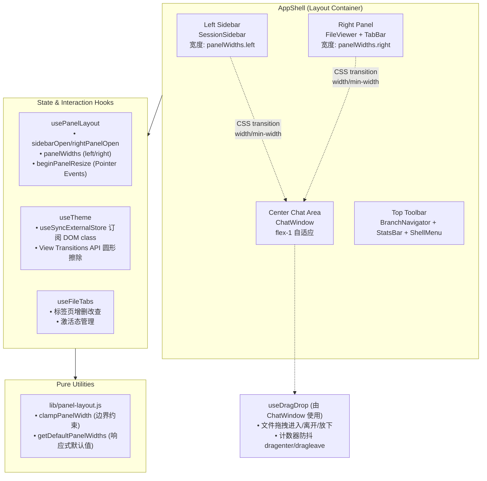
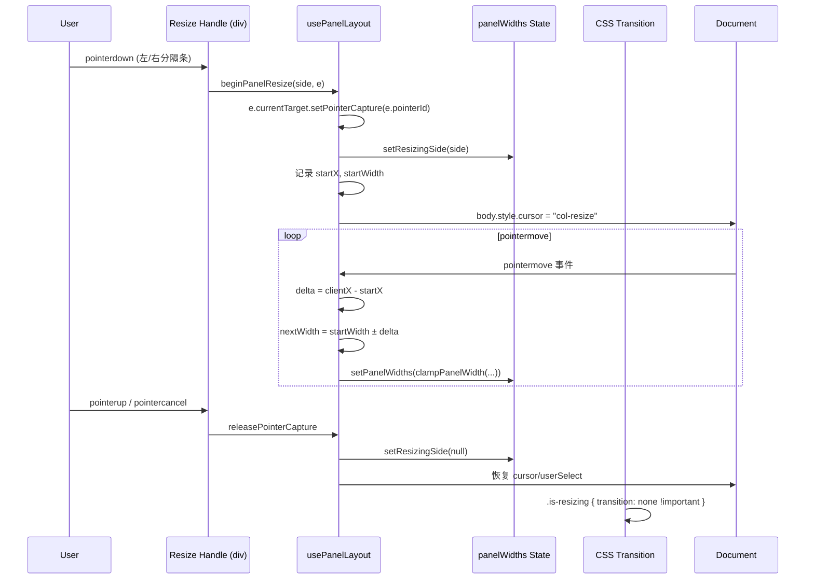
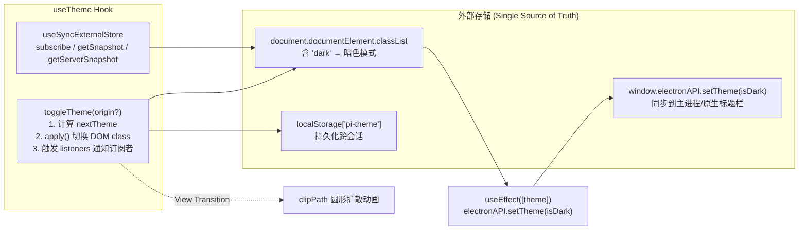

`AppShell` 是 pi-agent-desktop 的顶层布局容器，采用经典的**三栏式 IDE 布局**：左侧会话侧边栏、中间聊天区、右侧文件查看器面板。该系统集成了面板拖拽调整宽度、键盘快捷键导航、主题切换（含 View Transitions API 圆形擦除动画）、移动端响应式抽屉式侧边栏等核心交互。本文档从架构分层、状态管理、CSS 动画设计、键盘交互矩阵四个维度系统性解析。

Sources: [components/AppShell.tsx](components/AppShell.tsx#L1-L50), [hooks/usePanelLayout.ts](hooks/usePanelLayout.ts#L1-L30), [hooks/useTheme.ts](hooks/useTheme.ts#L1-L30), [lib/panel-layout.js](lib/panel-layout.js#L1-L34), [app/globals.css](app/globals.css#L700-L950)

---

## 整体架构与组件分层

`AppShell` 遵循**容器-展示分离**与**Hook 状态外提**原则：布局容器仅负责协调三大面板的显隐、宽度、动画触发；具体面板内容（会话树、聊天窗口、文件标签页）委托给独立组件；交互逻辑（拖拽、主题、快捷键）封装在可复用 Hook 中。



**关键设计决策**：

| 维度 | 选择 | 理由 |
|------|------|------|
| 状态存储 | `usePanelLayout` 返回对象 + React state | 避免 Context 过度传播，面板宽度仅在拖拽/窗口 resize 时写入 |
| 动画驱动 | CSS `transition` + `will-change` | 合成器线程动画，避免主线程阻塞；`prefers-reduced-motion` 自动降级 |
| 拖拽原语 | `Pointer Events` (`pointerdown/move/up/cancel`) | 统一鼠标/触控/笔输入，支持 `setPointerCapture` 防止焦点丢失 |
| 主题同步 | `useSyncExternalStore` 订阅 `document.documentElement.classList` | SSR 安全，服务端快照为 `light`，客户端激活后读取实际 DOM 状态 |
| 移动端适配 | `@media (max-width: 640px)` 切换为 `fixed` + `transform` 抽屉 | 侧边栏不再占据流式布局空间，配合半透明 backdrop 遮罩 |

Sources: [components/AppShell.tsx](components/AppShell.tsx#L50-L150), [hooks/usePanelLayout.ts](hooks/usePanelLayout.ts#L1-L97), [hooks/useTheme.ts](hooks/useTheme.ts#L1-L95), [app/globals.css](app/globals.css#L700-L950)

---

## 面板拖拽调整宽度机制

### 核心流程



### 边界约束与响应式默认值

`lib/panel-layout.js` 定义了面板宽度的**硬性约束**与**视口感知默认值**：

```javascript
// 左侧栏：固定像素范围
const LEFT_PANEL_DEFAULT_WIDTH = 260;
const LEFT_PANEL_MIN_WIDTH = 220;
const LEFT_PANEL_MAX_WIDTH = 480;           // 绝对上限
// 动态上限：不超过视口 45%
clampPanelWidth("left", width, windowWidth) 
  → Math.min(LEFT_PANEL_MAX_WIDTH, Math.floor(windowWidth * 0.45))

// 右侧栏：比例制
const RIGHT_PANEL_DEFAULT_RATIO = 0.42;      // 默认 42% 视口宽
const RIGHT_PANEL_MIN_WIDTH = 300;           // 绝对下限
const RIGHT_PANEL_MAX_RATIO = 0.6;           // 不超过视口 60%
```

**响应式行为**：

- 窗口 `resize` 事件触发 `clampPanelWidth` 重新钳制，防止面板超出可视区
- 移动端（≤640px）完全禁用拖拽，侧边栏改为全宽抽屉，右侧面板全屏覆盖
- `beginPanelResize` 内部 `if (window.innerWidth <= 640) return` 早期返回

Sources: [hooks/usePanelLayout.ts](hooks/usePanelLayout.ts#L15-L60), [lib/panel-layout.js](lib/panel-layout.js#L1-L34), [app/globals.css](app/globals.css#L830-L880)

### CSS 动画实现

```css
/* 桌面端：width + min-width 双轨并行动画 */
@media (min-width: 641px) {
  .sidebar-container,
  .right-panel-container {
    overflow: hidden;
    transition:
      width var(--duration-fast) var(--ease-smooth-out),  /* 250ms cubic-bezier(0.22,1,0.36,1) */
      min-width var(--duration-fast) var(--ease-smooth-out);
  }
  /* 拖拽时瞬间禁用 transition，避免与 JS 设置的宽度冲突 */
  .sidebar-container.is-resizing,
  .right-panel-container.is-resizing {
    transition: none !important;
  }
  /* 内容固定宽度，防止动画期间重排 */
  .sidebar-container > *,
  .right-panel-container > * {
    width: 100%;
    min-width: 220px; /* 或 300px */
  }
}
```

**关键细节**：

- 分隔条 `::after` 伪元素仅 1px 宽，hover/active 时显示 accent 色与焦点环，提供视觉反馈
- `touch-action: none` 禁止浏览器默认触控滚动，保证拖拽独占
- `prefers-reduced-motion: reduce` 媒体查询强制 `transition: none !important`

Sources: [app/globals.css](app/globals.css#L830-L950), [components/AppShell.tsx](components/AppShell.tsx#L410-L450)

---

## 键盘快捷键系统

`AppShell` 在顶层注册全局 `keydown` 监听器，**仅在非可编辑元素且按下 `Ctrl`（非 `Meta`）时生效**，形成类 VS Code 的“应用级命令”语义。

### 快捷键矩阵

| 组合键 | 动作 | 备注 |
|--------|------|------|
| `Ctrl+B` | 切换左侧边栏显隐 | `sidebarOpen` 反转 |
| `Shift+Ctrl+B` | 切换右侧文件面板显隐 | `rightPanelOpen` 反转 |
| `Alt+B` | 切换右侧文件面板显隐 | 备选，`Alt` 键单独判断 |
| `Shift+M` | 打开 Models 配置模态框 | `modelsConfigOpen = true` |
| `Shift+S` | 打开 Skills 配置模态框 | 需有有效 `cwd`，否则静默忽略 |
| `Shift+T` | 切换主题（含圆形擦除动画） | 调用无参 `toggleTheme()`，从视口中心扩散（传 `origin` 的只有 Shell Menu 主题菜单项） |
| `Shift+F` | 显示右侧文件面板 | 单向开启，不切换 |
| `Ctrl+N` | 新建会话 | 需有有效 `cwd`，复用 `handleNewSession` |

### 实现细节

```typescript
// AppShell.tsx ~L280-340
useEffect(() => {
  const handler = (e: KeyboardEvent) => {
    // 1. 仅 Ctrl（非 Meta/Cmd），非编辑区
    if (!e.ctrlKey || e.metaKey || isEditableTarget(e.target)) return;
    
    const key = e.key.toLowerCase();

    // 2. Alt 组合键优先（单独分支，避免与 Ctrl 冲突）
    if (e.altKey && !e.shiftKey && key === "b") {
      e.preventDefault();
      setRightPanelOpen(v => !v);
      return;
    }
    if (e.altKey) return; // 其他 Alt+Key 保留给浏览器/系统

    // 3. Ctrl + Key 主分支
    if (!e.shiftKey && key === "b") { /* 切换左侧栏 */ }
    if (e.shiftKey && key === "b") { /* 切换右侧栏 */ }
    if (e.shiftKey && key === "m") { /* Models 配置 */ }
    if (e.shiftKey && key === "s") { /* Skills 配置 */ }
    if (e.shiftKey && key === "t") { /* 主题切换 */ }
    if (e.shiftKey && key === "f") { /* 显示右侧栏 */ }
    if (!e.shiftKey && key === "n") { /* 新建会话 */ }
  };
  window.addEventListener("keydown", handler);
  return () => window.removeEventListener("keydown", handler);
}, [/* 依赖项: toggleTheme, setSidebarOpen, ... */]);
```

**设计要点**：

- `isEditableTarget` 过滤 `contentEditable`、`INPUT`、`TEXTAREA`、`SELECT`，防止在输入框/编辑器中误触发
- `e.metaKey` 排除 macOS `Cmd` 键，保留系统级快捷键（如 `Cmd+C`）
- `Alt+B` 作为 `Shift+Ctrl+B` 的替代，考虑到某些键盘布局 `Shift+Ctrl` 难以按压
- 依赖数组包含所有 setter 与 `toggleTheme`，确保闭包引用最新状态

Sources: [components/AppShell.tsx](components/AppShell.tsx#L10-L25), [components/AppShell.tsx](components/AppShell.tsx#L280-L340)

---

## 主题切换：View Transitions API 圆形擦除

`useTheme` 实现了**零闪烁、可中断、尊重 `prefers-reduced-motion`**的主题切换动画，核心利用 `document.startViewTransition` 与 `Element.animate(clipPath)`。

### 状态同步架构



### 圆形擦除动画细节

```typescript
// hooks/useTheme.ts ~L30-L80
const toggleTheme = useCallback((origin?: { x: number; y: number }) => {
  const next: Theme = getSnapshot() === "dark" ? "light" : "dark";

  const apply = () => {
    if (next === "dark") document.documentElement.classList.add("dark");
    else document.documentElement.classList.remove("dark");
    localStorage.setItem("pi-theme", next);
    listeners.forEach(cb => cb());
  };

  // 降级条件：不支持 View Transitions 或用户开启减少动画
  const reduceMotion = window.matchMedia?.("(prefers-reduced-motion: reduce)").matches;
  const supportsVT = typeof document.startViewTransition === "function";

  if (!supportsVT || reduceMotion) { apply(); return; }

  // 计算圆形擦除终点半径（覆盖整个视口对角线）
  const x = origin?.x ?? window.innerWidth / 2;
  const y = origin?.y ?? window.innerHeight / 2;
  const endRadius = Math.hypot(
    Math.max(x, window.innerWidth - x),
    Math.max(y, window.innerHeight - y)
  );

  const transition = document.startViewTransition(apply);
  transition.ready.then(() => {
    document.documentElement.animate({
      clipPath: [
        `circle(0px at ${x}px ${y}px)`,
        `circle(${endRadius}px at ${x}px ${y}px)`
      ]
    }, {
      duration: 250,
      easing: "cubic-bezier(0.22, 1, 0.36, 1)",
      pseudoElement: "::view-transition-new(root)"
    });
  }).catch(() => { /* transition cancelled */ });
}, []);
```

**CSS 配合**：

```css
/* app/globals.css ~L40-L55 */
::view-transition-old(root),
::view-transition-new(root) {
  animation: none;           /* 禁用 UA 默认交叉淡入 */
  mix-blend-mode: normal;
}
::view-transition-old(root) { z-index: 1; }
::view-transition-new(root) { z-index: 2; }
```

**交互细节**：

- `origin` 参数可选，默认视口中心；Shell Menu 菜单项点击时传入按钮中心坐标，实现“从点击点扩散”
- `transition.ready` 在 DOM 更新完成后 resolve，随后在 `::view-transition-new(root)` 伪元素上运行 `clipPath` 动画
- `catch` 捕获转换取消（如用户快速连续点击），避免未处理 Promise 拒绝
- `prefers-reduced-motion` 直接跳过动画，仅执行 `apply()`

Sources: [hooks/useTheme.ts](hooks/useTheme.ts#L1-L95), [app/globals.css](app/globals.css#L40-L55), [components/AppShell.tsx](components/AppShell.tsx#L600-L650)

---

## 移动端响应式布局

断点 **640px** 为分水岭，CSS 与 JS 协同切换交互范式：

| 特性 | ≥641px (桌面) | ≤640px (移动) |
|------|---------------|---------------|
| 左侧栏 | `flex` 流式布局，`width` 动画 | `fixed` 定位，`transform: translateX(-100%/0)` 滑入 |
| 右侧栏 | `flex` 流式布局，`width` 动画 | 全屏覆盖，`display: none` 关闭时完全移除 |
| 遮罩层 | `display: none` | `sidebar-open` 时显示半透明 backdrop，点击关闭 |
| 拖拽调整 | `Pointer Events` 启用 | 完全禁用 (`beginPanelResize` 早期返回) |
| 标题栏安全区 | macOS 左侧 80px 预留 (`macos-titlebar-leading-safe-area`) | 同桌面 |

**CSS 关键片段**：

```css
/* app/globals.css ~L899-L950 */
@media (max-width: 640px) {
  .sidebar-container {
    position: fixed !important;
    top: 0; left: 0; bottom: 0;
    width: 280px; max-width: 85vw;
    transition: transform var(--duration-fast) var(--ease-smooth-out);
  }
  .sidebar-container.sidebar-open  { transform: translateX(0); box-shadow: var(--shadow-popover); }
  .sidebar-container.sidebar-closed { transform: translateX(-100%); box-shadow: none; }

  .right-panel-container.right-panel-closed {
    width: 0 !important; min-width: 0 !important;
    border-left: none !important; display: none !important;
  }
  .right-panel-container.right-panel-open {
    width: 100%; min-width: 0;
  }
}
```

Sources: [app/globals.css](app/globals.css#L899-L950), [components/AppShell.tsx](components/AppShell.tsx#L400-L420), [hooks/usePanelLayout.ts](hooks/usePanelLayout.ts#L20-L25)

---

## 顶部工具栏与下拉菜单系统

`AppShell` 顶部工具栏集成了：**侧边栏切换、路径面包屑、分支导航、统计栏、工作台菜单（主题/系统提示词/扩展/导出/语言）**。下拉菜单采用**单活动面板**模式：同一时刻仅展开一个下拉面板。

### 位置计算与 ResizeObserver

```typescript
// AppShell.tsx ~L150-L180
useEffect(() => {
  if (!activeTopPanel || !topBarRef.current) return;
  const update = () => {
    const rect = topBarRef.current!.getBoundingClientRect();
    setTopPanelPos({ top: rect.bottom, left: rect.left, width: rect.width });
  };
  update();
  const ro = new ResizeObserver(update);
  ro.observe(topBarRef.current);
  return () => ro.disconnect();
}, [activeTopPanel]);
```

- `ResizeObserver` 监听工具栏尺寸变化，实时同步下拉面板 `top/left/width`
- `data-origin="top-center"` / `top-right` 配合 CSS `transform-origin` 实现从锚点展开动画

### Shell Menu 定位算法

```typescript
// AppShell.tsx ~L130-L150
const updateShellMenuPosition = useCallback(() => {
  const button = shellMenuButtonRef.current;
  if (!button) return;
  const rect = button.getBoundingClientRect();
  setShellMenuPosition({
    top: rect.bottom + SHELL_MENU_GAP,           // 6px 间隙
    right: Math.max(
      SHELL_MENU_EDGE_PADDING,                   // 8px 边缘留白
      window.innerWidth - rect.right + SHELL_MENU_RIGHT_OFFSET  // 4px 右偏移
    ),
  });
}, []);
```

- 右对齐定位，防止菜单超出视口右边缘
- `useLayoutEffect` + `resize` 监听保证窗口大小变化时重新计算

Sources: [components/AppShell.tsx](components/AppShell.tsx#L130-L180), [components/AppShell.tsx](components/AppShell.tsx#L600-L680), [app/globals.css](app/globals.css#L500-L560)

---

## 文件拖拽上传集成

`useDragDrop` Hook 提供**轻量级文件拖拽区域**原语，全库唯一使用方是 `ChatWindow`（`ChatInput` 未使用该 Hook）。

```typescript
// hooks/useDragDrop.ts
export function useDragDrop(onDrop: (files: File[]) => void) {
  const [isDragOver, setIsDragOver] = useState(false);
  const counterRef = useRef(0);  // 嵌套元素 dragenter/dragleave 计数器

  const handleDragEnter = (e) => {
    if (!dataTransferHasFiles(e.dataTransfer)) return;
    e.preventDefault();
    counterRef.current += 1;
    setIsDragOver(true);
  };
  const handleDragLeave = () => {
    counterRef.current -= 1;
    if (counterRef.current <= 0) { counterRef.current = 0; setIsDragOver(false); }
  };
  const handleDrop = (e) => {
    e.preventDefault();
    counterRef.current = 0;
    setIsDragOver(false);
    const files = Array.from(e.dataTransfer.files);
    if (files.length) onDrop(files);
  };
  // ...
}
```

**计数器模式**解决 `dragleave` 在子元素间移动时误触发 `isDragOver=false` 的经典问题。

Sources: [hooks/useDragDrop.ts](hooks/useDragDrop.ts#L1-L46)

---

## 无障碍与键盘导航无障碍

| 元素 | ARIA 角色/属性 | 键盘支持 |
|------|----------------|----------|
| 侧边栏分隔条 | `role="separator" aria-orientation="vertical" aria-label="Resize sidebar"` | `Tab` 聚焦，`Enter/Space` 激活拖拽态（配合 Pointer Events） |
| 文件面板分隔条 | `role="separator" aria-orientation="vertical" aria-label="Resize file panel"` | 同左侧 |
| 顶部工具栏按钮 | `aria-label` 动态切换（显示/隐藏） | `Tab` 遍历，`Enter/Space` 触发 |
| Shell Menu | `role="menu" aria-controls="workbench-menu" aria-expanded` | `Esc` 关闭并焦点回归触发按钮 |
| 下拉面板 | `role="menuitem"` 按钮 | 同菜单 |
| 语言选择器 | 原生 `<select>` | 原生键盘导航 |

`useDismissOnOutsideClick` Hook 统一处理“点击外部/按 Esc 关闭下拉菜单并恢复焦点”。

Sources: [components/AppShell.tsx](components/AppShell.tsx#L410-L450), [components/AppShell.tsx](components/AppShell.tsx#L600-L680), [hooks/useDismissOnOutsideClick.ts](hooks/useDismissOnOutsideClick.ts)

---

## 关键 CSS 自定义属性速查

| 变量 | 默认值 | 用途 |
|------|--------|------|
| `--toolbar-height` | `36px` | 顶部/右侧工具栏高度 |
| `--control-height` | `32px` | 通用控件高度 |
| `--duration-fast` | `250ms` | 面板展开/折叠、下拉菜单动画时长 |
| `--ease-smooth-out` | `cubic-bezier(0.22, 1, 0.36, 1)` | 标准缓动，Material Design "smooth out" |
| `--resize-dur` | `300ms` | `.t-resize` 专用：ChatInput 输入框自动伸缩的 width/height 过渡（面板宽度动画用的是 `--duration-fast`） |
| `--dropdown-open-dur` | `var(--duration-fast)` | 下拉菜单展开时长 |
| `--dropdown-close-dur` | `var(--duration-quick)` (150ms) | 下拉菜单关闭时长 |
| `--material-sidebar` | `rgba(241,243,247,0.88)` / `rgba(18,22,29,0.9)` | 侧边栏毛玻璃背景 |
| `--material-toolbar` | `rgba(250,251,253,0.78)` / `rgba(12,15,20,0.8)` | 工具栏毛玻璃背景 |

Sources: [app/globals.css](app/globals.css#L1-L120), [app/globals.css](app/globals.css#L500-L560)

---

## 扩展点与自定义指南

### 新增全局快捷键

1. 在 `AppShell.tsx` 的 `keydown` handler 中添加新分支
2. 若涉及异步操作，建议派发自定义事件或通过 Context 触发业务逻辑
3. 更新依赖数组，确保闭包捕获最新回调

### 调整面板宽度约束

修改 `lib/panel-layout.js` 常量，重新构建即可生效（无运行时依赖）：

```javascript
// 示例：将左侧栏最大宽度提升到 600px
const LEFT_PANEL_MAX_WIDTH = 600;
// 示例：右侧栏默认比例改为 50%
const RIGHT_PANEL_DEFAULT_RATIO = 0.5;
```

### 自定义主题切换动画

- 替换 `useTheme.ts` 中 `clipPath` 关键帧为其他形状（如矩形扩散、水波纹）
- 或在 CSS 中定义 `@keyframes` 并在 `::view-transition-new(root)` 上应用 `animation`
- 需保持 `animation: none` 覆盖 UA 默认

### 新增面板（如底部终端面板）

1. 在 `usePanelLayout` 返回对象中新增 `bottomPanelOpen`、`panelHeights.bottom`
2. 在 `AppShell.tsx` 布局 JSX 中添加 `<div className="bottom-panel-container">`
3. 在 CSS 增加对应 `@media` 动画规则（`height` 代替 `width`）
4. 添加分隔条与 `beginPanelResize("bottom", ...)` 支持

---

## 相关页面导航

- **上游依赖**：[useAgentSession 主 Hook 与子 Hook 拆分策略](22-useagentsession-zhu-hook-yu-zi-hook-chai-fen-ce-lue) — `AppShell` 消费 `useAgentSession` 提供的会话状态
- **下游消费**：[液态思考球：WebGPU 优先 Canvas 降级渲染](25-ye-tai-si-kao-qiu-webgpu-you-xian-canvas-jiang-ji-xuan-ran) — 顶部工具栏集成的思考球组件
- **并行系统**：[消息虚拟化列表、Markdown 渲染与代码高亮](26-xiao-xi-xu-ni-hua-lie-biao-markdown-xuan-ran-yu-dai-ma-gao-liang) — 中间聊天区的核心渲染管线
- **桌面端集成**：[Electron 主进程启动链与双门槛就绪检查](10-electron-zhu-jin-cheng-qi-dong-lian-yu-shuang-men-jian-jiu-xu-jian-cha) — `electronAPI.setTheme` 同步主题到原生标题栏

---

## 总结

`AppShell` 布局系统展示了**声明式状态 + 命令式交互原语 + CSS 驱动动画**的工程化组合：

1. **面板拖拽** — `Pointer Events` + `setPointerCapture` + CSS `transition` 实现 60fps 无卡顿调整
2. **键盘快捷键** — 单一顶层监听器 + `isEditableTarget` 守卫 + 语义分组（Ctrl/Shift/Alt 正交设计）
3. **主题切换** — `useSyncExternalStore` 订阅 DOM class + View Transitions API 圆形擦除 + 降级策略
4. **响应式** — 640px 断点双模式（流式/抽屉），CSS 媒体查询与 JS 早期返回协同

该架构既保持了桌面端 IDE 级的信息密度与操作效率，又通过渐进增强在移动端提供可用体验，是 pi-agent-desktop 前端架构的**骨架层**核心。<blog>
# AppShell 布局系统：面板拖拽、键盘快捷键、主题切换

`AppShell` 是 pi-agent-desktop 的顶层布局容器，采用经典的**三栏式 IDE 布局**：左侧会话侧边栏、中间聊天区、右侧文件查看器面板。该系统集成了面板拖拽调整宽度、键盘快捷键导航、主题切换（含 View Transitions API 圆形擦除动画）、移动端响应式抽屉式侧边栏等核心交互。本文档从架构分层、状态管理、CSS 动画设计、键盘交互矩阵四个维度系统性解析。

Sources: [components/AppShell.tsx](components/AppShell.tsx#L1-L50), [hooks/usePanelLayout.ts](hooks/usePanelLayout.ts#L1-L30), [hooks/useTheme.ts](hooks/useTheme.ts#L1-L30), [lib/panel-layout.js](lib/panel-layout.js#L1-L34), [app/globals.css](app/globals.css#L700-L950)

---

## 整体架构与组件分层

`AppShell` 遵循**容器-展示分离**与**Hook 状态外提**原则：布局容器仅负责协调三大面板的显隐、宽度、动画触发；具体面板内容（会话树、聊天窗口、文件标签页）委托给独立组件；交互逻辑（拖拽、主题、快捷键）封装在可复用 Hook 中。


**关键设计决策**：

| 维度 | 选择 | 理由 |
|------|------|------|
| 状态存储 | `usePanelLayout` 返回对象 + React state | 避免 Context 过度传播，面板宽度仅在拖拽/窗口 resize 时写入 |
| 动画驱动 | CSS `transition` + `will-change` | 合成器线程动画，避免主线程阻塞；`prefers-reduced-motion` 自动降级 |
| 拖拽原语 | `Pointer Events` (`pointerdown/move/up/cancel`) | 统一鼠标/触控/笔输入，支持 `setPointerCapture` 防止焦点丢失 |
| 主题同步 | `useSyncExternalStore` 订阅 `document.documentElement.classList` | SSR 安全，服务端快照为 `light`，客户端激活后读取实际 DOM 状态 |
| 移动端适配 | `@media (max-width: 640px)` 切换为 `fixed` + `transform` 抽屉 | 侧边栏不再占据流式布局空间，配合半透明 backdrop 遮罩 |

Sources: [components/AppShell.tsx](components/AppShell.tsx#L50-L150), [hooks/usePanelLayout.ts](hooks/usePanelLayout.ts#L1-L97), [hooks/useTheme.ts](hooks/useTheme.ts#L1-L95), [app/globals.css](app/globals.css#L700-L950)

---

## 面板拖拽调整宽度机制

### 核心流程


### 边界约束与响应式默认值

`lib/panel-layout.js` 定义了面板宽度的**硬性约束**与**视口感知默认值**：

```javascript
// 左侧栏：固定像素范围
const LEFT_PANEL_DEFAULT_WIDTH = 260;
const LEFT_PANEL_MIN_WIDTH = 220;
const LEFT_PANEL_MAX_WIDTH = 480;           // 绝对上限
// 动态上限：不超过视口 45%
clampPanelWidth("left", width, windowWidth) 
  → Math.min(LEFT_PANEL_MAX_WIDTH, Math.floor(windowWidth * 0.45))

// 右侧栏：比例制
const RIGHT_PANEL_DEFAULT_RATIO = 0.42;      // 默认 42% 视口宽
const RIGHT_PANEL_MIN_WIDTH = 300;           // 绝对下限
const RIGHT_PANEL_MAX_RATIO = 0.6;           // 不超过视口 60%
```

**响应式行为**：

- 窗口 `resize` 事件触发 `clampPanelWidth` 重新钳制，防止面板超出可视区
- 移动端（≤640px）完全禁用拖拽，侧边栏改为全宽抽屉，右侧面板全屏覆盖
- `beginPanelResize` 内部 `if (window.innerWidth <= 640) return` 早期返回

Sources: [hooks/usePanelLayout.ts](hooks/usePanelLayout.ts#L15-L60), [lib/panel-layout.js](lib/panel-layout.js#L1-L34), [app/globals.css](app/globals.css#L830-L880)

### CSS 动画实现

```css
/* 桌面端：width + min-width 双轨并行动画 */
@media (min-width: 641px) {
  .sidebar-container,
  .right-panel-container {
    overflow: hidden;
    transition:
      width var(--duration-fast) var(--ease-smooth-out),  /* 250ms cubic-bezier(0.22,1,0.36,1) */
      min-width var(--duration-fast) var(--ease-smooth-out);
  }
  /* 拖拽时瞬间禁用 transition，避免与 JS 设置的宽度冲突 */
  .sidebar-container.is-resizing,
  .right-panel-container.is-resizing {
    transition: none !important;
  }
  /* 内容固定宽度，防止动画期间重排 */
  .sidebar-container > *,
  .right-panel-container > * {
    width: 100%;
    min-width: 220px; /* 或 300px */
  }
}
```

**关键细节**：

- 分隔条 `::after` 伪元素仅 1px 宽，hover/active 时显示 accent 色与焦点环，提供视觉反馈
- `touch-action: none` 禁止浏览器默认触控滚动，保证拖拽独占
- `prefers-reduced-motion: reduce` 媒体查询强制 `transition: none !important`

Sources: [app/globals.css](app/globals.css#L830-L950), [components/AppShell.tsx](components/AppShell.tsx#L410-L450)

---

## 键盘快捷键系统

`AppShell` 在顶层注册全局 `keydown` 监听器，**仅在非可编辑元素且按下 `Ctrl`（非 `Meta`）时生效**，形成类 VS Code 的“应用级命令”语义。

### 快捷键矩阵

| 组合键 | 动作 | 备注 |
|--------|------|------|
| `Ctrl+B` | 切换左侧边栏显隐 | `sidebarOpen` 反转 |
| `Shift+Ctrl+B` | 切换右侧文件面板显隐 | `rightPanelOpen` 反转 |
| `Alt+B` | 切换右侧文件面板显隐 | 备选，`Alt` 键单独判断 |
| `Shift+M` | 打开 Models 配置模态框 | `modelsConfigOpen = true` |
| `Shift+S` | 打开 Skills 配置模态框 | 需有有效 `cwd`，否则静默忽略 |
| `Shift+T` | 切换主题（含圆形擦除动画） | 调用无参 `toggleTheme()`，从视口中心扩散（传 `origin` 的只有 Shell Menu 主题菜单项） |
| `Shift+F` | 显示右侧文件面板 | 单向开启，不切换 |
| `Ctrl+N` | 新建会话 | 需有有效 `cwd`，复用 `handleNewSession` |

### 实现细节

```typescript
// AppShell.tsx ~L280-340
useEffect(() => {
  const handler = (e: KeyboardEvent) => {
    // 1. 仅 Ctrl（非 Meta/Cmd），非编辑区
    if (!e.ctrlKey || e.metaKey || isEditableTarget(e.target)) return;
    
    const key = e.key.toLowerCase();

    // 2. Alt 组合键优先（单独分支，避免与 Ctrl 冲突）
    if (e.altKey && !e.shiftKey && key === "b") {
      e.preventDefault();
      setRightPanelOpen(v => !v);
      return;
    }
    if (e.altKey) return; // 其他 Alt+Key 保留给浏览器/系统

    // 3. Ctrl + Key 主分支
    if (!e.shiftKey && key === "b") { /* 切换左侧栏 */ }
    if (e.shiftKey && key === "b") { /* 切换右侧栏 */ }
    if (e.shiftKey && key === "m") { /* Models 配置 */ }
    if (e.shiftKey && key === "s") { /* Skills 配置 */ }
    if (e.shiftKey && key === "t") { /* 主题切换 */ }
    if (e.shiftKey && key === "f") { /* 显示右侧栏 */ }
    if (!e.shiftKey && key === "n") { /* 新建会话 */ }
  };
  window.addEventListener("keydown", handler);
  return () => window.removeEventListener("keydown", handler);
}, [/* 依赖项: toggleTheme, setSidebarOpen, ... */]);
```

**设计要点**：

- `isEditableTarget` 过滤 `contentEditable`、`INPUT`、`TEXTAREA`、`SELECT`，防止在输入框/编辑器中误触发
- `e.metaKey` 排除 macOS `Cmd` 键，保留系统级快捷键（如 `Cmd+C`）
- `Alt+B` 作为 `Shift+Ctrl+B` 的替代，考虑到某些键盘布局 `Shift+Ctrl` 难以按压
- 依赖数组包含所有 setter 与 `toggleTheme`，确保闭包引用最新状态

Sources: [components/AppShell.tsx](components/AppShell.tsx#L10-L25), [components/AppShell.tsx](components/AppShell.tsx#L280-L340)

---

## 主题切换：View Transitions API 圆形擦除

`useTheme` 实现了**零闪烁、可中断、尊重 `prefers-reduced-motion`**的主题切换动画，核心利用 `document.startViewTransition` 与 `Element.animate(clipPath)`。

### 状态同步架构


### 圆形擦除动画细节

```typescript
// hooks/useTheme.ts ~L30-L80
const toggleTheme = useCallback((origin?: { x: number; y: number }) => {
  const next: Theme = getSnapshot() === "dark" ? "light" : "dark";

  const apply = () => {
    if (next === "dark") document.documentElement.classList.add("dark");
    else document.documentElement.classList.remove("dark");
    localStorage.setItem("pi-theme", next);
    listeners.forEach(cb => cb());
  };

  // 降级条件：不支持 View Transitions 或用户开启减少动画
  const reduceMotion = window.matchMedia?.("(prefers-reduced-motion: reduce)").matches;
  const supportsVT = typeof document.startViewTransition === "function";

  if (!supportsVT || reduceMotion) { apply(); return; }

  // 计算圆形擦除终点半径（覆盖整个视口对角线）
  const x = origin?.x ?? window.innerWidth / 2;
  const y = origin?.y ?? window.innerHeight / 2;
  const endRadius = Math.hypot(
    Math.max(x, window.innerWidth - x),
    Math.max(y, window.innerHeight - y)
  );

  const transition = document.startViewTransition(apply);
  transition.ready.then(() => {
    document.documentElement.animate({
      clipPath: [
        `circle(0px at ${x}px ${y}px)`,
        `circle(${endRadius}px at ${x}px ${y}px)`
      ]
    }, {
      duration: 250,
      easing: "cubic-bezier(0.22, 1, 0.36, 1)",
      pseudoElement: "::view-transition-new(root)"
    });
  }).catch(() => { /* transition cancelled */ });
}, []);
```

**CSS 配合**：

```css
/* app/globals.css ~L40-L55 */
::view-transition-old(root),
::view-transition-new(root) {
  animation: none;           /* 禁用 UA 默认交叉淡入 */
  mix-blend-mode: normal;
}
::view-transition-old(root) { z-index: 1; }
::view-transition-new(root) { z-index: 2; }
```

**交互细节**：

- `origin` 参数可选，默认视口中心；Shell Menu 菜单项点击时传入按钮中心坐标，实现“从点击点扩散”
- `transition.ready` 在 DOM 更新完成后 resolve，随后在 `::view-transition-new(root)` 伪元素上运行 `clipPath` 动画
- `catch` 捕获转换取消（如用户快速连续点击），避免未处理 Promise 拒绝
- `prefers-reduced-motion` 直接跳过动画，仅执行 `apply()`

Sources: [hooks/useTheme.ts](hooks/useTheme.ts#L1-L95), [app/globals.css](app/globals.css#L40-L55), [components/AppShell.tsx](components/AppShell.tsx#L600-L650)

---

## 移动端响应式布局

断点 **640px** 为分水岭，CSS 与 JS 协同切换交互范式：

| 特性 | ≥641px (桌面) | ≤640px (移动) |
|------|---------------|---------------|
| 左侧栏 | `flex` 流式布局，`width` 动画 | `fixed` 定位，`transform: translateX(-100%/0)` 滑入 |
| 右侧栏 | `flex` 流式布局，`width` 动画 | 全屏覆盖，`display: none` 关闭时完全移除 |
| 遮罩层 | `display: none` | `sidebar-open` 时显示半透明 backdrop，点击关闭 |
| 拖拽调整 | `Pointer Events` 启用 | 完全禁用 (`beginPanelResize` 早期返回) |
| 标题栏安全区 | macOS 左侧 80px 预留 (`macos-titlebar-leading-safe-area`) | 同桌面 |

**CSS 关键片段**：

```css
/* app/globals.css ~L899-L950 */
@media (max-width: 640px) {
  .sidebar-container {
    position: fixed !important;
    top: 0; left: 0; bottom: 0;
    width: 280px; max-width: 85vw;
    transition: transform var(--duration-fast) var(--ease-smooth-out);
  }
  .sidebar-container.sidebar-open  { transform: translateX(0); box-shadow: var(--shadow-popover); }
  .sidebar-container.sidebar-closed { transform: translateX(-100%); box-shadow: none; }

  .right-panel-container.right-panel-closed {
    width: 0 !important; min-width: 0 !important;
    border-left: none !important; display: none !important;
  }
  .right-panel-container.right-panel-open {
    width: 100%; min-width: 0;
  }
}
```

Sources: [app/globals.css](app/globals.css#L899-L950), [components/AppShell.tsx](components/AppShell.tsx#L400-L420), [hooks/usePanelLayout.ts](hooks/usePanelLayout.ts#L20-L25)

---

## 顶部工具栏与下拉菜单系统

`AppShell` 顶部工具栏集成了：**侧边栏切换、路径面包屑、分支导航、统计栏、工作台菜单（主题/系统提示词/扩展/导出/语言）**。下拉菜单采用**单活动面板**模式：同一时刻仅展开一个下拉面板。

### 位置计算与 ResizeObserver

```typescript
// AppShell.tsx ~L150-L180
useEffect(() => {
  if (!activeTopPanel || !topBarRef.current) return;
  const update = () => {
    const rect = topBarRef.current!.getBoundingClientRect();
    setTopPanelPos({ top: rect.bottom, left: rect.left, width: rect.width });
  };
  update();
  const ro = new ResizeObserver(update);
  ro.observe(topBarRef.current);
  return () => ro.disconnect();
}, [activeTopPanel]);
```

- `ResizeObserver` 监听工具栏尺寸变化，实时同步下拉面板 `top/left/width`
- `data-origin="top-center"` / `top-right` 配合 CSS `transform-origin` 实现从锚点展开动画

### Shell Menu 定位算法

```typescript
// AppShell.tsx ~L130-L150
const updateShellMenuPosition = useCallback(() => {
  const button = shellMenuButtonRef.current;
  if (!button) return;
  const rect = button.getBoundingClientRect();
  setShellMenuPosition({
    top: rect.bottom + SHELL_MENU_GAP,           // 6px 间隙
    right: Math.max(
      SHELL_MENU_EDGE_PADDING,                   // 8px 边缘留白
      window.innerWidth - rect.right + SHELL_MENU_RIGHT_OFFSET  // 4px 右偏移
    ),
  });
}, []);
```

- 右对齐定位，防止菜单超出视口右边缘
- `useLayoutEffect` + `resize` 监听保证窗口大小变化时重新计算

Sources: [components/AppShell.tsx](components/AppShell.tsx#L130-L180), [components/AppShell.tsx](components/AppShell.tsx#L600-L680), [app/globals.css](app/globals.css#L500-L560)

---

## 文件拖拽上传集成

`useDragDrop` Hook 提供**轻量级文件拖拽区域**原语，全库唯一使用方是 `ChatWindow`（`ChatInput` 未使用该 Hook）。

```typescript
// hooks/useDragDrop.ts
export function useDragDrop(onDrop: (files: File[]) => void) {
  const [isDragOver, setIsDragOver] = useState(false);
  const counterRef = useRef(0);  // 嵌套元素 dragenter/dragleave 计数器

  const handleDragEnter = (e) => {
    if (!dataTransferHasFiles(e.dataTransfer)) return;
    e.preventDefault();
    counterRef.current += 1;
    setIsDragOver(true);
  };
  const handleDragLeave = () => {
    counterRef.current -= 1;
    if (counterRef.current <= 0) { counterRef.current = 0; setIsDragOver(false); }
  };
  const handleDrop = (e) => {
    e.preventDefault();
    counterRef.current = 0;
    setIsDragOver(false);
    const files = Array.from(e.dataTransfer.files);
    if (files.length) onDrop(files);
  };
  // ...
}
```

**计数器模式**解决 `dragleave` 在子元素间移动时误触发 `isDragOver=false` 的经典问题。

Sources: [hooks/useDragDrop.ts](hooks/useDragDrop.ts#L1-L46)

---

## 无障碍与键盘导航无障碍

| 元素 | ARIA 角色/属性 | 键盘支持 |
|------|----------------|----------|
| 侧边栏分隔条 | `role="separator" aria-orientation="vertical" aria-label="Resize sidebar"` | `Tab` 聚焦，`Enter/Space` 激活拖拽态（配合 Pointer Events） |
| 文件面板分隔条 | `role="separator" aria-orientation="vertical" aria-label="Resize file panel"` | 同左侧 |
| 顶部工具栏按钮 | `aria-label` 动态切换（显示/隐藏） | `Tab` 遍历，`Enter/Space` 触发 |
| Shell Menu | `role="menu" aria-controls="workbench-menu" aria-expanded` | `Esc` 关闭并焦点回归触发按钮 |
| 下拉面板 | `role="menuitem"` 按钮 | 同菜单 |
| 语言选择器 | 原生 `<select>` | 原生键盘导航 |

`useDismissOnOutsideClick` Hook 统一处理“点击外部/按 Esc 关闭下拉菜单并恢复焦点”。

Sources: [components/AppShell.tsx](components/AppShell.tsx#L410-L450), [components/AppShell.tsx](components/AppShell.tsx#L600-L680), [hooks/useDismissOnOutsideClick.ts](hooks/useDismissOnOutsideClick.ts)

---

## 关键 CSS 自定义属性速查

| 变量 | 默认值 | 用途 |
|------|--------|------|
| `--toolbar-height` | `36px` | 顶部/右侧工具栏高度 |
| `--control-height` | `32px` | 通用控件高度 |
| `--duration-fast` | `250ms` | 面板展开/折叠、下拉菜单动画时长 |
| `--ease-smooth-out` | `cubic-bezier(0.22, 1, 0.36, 1)` | 标准缓动，Material Design "smooth out" |
| `--resize-dur` | `300ms` | `.t-resize` 专用：ChatInput 输入框自动伸缩的 width/height 过渡（面板宽度动画用的是 `--duration-fast`） |
| `--dropdown-open-dur` | `var(--duration-fast)` | 下拉菜单展开时长 |
| `--dropdown-close-dur` | `var(--duration-quick)` (150ms) | 下拉菜单关闭时长 |
| `--material-sidebar` | `rgba(241,243,247,0.88)` / `rgba(18,22,29,0.9)` | 侧边栏毛玻璃背景 |
| `--material-toolbar` | `rgba(250,251,253,0.78)` / `rgba(12,15,20,0.8)` | 工具栏毛玻璃背景 |

Sources: [app/globals.css](app/globals.css#L1-L120), [app/globals.css](app/globals.css#L500-L560)

---

## 扩展点与自定义指南

### 新增全局快捷键

1. 在 `AppShell.tsx` 的 `keydown` handler 中添加新分支
2. 若涉及异步操作，建议派发自定义事件或通过 Context 触发业务逻辑
3. 更新依赖数组，确保闭包捕获最新回调

### 调整面板宽度约束

修改 `lib/panel-layout.js` 常量，重新构建即可生效（无运行时依赖）：

```javascript
// 示例：将左侧栏最大宽度提升到 600px
const LEFT_PANEL_MAX_WIDTH = 600;
// 示例：右侧栏默认比例改为 50%
const RIGHT_PANEL_DEFAULT_RATIO = 0.5;
```

### 自定义主题切换动画

- 替换 `useTheme.ts` 中 `clipPath` 关键帧为其他形状（如矩形扩散、水波纹）
- 或在 CSS 中定义 `@keyframes` 并在 `::view-transition-new(root)` 上应用 `animation`
- 需保持 `animation: none` 覆盖 UA 默认

### 新增面板（如底部终端面板）

1. 在 `usePanelLayout` 返回对象中新增 `bottomPanelOpen`、`panelHeights.bottom`
2. 在 `AppShell.tsx` 布局 JSX 中添加 `<div className="bottom-panel-container">`
3. 在 CSS 增加对应 `@media` 动画规则（`height` 代替 `width`）
4. 添加分隔条与 `beginPanelResize("bottom", ...)` 支持

---

## 相关页面导航

- **上游依赖**：[useAgentSession 主 Hook 与子 Hook 拆分策略](22-useagentsession-zhu-hook-yu-zi-hook-chai-fen-ce-lue) — `AppShell` 消费 `useAgentSession` 提供的会话状态
- **下游消费**：[液态思考球：WebGPU 优先 Canvas 降级渲染](25-ye-tai-si-kao-qiu-webgpu-you-xian-canvas-jiang-ji-xuan-ran) — 顶部工具栏集成的思考球组件
- **并行系统**：[消息虚拟化列表、Markdown 渲染与代码高亮](26-xiao-xi-xu-ni-hua-lie-biao-markdown-xuan-ran-yu-dai-ma-gao-liang) — 中间聊天区的核心渲染管线
- **桌面端集成**：[Electron 主进程启动链与双门槛就绪检查](10-electron-zhu-jin-cheng-qi-dong-lian-yu-shuang-men-jian-jiu-xu-jian-cha) — `electronAPI.setTheme` 同步主题到原生标题栏

---

## 总结

`AppShell` 布局系统展示了**声明式状态 + 命令式交互原语 + CSS 驱动动画**的工程化组合：

1. **面板拖拽** — `Pointer Events` + `setPointerCapture` + CSS `transition` 实现 60fps 无卡顿调整
2. **键盘快捷键** — 单一顶层监听器 + `isEditableTarget` 守卫 + 语义分组（Ctrl/Shift/Alt 正交设计）
3. **主题切换** — `useSyncExternalStore` 订阅 DOM class + View Transitions API 圆形擦除 + 降级策略
4. **响应式** — 640px 断点双模式（流式/抽屉），CSS 媒体查询与 JS 早期返回协同

该架构既保持了桌面端 IDE 级的信息密度与操作效率，又通过渐进增强在移动端提供可用体验，是 pi-agent-desktop 前端架构的**骨架层**核心。