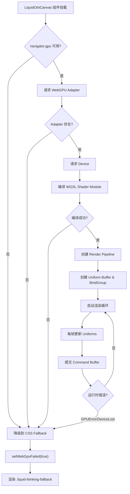
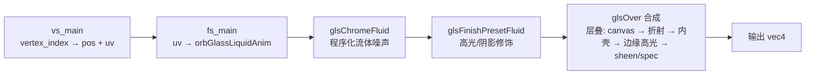
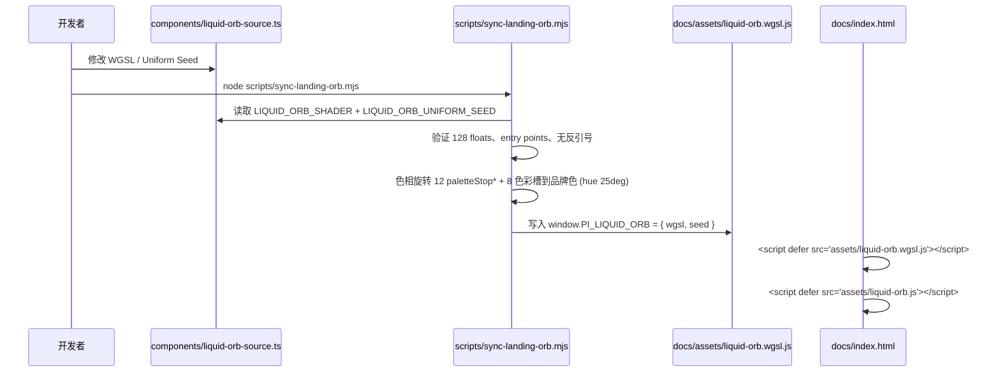

液态思考球是 Pi Agent Desktop 的视觉标识组件，用于在 Agent 思考、等待模型响应、执行工具等阶段提供实时视觉反馈。它采用 **WebGPU 优先、CSS 降级** 的双路径：成功路径在 `<canvas>` 上跑 WGSL（`canvas.getContext("webgpu")`），失败路径**不是 Canvas 2D**，而是隐藏 canvas 并渲染 `<span class="liquid-thinking-fallback">` 的纯 CSS 动画。该组件既作为桌面应用中的状态指示器（`AgentThinkingOrb`），也被同步构建到登录页（`docs/index.html`）作为品牌动画展示。

Sources: [components/AgentThinkingOrb.tsx](components/AgentThinkingOrb.tsx#L1-L124), [docs/index.html](docs/index.html#L828-L835)

## 架构概览



Sources: [components/LiquidOrbCanvas.tsx](components/LiquidOrbCanvas.tsx#L1-L218), [docs/assets/liquid-orb.js](docs/assets/liquid-orb.js#L1-L355)

## 核心组件与文件结构

| 文件 | 角色 | 关键职责 |
|------|------|----------|
| `components/LiquidOrbCanvas.tsx` | React 组件（桌面应用） | WebGPU 初始化、渲染循环、生命周期管理、降级触发 |
| `components/liquid-orb-source.ts` | 单一真相源 | WGSL 着色器代码、Uniform 种子数据（128 floats = 512 bytes） |
| `scripts/sync-landing-orb.mjs` | 构建同步脚本 | 从源文件提取 WGSL + Seed，色相旋转到品牌色（#ff8f40），生成 `docs/assets/liquid-orb.wgsl.js` |
| `docs/assets/liquid-orb.wgsl.js` | 登录页运行时载荷 | `window.PI_LIQUID_ORB = { wgsl, seed }` 全局注入 |
| `docs/assets/liquid-orb.js` | 登录页框架无关运行时 | 设备共享、IntersectionObserver 惰性启动、可见性/动画偏好暂停、降级逻辑 |
| `docs/index.html` | 登录页宿主 | `<canvas data-orb-canvas>` + `<span class="orb-live-fallback" data-orb-fallback>` 双轨 DOM |

Sources: [components/liquid-orb-source.ts](components/liquid-orb-source.ts#L1-L278), [scripts/sync-landing-orb.mjs](scripts/sync-landing-orb.mjs#L1-L228), [docs/index.html](docs/index.html#L828-L835)

## WebGPU 渲染管线

### 着色器架构 (WGSL)

着色器采用 **全屏三角形** 拓扑（`triangle-list`，3 顶点），顶点着色器直接由 `vertex_index` 生成位置与 UV，无需顶点缓冲区。片段着色器 `fs_main` 调用 `orbGlassLiquidAnim` 计算每像素颜色。



**Uniform 布局** (`struct Uniforms`, 128 floats = 512 bytes)：
- `size: vec2<f32>` — 画布像素尺寸
- `time, speed, radius, zoom, warp, ridgeAmt, sharp, shade, sheen, gloss, shellMidAlpha, shellEdgeAlpha, exposure, style, edgeSoftness, edgeGlow, paletteCount, glassEnabled, glassOpacity, contourDeform, bandDensity, chromaticShift` — 22 个材质/动画标量
- `metalScale, metalStretch, metalAngle, metalOffset, metalPhase, metalEvolution, metalRoughness, metalDepth` — 8 个金属参数
- 12 个 `vec4<f32>` 命名颜色槽：`colorA-D`, `highlightColor`, `shellInner/Mid/Edge`, `sheenColor`, `specColor`, `canvasColor`, `glowColor`
- 12 个 `paletteStop*` 渐变停止位（float 80 起；当前 `paletteCount=0` 未采样，保留扩展性）

Sources: [components/liquid-orb-source.ts](components/liquid-orb-source.ts#L1-L200), [components/liquid-orb-source.ts](components/liquid-orb-source.ts#L200-L278)

### 关键算法细节

| 算法 | 用途 | 关键公式 |
|------|------|----------|
| `glsChromeFluid` | 程序化金属流体 | 9 阶傅里叶级数扰动 UV，`flare = 1/|sin(t*0.24 - q.y - q.x)|` 产生镜面高光条带 |
| `lqRamp` | 四色平滑渐变 | 三段 `smoothstep` 混合 `colorA→B→C→D`，重叠区域创造平滑过渡 |
| `glsRefractionProfile` | 玻璃折射剖面 | `1 - sqrt(1 - (1-depth)²)` 圆形折射曲线，`pow(..., 0.68)` 增强边缘 |
| `glsHighlightLobe` | 各向异性高光瓣 | `pow(clamp((dot(normal, dir) - cut)/(1-cut), 0, 1), power)` 可调锐度的高光 |
| `mfEdgeGlow` | 边缘发光 | `exp(-max(r-rad,0)*11) * smoothstep(rad-soft, rad+soft, r)` 指数衰减 + 软边界 |

Sources: [components/liquid-orb-source.ts](components/liquid-orb-source.ts#L1-L200)

### 渲染循环与性能控制

```typescript
// 30 FPS 上限，DPR 封顶 2×
if (!reduceMotion.matches && now - lastRenderedAt < 1000 / 30) {
  animationFrame = requestAnimationFrame(render);
  return;
}
// DPR 计算
const dpr = Math.min(window.devicePixelRatio || 1, 2);
renderWidth = Math.max(1, Math.round(cssWidth * dpr));
```

**生命周期守卫**：
- `IntersectionObserver` — 视口外暂停（登录页版本以 `rootMargin: "200px 0px"` 提前唤醒；桌面组件未配置 `rootMargin`）
- `document.visibilitychange` — 标签页隐藏暂停
- `prefers-reduced-motion` — 系统动画减弱偏好冻结为静态帧
- `GPUDevice.lost` / `uncapturederror` — 运行时错误触发降级

Sources: [components/LiquidOrbCanvas.tsx](components/LiquidOrbCanvas.tsx#L50-L180), [docs/assets/liquid-orb.js](docs/assets/liquid-orb.js#L200-L300)

## 降级机制：WebGPU → CSS Fallback

### 触发条件

| 场景 | 触发点 | 处理 |
|------|--------|------|
| 浏览器不支持 WebGPU | `!navigator.gpu` | 同步降级 |
| 无可用 Adapter | `requestAdapter()` 返回 null | 同步降级 |
| Shader 编译失败 | `getCompilationInfo()` 有 error | 同步降级 |
| 运行时渲染异常 | `try/catch` 捕获 `encoder` 提交错误 | 异步降级 |
| GPU 设备丢失 | `device.lost` Promise resolve | 异步降级 |
| 未捕获 GPU 错误 | `uncapturederror` 事件 | 异步降级 |

### 降级执行流程

```typescript
const stopWithFallback = () => {
  if (stopped || failed) return;
  failed = true;
  cancelAnimationFrame(animationFrame);
  removeRuntimeListeners?.();
  context?.unconfigure();
  device?.destroy();
  context = null;
  device = null;
  setWebGpuFailed(true);  // 触发 React 重渲染显示 fallback
};
```

登录页版本（`liquid-orb.js`）在降级时：
1. 隐藏 `<canvas>`，显示 `<span class="orb-live-fallback" data-orb-fallback>`
2. 设置宿主 `data-renderer="fallback"`、`data-renderer-reason="<原因>"`
3. 徽章文本变为 "CSS 回退"

Sources: [components/LiquidOrbCanvas.tsx](components/LiquidOrbCanvas.tsx#L30-L60), [docs/assets/liquid-orb.js](docs/assets/liquid-orb.js#L80-L130)

### CSS Fallback 实现

桌面端（`app/globals.css` `.liquid-thinking-fallback`）与登录页（`docs/index.html` `.orb-live-fallback`）是两套样式：桌面约 38px、冷蓝灰；登录页约 42px、跟 `--primary` 品牌色。不要把登录页 class 当成桌面组件的 API。

纯 CSS 通过伪元素实现旋转锥形渐变 + 内阴影模拟玻璃质感（登录页示意）：

```css
.orb-live-fallback {
  position: relative; display: block; width: 42px; height: 42px;
  overflow: hidden; border-radius: 50%;
  border: 1px solid color-mix(in srgb, white 30%, var(--border));
  background:
    radial-gradient(circle at 30% 24%, rgba(255, 255, 255, 0.78), transparent 24%),
    radial-gradient(circle at 68% 72%, color-mix(in srgb, var(--primary) 62%, transparent), transparent 48%),
    #241a12;
  box-shadow:
    inset 0 1px 0 rgba(255, 255, 255, 0.32),
    0 10px 22px -14px color-mix(in srgb, var(--primary) 70%, transparent);
}
.orb-live-fallback::before {
  content: ""; position: absolute; inset: -30%;
  background: conic-gradient(from 20deg, transparent,
    color-mix(in srgb, var(--primary) 70%, white 30%) 22%,
    color-mix(in srgb, var(--primary) 45%, #4a2d17) 38%,
    transparent 58%, rgba(255, 236, 214, 0.6));
  filter: blur(5px); mix-blend-mode: screen;
  animation: orb-fallback-shift 3200ms linear infinite;
}
.orb-live-fallback::after {
  content: ""; position: absolute; inset: 1px; border-radius: inherit;
  box-shadow: inset 5px 7px 10px rgba(255, 255, 255, 0.12), inset -6px -7px 12px rgba(0, 0, 0, 0.34);
}
@keyframes orb-fallback-shift { to { transform: rotate(1turn); } }
@media (prefers-reduced-motion: reduce) {
  .orb-live-fallback::before { animation: none; }
}
```

**设计意图**：锥形渐变模拟环向流体条带，`mix-blend-mode: screen` 叠加高光，`filter: blur` 柔化边缘，3.2 秒周期匹配 WebGPU 版本的视觉节奏。

Sources: [docs/index.html](docs/index.html#L755-L768)

## 统一构建流程：单一真相源同步



**色相旋转策略**（`sync-landing-orb.mjs`）：
- 源 Seed 为冷蓝色调（~213°），品牌色为暖橙（`#ff8f40`, 25°）
- 仅对语义色彩槽（`colorB/C/D`, `shellMid`, `sheenColor`, `specColor`, `canvasColor`）锚定目标 `L/S` 值进行色相替换
- 中性色（高光白、纯白 glow、壳边缘）保持 `S < 0.06` 不旋转，避免塑料感
- `paletteCount=0` 导致 12 个 `paletteStop*` 当前不被采样，仍同步旋转保证一致性

Sources: [scripts/sync-landing-orb.mjs](scripts/sync-landing-orb.mjs#L1-L228)

## AgentThinkingOrb：产品级集成

`AgentThinkingOrb` 封装 `LiquidOrbCanvas` 并提供语义化状态标签。`AgentPhase` **没有** `thinking` 变体，只有 `waiting_model` | `running_tools` | `null`；`null` 走默认文案。

| phase | 显示标签 (zh-CN) | 来源 |
|-------|------------------|------|
| `null`（及其他非工具/等待） | "正在思考…" | `t("agent.thinking")` |
| `{ kind: "waiting_model" }` | "正在等待模型…" | `t("agent.waitingModel")` |
| `running_tools`（0 个工具） | "正在运行工具…" | `t("agent.runningTools")` |
| `running_tools`（≤3 个） | "正在运行 {tools}…" | `t("agent.runningTool", { tools: names.join(", ") })` |
| `running_tools`（>3 个） | "正在运行 {tools}（另有 {count} 项）…" | 前 2 个名字 + `count = names.length - 2` |

**流式思考面板**：`ChatWindow` 用 `splitActiveThinking` 从 `streamingMessage` 抽出 `thinking` 块文本，经 `thinking` prop 传入。有内容时可展开手风琴（`t-acc`），直播思考不再进入 `MessageView` 的 `ThinkingBlock`。

**标签过渡动画**：
- 标签变化时，旧标签 `is-exit` 淡出，新标签 `is-enter-start` 淡入
- 通过 `requestAnimationFrame` 双帧延迟触发 `setEntering(false)`，配合 CSS `transition` 实现平滑切换
- `prefers-reduced-motion` 下禁用过渡，直接切换

Sources: [components/AgentThinkingOrb.tsx](components/AgentThinkingOrb.tsx#L1-L124)

## 与其他页面的关联

| 关联页面 | 关系 |
|----------|------|
| [AppShell 布局系统](24-appshell-bu-ju-xi-tong-mian-ban-tuo-zhuai-jian-pan-kuai-jie-jian-zhu-ti-qie-huan) | `AgentThinkingOrb` 由 `ChatWindow` 以 `activeAgentIndicator` 传入 `MessageList`，渲染于消息区 |
| [streamReducer 流式消息状态机](23-streamreducer-liu-shi-xiao-xi-zhuang-tai-ji-yu-zeng-liang-xuan-ran) | Agent 思考阶段通过 SSE 事件驱动 `AgentPhase` 变化，进而驱动 Orb 标签更新 |
| [useAgentSession 主 Hook](22-useagentsession-zhu-hook-yu-zi-hook-chai-fen-ce-lue) | `useAgentSession` 暴露 `phase` 状态供 `AgentThinkingOrb` 消费 |
| [项目概览](1-xiang-mu-gai-lan) | 登录页液态球作为产品视觉入口，展示技术栈（WebGPU/WGSL）能力 |

## 关键设计决策速查

| 决策 | 理由 | 权衡 |
|------|------|------|
| 全屏三角形而非矩形 | 顶点数 3 vs 6，无索引缓冲区，顶点着色器极简 | 光栅化覆盖全屏，片段着色器执行次数相同 |
| Uniform Buffer 512 bytes | 单次 `writeBuffer` 更新所有参数，避免多次绑定 | 固定内存布局，扩展需修改 WGSL struct + Seed 同步 |
| 30 FPS 上限 | 状态指示器非游戏，30 FPS 视觉流畅且省电 | 高刷屏幕下动画稍显不够丝滑，可通过 `speed` 调节感知速度 |
| DPR 封顶 2× | 移动端高 DPR 导致像素数爆炸，GPU 负载失控 | 3×+ 屏幕上边缘略模糊，但 46px 小尺寸下不可察觉 |
| 惰性 GPU 初始化 (IntersectionObserver) | 登录页可能有多个 Orb，仅视口附近启动节省资源 | 首次进入视口有 ~50-200ms 冷启动延迟 |
| 色相旋转而非重新设计 Seed | 保留设计师调优的材质参数（warp/ridge/gloss 等），仅换肤 | 无法针对品牌色单独微调材质感知，但维护成本极低 |

Sources: [components/LiquidOrbCanvas.tsx](components/LiquidOrbCanvas.tsx#L1-L218), [scripts/sync-landing-orb.mjs](scripts/sync-landing-orb.mjs#L1-L228)

## 调试与验证

### 开发时验证同步状态
```bash
# 检查登录页载荷是否与源文件同步（不写入）
node scripts/sync-landing-orb.mjs --check

# 强制使用原冷色调（复现产品原生外观）
node scripts/sync-landing-orb.mjs --hue 213
```

### 运行时诊断
- 宿主元素 `data-renderer` 属性："webgpu" / "fallback" / "pending"
- 宿主元素 `data-renderer-reason`：降级原因（"no-webgpu", "no-adapter", "shader-compile", "gpu-error", "device-lost", "render-error"）
- 控制台警告：`[liquid-orb] render failed: <错误详情>`

### 浏览器兼容性基线
| 特性 | Chrome | Edge | Firefox | Safari |
|------|--------|------|---------|--------|
| WebGPU | 113+ | 113+ | 141+ (flag) | 26.4+ (TP) |
| 液态球表现 | ✅ 完整 | ✅ 完整 | ⚠️ 降级 | ✅ 完整 (TP) |

Sources: [docs/assets/liquid-orb.js](docs/assets/liquid-orb.js#L1-L355), [scripts/sync-landing-orb.mjs](scripts/sync-landing-orb.mjs#L150-L200)

## 下一步阅读建议

- [消息虚拟化列表、Markdown 渲染与代码高亮](26-xiao-xi-xu-ni-hua-lie-biao-markdown-xuan-ran-yu-dai-ma-gao-liang) — 理解聊天消息列表的高性能渲染架构
- [AppShell 布局系统](24-appshell-bu-ju-xi-tong-mian-ban-tuo-zhuai-jian-pan-kuai-jie-jian-zhu-ti-qie-huan) — 查看 Orb 在整体布局中的定位与交互
- [streamReducer 流式消息状态机](23-streamreducer-liu-shi-xiao-xi-zhuang-tai-ji-yu-zeng-liang-xuan-ran) — 了解驱动 Orb 状态变化的事件流