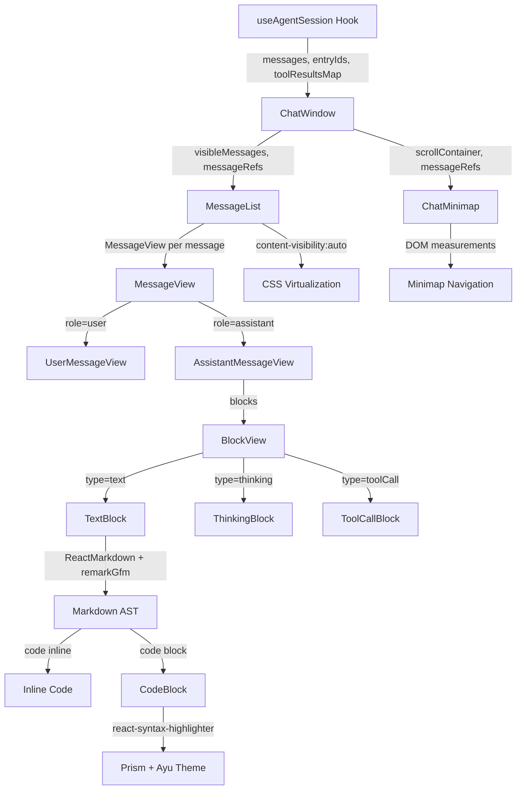

本页面深入剖析 Pi Agent Desktop 前端聊天界面的三大核心渲染技术：**消息虚拟化列表**、**Markdown 渲染管线**与**代码语法高亮**。这些技术共同支撑了长对话历史的流畅滚动、富文本消息的正确呈现，以及代码片段的专业级着色体验。文档将从架构分层、数据流向、关键实现细节三个维度展开，配合 Mermaid 架构图与对比表格，帮助中级开发者快速掌握核心设计模式并具备二次开发能力。

Sources: [components/MessageList.tsx](components/MessageList.tsx#L1-L89), [components/MessageView.tsx](components/MessageView.tsx#L1-L864), [components/message-content.ts](components/message-content.ts#L1-L52), [components/ChatMinimap.tsx](components/ChatMinimap.tsx#L1-L408), [lib/ayu-syntax-theme.ts](lib/ayu-syntax-theme.ts#L1-L117)

## 整体架构与数据流向

聊天消息渲染管线遵循**单向数据流**原则：会话数据 → 状态选择器 → 虚拟化列表 → 消息视图组件 → Markdown/代码渲染器。下图展示了核心组件依赖关系与数据传递路径。



**核心数据流向说明**：

| 阶段 | 关键组件 | 数据形态 | 处理逻辑 |
|------|----------|----------|----------|
| 数据获取 | `useAgentSession` | `AgentMessage[]` | 从 SSE 事件流增量构建消息数组 |
| 过滤与索引 | `ChatWindow` | `visibleMessages`, `entryIds`, `toolResultsMap` | 过滤 toolResult、计算导航索引、建立工具结果映射 |
| 虚拟化列表 | `MessageList` | `React.ReactNode[]` | `React.memo` 优化 + CSS `content-visibility` 原生虚拟化 |
| 消息分发 | `MessageView` | 单条 `AgentMessage` | 根据 `role` 分发到 `UserMessageView` / `AssistantMessageView` / `CustomMessageView` |
| Assistant 块渲染 | `BlockView` | `AssistantContentBlock[]` | 按 `type` 分发到 `TextBlock` / `ThinkingBlock` / `ToolCallBlock` |
| Markdown 渲染 | `TextBlock` | `string` | `ReactMarkdown` + `remarkGfm` + 自定义 `code`/`pre` 组件 |
| 代码高亮 | `CodeBlock` | `code: string, lang: string` | `react-syntax-highlighter` (Prism) + `ayuDark/ayuLightSyntaxTheme` |
| 导航辅助 | `ChatMinimap` | `messageRefs`, `scrollContainer` | 基于真实 DOM 位置计算节点比例，支持点击/拖拽跳转 |

Sources: [components/MessageList.tsx](components/MessageList.tsx#L1-L89), [components/ChatWindow.tsx](components/ChatWindow.tsx#L1-L388), [components/MessageView.tsx](components/MessageView.tsx#L1-L864), [components/ChatMinimap.tsx](components/ChatMinimap.tsx#L1-L408)

## 消息虚拟化列表：CSS 原生 `content-visibility` 方案

### 设计动机与选型对比

长对话场景下，数百条消息的完整 DOM 渲染会导致首屏渲染阻塞、滚动卡顿、内存占用高。团队评估了三类虚拟化方案，最终选择 **CSS `content-visibility: auto`** 作为主策略，辅以 `ChatMinimap` 提供导航。

| 方案 | 优势 | 劣势 | 适用场景 |
|------|------|------|----------|
| **CSS `content-visibility: auto`** | 零依赖、浏览器原生优化、保持语义化 DOM、无需计算高度 | 兼容性要求较新 (Chrome 85+、Firefox 114+、Safari 15.4+)、精细控制力弱 | **本项目主选**：Electron 保证运行时版本、消息高度不一、需要 SEO/无障碍 |
| `react-window` / `react-virtual` | 精确控制、成熟生态、支持动态高度测量 | 需预估/测量行高、破坏语义化 DOM、滚动同步复杂 | 固定行高列表、大数据表格 |
| `IntersectionObserver` 手动实现 | 完全可控、兼容性好 | 实现复杂、需维护占位元素、性能调优难 | 极度定制化需求 |

**关键决策点**：Electron 环境锁定 Chromium 版本，`content-visibility` 支持无顾虑；消息包含代码块、思考块、工具调用等变高内容，预估行高极不准确；保持完整 DOM 树便于 `ChatMinimap` 通过 `messageRefs` 实测位置。

Sources: [components/MessageList.tsx](components/MessageList.tsx#L70-L85), [components/ChatMinimap.tsx](components/ChatMinimap.tsx#L1-L408)

### 实现细节：`MessageList` 组件

```tsx
// components/MessageList.tsx - 关键片段
const view = (
  <MessageView key={entryIds[idx] ?? `idx-${idx}`} ... />
);

if (!isUserOrAssistant) return view;

const currentRefIdx = refIdx++;
return (
  <div
    key={entryIds[idx] ?? `idx-${idx}`}
    ref={(el) => { messageRefs.current[currentRefIdx] = el; }}
    style={{ contentVisibility: "auto", containIntrinsicSize: "auto 150px" }}
  >
    {view}
  </div>
);
```

**核心技术点**：

1. **`content-visibility: auto`**：浏览器跳过元素的布局、绘制、命中测试，直到其接近视口。配合 `contain-intrinsic-size: auto 150px` 提供估算尺寸，避免滚动条跳变。
2. **`contain-intrinsic-size: auto 150px`**：`auto` 让浏览器记住上次渲染高度，`150px` 作为首次估算 fallback。经验值覆盖绝大多数单条消息高度。
3. **`messageRefs` 稳定引用**：`useMessageRefs` Hook 维护固定长度数组，索引与可见消息一一对应，供 `ChatMinimap` 实时测量位置。
4. **`React.memo` 组件级隔离**：`MessageList` 与 `MessageView` 均为 `React.memo`，配合 `entryIds` 作为 key，避免列表局部更新触发全量重渲染。

Sources: [components/MessageList.tsx](components/MessageList.tsx#L1-L89), [components/ChatMinimap.tsx](components/ChatMinimap.tsx#L399-L408)

### `useMessageRefs` Hook：稳定引用数组工厂

```ts
// components/ChatMinimap.tsx
export function useMessageRefs(count: number): RefObject<(HTMLDivElement | null)[]> {
  const refs = useRef<(HTMLDivElement | null)[]>([]);
  refs.current = Array(count).fill(null).map((_, i) => refs.current[i] ?? null);
  return refs;
}
```

**设计要点**：
- **稳定身份**：返回同一 `RefObject`，`current` 内部数组长度随 `count` 变化，但已有索引保持引用不变。
- **懒初始化**：新增位置填 `null`，待 `MessageList` 挂载时由 `ref` 回调填充真实 DOM 节点。
- **零渲染副作用**：纯 Hook 无 JSX，`ChatWindow` 调用后直接传给 `MessageList` 与 `ChatMinimap`。

Sources: [components/ChatMinimap.tsx](components/ChatMinimap.tsx#L399-L408)

## Markdown 渲染管线：`ReactMarkdown` + `remarkGfm` + 自定义组件

### 架构分层

```mermaid
flowchart LR
    A[原始文本 block.text] --> B[ReactMarkdown]
    B --> C[remarkGfm 插件]
    C --> D[Markdown AST]
    D --> E{节点类型}
    E -->|code (inline)| F[内联 code 组件]
    E -->|pre > code (block)| G[CodeBlock 组件]
    E -->|其他| H[默认 HTML 标签]
    G --> I[react-syntax-highlighter]
    I --> J[Prism 高亮器]
    J --> K[ayuDark/ayuLight 主题]
```

Sources: [components/MessageView.tsx](components/MessageView.tsx#L600-L720), [components/MessageView.tsx](components/MessageView.tsx#L799-L864)

### `TextBlock` 组件：渲染入口与组件重写

```tsx
// components/MessageView.tsx - TextBlock
function TextBlock({ block }: { block: TextContent }) {
  return (
    <div className="markdown-body">
      <ReactMarkdown
        remarkPlugins={[remarkGfm]}
        components={{
          code({ className, children, ...props }) {
            const lang = className?.replace("language-", "") ?? "";
            const raw = String(children);
            const isBlock = className?.includes("language-") || raw.includes("\n");
            if (isBlock) {
              return <CodeBlock code={raw.replace(/\n$/, "")} lang={lang} />;
            }
            return (
              <code
                className="bg-bg-selected px-1 py-[1px] rounded-[3px] font-mono text-[0.9em]"
                {...props}
              >
                {children}
              </code>
            );
          },
          pre({ children }) {
            return <>{children}</>; // 移除默认 <pre>，由 CodeBlock 完全接管
          },
        }}
      >
        {block.text}
      </ReactMarkdown>
    </div>
  );
}
```

**关键设计决策**：

| 决策点 | 方案 | 理由 |
|--------|------|------|
| Markdown 解析器 | `react-markdown` + `remark-gfm` | 支持 GFM 表格、任务列表、删除线、自动链接；生态成熟、TS 支持完善 |
| 代码块识别 | `className.includes("language-") \|\| raw.includes("\n")` | `remark-gfm` 对围栏代码块生成 `className="language-xxx"`；换行符兜底兼容缩进代码块 |
| `<pre>` 移除 | `pre: ({children}) => <>{children}</>` | 防止双层 `<pre>` 导致样式冲突，`CodeBlock` 自带容器与行号 |
| 内联代码样式 | Tailwind `bg-bg-selected px-1 py-[1px] rounded-[3px] font-mono text-[0.9em]` | 与主题变量绑定，自动适配深/浅色模式 |
| 安全性 | `ReactMarkdown` 默认逃逸 HTML | 防 XSS，仅渲染 Markdown 标准语法 |

Sources: [components/MessageView.tsx](components/MessageView.tsx#L600-L720)

### 内容提取与类型守卫：`message-content.ts`

渲染前需从 `AgentMessage.content`（可能为 `string | ContentBlock[]`）安全提取文本、图片、Assistant 块。`message-content.ts` 提供三个纯函数，配合类型守卫实现**运行时安全降级**。

```ts
// components/message-content.ts
function isTextContent(value: unknown): value is TextContent {
  return isRecord(value) && value.type === "text" && typeof value.text === "string";
}

export function getTextContent(content: unknown): string {
  if (typeof content === "string") return content;
  if (!Array.isArray(content)) return "";
  return content.filter(isTextContent).map((b) => b.text).join("\n");
}

export function getAssistantContent(content: unknown): AssistantContentBlock[] {
  if (!Array.isArray(content)) return [];
  return content.filter(isAssistantContentBlock);
}

export function getImageContent(content: unknown): ImageContent[] {
  if (!Array.isArray(content)) return [];
  return content.filter(isImageContent);
}
```

**防御性编程亮点**：

| 输入异常情况 | 处理策略 | 测试用例 |
|--------------|----------|----------|
| `undefined` / `null` | 返回空字符串/空数组 | `getTextContent(undefined) === ""` |
| 非数组对象 | 视为无效，降级空结果 | `getTextContent({type: "text"}) === ""` |
| 数组含 `null` / 无效类型 | `filter` 自动剔除 | `getAssistantContent([null, {type: "unknown"}]) === []` |
| `text` 字段非字符串 | `typeof value.text === "string"` 守卫拦截 | `getTextContent([{type: "text", text: 123}]) === ""` |

Sources: [components/message-content.ts](components/message-content.ts#L1-L52), [components/message-content.test.ts](components/message-content.test.ts#L1-L40)

## 代码语法高亮：`react-syntax-highlighter` + Ayu 主题双模式

### 技术栈选型

| 维度 | 选型 | 备选 | 选型理由 |
|------|------|------|----------|
| 高亮引擎 | **Prism** (via `react-syntax-highlighter`) | Shiki, Highlight.js | Prism 体积小、浏览器端无 WASM 开销、语言包按需加载 |
| 主题 | **Ayu Dark / Ayu Light** (自定义移植) | One Dark, Dracula, GitHub | Ayu 色彩平衡好、对比度达标、深浅色配套完整 |
| 行号 | 内置 `showLineNumbers` | 自行实现 | 零配置、样式可通过 `lineNumberStyle` 微调 |
| 主题切换 | `useTheme` Hook 读取 `isDark` | CSS `prefers-color-scheme` | 与应用级主题联动、支持手动切换、SSR 一致性 |

Sources: [components/MessageView.tsx](components/MessageView.tsx#L799-L864), [lib/ayu-syntax-theme.ts](lib/ayu-syntax-theme.ts#L1-L117), [app/globals.css](app/globals.css#L1-L200)

### `CodeBlock` 组件：完整实现

```tsx
// components/MessageView.tsx - CodeBlock
function CodeBlock({ code, lang }: { code: string; lang: string }) {
  const { t } = useI18n();
  const { isDark } = useTheme();
  const [copied, setCopied] = useState(false);

  useEffect(() => {
    if (!copied) return;
    const t = setTimeout(() => setCopied(false), 1500);
    return () => clearTimeout(t);
  }, [copied]);

  const copy = () => copyText(code).then(() => setCopied(true));

  return (
    <div className="relative my-1 rounded-panel overflow-hidden border border-border">
      {/* 顶部栏：语言标签 + 复制按钮 */}
      <div className="px-2.5 py-[3px] bg-bg-panel border-b border-border text-[11px] text-text-dim flex justify-between items-center">
        <span>{lang}</span>
        <button onClick={copy} aria-label={t("message.copyCode")} className="...">
          {copied ? t("common.copied") : t("common.copy")}
        </button>
      </div>
      {/* 高亮器 */}
      <SyntaxHighlighter
        language={lang || "text"}
        style={isDark ? ayuDarkSyntaxTheme : ayuLightSyntaxTheme}
        showLineNumbers
        lineNumberStyle={{ color: "var(--text-dim)", fontStyle: "normal" }}
        customStyle={{
          margin: 0,
          padding: "10px 12px",
          fontSize: 12.5,
          lineHeight: 1.6,
          borderRadius: 0,
          background: "var(--code-bg)",
        }}
        codeTagProps={{ style: { fontFamily: "var(--font-mono)" } }}
      >
        {code}
      </SyntaxHighlighter>
    </div>
  );
}
```

**关键实现细节**：

1. **主题响应式切换**：`useTheme()` 返回 `isDark`，运行时在 `ayuDarkSyntaxTheme` / `ayuLightSyntaxTheme` 间切换，无需重新挂载。
2. **CSS 变量注入背景**：`customStyle.background: "var(--code-bg)"` 与 `globals.css` 的 `--code-bg` (Light: `#f8f9fb`, Dark: `#0d1017`) 绑定，确保代码块背景与编辑器/终端一致。
3. **行号样式隔离**：`lineNumberStyle` 仅控制行号列颜色，避免污染代码文本。
4. **复制反馈防内存泄漏**：`useEffect` 清理 `setTimeout`，组件卸载时自动取消，符合 React 18 严格模式要求。
5. **语言回退**：`lang || "text"` 处理未指定语言的围栏代码块，Prism 会按纯文本渲染。

Sources: [components/MessageView.tsx](components/MessageView.tsx#L799-L864)

### Ayu 主题定制：`lib/ayu-syntax-theme.ts`

主题对象遵循 `react-syntax-highlighter` 期望的 **Prism 风格键值映射**，基础样式在 `base` 中定义，深/浅色仅覆盖 `color` 与 `background` 及语义 Token 色值。

```ts
// lib/ayu-syntax-theme.ts - 核心结构
const base = {
  'code[class*="language-"]': { fontFamily: "var(--font-mono)", fontSize: "1em", lineHeight: "1.6", ... },
  'pre[class*="language-"]': { fontFamily: "var(--font-mono)", fontSize: "1em", lineHeight: "1.6", margin: 0, overflow: "auto", ... },
  'code[class*="language-"]::selection': { background: "rgba(255, 180, 84, 0.22)" },
  'pre[class*="language-"]::selection': { background: "rgba(255, 180, 84, 0.22)" },
} as const;

export const ayuDarkSyntaxTheme = {
  ...base,
  'code[class*="language-"]': { ...base['code[class*="language-"]'], color: "#e6e1cf", background: "#0d1017" },
  'pre[class*="language-"]': { ...base['pre[class*="language-"]'], color: "#e6e1cf", background: "#0d1017" },
  comment: { color: "#5c6773", fontStyle: "italic" },
  keyword: { color: "#ffa0a0" },
  function: { color: "#ffd173" },
  string: { color: "#bae67e" },
  number: { color: "#ff8f40" },
  "class-name": { color: "#73d0ff" },
  // ... 30+ Token 类型
} as const;

export const ayuLightSyntaxTheme = {
  ...base,
  'code[class*="language-"]': { ...base['code[class*="language-"]'], color: "#4f5867", background: "#f8f9fb" },
  'pre[class*="language-"]': { ...base['pre[class*="language-"]'], color: "#4f5867", background: "#f8f9fb" },
  comment: { color: "#abb0b6", fontStyle: "italic" },
  keyword: { color: "#fa8d3e" },
  function: { color: "#f2ae49" },
  string: { color: "#86b300" },
  number: { color: "#f07171" },
  "class-name": { color: "#399ee6" },
  // ... 同键名，浅色调色板
} as const;
```

**主题 Token 映射表（核心语义类）**：

| Token 类型 | 语义 | Ayu Dark | Ayu Light | 典型适用 |
|------------|------|----------|-----------|----------|
| `comment` | 注释 | `#5c6773` (italic) | `#abb0b6` (italic) | `// comment`, `/* */` |
| `keyword` | 关键字 | `#ffa0a0` | `#fa8d3e` | `if`, `return`, `const` |
| `function` | 函数名 | `#ffd173` | `#f2ae49` | `foo()` 定义/调用 |
| `string` | 字符串 | `#bae67e` | `#86b300` | `"hello"`, `'world'` |
| `number` | 数字字面量 | `#ff8f40` | `#f07171` | `42`, `3.14` |
| `class-name` | 类名 | `#73d0ff` | `#399ee6` | `class Foo`, `new Bar()` |
| `operator` | 运算符 | `#f29e74` | `#ed9366` | `+`, `&&`, `??` |
| `punctuation` | 标点 | `#b3b1ad` | `#697386` | `{ }`, `[ ]`, `,` |
| `variable` | 变量 | `#e6e1cf` | `#4f5867` | 标识符默认色 |
| `deleted` / `inserted` | Diff 标记 | `#ff8f8f` / `#bae67e` | `#d95757` / `#75a743` | Git diff 场景 |

**扩展语言支持**：`react-syntax-highlighter` 内置常见语言，若需新增语言（如 `wgsl`、`zig`），可通过 `import 'react-syntax-highlighter/dist/esm/languages/prism-xxx'` 按需注册，打包体积可控。

Sources: [lib/ayu-syntax-theme.ts](lib/ayu-syntax-theme.ts#L1-L117)

## ChatMinimap：基于真实 DOM 的导航辅助

### 定位与价值

虚拟化列表隐藏了离屏 DOM，传统滚动条无法反映消息语义分布。`ChatMinimap` 通过 `messageRefs` 实测每条消息在滚动容器中的真实位置，生成**语义感知的迷你地图**，提供：
- 消息类型着色（用户/助手）
- 悬浮预览首行文本
- 点击/拖拽跳转
- 视口指示器（当前可视区在总高度中的比例）

Sources: [components/ChatMinimap.tsx](components/ChatMinimap.tsx#L1-L408)

### 核心算法：节点位置计算与碰撞消除

```ts
// 位置更新 - 基于真实 DOM 矩形
const elRect = el.getBoundingClientRect();
const containerRect = scrollEl.getBoundingClientRect();
const top = elRect.top - containerRect.top + scrollEl.scrollTop;
const h = elRect.height;
newNodes.push({
  topRatio: top / totalH,      // 0-1 归一化顶部位置
  heightRatio: h / totalH,     // 0-1 归一化高度
  msg, index: newNodes.length
});
```

**碰撞消除算法**（Tooltip 重叠解决）：

```ts
// 迭代推挤：自顶向下、自底向上各 10 轮
for (let pass = 0; pass < 10; pass++) {
  for (let i = 1; i < positions.length; i++) {
    const minTop = positions[i - 1] + TOOLTIP_HEIGHT + TOOLTIP_GAP;
    if (positions[i] < minTop) positions[i] = minTop;
  }
  for (let i = positions.length - 2; i >= 0; i--) {
    const maxTop = positions[i + 1] - TOOLTIP_HEIGHT - TOOLTIP_GAP;
    if (positions[i] > maxTop) positions[i] = maxTop;
  }
}
// 最终钳制到边界
positions[i] = Math.max(0, Math.min(minimapHeightPx - TOOLTIP_HEIGHT, positions[i]));
```

**性能特征**：
- `ResizeObserver` + `scroll` 事件（`passive: true`）双重触发位置更新
- `useMemo` 缓存 Tooltip 位置，仅 `minimapHovered`/`nodes`/`minimapHeightPx` 变化时重算
- 拖拽滚动使用 `requestAnimationFrame` 隐式节流（事件回调内直接写 `scrollTop`）

Sources: [components/ChatMinimap.tsx](components/ChatMinimap.tsx#L80-L200)

## 性能优化清单与最佳实践

### 渲染性能关键点

| 优化点 | 实现位置 | 效果 |
|--------|----------|------|
| `React.memo` 组件级隔离 | `MessageList`, `MessageView`, `UserMessageView`, `AssistantMessageView`, `CustomMessageView`, `BlockView`, `CodeBlock` | 父级重渲染不波及未变更消息 |
| `useMemo` 稳定派生值 | `ChatWindow`: `toolResultsMap`, `nextUserIdx`, `visibleMessages` | 避免每帧重建 Map/数组 |
| `useRef` 缓存可变状态 | `MessageView`: `blockStartTimesRef`, `streamStartRef` | 流式计时不触发重渲染 |
| CSS `content-visibility` | `MessageList` 包裹层 | 浏览器原生跳过离屏布局/绘制 |
| 代码高亮延迟实例化 | `CodeBlock` 仅在代码块节点渲染时挂载 | 减少首屏 JS 执行时间 |
| 虚拟化引用稳定性 | `useMessageRefs` 保持数组身份 | `ChatMinimap` 无需重建观测目标 |

### 内存与泄漏防护

1. **定时器清理**：所有 `setTimeout`（复制反馈、流式计时）均在 `useEffect` 中返回 `clearTimeout`，严格模式下双重挂载安全。
2. **事件监听器移除**：`ChatMinimap`、`useChatScroll` 的 `useEffect` 均返回清理函数，移除 `scroll`/`resize` 监听。
3. **`RefObject` 稳定身份**：`useMessageRefs` 返回同一 `RefObject`，避免重渲染导致 `ChatMinimap` 重新绑定观测器。

Sources: [components/MessageView.tsx](components/MessageView.tsx#L150-L200), [components/ChatMinimap.tsx](components/ChatMinimap.tsx#L100-L180), [hooks/agent-session/use-chat-scroll.ts](hooks/agent-session/use-chat-scroll.ts#L1-L93)

## 常见问题与排查指南

| 现象 | 可能原因 | 排查步骤 | 修复建议 |
|------|----------|----------|----------|
| 滚动卡顿、掉帧 | `content-visibility` 未生效 | DevTools Performance 录制，检查 Layout/Paint 时间 | 确认 Chromium ≥ 85、父容器 `overflow: auto`、元素有 `contain-intrinsic-size` |
| 代码块无高亮/报错 | 语言别名未注册 | Console 查看 `react-syntax-highlighter` 警告 | `import 'react-syntax-highlighter/dist/esm/languages/prism-xxx'` |
| 深/浅色切换代码块背景不同步 | `customStyle.background` 未用 CSS 变量 | 检查 `CodeBlock` `customStyle` 与 `globals.css` `--code-bg` | 统一使用 `var(--code-bg)`，勿硬编码十六进制 |
| Minimap 点位偏移 | `messageRefs` 索引错位 | 对比 `visibleMessages.length` 与 `refs.current.length` | 确保 `ChatWindow` 传入 `visibleMessages.length` 且 `MessageList` 仅对 user/assistant 递增 `refIdx` |
| Markdown 表格/任务列表不渲染 | 缺少 `remarkGfm` | 检查 `ReactMarkdown` `remarkPlugins` | 确保 `import remarkGfm from "remark-gfm"` 并传入数组 |

Sources: [components/MessageList.tsx](components/MessageList.tsx#L70-L85), [components/MessageView.tsx](components/MessageView.tsx#L600-L720), [components/ChatMinimap.tsx](components/ChatMinimap.tsx#L399-L408), [components/message-content.ts](components/message-content.ts#L1-L52)

## 扩展指南：新增语言支持与主题定制

### 新增代码高亮语言

```bash
# 1. 安装对应 Prism 语言包（若不在 react-syntax-highlighter 内置列表）
npm i react-syntax-highlighter  # 已包含常见 200+ 语言

# 2. 在应用入口按需注册（避免全量引入）
import SyntaxHighlighter from "react-syntax-highlighter";
import prismWgsl from "react-syntax-highlighter/dist/esm/languages/prism-wgsl";
SyntaxHighlighter.registerLanguage("wgsl", prismWgsl);
```

### 定制/新增语法主题

1. 复制 `lib/ayu-syntax-theme.ts` 为 `lib/custom-syntax-theme.ts`
2. 修改 `ayuDarkSyntaxTheme` / `ayuLightSyntaxTheme` 的 Token 色值
3. 在 `CodeBlock` 中导入并按 `isDark` 切换

```ts
// CodeBlock.tsx 修改点
import { customDarkSyntaxTheme, customLightSyntaxTheme } from "@/lib/custom-syntax-theme";
style={isDark ? customDarkSyntaxTheme : customLightSyntaxTheme}
```

**主题设计原则**：
- 保持 `base` 结构不变，仅覆盖语义 Token 色值
- 确保深/浅色对比度 ≥ 4.5:1 (WCAG AA)
- 选择色 `rgba(255, 180, 84, 0.22)` 统一使用品牌色 `accent` 衍生

Sources: [lib/ayu-syntax-theme.ts](lib/ayu-syntax-theme.ts#L1-L117), [components/MessageView.tsx](components/MessageView.tsx#L799-L864), [app/globals.css](app/globals.css#L1-L200)

## 相关页面导航

- 上一页：[液态思考球：WebGPU 优先 Canvas 降级渲染](25-ye-tai-si-kao-qiu-webgpu-you-xian-canvas-jiang-ji-xuan-ran) — WebGPU/Canvas 渲染架构
- 下一页：[测试策略：Node.js 原生测试、平台子集与冒烟测试](27-ce-shi-ce-lue-node-js-yuan-sheng-ce-shi-ping-tai-zi-ji-yu-mou-yan-ce-shi) — 全栈测试体系
- 关联页面：[streamReducer 流式消息状态机与增量渲染](23-streamreducer-liu-shi-xiao-xi-zhuang-tai-ji-yu-zeng-liang-xuan-ran) — 流式状态如何驱动增量渲染
- 关联页面：[AppShell 布局系统：面板拖拽、键盘快捷键、主题切换](24-appshell-bu-ju-xi-tong-mian-ban-tuo-zhuai-jian-pan-kuai-jie-jian-zhu-ti-qie-huan) — 主题系统与 `useTheme` Hook 细节

---

**文档维护提示**：本页面涵盖的组件均位于 `components/` 目录，核心渲染逻辑集中在 `MessageView.tsx`（~860 行）。修改 Markdown/代码渲染时，请同步更新 `message-content.test.ts` 与 `MessageView.test.ts` 的快照/行为用例，并验证深/浅色模式下的视觉回归。