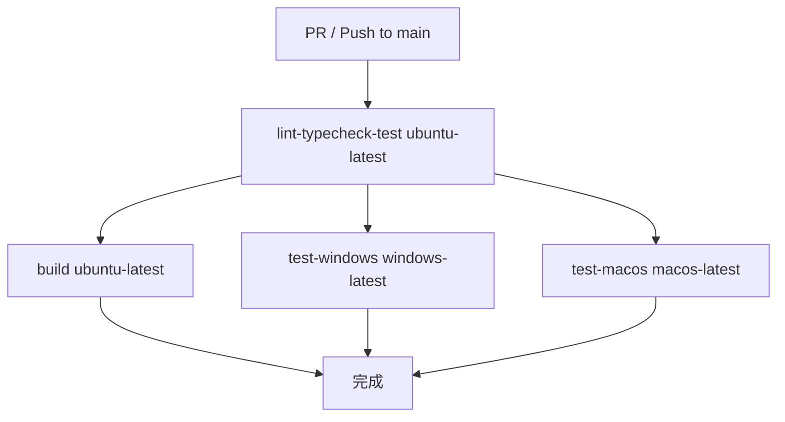
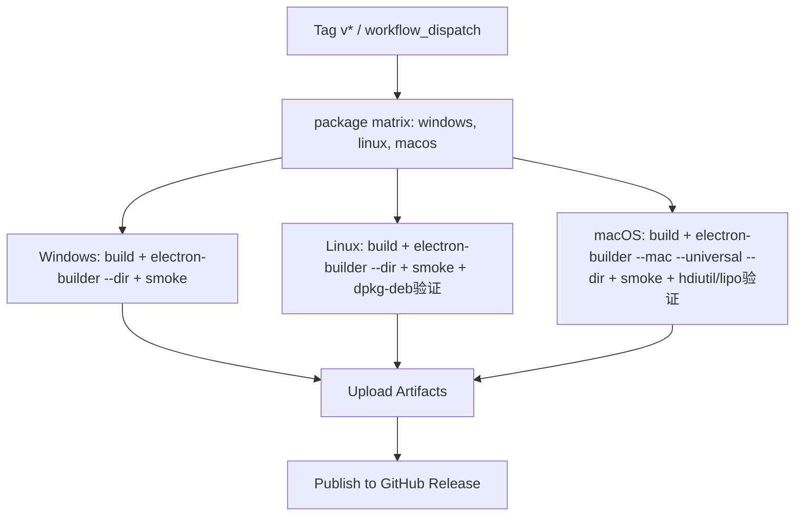

本文档系统性地描述 pi-agent-desktop 的三层测试体系：**Node.js 原生测试运行器**作为统一底座、**平台感知的测试子集**实现跨平台验证、**双层冒烟测试**守护构建产物与打包产物的运行时完整性。文档面向中级开发者，重点阐述架构决策、执行流程与扩展模式。

Sources: [package.json](package.json#L1-L81), [scripts/smoke-standalone-server.mjs](scripts/smoke-standalone-server.mjs#L1-L202), [scripts/smoke-packaged-standalone.mjs](scripts/smoke-packaged-standalone.mjs#L1-L82)

---

## 核心架构：三层测试金字塔

```
┌─────────────────────────────────────────────────────────────┐
│                     CI/CD 流水线                              │
├─────────────────────────────────────────────────────────────┤
│  ┌──────────────┐  ┌──────────────┐  ┌──────────────────┐   │
│  │  Lint        │  │  Typecheck   │  │  Test (全平台)    │   │
│  │  ESLint      │  │  tsc --noEmit│  │  node --test     │   │
│  └──────────────┘  └──────────────┘  └──────────────────┘   │
├─────────────────────────────────────────────────────────────┤
│  ┌──────────────────┐  ┌──────────────────┐  ┌───────────┐  │
│  │  test:windows    │  │  test:macos      │  │  Build    │  │
│  │  (Windows 路径/   │  │  (macOS 通用/    │  │  独立构建  │  │
│  │   进程/文件锁)    │  │   运行时分发)     │  │  + Smoke  │  │
│  └──────────────────┘  └──────────────────┘  └───────────┘  │
├─────────────────────────────────────────────────────────────┤
│  ┌──────────────────────────────────────────────────────┐   │
│  │  Desktop Packages (三平台并行打包 + 冒烟验证)           │   │
│  │  Windows NSIS / Linux DEB / macOS Universal DMG+ZIP  │   │
│  └──────────────────────────────────────────────────────┘   │
└─────────────────────────────────────────────────────────────┘
```

**设计原则**：

1. **零外部依赖**：仅使用 Node.js 20+ 内置的 `node:test` 与 `node:assert`，无 Jest/Vitest/Mocha 运行时开销
2. **平台分层**：通用单元测试全平台运行；平台相关逻辑（路径规范化、文件锁、进程树、macOS 通用二进制分发）由专用脚本子集覆盖
3. **构建即测试**：`build:standalone` 与 `pack/dist` 命令内嵌冒烟测试，**构建失败即测试失败**，无需额外 CI 阶段
4. **源码级契约测试**：部分测试通过读取源文件 AST/文本验证实现模式（如 `useAgentSession` 的纯函数更新器、`FileViewer` 的渲染分支顺序），而非运行时渲染

Sources: [package.json](package.json#L13-L28), [.github/workflows/ci.yml](.github/workflows/ci.yml#L1-L119), [package.test.ts](package.test.ts#L1-L141)

---

## 一、Node.js 原生测试运行器

### 1.1 统一入口：`npm test`

```json
"test": "node --test --test-force-exit \"lib/**/*.test.ts\" \"lib/**/*.test.mjs\" \"electron/**/*.test.ts\" \"app/**/*.test.ts\" \"app/api/sessions/[[]id]/routes.test.ts\" \"hooks/**/*.test.ts\" \"components/**/*.test.ts\" \"scripts/**/*.test.mjs\" \"package.test.ts\" \"middleware.test.ts\""
```

**关键标志位**：

| 标志 | 作用 | 理由 |
|------|------|------|
| `--test` | 启用原生测试运行器 | Node.js 18+ 稳定，无需额外安装 |
| `--test-force-exit` | 测试完成后强制退出进程 | SQLite 连接池、HTTP 服务器等异步句柄会阻塞自然退出 |
| glob 模式显式列举 | 精确控制测试发现范围 | 避免误拾 `.test.ts` 之外的文件；`middleware.test.ts` 需在根目录显式引入 |

Sources: [package.json](package.json#L22-L23), [package.test.ts](package.test.ts#L11-L18)

### 1.2 测试文件命名与组织约定

| 目录 | 测试文件模式 | 典型测试对象 |
|------|-------------|--------------|
| `lib/` | `*.test.ts` / `*.test.mjs` | 纯逻辑模块（路径策略、会话锁、Git worktree、MCP 配置等） |
| `electron/` | `*.test.ts` | 主进程工具函数、环境过滤、进程树、启动链 |
| `hooks/` | `*.test.ts` | React Hook 源码契约（纯函数更新、effect 清理、状态机不变量） |
| `components/` | `*.test.ts` | 组件渲染分支顺序、大文件回退逻辑、复制计时器清理 |
| `app/api/` | `*.test.ts` | API 路由集成测试（需真实 SessionManager、文件系统、Git） |
| `scripts/` | `*.test.mjs` | 构建脚本功能验证（运行时复制、macOS 通用二进制分发） |

Sources: [package.json](package.json#L22-L23), [lib/pi-runtime.test.ts](lib/pi-runtime.test.ts#L1-L69), [hooks/useAgentSession.test.ts](hooks/useAgentSession.test.ts#L1-L55)

### 1.3 典型测试模式对比

| 模式 | 适用场景 | 示例 |
|------|----------|------|
| **行为驱动单元测试** | 纯函数、状态机、工具类 | `path-policy.test.ts`、`session-lock.test.ts`、`file-browser.test.ts` |
| **源码契约测试** | React Hook/组件实现模式不可变性 | `useAgentSession.test.ts`、`MessageView.test.ts`、`FileViewer.test.ts` |
| **集成测试（真实依赖）** | API 路由、Git 操作、文件系统 | `routes.test.ts`、`git-worktree.test.ts` |
| **脚本功能测试** | 构建产物完整性、文件复制语义 | `ensure-standalone-next-runtimes.test.mjs` |

Sources: [lib/path-policy.test.ts](lib/path-policy.test.ts#L1-L110), [lib/session-lock.test.ts](lib/session-lock.test.ts#L1-L70), [app/api/sessions/[id]/routes.test.ts](app/api/sessions/[id]/routes.test.ts#L1-L200), [scripts/ensure-standalone-next-runtimes.test.mjs](scripts/ensure-standalone-next-runtimes.test.mjs#L1-L49)

---

## 二、平台子集：`test:windows` 与 `test:macos`

### 2.1 设计动机

全量测试套件包含 **Next.js 中间件**、**Web 服务器路由**、**React 组件契约** 等与平台无关的测试。但 **Electron 主进程**、**文件系统路径规范化**、**进程树管理**、**macOS 通用二进制分发** 等模块存在显著平台差异。为避免在非目标平台上运行无关测试（或因平台 API 不存在而失败），引入两个专用脚本：

```json
"test:windows": "node --test --test-force-exit \"electron/**/*.test.ts\" \"lib/file-paths.test.ts\" \"lib/path-policy.test.ts\" \"lib/session-lock.test.ts\" \"lib/session-path-cache.test.ts\" \"lib/file-browser.test.ts\" \"lib/custom-path-selection.test.ts\" \"lib/git-worktree.test.ts\" \"app/api/...\"",
"test:macos": "node --test --test-force-exit \"electron/**/*.test.ts\" \"lib/file-paths.test.ts\" \"lib/path-policy.test.ts\" \"lib/session-lock.test.ts\" \"lib/session-path-cache.test.ts\" \"lib/file-browser.test.ts\" \"lib/custom-path-selection.test.ts\" \"lib/git-worktree.test.ts\" \"app/api/...\" \"lib/electron-*.test.mjs\" \"scripts/ensure-standalone-macos-universal-runtimes.test.mjs\""
```

**差异点**：

| 维度 | Windows 子集 | macOS 子集 |
|------|-------------|-----------|
| Electron 测试 | 全部 `electron/**/*.test.ts` | 全部 `electron/**/*.test.ts` |
| 核心 lib 测试 | 路径、策略、锁、缓存、浏览器、Git worktree | 同上 |
| macOS 专属 | ❌ | `ensure-standalone-macos-universal-runtimes.test.mjs`、`lib/electron-*.test.mjs` |
| 中间件测试 | ❌ (仅全量套件) | ❌ (仅全量套件) |

> **关键约束**：`middleware.test.ts` 仅在全量 `npm test` 中运行，**不**包含在平台子集中，避免重复执行且保持平台子集聚焦。

Sources: [package.json](package.json#L24-L27), [package.test.ts](package.test.ts#L52-L85)

### 2.2 平台感知测试代码模式

测试代码内部通过 `process.platform` 与 `test({ skip: condition })` 实现**单文件跨平台**：

```typescript
// lib/path-policy.test.ts
const isWin = process.platform === "win32";

test("validateAgentCwd: rejects Windows drive root", { skip: !isWin }, () => {
  assert.equal(validateAgentCwd("C:\\"), "Filesystem root is not allowed as cwd");
});

test("validateAgentCwd: rejects POSIX filesystem root", { skip: isWin }, () => {
  assert.equal(validateAgentCwd("/"), "Filesystem root is not allowed as cwd");
});
```

```typescript
// electron/process-tree.test.ts
if (process.platform !== "win32") {
  // 读取 /proc/<pid>/stat 判断僵尸进程
  const stat = readFileSync(`/proc/${pid}/stat`, "utf8");
}
```

Sources: [lib/path-policy.test.ts](lib/path-policy.test.ts#L6-L20), [electron/process-tree.test.ts](electron/process-tree.test.ts#L1-L30)

### 2.3 CI 中的平台矩阵执行

```yaml
# .github/workflows/ci.yml
test-windows:
  runs-on: windows-latest
  steps:
    - run: npm run test:windows    # 仅 Windows 相关测试

test-macos:
  runs-on: macos-latest
  steps:
    - run: npm run test:macos      # 仅 macOS 相关测试
```

**并行性优势**：`lint-typecheck-test`（Ubuntu 全量）与 `test-windows`/`test-macos` **并行执行**，总耗时约等于最长单作业。

Sources: [.github/workflows/ci.yml](.github/workflows/ci.yml#L60-L119)

---

## 三、双层冒烟测试：构建产物与打包产物

冒烟测试不验证业务逻辑正确性，而是验证 **“能否启动、能否响应关键 API、关键资源是否就位”**。分为两个层级：

### 3.1 第一层：Standalone 服务器冒烟 (`smoke-standalone-server.mjs`)

**触发时机**：`npm run build:standalone` 末尾自动调用

```bash
npm run build:standalone
# 等价于：
next build &&
node scripts/ensure-standalone-next-runtimes.mjs &&
node scripts/ensure-standalone-pi-runtime.mjs &&
node scripts/ensure-standalone-macos-universal-runtimes.mjs &&
node scripts/dereference-standalone-symlinks.mjs &&
node scripts/smoke-standalone-server.mjs    # ← 冒烟测试
```

**验证流程**：

1. **隔离环境准备**：在系统临时目录创建 `pi-agent-standalone-smoke-<random>` 目录，复制 `.next/standalone` 产物，写入最小化会话 fixture（`jsonl` 格式）
2. **进程启动**：使用 `node` 或 `electron`（`ELECTRON_RUN_AS_NODE=1`）启动 `server.js`，绑定随机空闲端口
3. **健康检查轮询**：30 秒内每 100ms 请求 `/api/health`，直到 200 或超时
4. **关键 API 验证**：
   - `GET /api/sessions` → 返回会话列表数组
   - `GET /api/auth/providers` → 返回提供商数组
   - `GET /api/sessions/<fixture>/export?format=html` → HTML 导出包含嵌入的会话数据
5. **清理**：终止子进程树（Windows `taskkill /T /F`，POSIX `kill -SIGTERM` 进程组），递归删除临时目录

**关键实现细节**：

```javascript
// 跨平台进程树终止
if (process.platform === "win32") {
  spawnSync("taskkill", ["/PID", String(child.pid), "/T", "/F"]);
} else {
  process.kill(-child.pid, "SIGTERM");  // 负 PID 杀进程组
}
```

**验证矩阵**：

| 检查点 | 成功标准 | 失败处理 |
|--------|----------|----------|
| `/api/health` | 200 OK within 30s | 抛出错误，进程退出码 1 |
| `/api/sessions` | 返回数组（含 fixture） | 同上 |
| `/api/auth/providers` | 返回数组 | 同上 |
| HTML 导出 | 200 + 含 `session-data` script 标签 + 解码后内容匹配 fixture | 同上 |

Sources: [scripts/smoke-standalone-server.mjs](scripts/smoke-standalone-server.mjs#L1-L202), [package.json](package.json#L15-L18)

### 3.2 第二层：打包产物冒烟 (`smoke-packaged-standalone.mjs`)

**触发时机**：`npm run pack`、`npm run dist`、`npm run pack:mac`、`npm run dist:mac` 末尾自动调用

```bash
npm run pack
# 等价于：
npm run build:standalone &&
npm run build:electron &&
npx electron-builder --dir &&
node scripts/smoke-packaged-standalone.mjs    # ← 打包产物冒烟
```

**发现打包产物的跨平台逻辑**：

```javascript
function findPackagedOutput() {
  if (process.platform === "win32") {
    // release/win-unpacked/resources/standalone + Pi Agent Desktop.exe
  }
  if (process.platform === "linux") {
    // release/linux-unpacked/resources/standalone + pi-agent-desktop/Pi Agent Desktop
  }
  if (process.platform === "darwin") {
    // 遍历 release/mac[-arm64|-x64|-universal]/*.app/Contents/Resources/standalone
    // 可执行文件在 Contents/MacOS/<AppName>
  }
}
```

**复用验证逻辑**：`smoke-packaged-standalone.mjs` 直接 `spawnSync` 调用 `smoke-standalone-server.mjs`，**传入发现的打包产物路径与运行时可执行文件**，复用完全相同的健康检查与 API 验证流程。

```javascript
const result = spawnSync(
  process.execPath,  // 当前 Node 运行器
  [join(scriptsDir, "smoke-standalone-server.mjs"), packagedOutput.standaloneDir, packagedOutput.runtimeExecutable],
  { cwd: projectRoot, stdio: "inherit" }
);
```

**macOS 通用二进制特殊处理**：`electron-builder.yml` 中 `x64ArchFiles` 排除了 `standalone/**` 下的原生模块（`@earendil-works/pi-tui`、`sharp`、`esbuild` 等），防止 `@electron/universal` 错误合并两架构的 `.node/.dylib`。冒烟测试在 **实际打包产物的运行时架构** 下执行，天然验证了正确架构被加载。

Sources: [scripts/smoke-packaged-standalone.mjs](scripts/smoke-packaged-standalone.mjs#L1-L82), [electron-builder.yml](electron-builder.yml#L85-L95), [package.json](package.json#L28-L33)

---

## 四、测试代码模式深度解析

### 4.1 纯逻辑单元测试：`path-policy` 与 `session-lock`

**路径策略** 验证跨平台安全边界：

- Windows：驱动器根目录、`C:\Windows`、`C:\Program Files` 等系统目录拒绝
- POSIX：`/`、`/etc`、`/usr` 等系统目录拒绝
- 通用：用户家目录本身拒绝，子目录允许；`.git/`、`.hg/`、`.svn/`、`node_modules/`、`.env*` 写入拒绝
- **路径分隔符统一**：测试同时覆盖正斜杠与反斜杠

**会话文件锁** 验证并发序列化与资源释放：

- 同路径 100 并发任务严格串行执行（顺序断言）
- 不同路径并发执行 < 180ms（并行验证）
- 异常抛出后锁正确释放（< 50ms 可重入）
- 全局 `__piWriteLocks` Map 在释放后清理条目

Sources: [lib/path-policy.test.ts](lib/path-policy.test.ts#L1-L110), [lib/session-lock.test.ts](lib/session-lock.test.ts#L1-L70)

### 4.2 源码契约测试：`useAgentSession` 与 `FileViewer`

**不依赖渲染器**，直接读取源文件文本验证实现模式：

```typescript
// hooks/useAgentSession.test.ts
const source = readFileSync(new URL("./useAgentSession.ts", import.meta.url), "utf8");

test("streaming append uses a pure setMessages updater (no nested setState)", () => {
  assert.match(source, /setMessages\(\(prev\) => \[\.\.\.prev,/);
  assert.doesNotMatch(source, /setMessages\(\(prev\) => \{/);  // 禁止块状 updater
});

test("plan-mode setCanExecutePlan runs outside the messages updater", () => {
  const planBlock = source.slice(source.indexOf('setEntryIds('));
  assert.match(planBlock, /if \(agentModeRef\.current === "plan"\) \{/);
  assert.match(planBlock, /if \(text\.trim\(\)\) setCanExecutePlan\(true\);/);
});
```

```typescript
// components/FileViewer.test.ts
test("diff and markdown branches precede the large source fallback", () => {
  const diffIndex = source.indexOf('viewMode === "diff" && hasDiff');
  const markdownIndex = source.indexOf("isMarkdown && previewMode");
  const largeSourceIndex = source.indexOf("isLargeSource ? (");
  assert.ok(diffIndex < largeSourceIndex);
  assert.ok(markdownIndex < largeSourceIndex);
});
```

**优势**：零运行时依赖、极快执行、捕获重构引入的模式回归。

Sources: [hooks/useAgentSession.test.ts](hooks/useAgentSession.test.ts#L1-L55), [components/FileViewer.test.ts](components/FileViewer.test.ts#L1-L54)

### 4.3 集成测试：API 路由与 Git Worktree

**真实依赖、真实文件系统、真实 Git 仓库**：

```typescript
// app/api/sessions/[id]/routes.test.ts
const testAgentDir = mkdtempSync(join(tmpdir(), "pi-routes-agent-"));
process.env.PI_CODING_AGENT_DIR = testAgentDir;  // 隔离开发者真实 ~/.pi

function createTestSession(dir: string, sessionCwd = dir) {
  const sm = SessionManager.create(sessionCwd, dir);
  sm.appendMessage({ role: "user", content: "Hello world" } as never);
  // ...
  return { sm, file, id, userMsgId };
}

test("POST /api/sessions/[id]/branch creates branched session", async () => {
  const { id, userMsgId } = createTestSession(dir);
  const req = new Request(`http://localhost/api/sessions/${id}/branch`, {
    method: "POST", body: JSON.stringify({ targetEntryId: userMsgId, name: "Branched Session" })
  });
  const res = await branchSession(req, { params: Promise.resolve({ id }) });
  assert.equal(res.status, 200);
  // 验证分支会话可打开、名称为预期值
});
```

**Git Worktree 测试** 更进一步，提供 **真实 Git 运行器** 与 **脚本化运行器** 双模式：

```typescript
// lib/git-worktree.test.ts
const realGitRunner: GitRunner = (args, { cwd }) =>
  new Promise(resolve => execFile("git", args, { cwd }, (err, stdout, stderr) => resolve({...})));

test("createGitWorktree creates a new branch in a sibling worktree", async () => {
  // 使用 scriptedRunner 模拟 git 交互，验证调用序列
});

test("createGitWorktree records ownership that real Git can verify", async () => {
  // 使用 realGitRunner 在真实临时仓库创建 worktree，验证所有权 token 可被 Git reflog 读取
  // 测试结束 removeGitWorktree 清理
});
```

Sources: [app/api/sessions/[id]/routes.test.ts](app/api/sessions/[id]/routes.test.ts#L1-L200), [lib/git-worktree.test.ts](lib/git-worktree.test.ts#L1-L200)

### 4.4 中间件测试的 ESM Loader 存根

`middleware.ts` 依赖 `next/server`（无 `exports` map）与 `@/*` 路径别名，**Node 原生 ESM 无法直接加载**。解决方案：内联 `resolve` hook 存根：

```typescript
// middleware.test.ts
const LOADER_SOURCE = `
export function resolve(specifier, context, nextResolve) {
  if (specifier === "next/server") {
    return { url: "data:text/javascript," + encodeURIComponent(stub), shortCircuit: true };
  }
  if (specifier.startsWith("@/") && context.parentURL) {
    return { url: new URL(specifier.slice(2) + ".ts", new URL("./", context.parentURL)).href, shortCircuit: true };
  }
  return nextResolve(specifier, context);
}
`;
register("data:text/javascript," + encodeURIComponent(LOADER_SOURCE), import.meta.url);
const { isAllowedOrigin, shouldApplyOriginCheck } = await import("./middleware.ts");
```

**测试覆盖**：

- `isAllowedOrigin`：loopback 允许列表（含大小写不敏感）、跨源拒绝、LAN IP 拒绝、malformed 拒绝
- `shouldApplyOriginCheck`：`/api/*` 全方法检查、非 API 路由不检查（由 CSP 保护）

Sources: [middleware.test.ts](middleware.test.ts#L1-L131)

---

## 五、构建脚本测试：确保产物完整性

### 5.1 `ensure-standalone-next-runtimes.test.mjs`

验证 **Next.js Turbo 运行时** 仅复制生产版本（`.prod.js`），跳过开发版与非 Turbo 文件：

```javascript
test("ensure-standalone-next-runtimes copies turbo prod runtimes into standalone", () => {
  // 构造伪造 node_modules/next/dist/compiled/next-server 目录
  // 写入 .prod.js 与 .dev.js
  // 运行脚本
  // 断言仅 .prod.js 被复制到 .next/standalone/node_modules/.../next-server/
  // 断言内容逐字节一致
});
```

### 5.2 `package.test.ts`：脚本层面的元测试

**不测试业务逻辑，测试 `package.json` scripts 字段的结构契约**：

- `build:standalone` 必须按顺序包含 `next build`、三个 `ensure-standalone-*`、 `dereference-standalone-symlinks`、 `smoke-standalone-server`
- `pack`/`dist`/`pack:mac`/`dist:mac` 必须以 `npm run build:standalone &&` 开头，以 `&& node scripts/smoke-packaged-standalone.mjs` 结尾
- 打包脚本**不得**包含 `@electron/rebuild`（electron-builder 内置重建）
- `next.config.ts` 的 `outputFileTracingExcludes` 必须覆盖所有 `*.test.*` 模式

Sources: [package.test.ts](package.test.ts#L1-L141), [scripts/ensure-standalone-next-runtimes.test.mjs](scripts/ensure-standalone-next-runtimes.test.mjs#L1-L49)

---

## 六、CI/CD 集成全景

### 6.1 PR 验证流水线 (`.github/workflows/ci.yml`)



- **并行度**：`lint-typecheck-test` 通过后，`build`、`test-windows`、`test-macos` **三路并行**
- **超时控制**：全量测试 5 分钟，平台子集 10 分钟
- **Node 版本**：统一 Node 24（通过 `actions/setup-node@v4`）

Sources: [.github/workflows/ci.yml](.github/workflows/ci.yml#L1-L119)

### 6.2 发布流水线 (`.github/workflows/desktop-packages.yml`)



**macOS 通用二进制验证**：

```bash
archs="$(lipo -archs "release/mac-universal/Pi Agent Desktop.app/Contents/MacOS/Pi Agent Desktop")"
echo "${archs}" | grep -q "x86_64"
echo "${archs}" | grep -q "arm64"
```

Sources: [.github/workflows/desktop-packages.yml](.github/workflows/desktop-packages.yml#L1-L170)

---

## 七、常见扩展与故障排查

### 7.1 新增测试文件的检查清单

| 步骤 | 动作 | 验证命令 |
|------|------|----------|
| 1 | 按目录约定命名 `*.test.ts` / `*.test.mjs` | `npm test` 自动发现 |
| 2 | 若涉及平台特定逻辑，在测试内部用 `{ skip: !isWin }` 或 `{ skip: isWin }` | `npm run test:windows` / `npm run test:macos` |
| 3 | 若为构建脚本测试，放入 `scripts/*.test.mjs` | `npm test` 包含 `scripts/**/*.test.mjs` |
| 4 | 若为 API 路由集成测试，放入 `app/api/**/*.test.ts` 并隔离 `PI_CODING_AGENT_DIR` | `npm test` |
| 5 | 运行全量套件确认无回归 | `npm test` |

### 7.2 常见失败模式与对策

| 现象 | 可能原因 | 排查方向 |
|------|----------|----------|
| 测试挂起不退出 | 异步句柄未关闭（SQLite、HTTP Server、setInterval） | 确认 `--test-force-exit` 生效；检查测试是否正确 `await` 所有异步操作 |
| Windows 路径测试在 macOS 失败 | 硬编码 `\` 分隔符或 `C:\` 前缀 | 使用 `path.join`/`path.resolve`；测试内用 `process.platform` 分支 |
| `smoke-standalone-server` 超时 | 端口冲突、standalone 产物缺失、`server.js` 启动报错 | 检查 `build:standalone` 前置步骤是否全部通过；查看 stderr 捕获输出 |
| `smoke-packaged-standalone` 找不到产物 | `electron-builder` 输出目录结构变化、macOS universal 命名不符 | 对照 `findPackagedOutput` 逻辑与 `electron-builder.yml` 的 `artifactName` |
| `middleware.test.ts` 无法加载 `next/server` | ESM resolve hook 失效（Node 版本升级导致 API 变更） | 检查 `register` hook 签名与 `data:` URL 编码 |

### 7.3 调试技巧

```bash
# 单文件运行（Node 原生支持 --test-name-pattern）
node --test --test-force-exit lib/path-policy.test.ts

# 仅运行特定测试名
node --test --test-force-exit --test-name-pattern="validateAgentCwd" lib/path-policy.test.ts

# 查看完整测试输出（含 console.log）
node --test --test-force-exit lib/pi-runtime.test.ts 2>&1 | head -100

# 冒烟测试单独调试（需先构建）
npm run build:standalone
node scripts/smoke-standalone-server.mjs .next/standalone $(which node)
```

---

## 八、相关文档导航

| 文档 | 说明 |
|------|------|
| [CI/CD 流水线与三平台桌面包发布](28-ci-cd-liu-shui-xian-yu-san-ping-tai-zhuo-mian-bao-fa-bu) | GitHub Actions 工作流完整配置、制品发布、版本管理 |
| [关键设计决策与已知陷阱速查](29-guan-jian-she-ji-jue-ce-yu-yi-zhi-xian-jing-su-cha) | 跨平台路径、进程管理、ESM Loader 等核心决策记录 |
| [Electron 主进程启动链与双门槛就绪检查](10-electron-zhu-jin-cheng-qi-dong-lian-yu-shuang-men-jian-jiu-xu-jian-cha) | 主进程启动序列、健康检查端点设计（冒烟测试依赖的 `/api/health`） |
| [打包构建流程与 macOS Universal 双架构处理](11-da-bao-gou-jian-liu-cheng-yu-macos-universal-shuang-jia-gou-chu-li) | `build:standalone` 详细步骤、macOS 通用二进制分发机制 |

---

## 附录：测试命令速查表

| 命令 | 作用域 | 典型耗时 | 适用场景 |
|------|--------|----------|----------|
| `npm test` | 全量（所有平台无关 + 平台相关） | ~60s | 本地开发全量验证、CI 主作业 |
| `npm run test:windows` | Windows 相关子集 | ~30s | Windows CI、本地 Windows 开发 |
| `npm run test:macos` | macOS 相关子集 | ~30s | macOS CI、本地 macOS 开发 |
| `npm run build` | 构建 + 立即冒烟 | ~120s | 发布前验证、CI build 作业 |
| `npm run pack` | 构建 + 打包目录 + 冒烟 | ~180s | 安装包结构检查 |
| `npm run dist` | 构建 + 打包安装程序 + 冒烟 | ~300s | 正式发布制品生产 |

> **提示**：所有冒烟测试内嵌于构建/打包命令，**无需单独调用**。若需单独跑冒烟，先确保对应产物已存在，再直接运行 `node scripts/smoke-standalone-server.mjs <standaloneDir> [runtimeExecutable]` 或 `node scripts/smoke-packaged-standalone.mjs`。