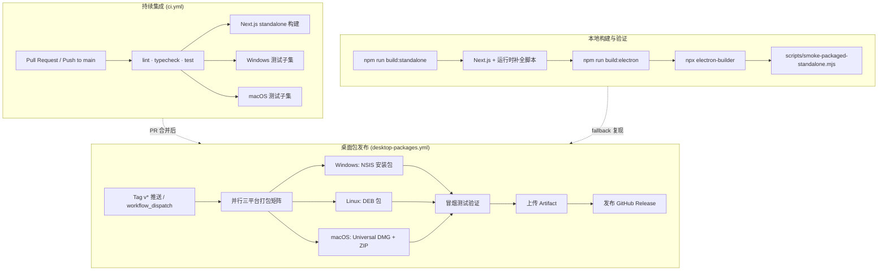
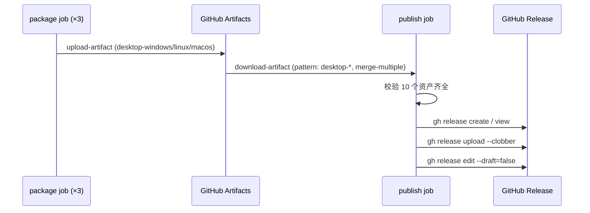
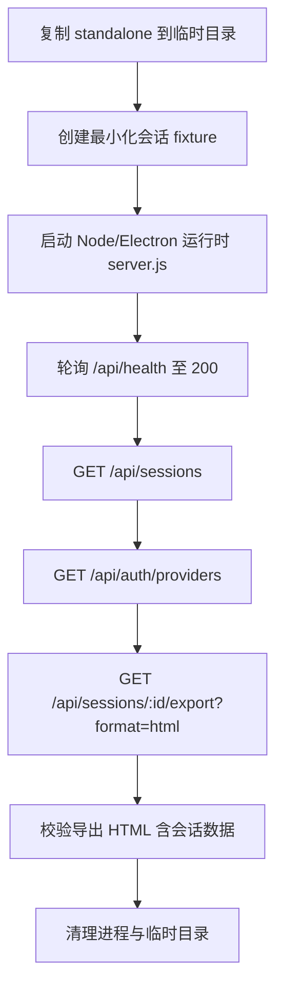
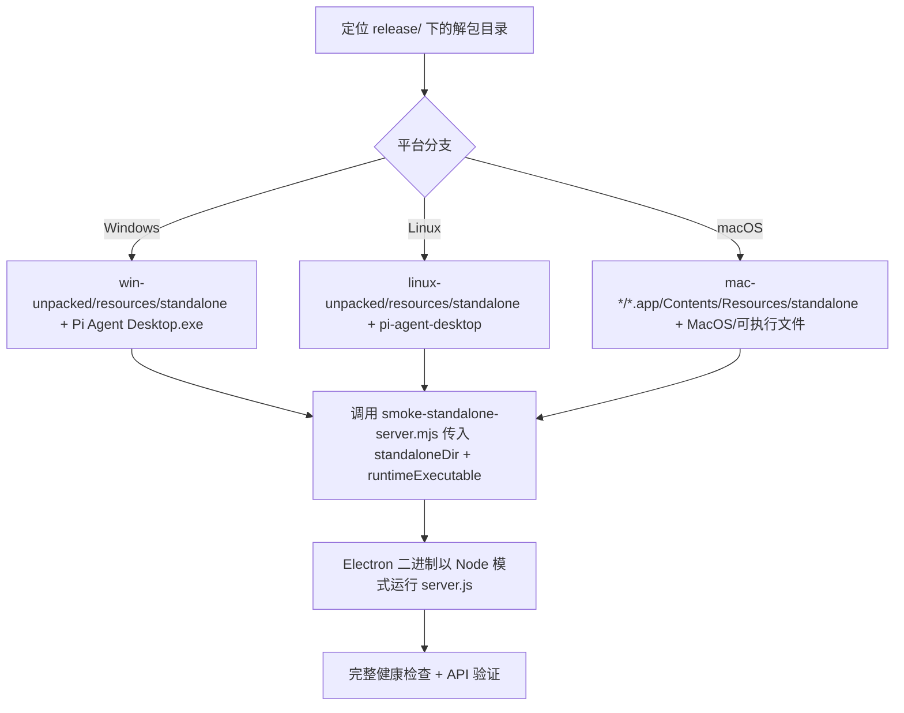

本文档系统记录 Pi Agent Desktop 的持续集成流水线、多平台打包构建流程、macOS Universal 双架构合并策略、以及 GitHub Release 发布自动化。面向中级开发者，重点阐述 **为什么这样设计**、**关键步骤的技术细节**、以及 **本地复现与排查路径**。

Sources: [.github/workflows/ci.yml](.github/workflows/ci.yml#L1-L119), [.github/workflows/desktop-packages.yml](.github/workflows/desktop-packages.yml#L1-L170), [electron-builder.yml](electron-builder.yml#L1-L133), [package.json](package.json#L1-L81), [docs/RELEASING.md](docs/RELEASING.md#L1-L47)

## 整体架构概览



---

## 一、CI 流水线：ci.yml

CI 流水线在 **Pull Request** 与 **main 分支推触发**，采用并发控制取消同一分支的过期运行。核心设计原则：**快速反馈**、**平台差异隔离**、**artifact 最小化**。

### 1.1 作业拓扑与依赖关系

| 作业 | 运行环境 | 依赖 | 核心任务 |
|------|----------|------|----------|
| `lint-typecheck-test` | ubuntu-latest | — | ESLint + tsc --noEmit + 完整单测套件 |
| `build` | ubuntu-latest | `lint-typecheck-test` | `npm run build` 产出 `.next/standalone` |
| `test-windows` | windows-latest | — | Electron 类型检查 + `check:electron-deps` + Windows 专用测试子集 |
| `test-macos` | macos-latest | — | Electron 类型检查 + `check:electron-deps` + macOS 专用测试子集 |

**关键点**：
- Windows/macOS 作业**不依赖** Linux 的 lint/typecheck/test，实现平行快速反馈
- 平台测试仅覆盖路径处理、Electron 配置、打包相关子集（`test:windows` / `test:macos` 脚本），避免全量重复
- `concurrency: cancel-in-progress: true` 保证同分支仅保留最新运行

Sources: [.github/workflows/ci.yml](.github/workflows/ci.yml#L1-L119), [package.json](package.json#L15-L33)

### 1.2 Node.js 版本与缓存策略

```yaml
- name: Setup Node
  uses: actions/setup-node@v4
  with:
    node-version: "24"
    cache: "npm"
```

- 统一 **Node 24** 与 `npm ci` 确保可复现安装
- npm 缓存加速依赖安装（约 30-50% 时间节省）

### 1.3 平台测试子集设计

Windows 与 macOS 仅运行与平台强相关的测试：

```json
"test:windows": "node --test ... electron/**/*.test.ts lib/file-paths.test.ts lib/path-policy.test.ts lib/session-lock.test.ts ..."
"test:macos":  "node --test ... electron/**/*.test.ts lib/file-paths.test.ts lib/path-policy.test.ts lib/session-lock.test.ts ..."
```

**设计意图**：文件路径规范化、会话锁、Git worktree、自定义路径选择等在跨平台行为差异最大，优先覆盖。

Sources: [package.json](package.json#L23-L30)

---

## 二、三平台桌面包构建：desktop-packages.yml

Release 工作流在 **Git tag 推送（`v*`）** 或 **手动触发** 时运行，**不取消进行中作业**（`cancel-in-progress: false`），避免并行打包时的资源争用。

### 2.1 矩阵策略与产物映射

| 平台 | Runner | 构建脚本 | 产物 | 验证步骤 |
|------|--------|----------|------|----------|
| Windows | `windows-latest` | `npm run dist` | `Setup-*.exe`, `.blockmap`, `latest.yml` | 冒烟测试 |
| Linux | `ubuntu-latest` | `npm run dist` | `*-linux-*.deb`, `latest-linux.yml` | `dpkg-deb -I` + 冒烟测试 |
| macOS | `macos-latest` | `npm run dist:mac` | `*-mac-universal.dmg/.zip`, `.blockmap`, `latest-mac.yml` | `hdiutil verify` + `unzip -t` + `lipo` 双架构校验 + 冒烟测试 |

**关键环境变量**：
```yaml
env:
  CSC_IDENTITY_AUTO_DISCOVERY: "false"  # 禁用自动代码签名发现，产物均未签名
```

Sources: [.github/workflows/desktop-packages.yml](.github/workflows/desktop-packages.yml#L1-L80)

### 2.2 版本一致性守卫

```bash
tag="${GITHUB_REF_NAME}"
version="$(node -p "require('./package.json').version")"
if [ "$tag" != "v${version}" ]; then
  echo "tag ${tag} does not match package.json version v${version}"
  exit 1
fi
```

**必须**满足：`git tag` 与 `package.json.version` 严格对应（`v` 前缀），否则打包作业直接失败。这是防止版本漂移的**硬性闸门**。

Sources: [.github/workflows/desktop-packages.yml](.github/workflows/desktop-packages.yml#L22-L30)

### 2.3 Linux 打包依赖预装

```yaml
- name: Install Linux packaging tools
  if: matrix.pack_id == 'linux'
  run: sudo apt-get update && sudo apt-get install -y fakeroot dpkg
```

`electron-builder` 生成 DEB 需要 `fakeroot` 与 `dpkg`，GitHub-hosted Ubuntu runner 默认未预装。

### 2.4 产物上传与发布流程



**资产清单（共 10 个）**：
| 文件模式 | 平台 | 说明 |
|----------|------|------|
| `Pi-Agent-Desktop-Setup-*.exe` | Windows | NSIS 安装包 |
| `Pi-Agent-Desktop-Setup-*.exe.blockmap` | Windows | 差量更新清单 |
| `latest.yml` | Windows | electron-updater 更新元数据 |
| `Pi-Agent-Desktop-*-linux-*.deb` | Linux | DEB 安装包 |
| `latest-linux.yml` | Linux | 更新元数据 |
| `Pi-Agent-Desktop-*-mac-universal.dmg` | macOS | Universal DMG |
| `Pi-Agent-Desktop-*-mac-universal.dmg.blockmap` | macOS | 差量更新 |
| `Pi-Agent-Desktop-*-mac-universal.zip` | macOS | Universal ZIP（备选分发） |
| `Pi-Agent-Desktop-*-mac-universal.zip.blockmap` | macOS | 差量更新 |
| `latest-mac.yml` | macOS | 更新元数据 |

**发布说明来源**：若 `docs/releases/vX.Y.Z.md` 存在则作为 `--notes-file`，否则自动生成。

Sources: [.github/workflows/desktop-packages.yml](.github/workflows/desktop-packages.yml#L82-L170)

---

## 三、立构建管线：build:standalone 深度解析

`npm run build:standalone` 是桌面包构建的**核心前置步骤**，由 5 个串行脚本组成：

```json
"build:standalone": "next build && node scripts/ensure-standalone-next-runtimes.mjs && node scripts/ensure-standalone-pi-runtime.mjs && node scripts/ensure-standalone-macos-universal-runtimes.mjs && node scripts/dereference-standalone-symlinks.mjs && node scripts/smoke-standalone-server.mjs"
```

### 3.1 Next.js Turbopack 运行时补全：`ensure-standalone-next-runtimes.mjs`

**问题**：Next.js 16 Turbopack 生产构建的 NFT 追踪常遗漏 `app-route-turbo.runtime.prod.js` 等运行时文件，导致 Electron 打包后加载 API 路由失败：
```
Cannot find module 'next/dist/compiled/next-server/app-route-turbo.runtime.prod.js'
```

**解决**：构建后显式拷贝所有 `*turbo*.runtime.prod.js` 到 `.next/standalone/node_modules/next/dist/compiled/next-server/`。

Sources: [scripts/ensure-standalone-next-runtimes.mjs](scripts/ensure-standalone-next-runtimes.mjs#L1-L49)

### 3.2 Pi 运行时依赖闭包补全：`ensure-standalone-pi-runtime.mjs`

**问题**：NFT 追踪外部 `@earendil-works/pi-coding-agent`、`@earendil-works/pi-ai` 包时，可能漏掉其 **生产依赖传递闭包**。

**解决**：从项目 `node_modules` 递归拷贝完整依赖树（含 `dependencies`、`optionalDependencies`、`peerDependencies`），保持 npm 目录布局不变。`required: true/false` 区分必选与可选依赖，缺失必选依赖直接报错。

```javascript
const roots = ["@earendil-works/pi-coding-agent", "@earendil-works/pi-ai"];
// BFS 遍历依赖图，realpathSync 去重，cpSync 保持相对路径
```

Sources: [scripts/ensure-standalone-pi-runtime.mjs](scripts/ensure-standalone-pi-runtime.mjs#L1-L93)

### 3.3 macOS Universal 双架构运行时：`ensure-standalone-macos-universal-runtimes.mjs`

**核心挑战**：Next.js standalone 仅追踪**宿主架构**的原生可选依赖。Universal 应用需 **arm64 与 x64 两套 Sharp / esbuild 原生包**并存，运行时由 Node.js 自动选择匹配架构的包。

**策略**：
1. **宿主已安装包直接拷贝**（`cpSync`）
2. **缺失架构包用 `npm pack` 下载 tarball 解压**（规避 `npm install` 的 `EBADPLATFORM`）
3. **esbuild CLI 恢复**：`npm pack esbuild@version` 获取可移植 JS CLI，替换宿主编译的 Mach-O 二进制

```javascript
// 必需的 4 个 Sharp 包 + 2 个 esbuild 包
const expectedNames = [
  "@img/sharp-darwin-arm64", "@img/sharp-darwin-x64",
  "@img/sharp-libvips-darwin-arm64", "@img/sharp-libvips-darwin-x64",
  "@esbuild/darwin-arm64", "@esbuild/darwin-x64"
];
```

**为什么不用 `npm install --arch`？** —— `npm install` 无法在单一架构 runner 上安装异构可选依赖；`npm pack` 仅下载 tarball，不执行 `postinstall` 编译，完美规避平台限制。

Sources: [scripts/ensure-standalone-macos-universal-runtimes.mjs](scripts/ensure-standalone-macos-universal-runtimes.mjs#L1-L225)

### 3.4 符号链接实体化：`dereference-standalone-symlinks.mjs`

**问题**：`@electron/universal` 合并 x64/arm64 临时 app 时，对每个文件 `realpath()` 并比较相对路径。若 `standalone/node_modules` 仍含指向构建树 `node_modules` 的符号链接，两架构临时 app 深度不同 → 同一目标文件产生不同相对路径 → 合并中止：
```
uniqueToX64:   ../../../../../../../../Users/runner/.../semver/bin/semver.js
uniqueToArm64: ../../../node_modules/.../semver/bin/semver.js
```

**解决**：深度优先收集所有符号链接，**按路径长度倒序**（先处理深层链接）替换为实体拷贝（`cpSync(..., {dereference: true})`），悬空链接直接删除。

Sources: [scripts/dereference-standalone-symlinks.mjs](scripts/dereference-standalone-symlinks.mjs#L1-L78)

### 3.5 立构建冒烟测试：`smoke-standalone-server.mjs`

**验证目标**：standalone 服务器在隔离环境中能正常启动、健康检查通过、会话 API 与导出功能工作。



- **超时控制**：启动 30s、请求 10s
- **跨平台进程管理**：Windows `taskkill /T /F`、POSIX `kill -SIGTERM` 整个进程组
- **双运行时模式**：`usesElectronRuntime` 决定是否传 `ELECTRON_RUN_AS_NODE=1`

Sources: [scripts/smoke-standalone-server.mjs](scripts/smoke-standalone-server.mjs#L1-L202)

---

## 四、electron-builder 配置与三平台差异

`electron-builder.yml` 定义了**应用标识**、**文件收集**、**extraResources**、**ASAR 打包**、**平台专用目标**与 **macOS Universal 合并策略**。

### 4.1 核心文件收集策略

```yaml
files:
  - package.json
  - build/icon.ico
  - build/icon.icns
  - electron/dist/**/*
  - "!electron/**/*.ts"
  - "!electron/tsconfig.json"
```

- **仅包含编译产物** `electron/dist/**/*`，排除 TypeScript 源码
- `asar: true` 将应用代码打包为单文件，**但 `extraResources` 位于 ASAR 外部**（electron-updater 运行时依赖需文件系统直接访问）

### 4.2 extraResources：运行时依赖外置清单

```yaml
extraResources:
  - from: .next/standalone
    to: standalone
    filter: [ "**/*", "!node_modules", "!release", ... ]
  - from: .next/standalone/node_modules
    to: standalone/node_modules
  - from: .next/static
    to: standalone/.next/static
  - from: public
    to: standalone/public
  # electron-updater 运行时依赖链（16 个包）
  - from: node_modules/electron-updater
    to: app/node_modules/electron-updater
  - from: node_modules/builder-util-runtime
    to: app/node_modules/builder-util-runtime
  # ... fs-extra, graceful-fs, jsonfile, js-yaml, lazy-val, lodash.*, semver, ...
```

**同步校验**：`lib/electron-updater-runtime-deps.mjs` 在 CI 中运行 `check:electron-deps`，对比 `electron-builder.yml` 与 `node_modules` 确保**零遗漏、零多余**。

Sources: [electron-builder.yml](electron-builder.yml#L14-L60), [lib/electron-updater-runtime-deps.mjs](lib/electron-updater-runtime-deps.mjs#L1-L98)

### 4.3 Windows：NSIS 安装包定制

```yaml
win:
  target:
    - target: nsis
      arch: [x64]
  icon: build/icon.ico
  signAndEditExecutable: false

nsis:
  oneClick: false
  allowToChangeInstallationDirectory: true
  createDesktopShortcut: true
  createStartMenuShortcut: true
  artifactName: "Pi-Agent-Desktop-Setup-${version}.${ext}"
  include: build/installer.nsh
```

**自定义 NSIS 脚本** (`build/installer.nsh`) 处理：
- 安装/卸载前**强制关闭残留进程**（`taskkill /F /T` + PowerShell 校验）
- 目录页提示：**切换盘符后自动创建子文件夹**，避免用户手动输入导致嵌套
- 安装日志记录到 `%TEMP%\Pi-Agent-Desktop\installer.log`

Sources: [electron-builder.yml](electron-builder.yml#L62-L76), [build/installer.nsh](build/installer.nsh#L1-L145)

### 4.4 Linux：DEB 包

```yaml
linux:
  executableName: pi-agent-desktop
  syncDesktopName: true
  target:
    - target: deb
      arch: [x64]
  icon: build/icon.png
  category: Development
  artifactName: "Pi-Agent-Desktop-${version}-linux-${arch}.${ext}"
```

- `electron-updater` 的 `DebUpdater` 支持应用内自动下载更新
- 无代码签名，用户需手动 `dpkg -i`

### 4.5 macOS Universal：双架构合并的核心配置

```yaml
mac:
  target:
    - target: dmg
      arch: [universal]
    - target: zip
      arch: [universal]
  icon: build/icon.icns
  category: public.app-category.developer-tools
  darkModeSupport: true
  x64ArchFiles: "Contents/Resources/standalone{,/.next}/**/{@earendil-works/pi-tui/native/darwin/prebuilds/**,@mariozechner/clipboard-darwin-{arm64,x64}/**,@img/sharp-darwin-{arm64,x64}/**,@img/sharp-libvips-darwin-{arm64,x64}/**,@esbuild/darwin-{arm64,x64}/**}"
  artifactName: "Pi-Agent-Desktop-${version}-mac-${arch}.${ext}"
```

#### `x64ArchFiles` 的作用与原理

`@electron/universal` 默认对**所有同名文件**执行 `lipo` 合并生成 Universal 二进制。**但原生 Node.js addon（`.node`/`.dylib`）与架构专用二进制（esbuild CLI、Sharp 库）不能合并**——它们是**架构专属**的，运行时由 Node.js 的可选依赖解析机制自动加载匹配架构的包。

`x64ArchFiles` 使用 **minimatch glob** 指定**跳过 lipo、直接并存**的路径模式。配置覆盖：
| 类别 | 路径模式 | 说明 |
|------|----------|------|
| pi-tui 原生模块 | `standalone/**/@earendil-works/pi-tui/native/darwin/prebuilds/**` | 两架构 `.node` 并存 |
| clipboard-darwin | `standalone/**/@mariozechner/clipboard-darwin-{arm64,x64}/**` | 两架构 `.node` 并存 |
| Sharp 图像处理 | `standalone/**/@img/sharp-darwin-{arm64,x64}/**`<br>`standalone/**/@img/sharp-libvips-darwin-{arm64,x64}/**` | 4 个包并存 |
| esbuild 编译器 | `standalone/**/@esbuild/darwin-{arm64,x64}/**` | 两架构 CLI 并存 |
| Next.js 编译产物 | `standalone/.next/**` | 包含 NFT 追踪的 pi-coding-agent 哈希目录 |

**测试用例验证**（`electron-builder-config.test.mjs`）：
- ✅ 所有上述路径 **匹配** `x64ArchFiles`（不 lipo）
- ❌ `Contents/MacOS/Pi Agent Desktop` **不匹配**（主进程二进制**必须** lipo 合并）

Sources: [electron-builder.yml](electron-builder.yml#L78-L110), [lib/electron-builder-config.test.mjs](lib/electron-builder-config.test.mjs#L68-L92)

---

## 五、打包后验证：smoke-packaged-standalone.mjs

`npm run dist` / `dist:mac` 末尾调用 `scripts/smoke-packaged-standalone.mjs`，**在真实打包产物上**运行与 standalone 相同的冒烟测试。



**关键差异**：使用 **Electron 打包后的可执行文件**（而非系统 Node）作为运行时，验证 `ELECTRON_RUN_AS_NODE=1` 模式下 ASAR 外部资源加载、extraResources 路径解析、原生模块加载均正常。

Sources: [scripts/smoke-packaged-standalone.mjs](scripts/smoke-packaged-standalone.mjs#L1-L82), [package.json](package.json#L37-L40)

---

## 六、本地构建与发布 Fallback 流程

当 GitHub Actions 失败或需复现问题时，本地完整复现步骤：

### 6.1 环境准备

| 平台 | 前置依赖 |
|------|----------|
| Windows | 无额外依赖（NSIS 内置） |
| Linux | `fakeroot`、`dpkg`（Debian/Ubuntu: `apt-get install fakeroot dpkg`；Arch: `pacman -S fakeroot dpkg libxcrypt-compat`） |
| macOS | Xcode Command Line Tools（`lipo`、`hdiutil`、`codesign`） |

### 6.2 构建命令

```bash
# 干净 worktree
git status --porcelain  # 应为空
npm ci

# Windows / Linux
npm run dist

# macOS (Universal)
npm run dist:mac
```

### 6.3 产物位置

```
release/
├── win-unpacked/           # Windows 解包目录（冒烟测试用）
├── Pi-Agent-Desktop-Setup-*.exe
├── Pi-Agent-Desktop-Setup-*.exe.blockmap
├── latest.yml
├── linux-unpacked/         # Linux 解包目录
├── Pi-Agent-Desktop-*-linux-*.deb
├── latest-linux.yml
├── mac-universal/          # macOS Universal 合并后 .app
├── Pi-Agent-Desktop-*-mac-universal.dmg
├── Pi-Agent-Desktop-*-mac-universal.dmg.blockmap
├── Pi-Agent-Desktop-*-mac-universal.zip
├── Pi-Agent-Desktop-*-mac-universal.zip.blockmap
└── latest-mac.yml
```

Sources: [docs/RELEASING.md](docs/RELEASING.md#L40-L47), [scripts/smoke-packaged-standalone.mjs](scripts/smoke-packaged-standalone.mjs#L1-L82)

---

## 七、常见失败模式与排查清单

| 现象 | 可能原因 | 排查与修复 |
|------|----------|------------|
| `next build` 后 API 路由报 `Cannot find module '...app-route-turbo.runtime.prod.js'` | `ensure-standalone-next-runtimes.mjs` 未运行或源文件缺失 | 确认 `node_modules/next/dist/compiled/next-server/` 下存在 `*turbo*.runtime.prod.js` |
| `electron-builder` 报 `EBADPLATFORM` 安装 `@img/sharp-darwin-x64` | 在 arm64 macOS 上 `npm install` 尝试编译 x64 原生包 | 使用 `npm pack` 下载 tarball 而非 `npm install`（已在 `ensure-standalone-macos-universal-runtimes.mjs` 中实现） |
| `@electron/universal` 合并失败：`uniqueToX64` / `uniqueToArm64` 路径不一致 | `standalone/node_modules` 残留符号链接 | 运行 `dereference-standalone-symlinks.mjs` 实体化所有链接 |
| macOS 产物 `lipo -archs` 仅显示单一架构 | `x64ArchFiles` 模式未覆盖某原生包，导致被错误合并 | 检查 `electron-builder.yml` `x64ArchFiles` glob，参考测试用例补全 |
| `check:electron-deps` 失败：`Missing from electron-builder.yml extraResources` | 新增依赖未同步到 `extraResources` | 对照 `ELECTRON_UPDATER_RUNTIME_PACKAGES` 补充 `electron-builder.yml` |
| 冒烟测试超时 `/api/health` 不返回 200 | standalone 服务器启动失败（端口冲突、缺少运行时依赖、路径解析错误） | 查看 stderr 输出；确认 `ELECTRON_RUN_AS_NODE=1` 传递；验证 `standalone/server.js` 存在 |
| GitHub Release 资产数量不足 10 个 | 某平台打包失败或 artifact 上传路径不匹配 | 检查 `package` job 日志；核对 `upload-artifact` 的 `path` glob 与实际产物名 |

---

## 八、关键设计决策回顾

| 决策点 | 选择 | 理由 |
|--------|------|------|
| **Node.js 版本** | 24 (LTS) | 与 Next.js 16、Electron 43 兼容性验证通过 |
| **并发控制** | CI: `cancel-in-progress: true`<br>CD: `cancel-in-progress: false` | CI 追求快速反馈；CD 打包耗时长且产物不可重入，避免中途取消导致资源浪费 |
| **macOS 代码签名** | 暂不签名（`CSC_IDENTITY_AUTO_DISCOVERY=false`） | 避免证书管理复杂性；Release Notes 披露 Gatekeeper 提示 |
| **Windows 代码签名** | 暂不签名 | 同理，披露 SmartScreen 提示 |
| **Linux 分发格式** | 仅 DEB | 目标用户以 Debian/Ubuntu 为主；AppImage/Flatpak 维护成本高 |
| **Universal 合并策略** | `x64ArchFiles` 显式排除原生包 | 运行时架构选择由 Node.js 可选依赖机制保证，合并会破坏原生二进制 |
| **standalone 运行时补全** | 4 个专用脚本串行 | 各解决独立问题：Turbopack 运行时、Pi 依赖闭包、双架构原生包、符号链接、端到端验证 |
| **测试分层** | CI 全量 + 平台子集 + 打包后冒烟 | 平衡覆盖率与执行时间；冒烟测试捕获打包层面的集成问题 |

---

## 九、延伸阅读与相关文档

| 文档 | 说明 |
|------|------|
| [打包构建流程与 macOS Universal 双架构处理](11-da-bao-gou-jian-liu-cheng-yu-macos-universal-shuang-jia-gou-chu-li) | 深入 macOS 双架构合并原理、NFT 追踪限制、运行时架构选择机制 |
| [Preload、CSP、自动更新与系统托盘](12-preload-csp-zi-dong-geng-xin-yu-xi-tong-tuo-pan) | electron-updater 集成、更新检查与下载流程、系统托盘交互 |
| [测试策略：Node.js 原生测试、平台子集与冒烟测试](27-ce-shi-ce-lue-node-js-yuan-sheng-ce-shi-ping-tai-zi-ji-yu-mou-yan-ce-shi) | 测试金字塔、平台子集设计、冒烟测试实现细节 |
| [关键设计决策与已知陷阱速查](29-guan-jian-she-ji-jue-ce-yu-yi-zhi-xian-jing-su-cha) | 跨文档的决策索引与常见坑位汇总 |

---

## 附录：版本发布检查单（摘自 RELEASING.md）

```
☐ package.json / package-lock.json 版本已更新至 X.Y.Z
☐ docs/releases/vX.Y.Z.md 发布说明已编写
☐ 本地跑通：lint / tsc / electron tsc / test / check:electron-deps / npm audit
☐ PR 合并至 main，CI 全绿
☐ git tag vX.Y.Z && git push origin vX.Y.Z
☐ GitHub Actions desktop-packages.yml 三平台全绿
☐ GitHub Release 10 个资产齐全、latest*.yml version/SHA512 正确
☐ Release Notes 披露：Windows 无签名 SmartScreen、macOS 无签名无公证 Gatekeeper
```