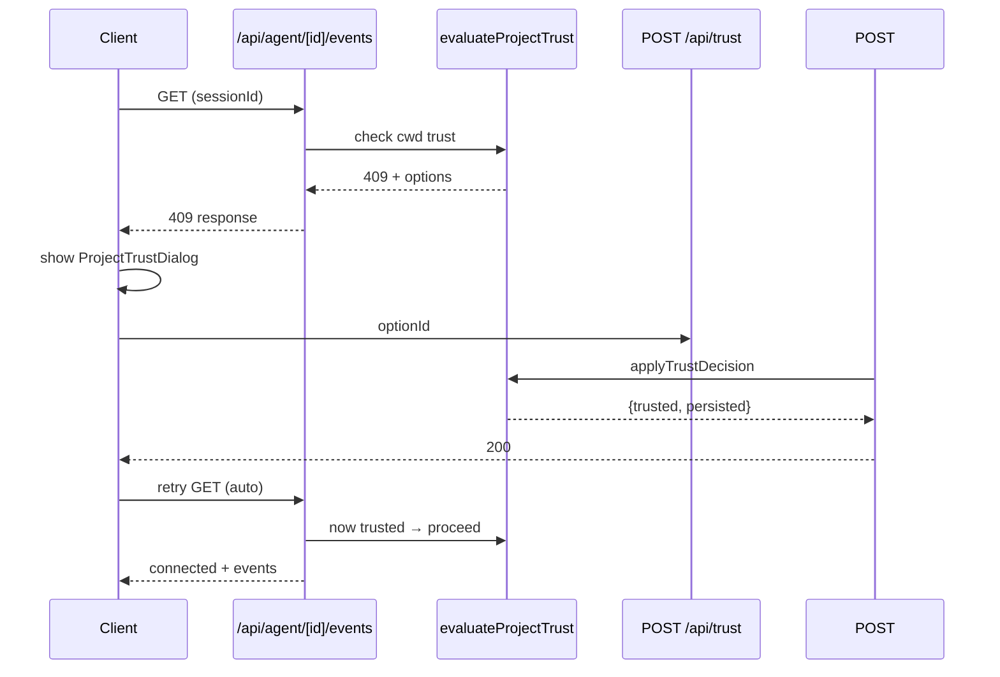

本页面汇总 Pi Agent Desktop 项目中的核心架构决策、工程权衡与已知陷阱，供高级开发者快速定位风险点、理解设计意图并在修改时避免回归。内容按**架构层级**组织，每条目标注对应源码位置，便于代码考古式验证。

---

## 一、整体架构决策

### 1.1 四层分离 + 双模式复用

**决策**：采用 **浏览器层 / 服务端层 / SDK 层 / 持久层** 四层架构，同一份 Next.js + React 代码同时服务 Web 开发模式（`npm run dev`）与 Electron 桌面模式（`npm run dev:electron` / 打包分发）。

**权衡**：
- ✅ 零重复 UI 逻辑、单一状态流向（SSE 推送）
- ✅ 服务端与 AgentSession 进程内直调，零 IPC/RPC 开销
- ⚠️ Electron 主进程需托管 Next.js 子进程，引入端口选取、健康检查、进程树清理等运维复杂度
- ⚠️ 打包需生成 standalone 产物并补齐 Turbopack runtime（历史曾漏包导致 #9 启动卡死）

**关键约束**：Next.js `output: 'standalone'`；Electron 通过 `ELECTRON_RUN_AS_NODE=1`（Windows/Linux）或 `utilityProcess.fork`（macOS）启动 `server.js`；主进程只在 `/api/health` 2xx 后 `loadURL` 进入应用页。

Sources: [ARCHITECTURE.md](docs/ARCHITECTURE.md#L30-L80), [electron/main.ts](electron/main.ts#L130-L200), [electron/server-wait.ts](electron/server-wait.ts#L165-L228)

---

### 1.2 HMR 安全的 `globalThis` 进程内注册表

**决策**：所有跨热重载需持久化的单例状态（会话注册表、启动锁、路径缓存、写锁、OAuth 回调、文件访问白名单）均挂载在 `globalThis.__pi*` 下，并配合 `declare global` 类型声明。

| 变量 | 模块 | 用途 | TTL / 回收策略 |
|---|---|---|---|
| `__piSessions` | `lib/rpc-manager.ts` | 活跃 AgentSessionWrapper 注册表 | 会话销毁时 `delete`；10 分钟空闲自动销毁 |
| `__piStartLocks` | `lib/rpc-manager.ts` | 并发启动同一 session 的 Promise 去重 | 启动完成/失败自动清理 |
| `__piSessionPathCacheState` | `lib/session-reader.ts` | `sessionId → .jsonl 路径` 正向 + 30s 负向缓存 | 正向永久（显式失效）；负向 30s TTL |
| `__piWriteLocks` | `lib/session-lock.ts` | 按文件路径串行化写入 | Promise 链自然释放 |
| `__piAllowedRootsCache` | `lib/allowed-roots.ts` | 文件访问白名单（针对 `cwd`） | 5 秒 TTL，过期整体重建 |
| `__piLoginCallbacks` | `app/api/auth/login/[provider]/route.ts` | OAuth 回调 Promise | 回调完成后 `delete` |

**现状**：文档曾长期声称“三个 globalThis”，实际至少 10 个——上表之外另有 `__piSessionOnlyTrust`（`lib/rpc-manager.ts`）、`__piGitWorktreeLocks`（`lib/git-worktree.ts`）、`__piUpstreamUsageCache`（`lib/upstream-usage/service.ts`）、`__piLtmService`/`__piLtmServiceKey`/`__piLtmServiceError`/`__piLtmServiceErrorAt`（`lib/ltm/service.ts`）；各变量均已配 `declare global` 类型声明（含 `__piLoginCallbacks`），不再有类型排查盲区。

Sources: [ARCHITECTURE.md](docs/ARCHITECTURE.md#L550-L580), [lib/rpc-manager.ts](lib/rpc-manager.ts#L278-L285), [lib/session-reader.ts](lib/session-reader.ts#L14-L30), [lib/session-lock.ts](lib/session-lock.ts#L1-L15), [lib/session-path-cache.ts](lib/session-path-cache.ts#L1-L30)

---

## 二、会话与分支模型

### 2.1 `.jsonl` Append-Only 文件格式与三种分支机制

**决策**：会话以单文件 `.jsonl` 存储，每行一个 `SessionEntry`（header + 消息/工具/压缩/分支/标签等条目）。三种分支机制共存：

| 机制 | 触发方式 | 文件关系 | 适用场景 |
|---|---|---|---|
| **Fork** | `POST /api/sessions/fork` | 新 `.jsonl`，header `parentSession` 指向旧文件 | 对话中途另起炉灶，保留上下文 |
| **会话内分支** | `BranchCloneModal` → `branch` | 同一文件，`parentId` 指向分叉入口 entry | 同一会话内并行探索，轻量 |
| **Git Worktree Clone** | `BranchCloneModal` → `clone` | 新工作区 + 复制 `.jsonl` + `git worktree add` | 需要独立文件系统隔离的长期并行 |

**权衡**：Append-only 天然适合并发读、便于流式重放；但**随机访问需全量扫描**（故引入 `session-path-cache`），且**跨进程并发追加在 Windows 上实测健壮**（单 syscall `appendFileSync`），但 SDK 自身 loader 未单独压测。

**现状**：Fork 后的竞态已修复——`AppShell.tsx` 改为调用 `lib/fork-session-wait.ts` 的 `resolveForkedSession()`（退避 50/100/200/400/800ms 重试 + 单会话直查兜底），直到列表包含新 ID 或超时。

Sources: [ARCHITECTURE.md](docs/ARCHITECTURE.md#L400-L460), [lib/session-reader.ts](lib/session-reader.ts#L50-L90), [components/AppShell.tsx](components/AppShell.tsx#L187-L195), [docs/investigations/white-screen.md](docs/investigations/white-screen.md#L60-L80)

---

### 2.2 会话路径缓存：正向永久 + 负向 30s TTL

**决策**：`resolveSessionPath()` 先查正向缓存 → 命中即返回；未命中查负向缓存 → 若在 30s TTL 内且无活跃 RPC wrapper 则直接返回 404；否则触发 `listAllSessions()` 全量扫描刷新缓存。

**设计考量**：
- 正向缓存永久有效，因 session 文件一旦创建路径不变
- 负向缓存防止恶意/随机 ID 触发全盘扫描，**但需警惕“先查后建”竞态**：Fork/Clone 瞬间注册新 ID，若此时恰好有并发请求记录了负向缓存，会在 30s 内误判 404。代码通过检查 `__piSessions` 活跃 wrapper 规避此问题。

Sources: [lib/session-reader.ts](lib/session-reader.ts#L70-L100), [lib/session-path-cache.ts](lib/session-path-cache.ts#L1-L57)

---

### 2.3 会话锁：按文件路径串行化写入

**决策**：`withFileLock(filePath, fn)` 使用 `globalThis.__piWriteLocks: Map<string, Promise>` 实现进程内巧克力锁，**不可重入**（同路径嵌套调用会死锁），释放后若无后续等待者则删除 Map 条目。

**适用场景**：会话删除级联重写父指针（`sessions/[id]/route.ts`）、配置文件原子写入（`atomic-write.ts` 落盘前）。

Sources: [lib/session-lock.ts](lib/session-lock.ts#L1-L42), [app/api/sessions/[id]/route.ts](app/api/sessions/[id]/route.ts#L124-L145)

---

## 三、Agent 交互与能力

### 3.1 三模式审批策略：Plan / Ask / Full

**决策**：纯策略层 `lib/approval-policy.ts` 定义 `AgentMode` 与 `ToolPreset` 到**实际启用工具集**的映射，**零 I/O、零 React 依赖**，便于单测与服务端/客户端共享。

| 模式 | 生效工具集 | Ask 确认工具 |
|---|---|---|
| `plan` | `read, grep, find, ls`（强制，忽略 preset） | — |
| `ask` | 由 `toolPreset` 决定 | `bash, write, edit, memory_save, memory_forget` |
| `full` | 由 `toolPreset` 决定 | — |

**实现**：`desktop-approval-extension.ts` 在 `tool_call` 钩子中拦截，结合 `modeRef.current` 判断是否调用 `ctx.ui.confirm()`。**MCP 工具在 Ask 模式下同样需要确认**（`isMcpTool` 判断）。

**陷阱**：`codemode` 工具单独受 `codemodeEnabled` 守护，非 `plan` 模式下 `toolPreset === 'none'` 会直接拦截所有工具。

Sources: [lib/approval-policy.ts](lib/approval-policy.ts#L1-L86), [lib/desktop-approval-extension.ts](lib/desktop-approval-extension.ts#L1-L47)

---

### 3.2 Extension UI Bridge：进程内异步 RPC 响应队列

**决策**：`ExtensionUiBridge` 在服务端进程内实现 `ExtensionUIContext` 的对话子集（`confirm/select/input/editor/notify`），通过 SSE 向前端下发 `extension_ui_request` 事件，前端渲染 `ExtensionUiDialog` 并经 `POST /api/agent/[id]/command` 回传 `extension_ui_response` 解除 Promise。

**关键机制**：
- 每个请求分配 `randomUUID()`，挂载 `Deferred{resolve, timer}` 于 `pending: Map<id, Deferred>`
- 支持 `AbortSignal`、超时自动 resolve（confirm→false，其它→undefined）
- `destroy()` 统一清理所有 pending，防止会话销毁时泄漏

**陷阱**：若前端页面关闭/刷新导致 SSE 断开，服务端 `cleanup()` 会关闭 stream 但**不会自动 resolve pending dialogs**——需靠 `ExtensionUiBridge.destroy()` 在 wrapper 销毁时兜底。

Sources: [lib/extension-ui-bridge.ts](lib/extension-ui-bridge.ts#L1-L221), [app/api/agent/[id]/events/route.ts](app/api/agent/[id]/events/route.ts#L40-L143), [components/ExtensionUiDialog.tsx](components/ExtensionUiDialog.tsx)

---

### 3.3 长期记忆：SQLite + WAL + 有界 SQLITE_BUSY 重试

**决策**：`lib/ltm/sqlite-backend.ts` 使用 Node.js 同步 `DatabaseSync`，启用 `PRAGMA journal_mode=WAL`、`busy_timeout=5000`。针对跨进程写竞争（CLI 与桌面端共享 `~/.pi/agent/ltm.sqlite`），实现**分级重试策略**：

| 失败类型 | 判定标准 | 重试上限 |
|---|---|---|
| Fast fail | 语句在 `fastFailMs`(默认 1s) 内抛 `SQLITE_BUSY`（未等待 busy_timeout） | `maxAttempts`(默认 3) |
| Slow fail | 语句等待了完整 `busy_timeout`(5s) 后抛出 | `slowRetries`(默认 1) |

**实测**：CLI 持有 `BEGIN IMMEDIATE` 8s 时，桌面端 `/api/memory/recall` 确定性复现 500 `database is locked`。**Agent 结束时的 LTM 写入有安全包装**（`safeLtmAgentEndObserve` 全量 catch），不阻塞主事件流。

Sources: [lib/ltm/sqlite-backend.ts](lib/ltm/sqlite-backend.ts#L140-L220), [docs/investigations/white-screen.md](docs/investigations/white-screen.md#L90-L110), [lib/ltm/observe-hooks.ts](lib/ltm/observe-hooks.ts#L140)

---

### 3.4 Follow-up Queue：Revision 乐观锁并发控制

**决策**：`FollowUpQueue` 维护 `items: QueuedFollowUp[]` 与单调递增 `revision`。`reorder(orderedIds, expectedRevision)` 校验 `expectedRevision === this.revision` 后才应用新顺序，**实现乐观锁**；`shift()`/`restoreFront()` 同样推进 revision。

**用途**：用户在 `QueuedMessageList` 中拖拽重排待发送消息，防止多标签/多设备并发编辑导致顺序丢失。

Sources: [lib/follow-up-queue.ts](lib/follow-up-queue.ts#L1-L79), [components/chat-input/QueuedMessageList.tsx](components/chat-input/QueuedMessageList.tsx)

---

### 3.5 Project Trust 409 握手与延迟 Session 创建

**决策**：`evaluateProjectTrust(cwd)` 在 SSE 建立**前**校验项目信任状态。未受信项目返回 **409 + `NeedsTrustPayload`**，前端弹 `ProjectTrustDialog`，用户选择后经 `POST /api/trust` 提交，服务端 `applyTrustDecision` 写入 `ProjectTrustStore`（持久化到 `~/.pi/agent/trust.json`）或仅记入进程内 `sessionOnlyTrust: Map<cwd, boolean>`。

**流程**：


**陷阱**：`sessionOnlyTrust` 仅在当前 Node 进程内有效，**Electron 打包模式下 Next.js 子进程重启会丢失**，需用户重新授权（或选择持久化选项）。

Sources: [lib/project-trust-desktop.ts](lib/project-trust-desktop.ts#L1-L148), [app/api/agent/[id]/events/route.ts](app/api/agent/[id]/events/route.ts#L15-L40), [components/ProjectTrustDialog.tsx](components/ProjectTrustDialog.tsx)

---

### 3.6 MCP 双级配置：全局 + 项目作用域

**决策**：`mcp-config.ts` 维护 `global`（`~/.pi/agent/mcp.json`）与 `project`（`<cwd>/.pi/mcp.json`）两级配置，合并时项目级覆盖全局。UI 通过 `McpConfigModal` 管理，支持 STDIO / HTTP / SSE 三种传输。

Sources: [lib/mcp-config.ts](lib/mcp-config.ts), [components/McpConfigModal.tsx](components/McpConfigModal.tsx)

---

## 四、Electron 桌面端工程决策

### 4.1 启动链：双门槛就绪检查（stdout Ready + HTTP /api/health）

**决策**：`waitForNextServerReady()` 监听子进程 stdout `Ready` 文本**与**轮询 `/api/health`：开发模式 `Promise.any` 任一通过即就绪；打包模式（`requireHttpHealth=true`）仅以 HTTP 健康检查为成功信号。

**原因**：Turbopack standalone 曾漏包 `app-route-turbo.runtime.prod.js`，导致子进程 stdout 打印 Ready 但 App Route 无法响应（`Cannot find module`），Electron 误判就绪而白屏。HTTP 健康检查覆盖完整路由初始化路径。

**重试策略**：阶梯式分段延迟（<5s:100ms、<15s:250ms、≥15s:500ms），总超时 60s。

Sources: [electron/server-wait.ts](electron/server-wait.ts#L1-L130), [electron/main.ts](electron/main.ts#L300-L380), [docs/research/issue-9-startup-lifecycle-analysis.md](docs/research/issue-9-startup-lifecycle-analysis.md#L1-L50)

---

### 4.2 导航重试：有界指数退避 + 生命周期取消

**决策**：`loadPageWithRetry()` 封装 `loadPageWithTimeout()`（单次 15s），延迟数组 `[100, 250, 500]ms`，**最多 3 次重试**。支持 `AbortSignal` 与 `cancelAttempt()` 回调，窗口/进程生命周期变化时立即取消底层导航。

**修复背景**：v0.7.20 及更早版本 `showApp()` 调用 `loadURL()` 未 `await`，瞬时导航失败会永久留在启动页。v0.7.21 引入此机制修复。

Sources: [electron/navigation.ts](electron/navigation.ts#L1-L137), [electron/main.ts](electron/main.ts#L450-L500)

---

### 4.3 渲染进程崩溃恢复：有界自动重载（3 次 / 60s 窗口）

**决策**：`crash-recovery.ts` 实现 `getNextCrashReloadState()`：**排除 `clean-exit`**、**滑动窗口过滤 60s 内尝试**、**上限 3 次**。达上限后**不再重载**，主进程改为展示兜底启动页 `showStartupState("stopped", "页面多次崩溃，已停止自动恢复")`（`electron/main.ts:486`）。

**现状**：error boundary（`app/error.tsx`）与达上限后的兜底 UI（`startup.html#state=stopped`）均已落地，#20 的该缺口已闭合。

**实验证据**（兜底 UI 落地前）：单进程内 4 次 `taskkill` renderer（间隔 4s，60s 窗口内）→ 第 4 次不再重载（当时无兜底 UI，表现为永久白屏），日志记录 `Renderer crash auto-reload skipped { reason: 'killed' }`。

Sources: [electron/crash-recovery.ts](electron/crash-recovery.ts#L1-L28), [docs/investigations/white-screen.md](docs/investigations/white-screen.md#L100-L113), [docs/research/issue-20-white-screen-analysis.md](docs/research/issue-20-white-screen-analysis.md#L1-L50)

---

### 4.4 服务端重启策略：同构有界重启（3 次 / 60s）

**决策**：`restart-policy.ts` 与 `crash-recovery.ts` 结构对称：仅在 `serverState === 'ready'` 且非退出中、60s 内不超过 3 次时重启 Next.js 子进程。重启前会 `killProcessTree` 清理后代进程。

Sources: [electron/restart-policy.ts](electron/restart-policy.ts#L1-L23), [electron/main.ts](electron/main.ts#L220-L250)

---

### 4.5 CSP 共享常量 + Electron 动态端口注入

**决策**：`lib/csp.ts` 与 `electron/csp.ts` 共享基础指令集，**仅 `connect-src` 分环境**：Web 允许 `127.0.0.1:*`，Electron 绑定活跃端口。`main.ts` 在 `BrowserWindow` 创建时通过 `webContents.session.webRequest.onHeadersReceived` 注入。

**历史陷阱**：`proxy.ts` 曾为死代码，CSP 从未生效（ARCHITECTURE-REVIEW.md #1）。现已通过 middleware + Electron 双路径生效。

Sources: [lib/csp.ts](lib/csp.ts#L1-L63), [electron/csp.ts](electron/csp.ts#L1-L22), [electron/main.ts](electron/main.ts#L380-L420), [docs/ARCHITECTURE-REVIEW.md](docs/ARCHITECTURE-REVIEW.md#L80-L95)

---

### 4.6 原子写入配置文件：tmp+rename + EPERM 重试循环

**决策**：`writeFileAtomic()` 写 sibling `.tmp-{pid}-{random}` → `renameSync` 覆盖目标。Windows 上读者进程持有文件时 `renameSync` 抛 `EPERM/EACCES`，**实测需重试数百次**（25ms 间隔，上限 100 次）。重试耗尽回退直接 `writeFileSync`（牺牲原子性保可用性）。

**适用文件**：`desktop-settings.json`、`settings.json`、`extensions-config.json`、`mcp.json` 等跨进程共享配置。

**现状**：`extensions-config.ts` 主配置写入已迁移到 `writeFileAtomic()`（`writeSettingsFile`）；残留的裸 `writeFileSync`（约 :259）仅用于改写技能 SKILL.md frontmatter 文本，非 JSON 配置。

Sources: [lib/atomic-write.ts](lib/atomic-write.ts#L1-L68), [lib/desktop-settings.ts](lib/desktop-settings.ts#L110-L131), [lib/extensions-config.ts](lib/extensions-config.ts#L180-L200), [docs/investigations/white-screen.md](docs/investigations/white-screen.md#L30-L50)

---

### 4.7 自动更新门禁：状态机防误触发 `quitAndInstall`

**决策**：`update-install-gate.ts` 维护 `UpdateInstallState{updateDownloaded, downloadedVersion}`，`decideQuitAndInstall()` **仅在 `updateDownloaded=true` 时允许安装**。`preload.ts` 顶层暴露 `electronAPI.quitAndInstall()`（无 `.update` 命名空间），主进程调用前经 `decideQuitAndInstall(updateInstallState)` 校验。

**防范**：避免渲染进程 XSS → 调用 preload 暴露的 `quitAndInstall` → 未下载更新时触发安装路径 → 应用损坏。

Sources: [electron/update-install-gate.ts](electron/update-install-gate.ts), [electron/preload.ts](electron/preload.ts), [electron/main.ts](electron/main.ts#L550-L600)

---

## 五、前端架构与状态管理

### 5.1 `useAgentSession` 主 Hook + 子 Hook 拆分策略

**决策**：`useAgentSession.ts` 作为**组合层**，聚合 8 个子 Hook：
- `useSessionLoader`：会话加载/切换/上下文构建
- `useAgentEvents`：SSE 连接/重连/心跳/事件分发
- `useSessionCommands`：发送/中止/转向/跟进/重排
- `useSessionModelTools`：模型列表/思考等级/工具预设
- `useSessionLifecycleReset`：session 切换时的状态重置补丁
- `useChatScroll`：虚拟列表滚动锚定
- `agent-event-apply`：纯函数 SSE 事件→状态补丁
- `streamReducer`：流式消息增量状态机

**演进**：v0.7.16 前为单文件 800+ 行，ARCHITECTURE-OPTIMIZATION-REVIEW 指出“状态边界膨胀”，后拆分为上述结构。**现仍保留 `sessionScopedResetPatch`/`loadedAgentStatePatch` 等补丁对象在渲染期创建**，属可进一步优化点。

Sources: [hooks/useAgentSession.ts](hooks/useAgentSession.ts#L1-L200), [hooks/agent-session/](hooks/agent-session/), [docs/ARCHITECTURE-OPTIMIZATION-REVIEW-2026-06-26.md](docs/ARCHITECTURE-OPTIMIZATION-REVIEW-2026-06-26.md#L30-L60)

---

### 5.2 `streamReducer` 流式消息状态机

**决策**：最小状态 `{isStreaming, streamingMessage}` + 四动作 `{start, update, end, reset}`。**增量渲染**：`message_update` 直接替换 `streamingMessage`，`message_end` `reset` 后由 `reloadSession` 全量同步权威消息列表。

**优势**：避免在 reducer 中处理复杂合并逻辑，降低渲染期异常概率。

Sources: [hooks/agent-session/stream-state.ts](hooks/agent-session/stream-state.ts#L1-L32), [hooks/agent-session/agent-event-apply.ts](hooks/agent-session/agent-event-apply.ts#L70-L95)

---

### 5.3 消息虚拟化 + Markdown 渲染管线

**决策**：`MessageList` 使用定高虚拟化（`file-viewer-virtualization.ts` 复用于文件查看），`MessageView` 内部 `ReactMarkdown + remarkGfm + react-syntax-highlighter(ayu 主题)`。**代码块语言未知时 Prism 内部 try/catch 回退纯文本**，不抛错。

**现状**：消息 `content` 渲染已统一经 `components/message-content.ts` 的 `getTextContent()`/`getImageContent()` 取值——带 `Array.isArray` 守卫并把异形内容降级为空串，不会再因 SSE 下发异形 `content` 渲染期崩溃（Issue #20 候选机制一已消除）。

Sources: [components/MessageView.tsx](components/MessageView.tsx#L140-L210), [components/MessageList.tsx](components/MessageList.tsx), [lib/file-viewer-virtualization.ts](lib/file-viewer-virtualization.ts)

---

### 5.4 液态思考球：WebGPU 优先 + Canvas 降级

**决策**：`LiquidOrbCanvas` 优先尝试 `navigator.gpu` → `requestAdapter` → `createRenderPipelineAsync`，任一环节失败或 `device.lost` / `uncapturederror` 触发 `stopWithFallback()` → `setWebGpuFailed(true)` → 父组件 `AgentThinkingOrb` 渲染 Canvas 降级版（`liquid-orb-source.ts` 生成的 2D 实现）。

**资源管理**：`IntersectionObserver` + `ResizeObserver` + `visibilitychange` 精确控制渲染循环，**卸载时显式 `device.destroy()`、`context.unconfigure()`、移除所有监听器**。

Sources: [components/LiquidOrbCanvas.tsx](components/LiquidOrbCanvas.tsx#L1-L218), [components/AgentThinkingOrb.tsx](components/AgentThinkingOrb.tsx), [components/liquid-orb-source.ts](components/liquid-orb-source.ts)

---

### 5.5 统计与连接状态：props 驱动

**现状**：`StatsBar` 为纯 props 驱动组件（`StatsBarProps`：`showChat`/`sessionStats`/`contextUsage`/`currentProvider`），统计与连接状态经组件树 props 自上而下传递。历史方案曾用 `pi-session-stats`/`pi-connection-status` CustomEvent 广播，现已全部移除，代码库中无 `dispatchEvent`/`CustomEvent` 用法。

Sources: [components/StatsBar.tsx](components/StatsBar.tsx#L14-L23), [components/ChatWindow.tsx](components/ChatWindow.tsx#L165-L175)

---

## 六、已知陷阱与规避清单

### 6.1 白屏双兜底缺口（Issue #20 / #33）

| 兜底层 | 机制 | 状态 | 残留缺口 |
|---|---|---|---|
| **React 错误边界** | `app/error.tsx` + `app/global-error.tsx` | ✅ v0.8.5 落地 | —（`global-error.tsx` 自渲染 `<html>/<body>` 并用上下文无关 `translate()`，不依赖 layout/I18nProvider） |
| **渲染进程崩溃自动重载** | `crash-recovery.ts` 有界重载 | ✅ 落地 | —（达上限(3/60s)后 `showStartupState("stopped", ...)` 兜底启动页） |
| **Next.js 服务崩溃重启** | `restart-policy.ts` + `showStartupState('error')` | ✅ 落地 | — |
| **SSE 断连重连** | `agent-events-manager.ts` 指数退避 5 次 → 红条 + 手动重连 | ✅ 落地 | — |

**#33 根因分析（实验后修订）**：
- ❌ `.jsonl` 行交错 → 解析失败（实验 B GREEN，逐行 try/catch）
- ❌ `settings.json` 半写 → JSON.parse 抛错 → API 500（实验 A/D 全消费端容错）
- ✅ **SQLite 跨进程写竞争 → `SQLITE_BUSY` → `/api/memory/*` 500**（实验 C RED，确定复现）
- ❓ **白屏机制本身未锁定**：更可能是渲染进程级死亡（实验 E 机制）、dev 模式 `.next` 污染、或未识别层

**需用户补充**：`%APPDATA%\Pi Agent Desktop\logs\main.log` 白屏前内容、是否可 Ctrl+R 恢复。

Sources: [docs/investigations/white-screen.md](docs/investigations/white-screen.md), [docs/research/issue-20-white-screen-analysis.md](docs/research/issue-20-white-screen-analysis.md), [electron/crash-recovery.ts](electron/crash-recovery.ts), [app/error.tsx](app/error.tsx), [app/global-error.tsx](app/global-error.tsx)

---

### 6.2 配置文件并发写入：fs 层 RED，应用层 GREEN（有容错）

**实验 A 结论**：`writeFileSync` 非原子写在 2KB/32KB 负载下分别触发 43%/58% 读端 `JSON.parse` 抛错。**但所有消费端均有 try/catch 回退默认值**：
- `desktop-settings.ts:73-78` → `defaultDesktopSettings()`
- `extensions-config.ts:182-187` → `{}`
- SDK `createAgentSessionServices` / `ModelRuntime.create` 对损坏的 `settings.json`/`auth.json`/`models.json` 全部正常创建会话

**真实风险**：**写丢配置内容（完整性）**，而非可用性。`extensions-config.ts` 主配置已迁移到 `writeFileAtomic`（残留裸写仅 SKILL.md frontmatter 文本）。

Sources: [docs/investigations/white-screen.md](docs/investigations/white-screen.md#L30-L50), [lib/desktop-settings.ts](lib/desktop-settings.ts#L73-L78), [lib/extensions-config.ts](lib/extensions-config.ts#L182-L187)

---

### 6.3 SQLite 跨进程写竞争：唯一实锤的破坏链

**实验 C**：Holder 进程 `BEGIN IMMEDIATE` 持锁 8s，另一进程按 `busy_timeout=5000` + WAL 配置写入 → **5503ms 后确定性抛 `database is locked`** → `/api/memory/recall` 返回 500。

**缓解**：
- Agent 结束时 LTM 写有安全包装（`safeLtmAgentEndObserve` 全量 catch）
- `/api/memory/*` 直连路径需捕获降级（返回空结果/提示）或缩短 `busy_timeout` + 重试
- `close()` 时 `wal_checkpoint(TRUNCATE)` 失败仅记日志

Sources: [docs/investigations/white-screen.md](docs/investigations/white-screen.md#L90-L110), [lib/ltm/sqlite-backend.ts](lib/ltm/sqlite-backend.ts#L140-L220), [lib/ltm/observe-hooks.ts](lib/ltm/observe-hooks.ts#L140)

---

### 6.4 安全假象与攻击面（ARCHITECTURE-REVIEW.md TOP 10 遗留）

| 缺陷 | 位置 | 风险等级 | 缓解现状 |
|---|---|---|---|
| 无 CSRF/Origin 校验 | 所有 API 路由 | 🔴 严重 | **已修**：`middleware.ts` 对所有 `/api` 做 Origin 校验（`isAllowedOrigin` 不通过返回 403） |
| `POST /api/agent/new` 任意 `cwd` 加入白名单 | `agent/new/route.ts` | 🔴 严重 | **已修**：`validateAgentCwd` 拒绝根目录/home/系统目录；白名单缓存 5s TTL 非永久 |
| `POST /api/skills/install` 任意 `npx` 安装 | `skills/install/route.ts` | 🔴 严重 | **已修**：`validateSkillsPackage` 白名单校验（`owner/repo[@skill]` 格式），防供应链 + RCE 面 |
| Electron 主窗口未注入 CSP | `main.ts:228-247` | 🔴 严重 | **已修**（v0.8+ 引入共享 CSP builder） |
| `sandbox: true` 未启用 | `main.ts:240-242` | 🟡 中等 | **已修**：`sandbox: true` 与 `contextIsolation: true` 均已启用 |
| preload `ipcRenderer.on` 不可清理 | `preload.ts:6-9` | 🟡 中等 | **已修**：`onUpdateAvailable`/`onUpdateDownloaded` 返回 `() => ipcRenderer.off(...)` 反注册函数 |

**落地情况**：原“建议整体工作项立项”四项均已落地——
1. `middleware.ts` Origin 校验（对所有 `/api`，不通过返回 403）
2. `agent/new` 经 `validateAgentCwd` 收敛 cwd，白名单缓存 5s TTL
3. `skills/install` 经 `validateSkillsPackage` 包名白名单
4. Electron `sandbox: true` + `contextIsolation: true` 均已启用

Sources: [docs/ARCHITECTURE-REVIEW.md](docs/ARCHITECTURE-REVIEW.md#L80-L150), [app/api/agent/new/route.ts](app/api/agent/new/route.ts), [app/api/skills/install/route.ts](app/api/skills/install/route.ts), [electron/main.ts](electron/main.ts#L228-L247), [electron/preload.ts](electron/preload.ts#L6-L9)

---

### 6.5 资源生命周期泄漏清单

| 资源 | 位置 | 泄漏场景 | 修复状态 |
|---|---|---|---|
| SSE listener + heartbeat interval | `app/api/agent/[id]/events/route.ts:46-66` | 客户端静默消失（代理超时/网络抖动）不触发 `abort` | ✅ 已修：统一 `cleanup()` 供 `start`/`cancel`/`abort` 三路径调用 |
| Fork 失败孤儿 `.jsonl` | `lib/rpc-manager.ts` | 预注册后启动失败，文件名带 uuid 永不覆盖 | ✅ 已修：失败路径 `invalidateSessionPathCache` + `unlink(newSessionFile)`（best-effort，失败不阻断） |
| `ChatInput` blob URL | `components/ChatInput.tsx:118-129` | 卸载时未 `URL.revokeObjectURL` | ⚠️ 未修 |
| preload `ipcRenderer.on` | `electron/preload.ts` | 多次注册累积 listener | ✅ 已修：`onUpdateAvailable`/`onUpdateDownloaded` 返回 `ipcRenderer.off` 反注册函数 |
| `?includeState=1` GET 重置 idle timer | `app/api/sessions/[id]/route.ts` | 观测请求让会话永不回收 | ✅ 已修：改用只读 `peekState()`，不重置 idle timer |
| `AgentSessionWrapper.destroy()` 不 await unsubscribe | `lib/rpc-manager.ts:247-258` | 未来若 unsubscribe 变 async 会资源未释放 | ⚠️ 未修 |

Sources: [app/api/agent/[id]/events/route.ts](app/api/agent/[id]/events/route.ts#L46-L143), [lib/rpc-manager.ts](lib/rpc-manager.ts#L131-L163), [components/ChatInput.tsx](components/ChatInput.tsx#L118-L129), [electron/preload.ts](electron/preload.ts#L6-L9), [docs/ARCHITECTURE-REVIEW.md](docs/ARCHITECTURE-REVIEW.md#L150-L180)

---

### 6.6 前端隐式耦合与正确性陷阱

| 陷阱 | 位置 | 影响 | 建议修复 |
|---|---|---|---|
| `UserMessageView`/`CustomMessageView` 缺 `Array.isArray` 守卫 | `MessageView.tsx` | 异形 `content` 导致渲染期崩溃→白屏 | ✅ 已修复：统一经 `components/message-content.ts` 的 `getTextContent()`/`getImageContent()`（带守卫并降级空串） |
| Fork 后固定 50ms 轮询会话列表 | `AppShell.tsx` | 慢机器/杀毒软件下竞态失败 | ✅ 已修复：`lib/fork-session-wait.ts` 的 `resolveForkedSession()`（退避 50/100/200/400/800ms + 单会话直查兜底） |
| `useAgentSession` 职责过宽（组合层膨胀） | `hooks/useAgentSession.ts:48-800` | 状态子域耦合、禁用 exhaustive-deps | 继续拆分 `use-session-commands`/`use-session-model-tools`/`use-session-lifecycle-reset` |
| 全局 CustomEvent 统计桥 | `AppShell.tsx` | 隐式耦合、类型不安全 | ✅ 已移除：`StatsBar` 改为纯 props 驱动 |
| `ChatInput` blob URL 未释放 | `ChatInput.tsx:118-129` | 长期运行内存泄漏 | `useEffect` 返回 `revokeObjectURL` 清理 |

Sources: [components/MessageView.tsx](components/MessageView.tsx#L140-L210), [components/AppShell.tsx](components/AppShell.tsx#L187-L195), [hooks/useAgentSession.ts](hooks/useAgentSession.ts), [components/ChatInput.tsx](components/ChatInput.tsx#L118-L129), [docs/ARCHITECTURE-OPTIMIZATION-REVIEW-2026-06-26.md](docs/ARCHITECTURE-OPTIMIZATION-REVIEW-2026-06-26.md#L30-L90)

---

### 6.7 文档与代码漂移

| 文档声明 | 实际情况 | 影响 |
|---|---|---|
| “三个 globalThis” | 实为至少 10 个（另有 `__piSessionOnlyTrust`/`__piGitWorktreeLocks`/`__piUpstreamUsageCache`/`__piLtmService*` 等） | 维护者排查盲区 |
| 版本号滞后 | `ARCHITECTURE.md` 顶部版本与 `package.json` 不一致 | 误导版本对照 |
| “17 个顶层组件” | 实际 16 `.tsx` + 1 算法文件 | 口径不清 |
| README 项目结构段 | 缺 `hooks/` `bin/` `proxy.ts` 等 | 新人导航失效 |

**建议**：引入 `docs:check` CI 脚本，grep 比对文档中的版本号/计数/表格与实际代码。

Sources: [docs/ARCHITECTURE.md](docs/ARCHITECTURE.md#L550-L580), [docs/ARCHITECTURE-REVIEW.md](docs/ARCHITECTURE-REVIEW.md#L180-L220)

---

## 七、决策对照表：何时触发何种机制

```mermaid
flowchart TD
    A[用户操作 / 外部事件] --> B{分类}
    B -->|发起对话| C[SSE /api/agent/[id]/events]
    B -->|创建会话| D[POST /api/agent/new]
    B -->|Fork 会话| E[POST /api/sessions/fork]
    B -->|配置模型/技能/MCP| F[PUT /api/models-config 等]
    B -->|文件读写| G[/api/files/[...path]]
    B -->|长期记忆| H[/api/memory/*]
    B -->|Electron 启动| I[main.ts → server-wait → navigation]
    B -->|渲染进程崩溃| J[crash-recovery.ts]
    B -->|Next.js 子进程退出| K[restart-policy.ts]

    C --> C1[Project Trust 409?]
    C1 -->|否| C2[getRpcSession / startRpcSession]
    C1 -->|是| C3[前端弹 Dialog → POST /api/trust]
    C2 --> C4[AgentSessionWrapper.onEvent → SSE 推送]
    C4 --> C5[前端 streamReducer + agent-event-apply]
    C5 --> C6[MessageList 增量渲染]

    D --> D1[validateAgentCwd 校验后写入 __piAllowedRootsCache（5s TTL）]
    E --> E1[新 .jsonl + parentSession 指针]
    E1 --> E2[resolveForkedSession 退避重试 ✅]

    F --> F1[pi-runtime.ts → ModelRuntime.create]
    F1 --> F2[主配置写入走 writeFileAtomic ✅]

    G --> G1[isPathAllowed 校验 __piAllowedRootsCache]
    G1 --> G2[Range 请求 / 流式取消]

    H --> H1[sqlite-backend.ts WAL + busy_timeout]
    H1 --> H2[SQLITE_BUSY 分级重试]
    H2 --> H3[跨进程竞争 → 500 🔴]

    I --> I1[stdout Ready + HTTP /api/health 双门槛]
    I1 --> I2[loadPageWithRetry 指数退避 3次]

    J --> J1[滑动窗口 3/60s 判定]
    J1 -->|达上限| J2[showStartupState stopped 兜底 UI]

    K --> K1[同构 3/60s 判定]
    K1 -->|达上限| K2[showStartupState stopped]
```

---

## 八、快速定位索引

| 关键词 | 核心文件 | 相关章节 |
|---|---|---|
| 四层架构 | `docs/ARCHITECTURE.md` | §3 |
| globalThis 注册表 | `lib/rpc-manager.ts`, `lib/session-reader.ts`, `lib/session-lock.ts` | §1.2 |
| 会话分支 | `lib/session-reader.ts`, `components/BranchCloneModal.tsx` | §2.1 |
| 审批策略 | `lib/approval-policy.ts`, `lib/desktop-approval-extension.ts` | §3.1 |
| Extension UI Bridge | `lib/extension-ui-bridge.ts`, `app/api/agent/[id]/events/route.ts` | §3.2 |
| LTM SQLite | `lib/ltm/sqlite-backend.ts`, `lib/ltm/observe-hooks.ts` | §3.3 |
| Follow-up Queue | `lib/follow-up-queue.ts` | §3.4 |
| Project Trust | `lib/project-trust-desktop.ts`, `components/ProjectTrustDialog.tsx` | §3.5 |
| Electron 启动 | `electron/main.ts`, `electron/server-wait.ts`, `electron/navigation.ts` | §4.1-4.2 |
| 崩溃恢复 | `electron/crash-recovery.ts`, `electron/restart-policy.ts` | §4.3-4.4 |
| CSP | `lib/csp.ts`, `electron/csp.ts` | §4.5 |
| 原子写入 | `lib/atomic-write.ts` | §4.6 |
| 自动更新门禁 | `electron/update-install-gate.ts` | §4.7 |
| useAgentSession 拆分 | `hooks/useAgentSession.ts`, `hooks/agent-session/` | §5.1 |
| streamReducer | `hooks/agent-session/stream-state.ts` | §5.2 |
| 虚拟化/Markdown | `components/MessageList.tsx`, `components/MessageView.tsx` | §5.3 |
| 液态球降级 | `components/LiquidOrbCanvas.tsx`, `components/liquid-orb-source.ts` | §5.4 |
| 白屏双兜底 | `app/error.tsx`, `electron/crash-recovery.ts` | §6.1 |
| 配置并发写 | `lib/desktop-settings.ts`, `lib/extensions-config.ts`, `lib/atomic-write.ts` | §6.2 |
| SQLite 竞争 | `lib/ltm/sqlite-backend.ts` | §6.3 |
| 安全假象 | `docs/ARCHITECTURE-REVIEW.md` | §6.4 |
| 资源泄漏 | `app/api/agent/[id]/events/route.ts`, `lib/rpc-manager.ts` | §6.5 |
| 前端陷阱 | `components/MessageView.tsx`, `components/AppShell.tsx` | §6.6 |
| 文档漂移 | `docs/ARCHITECTURE.md`, `docs/ARCHITECTURE-REVIEW.md` | §6.7 |

---

## 后续阅读建议

- 深入理解会话分支与文件格式：[Pi 会话文件格式与 .jsonl 解析](13-pi-hui-hua-wen-jian-ge-shi-yu-jsonl-jie-xi)
- 掌握 AgentSession 生命周期与进程内注册表：[AgentSession 生命周期与进程内注册表](7-agentsession-sheng-ming-zhou-qi-yu-jin-cheng-nei-zhu-ce-biao)
- 排查白屏/启动卡死：[白屏问题调查记录](investigations/white-screen) / [Issue #9 启动生命周期分析](research/issue-9-startup-lifecycle-analysis)
- 前端状态流与 Hook 拆分：[useAgentSession 主 Hook 与子 Hook 拆分策略](22-useagentsession-zhu-hook-yu-zi-hook-chai-fen-ce-lue)
- Electron 打包与 macOS Universal：[打包构建流程与 macOS Universal 双架构处理](11-da-bao-gou-jian-liu-cheng-yu-macos-universal-shuang-jia-gou-chu-li)