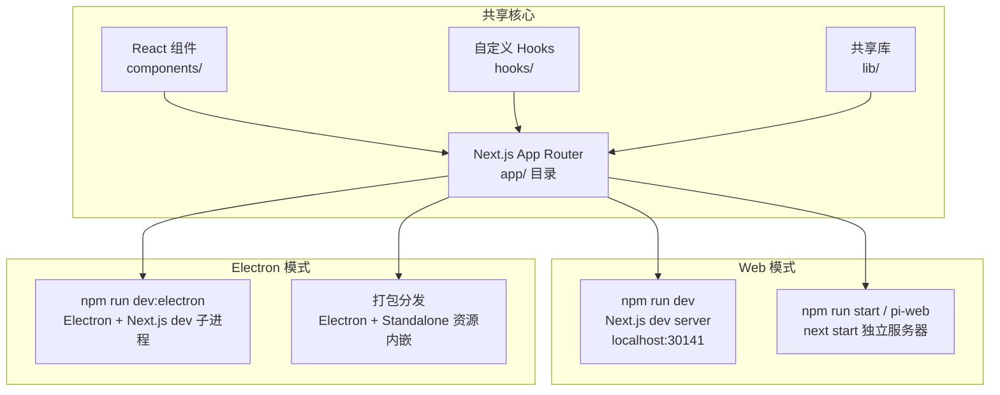
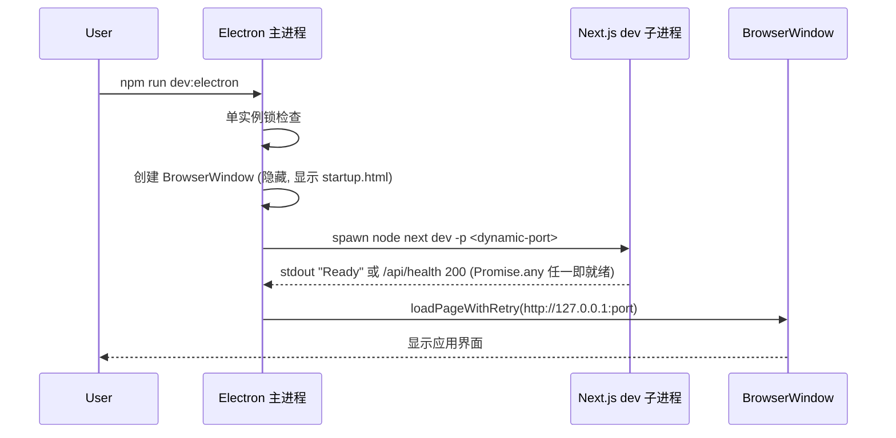
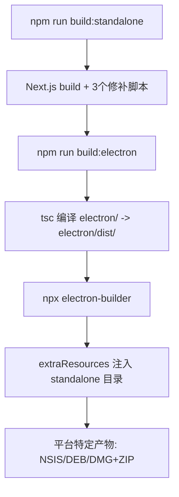

Pi Agent Desktop 采用 **双模式架构**：既可作为 **Web 应用** 在浏览器中运行（开发模式与生产独立服务器模式），也可作为 **Electron 桌面应用** 运行（开发模式与打包分发模式）。两种模式共享同一套 Next.js 代码库，通过不同的启动入口与进程编排实现差异化体验。

## 架构总览



Sources: [package.json](package.json#L1-L81), [electron/main.ts](electron/main.ts#L1-L200), [bin/pi-web.js](bin/pi-web.js#L1-L74)

## 模式对比表

| 维度 | Web 开发模式 | Web 生产模式 | Electron 开发模式 | Electron 生产模式 |
|------|-------------|-------------|------------------|------------------|
| **启动命令** | `npm run dev` | `npm run start` / `pi-web` | `npm run dev:electron` | 安装包 / `npm run dist` |
| **端口** | 固定 30141 | 30141（`start` 脚本写死；`pi-web` 支持 `-p`/`PORT`） | 动态分配 (避免冲突) | 动态分配 |
| **进程模型** | 单进程 Next.js | 单进程 Node.js | Electron 主进程 + Next.js 子进程 | Electron 主进程 + Utility/子进程 |
| **访问方式** | 浏览器 http://localhost:30141 | 浏览器 / 反向代理 | 原生窗口 (隐藏标题栏) | 原生窗口 + 系统托盘 |
| **CSP 策略** | Middleware 注入 | Middleware 注入 | 主进程动态注入 (含端口) | 主进程动态注入 |
| **热重载** | Turbopack 全量 | 不支持 | Turbopack + 窗口保持 | 不支持 |
| **原生能力** | 无 | 无 | 文件选择、托盘、自动更新 | 完整原生能力 |
| **适用场景** | UI 快速迭代、CI 测试 | 服务器部署、远程访问 | 桌面端功能调试 | 最终用户分发 |

Sources: [package.json](package.json#L10-L30), [electron/main.ts](electron/main.ts#L100-L180), [middleware.ts](middleware.ts#L1-L64)

---

## Web 模式详解

### 开发模式 (`npm run dev`)

```bash
npm run dev
# 等价于: next dev -p 30141
```

- **固定端口 30141**：避免与其他服务冲突，便于前后端联调
- **Turbopack 编译**：Next.js 16 默认启用，增量编译速度极快
- **中间件生效**：`middleware.ts` 对 `/api/*` 进行 Origin 检查，页面注入 CSP
- **允许的跨域来源**：`allowedDevOrigins` 配置了 `127.0.0.1`、`localhost`、`192.168.*.*` 以支持局域网调试

Sources: [package.json](package.json#L14), [next.config.ts](next.config.ts#L1-L43), [middleware.ts](middleware.ts#L1-L64)

### 生产独立服务器模式 (`npm run start` / `pi-web`)

`npm run start` 与 `pi-web` 均实际执行 `next start`，使用常规 `.next` 构建产物；`npm run build:standalone` 产出的 **Standalone 输出** (`.next/standalone/`) —— 最小化 `server.js` 入口、仅运行时必要的 `node_modules` 依赖闭包、静态资源 (`.next/static/`) 与 `public/` 目录 —— 仅在 Electron 打包模式下由主进程托管运行。

```bash
# 构建
npm run build:standalone

# 启动 (两种方式等价)
npm run start                    # next start -p 30141
npx pi-web                       # bin/pi-web.js 以 node 直接调用 next start
```

**`pi-web` 二进制优势**：
- 直接用 `process.execPath` 运行 `next/dist/bin/next`，规避 `.bin` 软链接与 Windows 路径空格问题
- 检测到 `Ready` 日志后自动打开浏览器 (跨平台 `start`/`open`/`xdg-open`)
- 标准输出透传，便于 systemd/PM2 托管

Sources: [package.json](package.json#L14-L18), [bin/pi-web.js](bin/pi-web.js#L1-L74), [next.config.ts](next.config.ts#L1-L43)

### Standalone 运行时修补脚本

生产构建需经历三个修补步骤，确保依赖闭包完整：

| 脚本 | 作用 | 关键细节 |
|------|------|----------|
| `ensure-standalone-next-runtimes.mjs` | 补全 Turbopack 运行时 | 将 `next/dist/compiled/next-server/*turbo*.runtime.prod.js` 复制到 standalone |
| `ensure-standalone-pi-runtime.mjs` | 补全 Pi 运行时依赖闭包 | BFS 遍历 `@earendil-works/pi-coding-agent` 与 `pi-ai` 的 `dependencies`/`optionalDependencies`/`peerDependencies`，保持 `node_modules` 目录结构 |
| `ensure-standalone-macos-universal-runtimes.mjs` | macOS 双架构原生模块 | Sharp (`@img/sharp-darwin-{arm64,x64}`) 与 esbuild (`@esbuild/darwin-{arm64,x64}`) 双架构并存；通过 `npm pack` 获取缺失架构包，恢复 esbuild 便携 CLI |

Sources: [scripts/ensure-standalone-next-runtimes.mjs](scripts/ensure-standalone-next-runtimes.mjs#L1-L49), [scripts/ensure-standalone-pi-runtime.mjs](scripts/ensure-standalone-pi-runtime.mjs#L1-L93), [scripts/ensure-standalone-macos-universal-runtimes.mjs](scripts/ensure-standalone-macos-universal-runtimes.mjs#L1-L200)

---

## Electron 模式详解

### 开发模式 (`npm run dev:electron`)

```bash
npm run dev:electron
# 顺序执行:
# 1. tsc -p electron/tsconfig.json  -> electron/dist/
# 2. 复制 startup.html/startup.js 到 electron/dist/
# 3. npx electron .
```

**进程编排流程**：



**关键差异点**：
- **动态端口分配**：`choosePort()` 从 30141 开始尝试，避免与并行的 `npm run dev` 冲突
- **启动等待界面**：`startup.html` 提供三态可视化反馈 (starting/error/stopped)，含涟漪动画与错误状态
- **就绪检查**：开发模式下 "Ready" 标准输出 **或** HTTP `/api/health` 任一通过（`Promise.any`）；生产模式仅认 HTTP
- **进程监控与自愈**：`restart-policy.ts` 限制 60 秒内最多 3 次重启，超限显示停止态
- **CSP 动态注入**：`mainWindow.webContents.session.webRequest.onHeadersReceived` 读取 `activePort` 注入 `connect-src ws://127.0.0.1:<port>`

Sources: [package.json](package.json#L28), [electron/main.ts](electron/main.ts#L100-L180), [electron/server-wait.ts](electron/server-wait.ts#L1-L229), [electron/navigation.ts](electron/navigation.ts#L1-L137), [electron/startup.html](electron/startup.html#L1-L200)

### 生产打包模式 (`npm run dist` / `npm run dist:mac`)

**构建流水线**：



**electron-builder 关键配置** (`electron-builder.yml`)：

```yaml
# 核心资源打包（陷阱：第一条 standalone 必须显式排除 node_modules，再单独拷贝）
files:
  - package.json
  - electron/dist/**/*
extraResources:
  - from: .next/standalone
    to: standalone
    filter:
      - "**/*"
      - "!node_modules"   # filter:["**/*"] 会静默排除 node_modules
      - "!release"
      - "!.git"
      - "!**/*.test.ts"
  - from: .next/standalone/node_modules   # 必须与上一项拆开，否则运行时缺依赖
    to: standalone/node_modules
  - from: .next/static
    to: standalone/.next/static
  - from: public
    to: standalone/public
  - from: node_modules/electron-updater   # asar 内主进程更新依赖，另列 extraResources
    to: app/node_modules/electron-updater
  # 以及 builder-util-runtime / fs-extra / graceful-fs / jsonfile / js-yaml /
  # lazy-val / lodash.* / semver / tiny-typed-emitter / universalify / debug / sax / argparse / ms
```

**macOS Universal 双架构特殊处理**：
- `x64ArchFiles` 指定 Sharp、esbuild、clipboard、pi-tui 原生模块**不进行 lipo 合并**，保持双架构并存
- 运行时由 Node.js 加载器根据 `process.arch` 自动选择对应 `.node`/`.dylib`
- `@electron/universal` 合并时通过 brace pattern 识别 `standalone{,/.next}/**` 路径

**打包后验证**：`smoke-packaged-standalone.mjs` 定位打包产物，复用 `smoke-standalone-server.mjs` 启动独立服务器并校验 `/api/health`、`/api/sessions`、`/api/auth/providers` 与 HTML 导出功能。

Sources: [electron-builder.yml](electron-builder.yml#L1-L133), [scripts/smoke-packaged-standalone.mjs](scripts/smoke-packaged-standalone.mjs#L1-L82), [scripts/smoke-standalone-server.mjs](scripts/smoke-standalone-server.mjs#L1-L202)

---

## 环境变量与配置差异

| 变量 | Web Dev | Web Prod | Electron Dev | Electron Prod | 说明 |
|------|---------|----------|--------------|---------------|------|
| `PORT` | 30141 (固定) | 30141（仅 `pi-web` 尊重 `PORT`/`-p`） | 动态分配 | 动态分配 | Next.js 监听端口 |
| `NODE_ENV` | development | production | development | production | 影响日志、错误堆栈 |
| `NEXT_TELEMETRY_DISABLED` | 未设置 | 未设置 | 1 | 未设置 | 禁用 Next.js 遥测（仅 Electron dev 启动 Next 子进程时设置） |
| `PI_CODING_AGENT_DIR` | 未设置 | 未设置 | 未设置 | 未设置 | 会话存储根目录；Electron 主进程不注入（serverEnv 仅透传 pickApiKeys 结果 + NODE_ENV + PORT + HOSTNAME） |
| `ELECTRON_RUN_AS_NODE` | - | - | - | 非 macOS 时=1 | 让 Electron 二进制作为 Node 运行器启动 server.js |
| API Keys | 继承进程环境 | 继承进程环境 | `pickApiKeys()` 过滤 | `pickApiKeys()` 过滤 | 仅透传 `ANTHROPIC_API_KEY` 等白名单 |

Sources: [electron/main.ts](electron/main.ts#L100-L160), [electron/env-filter.ts](electron/env-filter.ts#L1-L28), [next.config.ts](next.config.ts#L1-L43)

---

## 常见问题排查

| 现象 | 可能原因 | 定位步骤 |
|------|----------|----------|
| `npm run dev:electron` 窗口停留在"正在启动" | Next.js 子进程启动失败或端口被占用 | 查看 `~/Library/Logs/Pi Agent Desktop/main.log` (macOS) 或 `%APPDATA%/Pi Agent Desktop/logs/main.log` (Windows) |
| 打包应用闪退 | Standalone 依赖缺失 (Turbopack runtime / Pi runtime / Sharp 双架构) | 运行 `npm run build:standalone` 后检查 `.next/standalone/node_modules` 是否含 `*turbo*.runtime.prod.js` 与 `@earendil-works/pi-*` |
| Web 页面白屏 | CSP 违规阻断脚本加载 | 浏览器控制台查看 CSP 报错；对比 `middleware.ts` 与 `electron/csp.ts` 生成的策略 |
| `pi-web` 提示 "Build artifacts not found" | 未执行构建（缺少 `.next` 目录） | 确认 `.next` 目录存在（可先运行 `npm run build:standalone`） |
| macOS Universal 安装包在 Apple Silicon 上无法启动 | `x64ArchFiles` 配置遗漏导致 lipo 破坏原生模块 | 检查 `electron-builder.yml` 中 `x64ArchFiles` 是否包含所有 `@img/sharp-darwin-*` 与 `@esbuild/darwin-*` |

Sources: [electron/main.ts](electron/main.ts#L400-L500), [electron/log-format.ts](electron/log-format.ts), [scripts/ensure-standalone-next-runtimes.mjs](scripts/ensure-standalone-next-runtimes.mjs), [electron-builder.yml](electron-builder.yml#L100-L133)

---

## 下一步阅读建议

- **[目录结构与核心模块](4-mu-lu-jie-gou-yu-he-xin-mo-kuai)** — 了解代码库分层与核心模块职责
- **[技术栈与关键依赖](5-ji-zhu-zhan-yu-guan-jian-yi-lai)** — 掌握 Next.js、Electron、Pi SDK 版本约束与升级策略
- **[Electron 主进程启动链与双门槛就绪检查](10-electron-zhu-jin-cheng-qi-dong-lian-yu-shuang-men-jian-jiu-xu-jian-cha)** — 深入 Electron 进程编排、启动界面状态机与自愈机制
- **[打包构建流程与 macOS Universal 双架构处理](11-da-bao-gou-jian-liu-cheng-yu-macos-universal-shuang-jia-gou-chu-li)** — 详细构建流水线、electron-builder 配置与双架构原生模块方案