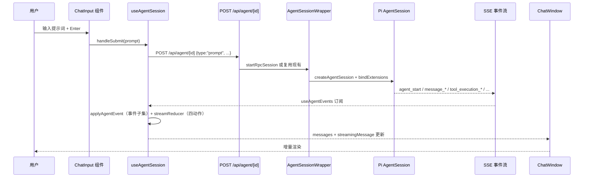
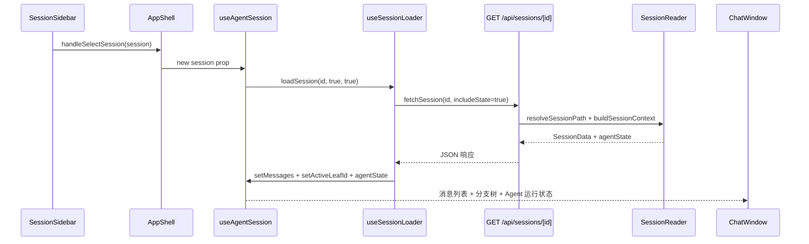

本文档系统梳理 pi-agent-desktop 的代码库拓扑，定位核心模块职责边界，建立从目录到架构的心智映射。作为**快速开始**阶段的第四站，它为后续深度解读（四层架构、AgentSession 生命周期、Electron 启动链等）提供导航坐标。

## 一、 顶层目录拓扑

```
pi-agent-desktop/
├── app/                    # Next.js App Router：页面、API 路由、全局布局
├── bin/                    # CLI 入口（pi-web.js）
├── build/                  # 打包产物资源（图标、NSIS 安装脚本）
├── components/             # 客户端 React 组件库（UI 与交互）
├── electron/               # Electron 主进程、Preload、启动页、系统托盘
├── hooks/                  # 客户端 React Hooks（状态、交互、生命周期）
├── lib/                    # 运行时核心库（会话、Agent、MCP、LTM、RPC、策略）
├── scripts/                # 构建/打包/冒烟测试工具链
├── docs/                   # 文档站点（纯静态 HTML，无静态站点框架）
├── public/                 # 静态资源
├── .github/                # CI/CD 工作流、Issue/PR 模板
├── .agents/                # 代理协作元数据（本项目特有）
└── 配置文件                # package.json, tsconfig.json, next.config.ts, tailwind.config.ts 等
```

Sources: [package.json](package.json#L1-L81), [.gitignore](.gitignore#L1-L46)

> **架构视角**：逻辑四层是 **浏览器 / Next.js 服务端 / SDK / 文件系统**。桌面模式下 Electron 主进程 (`electron/main.ts`) 托管 Next standalone，负责原生窗口、进程管理、自动更新、系统托盘；不要用 Electron/Next/React/Pi 切面替换那四层。前端通过 `fetch`/SSE 与 Next API 通信，而非 `electron-next` 模板。

## 二、 核心目录深度剖析

### 2.1 `app/` — Next.js 应用层

| 子目录 | 职责 | 关键文件 |
|--------|------|----------|
| `app/api/agent/[id]/` | Agent 命令收发：`POST /api/agent/[id]`（含 `fork` 等，无 `/command` 子路径） | `route.ts` |
| `app/api/sessions/` | 会话列表、读取、跨文件 Branch、Clone、导出、删除；信任不在此组 | 多个路由文件 |
| `app/api/trust/` | 项目信任握手（`GET`/`POST /api/trust`） | `route.ts` |
| `app/api/mcp/` | MCP 服务器配置 CRUD、连接测试、开关 | 多个路由文件 |
| `app/api/memory/` | 长期记忆（LTM）的增删改查、统计、观测钩子 | 多个路由文件 |
| `app/api/models-config/` | 模型提供商配置、OAuth/API Key、思考等级映射 | 多个路由文件 |
| `app/api/extensions/` | 扩展/Skill 的 toggle/add/remove 配置（**不是** Extension UI Bridge） | `route.ts` |
| `app/api/skills/` | 技能策略配置、启用/禁用、搜索安装 | 多个路由文件 |
| `app/api/usage/upstream/` | 上游额度查询 | `route.ts` |
| `app/api/statusline/` | Git 状态栏 | `route.ts` |
| `app/layout.tsx` | 根布局：字体、主题、I18nProvider、全局错误上报 | `layout.tsx` |
| `app/page.tsx` | 入口页：挂载 `AppShell` 组件 | `page.tsx` |

Sources: [app/layout.tsx](app/layout.tsx#L1-L48), [app/page.tsx](app/page.tsx#L1-L11), [app/api/agent/[id]/route.ts](app/api/agent/%5Bid%5D/route.ts#L1-L81)

> **设计模式**：API Routes 遵循 **薄控制器** 原则——仅做参数校验、鉴权、错误包装，核心逻辑下沉到 `lib/`。错误经 `jsonError` 返回 `{ error, errorCode? }` 并带 `x-request-id`。成功体各异：Agent `POST` 用 `{ success: true, data }`，其它路由不必套同一形状。前端通过 `lib/agent-client.ts` 发 Agent 命令（目标仍是 `POST /api/agent/[id]`）。

### 2.2 `electron/` — 桌面主进程层

| 文件 | 核心职责 |
|------|----------|
| `main.ts` | 单实例锁、窗口生命周期、Next.js 服务器进程托管（开发/生产双模式）、端口选取、启动页状态机、崩溃恢复、重启策略、自动更新门控、CSP 头构建、系统托盘 |
| `preload.ts` | Context Bridge 暴露安全 API 给渲染进程 |
| `server-process.ts` | 统一子进程/UtilityProcess 封装，跨平台优雅关闭 |
| `server-wait.ts` | 就绪检查：stdout "Ready" + 轮询 HTTP /api/health（dev 任一通过，打包仅 HTTP） |
| `restart-policy.ts` / `crash-recovery.ts` | 固定 60 秒滑动窗口最多 3 次重启、崩溃后自动恢复 |
| `update-install-gate.ts` | 更新下载后“安装并重启”的用户确认闸门 |
| `tray.ts` | 系统托盘菜单、窗口显隐切换 |

Sources: [electron/main.ts](electron/main.ts#L1-L200), [electron/server-process.ts](electron/server-process.ts#L1-L50), [electron/server-wait.ts](electron/server-wait.ts#L1-L50)

> **关键架构决策**：生产环境 macOS 使用 `utilityProcess.fork` 运行 Next.js 独立服务器，避免 Dock 栏出现第二个弹跳图标；Windows/Linux 使用 `spawn(process.execPath, [serverScript], { env: { ELECTRON_RUN_AS_NODE: 1 } })`。详见 [Electron 主进程启动链与双门槛就绪检查](10-electron-zhu-jin-cheng-qi-dong-lian-yu-shuang-men-jian-jiu-xu-jian-cha)。

### 2.3 `components/` — 客户端 UI 组件库

```
components/
├── AppShell.tsx              # 根布局：左侧栏、右侧面板、顶栏、分支导航、模态框编排
├── ChatWindow.tsx            # 聊天主区：消息列表、输入流、思考球、执行计划条
├── SessionSidebar.tsx        # 会话列表、新建、搜索、收藏、导出
├── FileExplorer.tsx / FileViewer.tsx  # 文件树与虚拟化大文件查看器
├── MessageView.tsx           # 单条消息渲染（Markdown、代码高亮、工具调用展开）
├── AgentThinkingOrb.tsx      # WebGPU 液态思考球（失败时 CSS span 降级）
├── LiquidOrbCanvas.tsx       # 着色器渲染入口
├── ModelsConfig.tsx          # 模型配置模态框
├── SkillsConfig.tsx          # 技能配置模态框
├── ExtensionsConfigModal.tsx # 扩展/Skill 启用与安装（非 UI Bridge）
├── McpConfigModal.tsx        # MCP 服务器管理
├── BranchNavigator.tsx       # 会话分支树可视化
├── BranchCloneModal.tsx      # Fork/分支/Worktree 克隆向导
├── chat-input/               # 输入区子系统：附件、模型选择、预设、思考等级
├── models-config/            # 模型配置子组件
├── session-sidebar/          # 侧边栏子组件
└── *.test.ts                 # 组件测试共置
```

Sources: [components/AppShell.tsx](components/AppShell.tsx#L1-L200), [components/ChatWindow.tsx](components/ChatWindow.tsx#L1-L50), [components/SessionSidebar.tsx](components/SessionSidebar.tsx#L1-L50)

> **组件设计原则**：
> - **容器/展示分离**：`AppShell`、`ChatWindow` 为容器，`MessageView`、`FileViewer` 为纯展示
> - **Ref 转发命令式句柄**：`ChatInput` 暴露 `focus`、`clear`、`setValue` 供父组件编排
> - **虚拟化优先**：`FileViewer` 用窗口虚拟化读大文件；`MessageList` 全量 `map` + CSS `content-visibility: auto`，不是 windowing

### 2.4 `hooks/` — 客户端状态与交互逻辑

| Hook 模块 | 核心职责 |
|-----------|----------|
| `useAgentSession.ts` | **主 Hook**（803 行）：组合 5 个子 Hook（`useSessionLoader`、`useAgentEvents`、`useSessionCommands`、`useSessionModelTools`、`useChatScroll`）+ ~10 个纯模块 |
| `agent-session/use-session-loader.ts` | 会话元数据与上下文加载（最新请求胜出守卫） |
| `agent-session/stream-state.ts` | 流式消息最小状态机（仅 start/update/end/reset，不覆盖全部 SSE 事件） |
| `agent-session/agent-event-apply.ts` | 对客户端 `AgentEvent`（约 20 种）的子集做纯函数归约 |
| `agent-session/use-agent-events.ts` | SSE 事件流订阅与心跳 |
| `agent-session/use-session-commands.ts` | 发送 Agent 命令的统一封装（`POST /api/agent/[id]`） |
| `agent-session/use-session-model-tools.ts` | 模型/工具/预设选择 |
| `agent-session/use-chat-scroll.ts` | 对话滚动与锚点 |
| `usePanelLayout.ts` | 面板拖拽调宽、响应式收纳、窗口 resize 同步（主题/语言/面板宽度走 localStorage，不写 `desktop-settings`） |
| `useFileTabs.ts` | 右侧文件标签页状态管理 |
| `useTheme.ts` | 主题切换（hooks/ 下无 `useI18n.ts`，`useI18n` 由 `components/I18nProvider.tsx` 导出） |
| `useAudio.ts` / `useUpstreamUsage.ts` | 提示音；上游额度轮询 |
| `useDragDrop.ts` / `useDismissOnOutsideClick.ts` | 通用交互原语 |

Sources: [hooks/useAgentSession.ts](hooks/useAgentSession.ts#L1-L200), [hooks/agent-session/use-session-loader.ts](hooks/agent-session/use-session-loader.ts#L1-L121), [hooks/agent-session/stream-state.ts](hooks/agent-session/stream-state.ts#L1-L32), [hooks/usePanelLayout.ts](hooks/usePanelLayout.ts#L1-L97)

> **Hook 拆分策略**：`useAgentSession` 803 行，通过 **5 个子 Hook + 纯模块** 垂直切分。详见 [useAgentSession 主 Hook 与子 Hook 拆分策略](22-useagentsession-zhu-hook-yu-zi-hook-chai-fen-ce-lue)。

### 2.5 `lib/` — 运行时核心库（后端与共享逻辑）

这是**业务逻辑的重心**，按领域划分为以下子系统：

#### 2.5.1 会话与分支子系统
| 文件 | 职责 |
|------|------|
| `session-reader.ts` | 会话列表扫描、路径缓存、首行读取、树构建、上下文投影 |
| `session-reader.ts` | `listAllSessions`、`resolveSessionPath`、`buildTree`、`buildSessionContext` |
| `session-lock.ts` | 基于文件锁的并发保护（Windows 兼容） |
| `session-branch-clone.ts` | 分支/克隆 payload 校验与 header 构造（Fork 命令逻辑在 `rpc-manager.ts`） |
| `session-cascade.ts` | 级联删除（父会话删除时递归清理子会话） |
| `session-export.ts` | 会话导出（HTML/Markdown） |
| `session-path-cache.ts` | 正/负缓存 + TTL，规避热重载下的假 404 |
| `fork-session-wait.ts` | Fork 后等待新会话文件落盘 |

Sources: [lib/session-reader.ts](lib/session-reader.ts#L1-L200), [lib/session-lock.ts](lib/session-lock.ts#L1-L50), [lib/session-branch-clone.ts](lib/session-branch-clone.ts#L1-L50)

#### 2.5.2 Agent 运行时与 RPC 子系统
| 文件 | 职责 |
|------|------|
| `pi-runtime.ts` | `createPiRuntime` 必须再走 `createAgentSessionServices`（扩展注册的模型才会进选择器） |
| `rpc-manager.ts` | `AgentSessionWrapper`：生命周期、策略初始化、工具集动态切换、Extension UI Bridge 集成、LTM 观测钩子、Follow-up Queue、Codemode 切换 |
| `agent-client.ts` | 客户端统一发送命令的 fetch 封装 |
| `agent-commands.ts` | 命令类型定义与校验（`prompt`、`set_tools`、`set_agent_mode` 等） |
| `approval-policy.ts` | AgentMode (plan/ask/full) + ToolPreset → 生效工具集、Ask 确认判定 |
| `desktop-approval-extension.ts` | 内联审批扩展：Plan 模式只读、Ask 模式确认、Full 模式直通 |
| `desktop-runtime-tools.ts` | 按 mode/preset **过滤**已注册工具名（叠加 MCP / `tool_search` / `codemode`）；不注入 bash/git/文件工具 |

Sources: [lib/pi-runtime.ts](lib/pi-runtime.ts#L1-L116), [lib/rpc-manager.ts](lib/rpc-manager.ts#L1-L200), [lib/agent-client.ts](lib/agent-client.ts#L1-L30), [lib/approval-policy.ts](lib/approval-policy.ts#L1-L86)

> **RPC 管理器核心模式**：
> - **会话复用**：`getRpcSession(id)` 若存活直接复用，避免重复启动 Pi AgentSession
> - **策略热切换**：`applyAgentMode` 动态调用 `inner.setActiveToolsByName`，无需重启会话
> - **Extension UI Bridge**：SSE `extension_ui_request` 下发，Agent 命令 `extension_ui_response` 回收（走 `POST /api/agent/[id]`，不是 `/api/extensions`）

#### 2.5.3 MCP 双级配置子系统
| 文件 | 职责 |
|------|------|
| `mcp-config.ts` | 全局 `~/.pi/agent/mcp.json` + 项目 `<cwd>/.pi/mcp.json`；支持 Streamable HTTP **与** stdio；拒绝遗留 SSE |

Sources: [lib/mcp-config.ts](lib/mcp-config.ts#L1-L200)

> **双级合并规则**：项目级同 `id` 覆盖全局级；未受信项目仅加载全局配置。详见 [MCP 服务器双级配置与管理 UI](19-mcp-fu-wu-qi-shuang-ji-pei-zhi-yu-guan-li-ui)。

#### 2.5.4 长期记忆 (LTM) 子系统
| 文件 | 职责 |
|------|------|
| `ltm/service.ts` | `MemoryService` 单例：remember/recall/observe/forget/stats，SQLite 后端 |
| `ltm/sqlite-backend.ts` | FTS5 全文检索；CJK supersede 用 Dice（`ltm/jaccard.ts`）、拉丁词用 Jaccard |
| `ltm/observe-hooks.ts` | `agent_end`/`pre_compact` 观测钩子 → 自动提取记忆 |
| `ltm/config.ts` | 启用开关、数据库路径、观测策略配置 |
| `ltm/types.ts` | MemoryType (pattern/preference/architecture/bug/workflow/fact)、RecallHit、ObserveInput |

Sources: [lib/ltm/service.ts](lib/ltm/service.ts#L1-L200), [lib/ltm/sqlite-backend.ts](lib/ltm/sqlite-backend.ts#L1-L50), [lib/ltm/observe-hooks.ts](lib/ltm/observe-hooks.ts#L1-L50)

> **观测钩子模式**：Pi AgentSession 在 `agent_end`、`pre_compact` 时回调 `observe`，由桌面端注入 `desktopLtmInlineExtension` 实现。详见 [长期记忆：SQLite 后端、观测钩子与检索 API](18-chang-qi-ji-yi-sqlite-hou-duan-guan-ce-gou-zi-yu-jian-suo-api)。

#### 2.5.5 其它核心模块
| 文件 | 职责 |
|------|------|
| `extension-ui-bridge.ts` | Extension UI 请求/响应/通知的内存队列与超时/AbortSignal 支持 |
| `follow-up-queue.ts` | 基于 revision 的乐观并发队列（`QueuedFollowUp`：id/message/images/createdAt） |
| `project-trust-desktop.ts` | 409 信任握手、session-only 临时信任（Map 存于 `rpc-manager.ts` 的 `__piSessionOnlyTrust`） |
| `agent-mode-persistence.ts` | 会话级 AgentMode 落盘与恢复（`findLastAgentMode`） |
| `skills-policy.ts` | 技能启用/禁用策略、工具暴露控制 |
| `desktop-settings.ts` | 持久化 `defaultAgentMode`、`defaultToolPreset`、`codemodeEnabled`、`ltm`；主题/语言/面板宽度在 localStorage / `usePanelLayout` |
| `trust-fetch.ts` / `trust-types.ts` | 409 needsTrust 重试封装 `ensureTrustThenFetch` 与信任类型定义 |
| `types.ts` | 核心领域类型（SessionHeader、AgentMessage、SessionEntry 等） |

Sources: [lib/extension-ui-bridge.ts](lib/extension-ui-bridge.ts#L1-L200), [lib/follow-up-queue.ts](lib/follow-up-queue.ts#L1-L50), [lib/project-trust-desktop.ts](lib/project-trust-desktop.ts#L1-L50), [lib/types.ts](lib/types.ts#L1-L200)

## 三、 模块交互架构图

```mermaid
graph TB
    subgraph Electron_Main["Electron 主进程"]
        Main[main.ts<br/>窗口/进程/托盘/更新]
        Preload[preload.ts<br/>Context Bridge]
        ServerProc[server-process.ts<br/>子进程统一封装]
        ServerWait[server-wait.ts<br/>stdout Ready + HTTP /api/health]
        Restart[restart-policy.ts<br/>60s 窗口限 3 次重启]
        Crash[crash-recovery.ts<br/>崩溃恢复]
    end

    subgraph NextJS_Server["Next.js 服务端 (Port 30141)"]
        API_Agent[/api/agent/[id]/]
        API_Sessions[/api/sessions/]
        API_MCP[/api/mcp/]
        API_Memory[/api/memory/]
        API_Models[/api/models-config/]
        API_Ext[/api/extensions/]
        API_Usage[/api/usage/upstream/]
        API_Status[/api/statusline/]
        API_Trust[/api/trust/]
    end

    subgraph Lib_Core["lib/ 核心库 (共享/服务端)"]
        PiRuntime[pi-runtime.ts<br/>ModelRuntime 工厂]
        RPCMgr[rpc-manager.ts<br/>AgentSessionWrapper]
        SessionReader[session-reader.ts<br/>会话索引/投影]
        SessionLock[session-lock.ts<br/>文件锁]
        BranchClone[session-branch-clone.ts<br/>Branch/Clone payload]
        MCPConfig[mcp-config.ts<br/>双级配置合并]
        LTM[ltm/service.ts<br/>MemoryService 单例]
        ExtBridge[extension-ui-bridge.ts<br/>异步 RPC 桥]
        FollowUp[follow-up-queue.ts<br/>Revision 并发队列]
        Trust[project-trust-desktop.ts<br/>409 信任握手]
        Approval[approval-policy.ts<br/>Mode+Preset→Tools]
        DesktopExt[desktop-approval-extension.ts<br/>内联审批]
        DesktopTools[desktop-runtime-tools.ts<br/>按 mode/preset 过滤工具名]
    end

    subgraph Client_UI["客户端 React"]
        AppShell[AppShell.tsx<br/>根布局编排]
        ChatWindow[ChatWindow.tsx<br/>消息流/输入/思考球]
        SessionSidebar[SessionSidebar.tsx<br/>会话树/搜索/导出]
        FileViewer[FileViewer.tsx<br/>虚拟化查看器]
        ThinkingOrb[AgentThinkingOrb.tsx<br/>WebGPU / CSS fallback]
        Hooks_Main[useAgentSession.ts<br/>主 Hook 聚合器]
        Hooks_Sub[agent-session/*.ts<br/>子 Hook 垂直切分]
        PanelLayout[usePanelLayout.ts<br/>拖拽/响应式]
        FileTabs[useFileTabs.ts<br/>标签页状态]
    end

    %% Electron -> Next.js
    Main -->|spawn/utilityProcess| NextJS_Server
    ServerWait -.->|stdout Ready / HTTP /api/health| Main
    Restart -.->|60s 窗口限 3 次| Main
    Crash -.->|自动恢复| Main

    %% Next.js API -> lib
    API_Agent --> RPCMgr
    API_Sessions --> SessionReader
    API_Sessions --> BranchClone
    API_Sessions --> SessionLock
    API_MCP --> MCPConfig
    API_Memory --> LTM
    API_Ext --> ExtConfig[extensions-config.ts]
    API_Trust --> Trust

    %% RPCMgr -> PiRuntime + Extensions
    RPCMgr --> PiRuntime
    RPCMgr --> DesktopExt
    RPCMgr --> DesktopTools
    RPCMgr --> ExtBridge
    RPCMgr --> FollowUp
    RPCMgr --> LTM
    RPCMgr --> Approval

    %% Client -> API
    Hooks_Main -->|fetch| API_Agent
    Hooks_Main -->|fetch| API_Sessions
    Hooks_Main -->|SSE| API_Agent
    Hooks_Sub -.-> Hooks_Main
    AppShell --> ChatWindow
    AppShell --> SessionSidebar
    AppShell --> FileViewer
    ChatWindow --> ThinkingOrb
    ChatWindow --> Hooks_Main
    SessionSidebar --> Hooks_Main
```

## 四、 核心模块职责对照表

| 领域 | 核心模块 | 入口文件 | 关键导出 | 依赖上游 |
|------|----------|----------|----------|----------|
| **会话持久化** | SessionReader | `lib/session-reader.ts` | `listAllSessions`, `resolveSessionPath`, `buildTree`, `buildSessionContext` | `@earendil-works/pi-coding-agent` |
| **会话并发控制** | SessionLock | `lib/session-lock.ts` | `withFileLock` | `fs/promises` |
| **分支与克隆** | SessionBranchClone | `lib/session-branch-clone.ts` | `validateBranchPayload`, `validateClonePayload`, `extractAncestryPath`, `createBranchedHeader`, `createClonedHeader` | `lib/git-worktree.ts` |
| **Agent 运行时** | PiRuntime | `lib/pi-runtime.ts` | `createPiRuntime`, `listOAuthProviders`, `loginProvider` | `@earendil-works/pi-coding-agent` |
| **RPC 会话管理** | RPCManager | `lib/rpc-manager.ts` | `AgentSessionWrapper`, `startRpcSession`, `getRpcSession` | `PiRuntime`, `ExtBridge`, `FollowUp`, `LTM` |
| **审批策略** | ApprovalPolicy | `lib/approval-policy.ts` | `effectiveToolsForMode`, `needsAskConfirm`, `summarizeToolCall` | 纯 TS，零依赖 |
| **内联审批扩展** | DesktopApprovalExt | `lib/desktop-approval-extension.ts` | `desktopApprovalInlineExtension`, `AgentModeRef` | `ApprovalPolicy` |
| **工具名过滤** | DesktopRuntimeTools | `lib/desktop-runtime-tools.ts` | `desktopRuntimeTools` | `approval-policy`、MCP/`tool_search`/`codemode` |
| **MCP 双级配置** | MCPConfig | `lib/mcp-config.ts` | `getMcpServers`, `loadDesktopMcpConfig`, `saveMcpServer` | `@earendil-works/pi-mcp` |
| **长期记忆** | LTM Service | `lib/ltm/service.ts` | `MemoryService`, `getMemoryService` | `ltm/sqlite-backend.ts`, `ltm/observe-hooks.ts` |
| **Extension UI Bridge** | ExtUIBridge | `lib/extension-ui-bridge.ts` | `ExtensionUiBridge`, `ExtensionUiRequestEvent` | `crypto.randomUUID` |
| **Follow-up 队列** | FollowUpQueue | `lib/follow-up-queue.ts` | `FollowUpQueue`, `FollowUpQueueSnapshot` | 纯 TS，零依赖 |
| **项目信任** | ProjectTrust | `lib/project-trust-desktop.ts` | `evaluateProjectTrust`, `applyTrustDecision`（`getSessionOnlyTrustMap()` 在 `lib/rpc-manager.ts`） | `lib/trust-types.ts` |
| **主 Hook** | UseAgentSession | `hooks/useAgentSession.ts` | `useAgentSession` | 所有 `agent-session/*` 子 Hook |
| **面板布局** | PanelLayout | `hooks/usePanelLayout.ts` | `usePanelLayout` | `lib/panel-layout.js` |
| **文件标签页** | FileTabs | `hooks/useFileTabs.ts` | `useFileTabs` | 纯 React 状态 |

## 五、 关键数据流向

### 5.1 用户发送提示词 → Agent 执行 → 流式返回



Sources: [hooks/useAgentSession.ts](hooks/useAgentSession.ts#L1-L200), [lib/rpc-manager.ts](lib/rpc-manager.ts#L1-L200), [app/api/agent/[id]/route.ts](app/api/agent/%5Bid%5D/route.ts#L1-L81)

### 5.2 会话切换/加载



Sources: [hooks/agent-session/use-session-loader.ts](hooks/agent-session/use-session-loader.ts#L1-L121), [lib/session-reader.ts](lib/session-reader.ts#L1-L200)

## 六、 与后续文档的衔接

| 下一步阅读 | 核心问题 | 对应本文定位的模块 |
|------------|----------|-------------------|
| [四层分离架构详解](6-si-ceng-fen-chi-jia-gou-xiang-jie) | 浏览器 / Next.js 服务端 / SDK / 文件系统 四层如何分工？（Electron 是桌面托管切面，不是替换这四层） | `electron/`、`app/`、`lib/`、`components/`/`hooks/` |
| [AgentSession 生命周期与进程内注册表](7-agentsession-sheng-ming-zhou-qi-yu-jin-cheng-nei-zhu-ce-biao) | `AgentSessionWrapper` 如何管理生命周期、复用、销毁？ | `lib/rpc-manager.ts` |
| [SSE 事件流与流式状态机](8-sse-shi-jian-liu-yu-liu-shi-zhuang-tai-ji) | `streamReducer` 与 `useAgentEvents` 如何协同？ | `hooks/agent-session/stream-state.ts`、`hooks/agent-session/use-agent-events.ts` |
| [Electron 主进程启动链与双门槛就绪检查](10-electron-zhu-jin-cheng-qi-dong-lian-yu-shuang-men-jian-jiu-xu-jian-cha) | `main.ts` 如何编排 Next.js 服务器进程？ | `electron/main.ts`、`electron/server-wait.ts` |
| [会话的两种访问模式](9-hui-hua-de-liang-chong-fang-wen-mo-shi-zhi-du-liu-lan-yu-jiao-hu-dui-hua) | 只读浏览 vs 交互对话的数据流差异？ | `lib/session-reader.ts` vs `lib/rpc-manager.ts` |

---

**导航提示**：
- ← 上一页：[双模式开发与运行](3-shuang-mo-shi-kai-fa-yu-yun-xing) — 掌握 `npm run dev` 与 `npm run dev:electron` 的区别
- → 下一页：[技术栈与关键依赖](5-ji-zhu-zhan-yu-guan-jian-yi-lai) — 深入 `@earendil-works/pi-coding-agent` 等上游 SDK
- 📖 深度入口：[四层分离架构详解](6-si-ceng-fen-chi-jia-gou-xiang-jie) — 从目录结构跃迁到架构分层理论