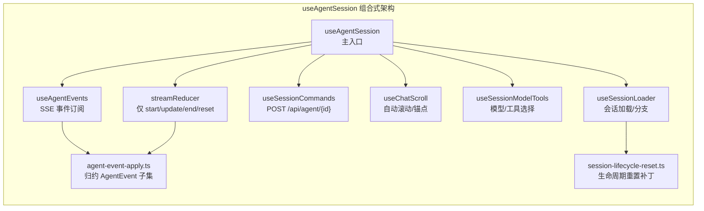

Pi Agent Desktop 是一个基于 **Electron + Next.js** 的桌面应用。架构主切面是 **浏览器层 / Next.js 服务端 / SDK / 文件系统** 四层（见 [项目概览](1-xiang-mu-gai-lan)）；Electron 是桌面托管切面（主进程托管 Next standalone），不是替换那四层。本文档系统梳理核心技术选型、关键依赖库及其在项目中的具体角色。

Sources: [package.json](package.json#L1-L81), [next.config.ts](next.config.ts#L1-L43), [electron/main.ts](electron/main.ts#L1-L200)

---

## 架构全景图

```mermaid
graph TB
    subgraph "用户交互层"
        UI[React 19 客户端组件]
        ORB[LiquidOrbCanvas WebGPU / CSS fallback]
        MD[ReactMarkdown + SyntaxHighlighter]
    end

    subgraph "状态与数据流层"
        HOOKS[useAgentSession 主 Hook]
        STREAM[streamReducer 流式状态机]
        EVENTS[useAgentEvents SSE 事件处理]
        CMD[useSessionCommands 会话命令]
    end

    subgraph "Next.js 服务端层"
        API[App Router 路由处理器（非 Server Actions）]
        MIDDLEWARE[Middleware：/api Origin 检查 + 页面 CSP]
        RUNTIME[Pi Runtime 适配器]
    end

    subgraph "Electron 主进程层"
        MAIN[main.ts 窗口/进程管理]
        PRELOAD[preload.ts 安全桥接]
        TRAY[系统托盘]
        UPDATER[electron-updater 自动更新]
        CSP[CSP 策略]
    end

    subgraph "Pi Agent 核心运行时"
        PI_CORE[@earendil-works/pi-coding-agent]
        PI_AI[@earendil-works/pi-ai]
        PI_MCP[@earendil-works/pi-mcp]
    end

    UI --> HOOKS
    HOOKS --> STREAM
    HOOKS --> EVENTS
    HOOKS --> CMD
    EVENTS --> API
    CMD --> API
    API --> RUNTIME
    RUNTIME --> PI_CORE
    PI_CORE --> PI_AI
    PI_CORE --> PI_MCP
    MAIN --> PRELOAD
    MAIN --> TRAY
    MAIN --> UPDATER
    MAIN --> CSP
    PRELOAD --> UI
    API --> MAIN
```

---

## 核心技术栈分层表

| 分层 | 技术 | 版本 | 关键作用 |
|------|------|------|----------|
| **前端框架** | React | ^19.2.4 | 并发特性、Server Components、Suspense 流式渲染 |
| **全栈框架** | Next.js | 16.3.6 | App Router 路由处理器、Standalone 输出、Turbopack；`"use server"` 未使用 |
| **桌面运行时** | Electron | ^43.7.7 | 原生窗口、进程管理、系统集成、安全沙箱 |
| **构建打包** | electron-builder | 26.15.3 | 多平台分发、macOS Universal、NSIS/Deb/DMG |
| **语言与类型** | TypeScript | 5.x | 严格模式、路径别名 `@/*`、增量编译 |
| **样式系统** | Tailwind CSS | ^4.2.2 | CSS-first 配置、设计令牌、暗色模式、Material 玻璃态 |
| **状态管理** | React Hooks + Reducer | — | useAgentSession 主 Hook、streamReducer 流式状态机 |
| **Markdown 渲染** | react-markdown + remark-gfm | 10.1.0 / 4.0.1 | GFM 表格、任务列表、自动链接 |
| **代码高亮** | react-syntax-highlighter (Prism) | 16.1.1 | Ayu 主题适配、行内/块级高亮 |
| **图标系统** | @lobehub/icons | 5.6.0 | 统一图标库、Tree-shaking 友好 |
| **字体** | next/font/google (Inter + Noto Sans Mono) | — | 构建时自托管、零网络依赖；`@fontsource/inter`/`@fontsource/jetbrains-mono` 曾以 devDependencies 声明但代码零引用，已于 2026-10-22 移除 |
| **自动更新** | electron-updater | 6.8.9 | GitHub Releases、差分更新、安装门控 |
| **测试运行器** | Node.js 原生 `node --test --test-force-exit` | 24.x | 无 ts-node/esm loader、平台子集、冒烟测试 |
| **代码规范** | ESLint 9 + Next.js 配置 | 9.x | Core Web Vitals、TypeScript、React Hooks 规则 |

Sources: [package.json](package.json#L1-L81), [tsconfig.json](tsconfig.json#L1-L45), [tailwind.config.ts](tailwind.config.ts#L1-L16), [eslint.config.mjs](eslint.config.mjs#L1-L27)

---

## 关键依赖深度解析

### 1. Pi Agent 生态核心三件套

这是整个应用的**业务核心**，所有 Agent 能力（会话管理、工具调用、模型路由、MCP 服务器）均源自这三个包：

| 包名 | 版本 | 职责 | 集成方式 |
|------|------|------|----------|
| `@earendil-works/pi-coding-agent` | ^1.1.0 | 会话生命周期、AgentSession、工具系统、权限策略、长期记忆 | `createPiRuntime` 必须再走 `createAgentSessionServices`，扩展注册的模型才会进选择器 |
| `@earendil-works/pi-ai` | ^1.1.0 | 模型提供商抽象、OAuth/API Key 认证、模型注册表 | `pi-runtime.ts` 中的 `listOAuthProviders`、`loginProvider`、`setProviderApiKey` 直接调用 |
| `@earendil-works/pi-mcp` | ^1.1.0 | MCP 服务器配置、资源/工具/提示词协议 | 双级配置（用户级 + 项目级），通过 `lib/mcp-config.ts` 管理 |

**架构关键点**：
- Next.js 配置 `serverExternalPackages` 将三包标记为外部依赖，不打包进 server bundle、运行时 require
- `outputFileTracingIncludes` 显式包含 `@earendil-works/pi-ai` 的原生资源
- `lib/pi-runtime.ts` 作为**薄适配层**：`ModelRuntime.create` 之后必须调用 `createAgentSessionServices`，再 `new ModelRegistry(services.modelRuntime)`；不要退回 create-only，否则扩展模型从选择器消失

Sources: [package.json](package.json#L49-L51), [next.config.ts](next.config.ts#L12-L14), [lib/pi-runtime.ts](lib/pi-runtime.ts#L1-L116), [lib/pi-types.ts](lib/pi-types.ts#L1-L69)

### 2. Electron 桌面运行时核心模块

`electron/main.ts` (735 行) 是主进程入口，协调以下子系统：

| 模块 | 文件 | 核心职责 |
|------|------|----------|
| **单实例锁** | `app.requestSingleInstanceLock()` | 防止多开，二次启动聚焦主窗口 |
| **窗口生命周期** | `BrowserWindow` + `startup.html` | 启动画面 → Next.js 就绪 → 无缝切换 |
| **Next.js 进程管理** | `server-process.ts`、`server-wait.ts` | Dev/Prod 双模式、端口探测、健康检查、崩溃恢复 |
| **就绪检查** | `server-wait.ts` | stdout "Ready" + 轮询 HTTP /api/health（dev 任一通过、打包仅 HTTP）；`crash-recovery.ts`/`restart-policy.ts` 为 60s 窗口最多 3 次的有界恢复（非指数退避） |
| **系统托盘** | `tray.ts` | 右键菜单、显示/隐藏、退出 |
| **自动更新** | `update-install-gate.ts` | 下载完成 → 用户确认 → `quitAndInstall` |
| **CSP 策略** | `csp.ts` | `buildElectronCspHeader` 动态生成；`script-src 'self' 'unsafe-inline' 'unsafe-eval'` |
| **Preload 桥接** | `preload.ts` | `contextBridge.exposeInMainWorld('electronAPI', ...)` 最小权限暴露 |
| **标题栏覆盖** | `title-bar-overlay.ts` | Windows/macOS 原生标题栏区域自定义、拖拽区域 |
| **环境变量过滤** | `env-filter.ts` | `pickApiKeys` 仅透传 API Key 相关变量给子进程 |
| **进程树清理** | `process-tree.ts` | `killProcessDescendants` 递归 SIGKILL、防止僵尸进程 |

Sources: [electron/main.ts](electron/main.ts#L1-L200), [electron/preload.ts](electron/preload.ts#L1-L37), [electron/csp.ts](electron/csp.ts#L1-L50), [electron/update-install-gate.ts](electron/update-install-gate.ts#L1-L100)

### 3. Next.js 服务端配置关键项

```typescript
// next.config.ts 关键配置解析
const nextConfig: NextConfig = {
  output: "standalone",                    // 独立输出，便于 Electron 打包
  turbopack: {},                           // 启用 Turbopack (Next 15+)
  serverExternalPackages: [                // 不打包进 server bundle，运行时 require
    "@earendil-works/pi-coding-agent",
    "@earendil-works/pi-ai",
    "@earendil-works/pi-mcp"
  ],
  allowedDevOrigins: ["127.0.0.1", "localhost", "192.168.*.*"], // 开发跨域
  outputFileTracingIncludes: {             // 包含 pi-ai 原生资源
    "/*": ["./node_modules/@earendil-works/pi-ai/**/*"]
  },
  outputFileTracingExcludes: {             // 排除测试/构建产物
    '*': ['release/**/*', '.git/**/*', 'dist/**/*', '**/*.test.ts', ...]
  },
  env: {                                   // 注入构建时版本号
    NEXT_PUBLIC_APP_VERSION: version,
    NEXT_PUBLIC_PI_VERSION: piVersion,
  },
};
```

Sources: [next.config.ts](next.config.ts#L1-L43)

### 4. 前端渲染与交互核心库

| 领域 | 库/实现 | 关键特性 |
|------|---------|----------|
| **思考动画** | `LiquidOrbCanvas` + WebGPU / CSS 降级 | `navigator.gpu.requestAdapter()` → Shader 编译 → `requestAnimationFrame` 循环；失败则隐藏 canvas 用 CSS span；`prefers-reduced-motion`、IntersectionObserver |
| **Markdown** | `react-markdown` + `remark-gfm` | GFM 表格、删除线、任务列表、自动链接；`components/message-content.ts` 预处理图片/思考块 |
| **代码高亮** | `react-syntax-highlighter` (Prism) | `ayuLightSyntaxTheme`/`ayuDarkSyntaxTheme` 双主题、`lib/ayu-syntax-theme.ts` 定制 |
| **虚拟化列表** | `file-viewer-virtualization.ts` + `FileViewer.tsx` | `FileViewer.tsx` 内 Myers diff 行级对比、`getVirtualLineWindow` 视口窗口、大文件分片加载 |
| **国际化** | `I18nProvider` + `lib/i18n/dictionaries.ts` | 运行时字典、TypeScript 类型安全键、`useI18n` Hook |
| **主题系统** | CSS 变量 + `useTheme` Hook | `--color-*` 设计令牌、暗色类 `.dark` 切换、localStorage 持久化、SSR 防闪烁脚本 |
| **拖拽面板** | `usePanelLayout` + `panel-layout.js` | Flex 布局、拖拽调整、状态持久化、键盘快捷键 |
| **字体加载** | `next/font/google` (Inter + Noto Sans Mono) | `display: swap`、CSS 变量 `--font-inter`/`--font-noto-mono`、零布局偏移 |

Sources: [components/LiquidOrbCanvas.tsx](components/LiquidOrbCanvas.tsx#L1-L200), [components/MessageView.tsx](components/MessageView.tsx#L1-L200), [app/globals.css](app/globals.css#L1-L200), [app/layout.tsx](app/layout.tsx#L1-L48), [hooks/useTheme.ts](hooks/useTheme.ts#L1-L50)

### 5. 状态管理：useAgentSession 主 Hook 架构



- **单一数据流**：SSE 事件 → `useAgentEvents` → `applyAgentEvent` 纯函数（对约 20 种客户端 `AgentEvent` 的子集归约）→ 需要时再 `dispatch` `streamReducer`
- **流式状态机**：`streamReducer` **只有** `start`/`update`/`end`/`reset`；不要把它说成覆盖 16 种 SSE 事件
- **会话命令**：`useSessionCommands` 向 `POST /api/agent/[id]` 发送 `fork`/`navigate_tree`/`prompt` 等；跨文件 Branch/Clone 走 `/api/sessions/[id]/branch` 与 `/clone`

Sources: [hooks/useAgentSession.ts](hooks/useAgentSession.ts#L1-L100), [hooks/agent-session/stream-state.ts](hooks/agent-session/stream-state.ts), [hooks/agent-session/agent-event-apply.ts](hooks/agent-session/agent-event-apply.ts), [hooks/agent-session/use-session-commands.ts](hooks/agent-session/use-session-commands.ts)

### 6. 构建与打包工具链

| 工具/脚本 | 用途 | 关键特性 |
|-----------|------|----------|
| `next build` + `output: standalone` | Next.js 产物 | 仅包含运行时必需文件、自动追踪依赖 |
| `ensure-standalone-next-runtimes.mjs` | 复制 Next.js 运行时 | 处理 `node_modules/next/dist` 等 |
| `ensure-standalone-pi-runtime.mjs` | 复制 Pi 运行时依赖闭包 | `pi-coding-agent` + `pi-ai` 的完整 node_modules 依赖闭包 |
| `ensure-standalone-macos-universal-runtimes.mjs` | macOS 双架构合并 | 保留 x64/arm64 并存、不 lipo、运行时选择 |
| `dereference-standalone-symlinks.mjs` | 解引用符号链接 | 规避 `electron-builder` 复制 symlink 问题 |
| `smoke-standalone-server.mjs` | 冒烟测试 | 启动 standalone server、健康检查 `/api/health` |
| `electron-builder.yml` | 多平台打包配置 | NSIS / Deb / DMG+Zip；extraResources 第一条 standalone `filter` 排除 `node_modules`，`node_modules` 单独一条，另拷 electron-updater 依赖 |
| `scripts/sync-landing-orb.mjs` | 官网同步 Liquid Orb | 将 WebGPU Shader 同步到文档站 |

Sources: [package.json](package.json#L13-L22), [electron-builder.yml](electron-builder.yml#L1-L133), [scripts/ensure-standalone-next-runtimes.mjs](scripts/ensure-standalone-next-runtimes.mjs), [scripts/smoke-standalone-server.mjs](scripts/smoke-standalone-server.mjs)

### 7. 测试策略与工具链

```bash
# package.json 测试脚本结构
"test": "node --test --test-force-exit \"lib/**/*.test.ts\" \"electron/**/*.test.ts\" ..."
"test:windows": "...平台特定子集..."
"test:macos": "...平台特定子集..."
```

- **运行器**：Node.js 24 原生 `node --test --test-force-exit`，**不**使用 ts-node 或 esm loader
- **测试分层**：
  - 单元测试：`lib/**/*.test.ts`、`hooks/**/*.test.ts`、`components/**/*.test.ts`
  - Electron 主进程测试：`electron/**/*.test.ts` (进程树、端口选择、重启策略、CSP)
  - 集成测试：`app/api/sessions/[id]/routes.test.ts` (API 路由)
  - 平台子集：Windows/macOS 特定文件系统、路径策略、Git worktree
  - 冒烟测试：`smoke-packaged-standalone.mjs`、`smoke-standalone-server.mjs`
- **覆盖率**：无强制阈值，重点覆盖核心纯函数 (`streamReducer`、`agent-event-apply`、`follow-up-queue`、路径策略)

Sources: [package.json](package.json#L23-L28), [hooks/agent-session/stream-state.test.ts](hooks/agent-session/stream-state.test.ts), [electron/process-tree.test.ts](electron/process-tree.test.ts)

---

## 版本兼容性矩阵

| 组件 | 版本要求 | 兼容性说明 |
|------|----------|------------|
| Node.js | ≥ 20 (CI 使用 24) | Next.js 16、Electron 43 均要求 Node 20+ |
| Electron | ^43.7.7 | 原生窗口、进程管理、系统集成（具体 Chromium/V8/Node 子版本未在本仓库验证） |
| Next.js | 16.3.6 | React 19、Turbopack 稳定、App Router 成熟 |
| React | ^19.2.4 | 并发特性、useOptimistic、useFormStatus |
| TypeScript | 5.x | `strict: true`、`moduleResolution: bundler` |
| Tailwind CSS | ^4.2.2 | CSS-first、Oxide 引擎、零配置迁移 |
| @earendil-works/* | ^1.1.0 | Pi Agent 核心 SDK，版本锁定避免破坏性变更 |

Sources: [package.json](package.json#L1-L81), [tsconfig.json](tsconfig.json#L1-L45), [electron/tsconfig.json](electron/tsconfig.json#L1-L18)

---

## 开发与构建命令速查

| 命令 | 用途 | 关键步骤 |
|------|------|----------|
| `npm run dev` | Web 开发模式 | `next dev -p 30141` |
| `npm run dev:electron` | Electron 开发 | `build:electron` → `npx electron .` |
| `npm run build:standalone` | 完整构建 | `next build` → 3 个 ensure 脚本 + `dereference-standalone-symlinks` → `smoke-standalone-server` |
| `npm run build:electron` | 编译主进程 | `tsc -p electron/tsconfig.json` → 复制启动页资源 |
| `npm run pack` | 打包目录测试 | `build:standalone` → `build:electron` → `electron-builder --dir` → 冒烟 |
| `npm run dist` | 生产分发 | `build:standalone` → `build:electron` → `electron-builder --publish never` |
| `npm run test` | 全量测试 | Node 原生测试运行器、强制退出 |
| `npm run lint` | 代码规范 | ESLint 9 + Next.js 推荐规则 |

Sources: [package.json](package.json#L13-L42)

---

## 依赖关系图谱

```mermaid
graph TD
    subgraph "运行时依赖"
        EU[electron-updater 6.8.9]
    end

    subgraph "开发依赖 - 核心框架"
        NEXT[next 16.3.6]
        REACT[react ^19.2.4]
        REACT_DOM[react-dom ^19.2.4]
        TYPESCRIPT[typescript 5.x]
        ELECTRON[electron ^43.7.7]
        ELECTRON_BUILDER[electron-builder 26.15.3]
        ELECTRON_PACKAGER[@electron/packager 20.3.0]
    end

    subgraph "开发依赖 - Pi Agent SDK"
        PI_CODING[@earendil-works/pi-coding-agent ^1.1.0]
        PI_AI[@earendil-works/pi-ai ^1.1.0]
        PI_MCP[@earendil-works/pi-mcp ^1.1.0]
    end

    subgraph "开发依赖 - UI 生态"
        TAILWIND[tailwindcss ^4.2.2]
        TAILWIND_POSTCSS[@tailwindcss/postcss ^4.2.2]
        POSTCSS[postcss 8]
        LOBE_ICONS[@lobehub/icons 5.6.0]
        REACT_MD[react-markdown 10.1.0]
        REMARK_GFM[remark-gfm 4.0.1]
        SYNTAX_HL[react-syntax-highlighter 16.1.1]
        SYNTAX_TYPES[@types/react-syntax-highlighter 15.5.13]
        WEBGPU_TYPES[@webgpu/types 0.1.72]
    end

    subgraph "开发依赖 - 工具链"
        ESLINT[eslint 9]
        ESLINT_NEXT[eslint-config-next 16.3.6]
        FS_EXTRA[fs-extra 8.1.0]
        MINIMATCH[minimatch 10.2.5]
        NODE_TYPES[@types/node 24]
        REACT_TYPES[@types/react 19]
        REACT_DOM_TYPES[@types/react-dom 19]
    end

    NEXT --> REACT
    NEXT --> REACT_DOM
    NEXT --> TYPESCRIPT
    NEXT --> TAILWIND
    NEXT --> PI_CODING
    NEXT --> PI_AI
    NEXT --> PI_MCP
    ELECTRON --> EU
    ELECTRON_BUILDER --> ELECTRON_PACKAGER
    REACT_MD --> REMARK_GFM
    SYNTAX_HL --> SYNTAX_TYPES
    PI_CODING --> PI_AI
    PI_CODING --> PI_MCP
```

Sources: [package.json](package.json#L49-L74)

---

## 迁移与升级注意事项

| 场景 | 关注点 | 参考文档 |
|------|--------|----------|
| **Next.js 大版本升级** | `serverExternalPackages` 行为变化、Turbopack 稳定性、App Router 破坏性变更 | [Next.js 升级指南](https://nextjs.org/docs/app/building-your-application/upgrading) |
| **Electron 大版本升级** | CSP 策略变更、`contextBridge` API、原生模块重新编译 (npmRebuild) | [Electron 版本发布](https://www.electronjs.org/releases) |
| **Pi Agent SDK 升级** | `ModelRuntime`/`AgentSession` 接口变更、`lib/pi-runtime.ts` 适配层同步、原生二进制兼容性 | `docs/research/pi-core-upgrade-2026-09-30.md` |
| **React 19 迁移** | `useOptimistic`、`useFormStatus`、Suspense 边界、Server Components 默认 | [React 19 升级指南](https://react.dev/blog/2024/12/05/react-19) |
| **Tailwind CSS v4 迁移** | CSS-first 配置、`@import "tailwindcss"`、`@theme` 指令、Oxide 引擎 | [Tailwind v4 迁移](https://tailwindcss.com/docs/v4-migration) |
| **TypeScript 严格模式** | `strict: true`、`noEmit: true`、路径别名、`isolatedModules` | [TS 配置参考](tsconfig.json) |

Sources: [docs/research/pi-core-upgrade-2026-09-30.md](docs/research/pi-core-upgrade-2026-09-30.md), [next.config.ts](next.config.ts#L1-L43), [lib/pi-runtime.ts](lib/pi-runtime.ts#L1-L116)

---

## 下一步阅读建议

按照 **Get Started** 目录的逻辑顺序，建议继续阅读：

1. **[四层分离架构详解](6-si-ceng-fen-chi-jia-gou-xiang-jie)** — 浏览器 / Next.js 服务端 / SDK / 文件系统；Electron 为桌面托管切面
2. **[AgentSession 生命周期与进程内注册表](7-agentsession-sheng-ming-zhou-qi-yu-jin-cheng-nei-zhu-ce-biao)** — 核心会话状态管理机制
3. **[Electron 主进程启动链与双门槛就绪检查](10-electron-zhu-jin-cheng-qi-dong-lian-yu-shuang-men-jian-jiu-xu-jian-cha)** — 桌面端启动流程与容错设计

或跳转至 **Deep Dive** 板块的专题文档，如 [液态思考球：WebGPU 优先 CSS 降级渲染](25-ye-tai-si-kao-qiu-webgpu-you-xian-canvas-jiang-ji-xuan-ran) 了解动画实现细节。