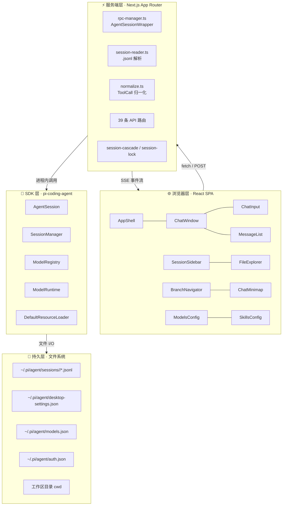
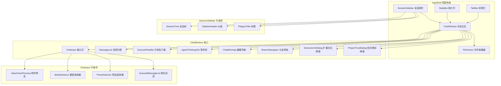
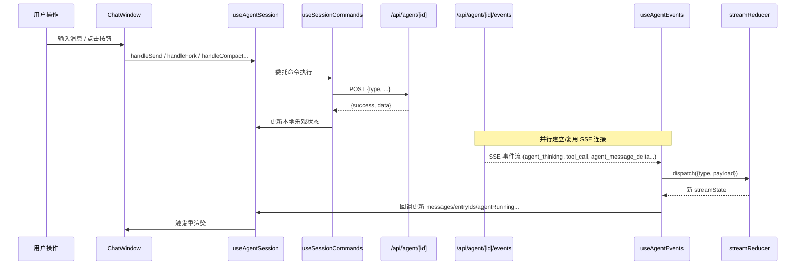
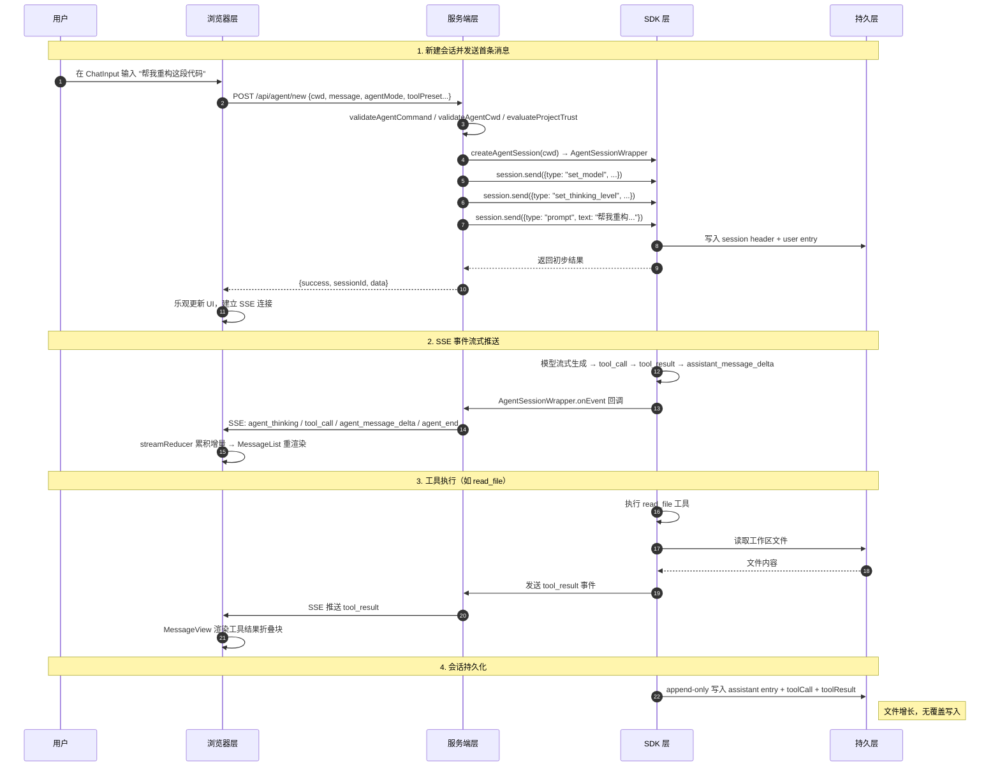

Pi Agent Desktop 采用**四层分离架构**，将关注点清晰地划分为浏览器层（UI 与交互）、服务端层（API 与会话编排）、SDK 层（AI 对话引擎）、持久层（文件系统存储）。这种分层确保了**单一职责**、**可独立演进**、**易于测试**，且在 Web 与 Electron 双模式下共享同一套核心逻辑。

Sources: [docs/ARCHITECTURE.md](docs/ARCHITECTURE.md#L57-L127)

## 架构总览



| 层 | 职责 | 关键约束 |
|---|---|---|
| **浏览器层** | UI 渲染、用户交互、SSE 消费、URL 状态 | 零状态库；流式消息由 `streamReducer` 增量更新 |
| **服务端层** | API 路由、AgentSession 包装、文件解析 | 活跃 session 必须存 `globalThis`（HMR 安全） |
| **SDK 层** | 真正的 AI 对话引擎、模型调度、工具执行 | 由 `@earendil-works/pi-coding-agent` 提供 |
| **持久层** | 所有状态最终落到磁盘 `.jsonl` 文件 | append-only；header 含 `parentSession` 显示元数据 |

Sources: [docs/ARCHITECTURE.md](docs/ARCHITECTURE.md#L57-L127)

---

## 第 1 层：浏览器层 — React SPA

### 核心组件拓扑



### 关键 Hook 体系

| Hook | 职责 | 核心依赖 |
|---|---|---|
| `useAgentSession` | 主编排器，聚合所有子 hook | `useSessionLoader`、`useAgentEvents`、`useSessionCommands`、`useSessionModelTools` |
| `useSessionLoader` | 会话加载、上下文构建、分支树生成 | `session-reader.ts` API |
| `useAgentEvents` | SSE 连接管理、事件分发、心跳 | `/api/agent/[id]/events` |
| `useSessionCommands` | 发送命令、Fork、导航、压缩、Steer/Follow-up | `agent-client.ts` |
| `useSessionModelTools` | 模型列表、工具预设、Thinking Level 映射 | `/api/models`、`/api/skills` |
| `useChatScroll` | 滚动容器绑定、自动滚动、锚点定位 | `MessageList` ref |
| `streamReducer` | 流式消息状态机（增量更新、工具调用合并） | 纯函数，无副作用 |

Sources: [hooks/useAgentSession.ts](hooks/useAgentSession.ts#L48-L110), [hooks/agent-session/use-session-loader.ts](hooks/agent-session/use-session-loader.ts), [hooks/agent-session/use-agent-events.ts](hooks/agent-session/use-agent-events.ts), [hooks/agent-session/use-session-commands.ts](hooks/agent-session/use-session-commands.ts), [hooks/agent-session/stream-state.ts](hooks/agent-session/stream-state.ts)

### 状态流向



Sources: [hooks/useAgentSession.ts](hooks/useAgentSession.ts#L200-L350), [hooks/agent-session/use-session-commands.ts](hooks/agent-session/use-session-commands.ts), [hooks/agent-session/use-agent-events.ts](hooks/agent-session/use-agent-events.ts), [hooks/agent-session/stream-state.ts](hooks/agent-session/stream-state.ts)

### 设计原则

1. **零外部状态库** — 仅使用 React 内置 `useReducer`/`useState`/`useRef`，避免依赖漂移
2. **单向数据流** — 用户动作 → 命令 Hook → API → SSE 事件 → Reducer → 状态更新 → 重渲染
3. **乐观更新与服务端同步** — 命令发出后立即更新本地状态，SSE 事件作为最终一致性校验
4. **组件边界显式化** — `ChatWindow` 通过 props 向 `AppShell` 推送 stats/context usage/model 信息，避免全局事件总线（正在迁移中）

Sources: [components/ChatWindow.tsx](components/ChatWindow.tsx#L120-L180), [components/AppShell.tsx](components/AppShell.tsx#L200-L280)

---

## 第 2 层：服务端层 — Next.js App Router

### API 路由分类

| 分类 | 路由示例 | 核心职责 |
|---|---|---|
| **Agent 控制** | `/api/agent/new`、`/api/agent/[id]`、`/api/agent/[id]/events` | 会话创建、命令发送、SSE 事件流 |
| **会话历史** | `/api/sessions`、`/api/sessions/[id]`、`/api/sessions/[id]/context` | 列表、详情、上下文/条目读取、导出 |
| **分支操作** | `POST /api/agent/[id]`（send `type:"fork"`）、`/api/sessions/[id]/branch`、`/api/sessions/[id]/clone` | Fork、会话内分支、Git worktree clone |
| **文件系统** | `/api/files/[...path]` | 列表、读取、写入、监听、Range 请求 |
| **模型/技能** | `/api/models`、`/api/models-config`、`/api/skills` | 提供商/模型配置、思考等级、技能安装 |
| **MCP** | `/api/mcp`、`/api/mcp/test`、`/api/mcp/toggle` | 服务器配置、连接测试、启用/禁用、工具暴露 |
| **认证/信任** | `/api/auth/*`、`/api/trust` | OAuth 登录、Project Trust 409 握手 |
| **桌面专用** | `/api/desktop-settings`、`/api/select-directory`、`/api/default-cwd` | 原生目录选择、设置持久化 |

Sources: [app/api](app/api), [docs/ARCHITECTURE.md](docs/ARCHITECTURE.md#L480-L520)

### 核心模块职责矩阵

```mermaid
flowchart LR
    subgraph Core["核心模块"]
        RM[rpc-manager.ts<br/>AgentSessionWrapper<br/>Registry & Locks]
        SR[session-reader.ts<br/>JSONL 解析<br/>Path Cache]
        NM[normalize.ts<br/>ToolCall 归一化]
        SC[session-cascade.ts<br/>Header 重写]
        SL[session-lock.ts<br/>文件写锁]
        AP[approval-policy.ts<br/>AgentMode/ToolPreset]
        EB[extension-ui-bridge.ts<br/>异步 RPC 响应队列]
        FQ[follow-up-queue.ts<br/>Revision 并发控制]
    end

    subgraph API["API 路由"]
        AN[agent/new]
        AI[agent/[id]]
        AE[agent/[id]/events]
        SLST[sessions/*]
        FL[files/[...path]]
        MC[models-config]
        SK[skills]
        MP[mcp]
    end

    AN --> RM
    AI --> RM
    AE --> RM
    SLST --> SR
    SLST --> SC
    SLST --> SL
    FL --> SR
    FL --> SL
    MC --> RM
    SK --> RM
    MP --> RM
    RM --> EB
    RM --> FQ
    RM --> AP
    SR --> NM
```

### rpc-manager.ts — 会话注册表与生命周期守护者

`rpc-manager.ts` 是服务端层的**中央枢纽**，负责：

1. **AgentSessionWrapper** — 封装上游 `AgentSession`，统一事件转发、模式切换、工具集管理、Extension UI Bridge 集成
2. **进程内注册表** — `globalThis.__piSessions: Map<string, AgentSessionWrapper>` 存活会话，HMR 安全
3. **并发启动锁** — `globalThis.__piStartLocks` 防止同一 sessionId 并发启动
4. **Fork 协议** — 预注册新 wrapper → 启动 → 原子切换，避免竞态
5. **Idle 回收** — 10 分钟无活动自动销毁，释放 SDK 资源
6. **资源热重载** — `requestResourceReload()` 触发 `inner.reload()` 后重新应用 AgentMode/ToolPreset

```typescript
// 关键数据结构（简化）
class AgentSessionWrapper {
  private listeners: EventListener[] = []
  private unsubscribe: () => void
  private idleTimer: ReturnType<setTimeout>
  readonly inner: AgentSessionLike  // 上游 SDK 实例
  
  // 模式与工具集状态
  private _agentMode: AgentMode
  private _toolPreset: ToolPreset
  private _modeRef: AgentModeRef   // 供 desktop-approval-extension 读取
  
  // Extension UI Bridge
  private _uiBridge: ExtensionUiBridge
  private followUpQueue: FollowUpQueue
  
  onEvent(listener) { ... }
  send(command) { ... }
  applyAgentMode(mode) { ... }
  destroy() { ... }
}
```

Sources: [lib/rpc-manager.ts](lib/rpc-manager.ts#L50-L250), [lib/rpc-manager.ts](lib/rpc-manager.ts#L270-L350)

### session-reader.ts — JSONL 解析与路径缓存

```mermaid
flowchart TD
    subgraph Reader["session-reader.ts"]
        LS[listAllSessions<br/>SessionManager.listAll + 缓存填充]
        RP[resolveSessionPath<br/>正向 + 负向缓存]
        BH[buildTree<br/>entries → SessionTreeNode[]]
        BC[buildSessionContext<br/>上游 projection + 归一化]
        RL[readFirstLineAsync<br/>流式读首行 header]
    end

    subgraph Cache["session-path-cache.ts"]
        PC[paths: Map<id, path>]
        MC[misses: Map<id, expiresAt>]
        TTL[30s 负缓存 TTL]
    end

    LS --> PC
    RP --> PC
    RP --> MC
    RP -.->|cache miss 时| LS
    RP -.->|负缓存命中且无活跃 RPC| MC
    RP -.->|负缓存命中但有活跃 RPC| LS
    BC --> NM[normalizeToolCalls]
```

**双层缓存策略**：
- **正向缓存** — `sessionId → filePath`，`listAllSessions()` 时批量填充，新建/Fork 时显式写入
- **负向缓存** — 记录「最近确认不存在」的 id，TTL 30s，防止随机 id 触发全量扫描；但若 `globalThis.__piSessions` 有活跃 wrapper 则忽略负缓存（先查后建场景）

Sources: [lib/session-reader.ts](lib/session-reader.ts#L1-L80), [lib/session-path-cache.ts](lib/session-path-cache.ts#L1-L57)

### session-cascade.ts & session-lock.ts — 分支删除的原子性保障

删除会话时需**级联重写**所有子会话的 `parentSession` 指针：

```mermaid
flowchart TD
    DELETE[DELETE /api/sessions/[id]] --> LOCK[withFileLock<br/>逐文件串行]
    LOCK --> READ[读取子会话文件]
    READ --> REWRITE[rewriteChildHeader<br/>oldParent → newParent/null]
    REWRITE --> WRITE[原子写入<br/>atomic-write.ts]
    WRITE --> CACHE[invalidateSessionPathCache<br/>清理路径缓存]
```

- `withFileLock` 使用 `globalThis.__piWriteLocks: Map<path, Promise>` 实现**进程级单文件写锁**，不同文件互不阻塞
- `rewriteChildHeader` 为纯函数，仅修改首行 JSON header 的 `parentSession` 字段，保留其余内容
- 删除父会话时，子会话的 `parentSession` 指向祖父（或移除），维护树结构完整性

Sources: [lib/session-cascade.ts](lib/session-cascade.ts#L1-L54), [lib/session-lock.ts](lib/session-lock.ts#L1-L42), [app/api/sessions/[id]/route.ts](app/api/sessions/[id]/route.ts)

### 统一错误处理与请求追踪

所有 API 路由遵循三件套：
1. `getRequestId(req)` — 从 `x-request-id` 头或生成 UUID
2. `logApiError({route, method, requestId, error, params})` — 结构化日志
3. `jsonError(req, status, message, meta?)` — 统一 JSON 错误响应，回传 `x-request-id` 头

便于生产环境日志聚合与请求链路追踪。

Sources: [lib/api-error.ts](lib/api-error.ts), [app/api/agent/new/route.ts](app/api/agent/new/route.ts#L1-L30)

---

## 第 3 层：SDK 层 — pi-coding-agent

### 上游依赖

```json
"@earendil-works/pi-coding-agent": "^0.99.1",
"@earendil-works/pi-ai": "^0.99.1"
```

### 核心能力边界

| 组件 | 职责 | 本项目交互方式 |
|---|---|---|
| `AgentSession` | 单次对话会话状态机、模型流式调用、工具执行编排 | `rpc-manager.ts` 封装为 `AgentSessionWrapper` |
| `SessionManager` | 会话文件 CRUD、列表、投影、分支操作 | `session-reader.ts` 直接调用 `listAll()`、`buildSessionProjection()` |
| `ModelRegistry` | 模型元数据、能力查询、提供商适配 | `models-config` API 透传 |
| `ModelRuntime` | 模型实例化、流式生成、工具绑定 | 内部封装，上层通过 `set_model` 命令切换 |
| `DefaultResourceLoader` | 系统提示、工具定义、技能加载 | `desktop-runtime-tools.ts`、`desktop-ltm-extension.ts` 注入扩展 |

### 关键接口契约

```typescript
// lib/pi-types.ts - 本地定义的 AgentSessionLike 接口
// 隔离上游变更，仅暴露桌面端需要的方法
interface AgentSessionLike {
  readonly sessionId: string
  readonly sessionFile: string | undefined
  readonly isStreaming: boolean
  readonly isCompacting: boolean
  readonly model: ModelLike | undefined
  readonly modelRuntime: { getModel(provider, modelId): ModelLike | undefined }
  readonly sessionManager: SessionManager
  readonly settingsManager: SettingsManager
  
  subscribe(listener): () => void
  prompt(text, options?): Promise<void>
  abort(): Promise<void>
  setModel(model): Promise<void>
  navigateTree(targetId, options?): Promise<NavigateTreeResult>
  setThinkingLevel(level: string): void
  compact(customInstructions?): Promise<unknown>
  getAllTools(): ToolInfo[]
  getActiveToolNames(): string[]
  setActiveToolsByName(names: string[]): void
  getContextUsage(): ContextUsage | undefined
  getSessionStats?(): SessionStats
  bindExtensions?(bindings): Promise<void>
}
```

**版本适配策略**：接口定义在本地 `pi-types.ts`，上游升级时仅需更新此文件与 `rpc-manager.ts` 的适配逻辑，不波及上层组件。

Sources: [lib/pi-types.ts](lib/pi-types.ts#L1-L69), [lib/rpc-manager.ts](lib/rpc-manager.ts#L1-L50)

---

## 第 4 层：持久层 — 文件系统

### 目录布局

```
~/.pi/agent/
├── sessions/
│   └── <encoded-cwd>/           # 按工作区编码隔离：--<去掉首分隔符后，/ \ : 全替换为 ->--
│       └── <timestamp>_<sessionId>.jsonl   # 会话主文件（append-only），Fork/分支产生新文件
├── settings.json                # pi 自身设置（非桌面端设置）
├── desktop-settings.json        # 全局桌面端设置
├── models.json                  # 模型配置（提供商、API Key、思考等级映射）
├── auth.json                    # OAuth token 缓存（单文件）
└── mcp.json                     # MCP 服务器配置（项目级 + 用户级）
```

### JSONL 会话文件格式

```jsonl
{"type":"session","version":3,"id":"<uuid>","timestamp":"2026-01-01T00:00:00.000Z","cwd":"/home/user/project","parentSession":null}
{"type":"message","id":"e1","parentId":null,"timestamp":"2026-01-01T00:00:01.000Z","message":{"role":"user","content":"Hello","timestamp":1700000001000}}
{"type":"message","id":"e2","parentId":"e1","timestamp":"2026-01-01T00:00:02.000Z","message":{"role":"assistant","content":[{"type":"text","text":"Hi!"},{"type":"toolCall","id":"call_1","name":"read_file","arguments":{"path":"package.json"}}],"timestamp":1700000002000}}
{"type":"message","id":"e3","parentId":"e2","timestamp":"2026-01-01T00:00:03.000Z","message":{"role":"toolResult","toolCallId":"call_1","toolName":"read_file","content":[{"type":"text","text":"{...}"}],"isError":false,"timestamp":1700000003000}}
{"type":"session_info","id":"e4","parentId":"e3","timestamp":"2026-01-01T00:00:04.000Z","name":"Initial session"}
{"type":"label","id":"e5","parentId":"e4","timestamp":"2026-01-01T00:00:05.000Z","targetId":"e2","label":"important"}
```

**关键设计**：
- **Append-only** — 绝不修改历史行，仅追加；修改通过新条目（label、toolResult 覆盖、compactionSummary）实现
- **条目类型全集** — `session`（首行 header）、`message`（内嵌 `message`，`role` 区分 user/assistant/toolResult）、`thinking_level_change`、`model_change`、`usage`、`compaction`、`branch_summary`、`custom`、`label`、`session_info`（存会话显示名称）、`custom_message`、`context_edit`
- **Header 元数据** — 首行包含 `parentSession`，构建跨文件分支树的关键
- **条目 ID 全局唯一** — 便于 `buildSessionProjection` 做投影与去重

Sources: [lib/session-reader.ts](lib/session-reader.ts#L80-L150), [lib/types.ts](lib/types.ts), [docs/ARCHITECTURE.md](docs/ARCHITECTURE.md#L350-L380)

### 文件访问白名单机制

服务端层通过**允许根目录集合**控制 `/api/files` 访问权限：

```mermaid
flowchart TD
    REQ[GET/PUT /api/files/...] --> GETROOTS[getAllowedRoots()]
    GETROOTS --> CACHE{globalThis.__piAllowedRootsCache<br/>5s TTL}
    CACHE -->|hit| CHECK[isPathAllowed]
    CACHE -->|miss| SCAN[listAllSessions<br/>收集所有 cwd]
    SCAN --> VALIDATE[validateAgentCwd<br/>拒绝根目录/家目录/系统目录]
    VALIDATE --> POPULATE[填充 roots Set]
    POPULATE --> CACHE
    CHECK --> REALPATH[realpath 解析符号链接]
    REALPATH --> ALLOW{路径在允许根下?}
    ALLOW -->|yes| PROCEED[执行文件操作]
    ALLOW -->|no| DENY[403 Access denied]
```

- **动态发现** — 扫描所有历史会话的 `cwd`，自动加入白名单
- **安全校验** — `validateAgentCwd` 拒绝 `/`、`C:\`、`~` 等危险路径
- **符号链接防护** — `realpath` 后再校验，防止链接逃逸
- **桌面端专用目录** — `~/pi-cwd-YYYYMMDD` 自动识别并允许

Sources: [lib/allowed-roots.ts](lib/allowed-roots.ts#L1-L77), [lib/path-policy.ts](lib/path-policy.ts), [app/api/files/[...path]/route.ts](app/api/files/[...path]/route.ts#L1-L80)

---

## 跨层数据流：一次对话的完整旅程



Sources: [app/api/agent/new/route.ts](app/api/agent/new/route.ts#L1-L92), [lib/rpc-manager.ts](lib/rpc-manager.ts#L350-L500), [hooks/agent-session/use-agent-events.ts](hooks/agent-session/use-agent-events.ts), [hooks/agent-session/stream-state.ts](hooks/agent-session/stream-state.ts)

---

## 关键跨层契约

| 契约点 | 浏览器层 | 服务端层 | SDK 层 | 持久层 |
|---|---|---|---|---|
| **Session ID** | URL `?session=xxx`、SSE 连接标识 | 路由参数 `[id]`、注册表键 | `AgentSession.sessionId` | `.jsonl` 文件名（`<timestamp>_<sessionId>.jsonl`）、header `id` |
| **消息格式** | `AgentMessage[]` (归一化后) | `normalizeToolCalls` 统一 | 上游原始格式 | JSONL 行 `type:"message"`（内嵌 `message.role` 区分 user/assistant/toolResult） |
| **工具调用** | `ChatInput` 提交 → `useSessionCommands` | `validateAgentCommand` 校验 | `AgentSession` 内部执行 | assistant 消息 content 内的 `toolCall` block + `role:"toolResult"` 消息条目 |
| **分支标识** | `BranchNavigator` 切换 `leafId` | `session-reader.buildTree` | `SessionManager.fork` | `parentSession` header、`label` 条目 |
| **模式/预设** | `AgentModeSelector`、`PresetSelector` | `approval-policy.ts` 验证 | `setActiveToolsByName` | `desktop_agent_mode` 自定义条目 |

---

## 双模式下的架构一致性

| 维度 | Web 模式 (`npm run dev`) | Desktop 模式 (`npm run dev:electron`) |
|---|---|---|
| **浏览器层** | 完全相同的 React SPA | 完全相同的 React SPA (BrowserWindow 加载) |
| **服务端层** | Next.js dev server `:30141` 同进程 | Standalone `server.js` 子进程 `127.0.0.1:PORT` |
| **进程内调用** | `new AgentSession()` 直接调用 | 同进程内直接调用（子进程隔离） |
| **SSE** | 直连 Next.js | 直连 Standalone server |
| **文件访问** | 受 `allowed-roots` 限制 | 同策略，额外有原生目录选择器 |
| **持久层** | `~/.pi/agent/` | 相同目录（共享数据） |

Sources: [docs/ARCHITECTURE.md](docs/ARCHITECTURE.md#L17-L55), [electron/main.ts](electron/main.ts#L100-L180)

---

## 核心设计决策回顾

| 决策 | 动机 | 权衡 |
|---|---|---|
| **四层严格分离** | 关注点正交，便于单元测试与并行开发 | 跨层调试需穿透多层，需完善日志与请求 ID 链路 |
| **globalThis 存活会话** | Next.js HMR 会销毁模块级变量，`globalThis` 存活 | 需手动管理清理，测试时需重置 |
| **SSE 而非 WebSocket** | HTTP/1.1 兼容、自动重连、防火墙友好、调试直观 | 单向服务端推送，客户端→服务端仍需 POST |
| **Append-only JSONL** | 简化并发、天然审计轨迹、易于增量读取 | 存储增长、需定期压缩（上游自动 compaction） |
| **零状态库** | 零依赖、零迁移成本、完全掌控渲染时机 | 样板代码多、需自建 reducer 模式 |
| **进程内 SDK 调用** | 零 IPC 延迟、共享内存、部署简单 | 服务端进程崩溃影响所有会话、需隔离策略 |

Sources: [docs/ARCHITECTURE.md](docs/ARCHITECTURE.md#L720-L850), [docs/ARCHITECTURE-REVIEW.md](docs/ARCHITECTURE-REVIEW.md#L100-L200), [docs/ARCHITECTURE-OPTIMIZATION-REVIEW-2026-06-26.md](docs/ARCHITECTURE-OPTIMIZATION-REVIEW-2026-06-26.md#L50-L150)

---

## 相关深度文档导航

| 文档 | 说明 |
|---|---|
| [AgentSession 生命周期与进程内注册表](7-agentsession-sheng-ming-zhou-qi-yu-jin-cheng-nei-zhu-ce-biao) | 深入 `rpc-manager.ts` 的注册表机制、启动锁、Idle 回收、Fork 协议 |
| [SSE 事件流与流式状态机](8-sse-shi-jian-liu-yu-liu-shi-zhuang-tai-ji) | `useAgentEvents` 连接管理、心跳、`streamReducer` 状态机细节 |
| [会话的两种访问模式](9-hui-hua-de-liang-chong-fang-wen-mo-shi-zhi-du-liu-lan-yu-jiao-hu-dui-hua) | 只读浏览（`session-reader`）vs 交互对话（`AgentSessionWrapper`） |
| [Pi 会话文件格式与 .jsonl 解析](13-pi-hui-hua-wen-jian-ge-shi-yu-jsonl-jie-xi) | JSONL 结构、`buildSessionProjection`、分支树构建 |
| [三种分支机制](14-san-chong-fen-zhi-ji-zhi-fork-hui-hua-nei-fen-zhi-git-worktree-clone) | Fork、会话内分支、Git worktree clone 的实现差异 |

---

*本文档基于 `docs/ARCHITECTURE.md` 权威参考与源码核对生成。如发现与代码不符，以源码为准。*