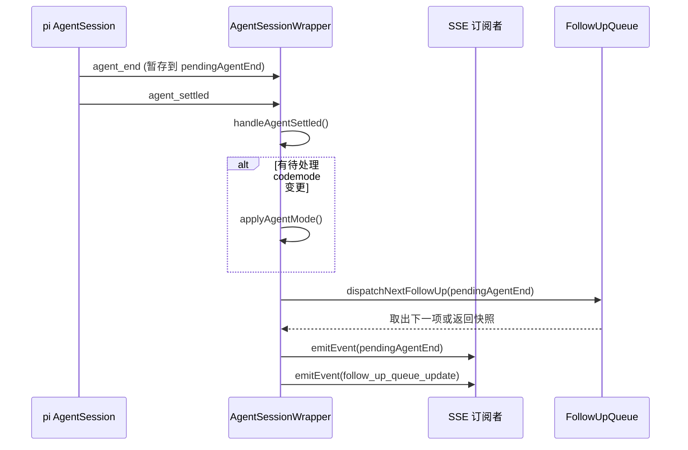

`AgentSession` 是桌面端与底层 `pi-coding-agent` 运行时交互的核心抽象。本文档深度解析其**进程内注册表机制**、**生命周期状态流转**、**并发启动保护**、**空闲回收策略**，以及**前后端协同的会话切换隔离**设计。

---

## 核心架构概览

### 整体组件关系

```mermaid
graph TB
    subgraph "前端 React"
        UA[useAgentSession] --> USL[useSessionLoader]
        UA --> UAE[useAgentEvents]
        UA --> USC[useSessionCommands]
        UAE --> SSE[SSE 事件流]
    end

    subgraph "Next.js API Routes"
        AGENT_CMD[POST /api/agent/[id]]
        AGENT_STATE[GET /api/agent/[id]]
        AGENT_EVENTS[GET /api/agent/[id]/events]
        SESSIONS[GET /api/sessions]
    end

    subgraph "进程内注册表 (globalThis，HMR 安全)"
        REGISTRY[(__piSessions: Map<id, AgentSessionWrapper>)]
        LOCKS[(__piStartLocks: Map<id, Promise>)]
        TRUST_MAP[(__piSessionOnlyTrust)]
    end

    subgraph "运行时核心"
        WRAPPER[AgentSessionWrapper]
        INNER[pi-coding-agent AgentSessionLike]
        RESOURCE[DefaultResourceLoader + Extensions]
    end

    UA --> AGENT_CMD
    UA --> AGENT_STATE
    UAE --> AGENT_EVENTS
    AGENT_CMD --> REGISTRY
    AGENT_STATE --> REGISTRY
    AGENT_EVENTS --> REGISTRY
    REGISTRY --> WRAPPER
    WRAPPER --> INNER
    WRAPPER --> RESOURCE
    LOCKS -.-> WRAPPER
    TRUST_MAP -.-> AGENT_CMD
```

**关键设计原则**：
- **单进程单例注册表**：`globalThis.__piSessions` 保证开发期 HMR 热重载不丢失活跃会话
- **包装器模式**：`AgentSessionWrapper` 将 pi 原生 `AgentSessionLike` 适配为桌面端所需接口（事件总线、策略管理、Follow-up 队列、Extension UI Bridge）
- **懒加载 + 并发去重**：首次命令/事件流触发时按需 `startRpcSession`，`__piStartLocks` 防止同一 `sessionId` 并发重复启动

Sources: [lib/rpc-manager.ts#L600-L800](lib/rpc-manager.ts#L600-L800), [lib/pi-types.ts](lib/pi-types.ts), [hooks/useAgentSession.ts](hooks/useAgentSession.ts)

---

## 进程内注册表设计

### 全局状态持久化策略

```typescript
// lib/rpc-manager.ts
declare global {
  var __piSessions: Map<string, AgentSessionWrapper> | undefined;
  var __piStartLocks: Map<string, Promise<{ session: AgentSessionWrapper; realSessionId: string }>> | undefined;
  var __piSessionOnlyTrust: Map<string, boolean> | undefined;
}

function getRegistry(): Map<string, AgentSessionWrapper> {
  if (!globalThis.__piSessions) {
    globalThis.__piSessions = new Map();
    // 进程退出清理
    process.once("exit", exitCleanup);
    process.on("SIGINT", () => { void gracefulCleanup("SIGINT"); });
    process.on("SIGTERM", () => { void gracefulCleanup("SIGTERM"); });
  }
  return globalThis.__piSessions;
}
```

| 变量 | 来源 | 用途 |
|------|------|------|
| `__piSessions` | `rpc-manager.ts` | 活跃 `AgentSessionWrapper` 注册表 |
| `__piStartLocks` | `rpc-manager.ts` | 同一 `sessionId` 启动中的共享 Promise |
| `__piSessionOnlyTrust` | `rpc-manager.ts` | Project Trust 会话级放行 |
| `__piSessionPathCacheState` | `session-reader.ts` | sessionId → `.jsonl` 正向/负向路径缓存 |
| `__piWriteLocks` | `session-lock.ts` | 单文件写入锁 |
| `__piAllowedRootsCache` | `allowed-roots.ts` | 文件访问白名单，**5s TTL** |
| `__piLoginCallbacks` | `auth/login/[provider]` | OAuth 手动输入回调 |
| `__piGitWorktreeLocks` | `git-worktree.ts` | Worktree 创建/清理并发锁 |
| `__piUpstreamUsageCache` | `upstream-usage` | 上游额度查询缓存，**120s TTL** |
| `__piLtmService` / `__piLtmServiceKey` / `__piLtmServiceError` / `__piLtmServiceErrorAt` | `ltm/service.ts` | LTM 单例、配置键、失败缓存与时间戳 |

**HMR 安全性**：Next.js 开发模式下模块热替换会重新执行模块代码，但 `globalThis` 跨模块生命周期持久化，避免注册表丢失导致活跃会话泄漏或重复创建。

Sources: [lib/rpc-manager.ts#L600-L650](lib/rpc-manager.ts#L600-L650)

### 注册表操作 API

```typescript
// 获取/创建会话（带并发去重）
export async function startRpcSession(
  sessionId: string,
  sessionFile: string,
  cwd: string,
  toolNamesOrOpts?: string[] | StartRpcSessionOptions
): Promise<{ session: AgentSessionWrapper; realSessionId: string }>

// 读取现有会话（不创建）
export function getRpcSession(sessionId: string): AgentSessionWrapper | undefined

// 批量操作
export function updateSessionCodemode(enabled: boolean): void
export function requestSessionResourceReload(cwd?: string): void
```

`startRpcSession` 顺序：已存活则复用 wrapper；否则与进行中的启动 Promise 共享锁；`SessionManager.open` 或 `create`；`findLastAgentMode` 恢复模式；`DefaultResourceLoader` 注入 codemode / tool_search / mcp / approval / ltm 扩展；`createAgentSession({ noTools: "builtin" })`；包装、`bindExtensions({ uiContext })`、`registry.set(realSessionId)`。空闲 10 分钟销毁。

**所有权守卫删除模式**：`destroy()` 中的 `onDestroy` 回调使用**身份比对**而非无条件删除：

```typescript
wrapper.onDestroy(() => {
  if (registry.get(realSessionId) === wrapper) registry.delete(realSessionId);
});
```

> 设计理由：`destroy()` 是异步的（需 await abort/unsubscribe），期间同一 `sessionId` 可能被新的 `startRpcSession` 重新注册。无条件 `delete` 会误踢出新包装器（P2-4 问题）。身份比对保证只清理**自己注册的那个实例**。

Sources: [lib/rpc-manager.ts#L850-L900](lib/rpc-manager.ts#L850-L900)

---

## AgentSessionWrapper 详解

### 核心职责矩阵

| 领域 | 关键字段/方法 | 说明 |
|------|--------------|------|
| **事件总线** | `listeners`, `emitEvent()`, `onEvent()` | SSE 订阅分发，支持 `agent_end`/`agent_settled` 合成 |
| **生命周期** | `start()`, `destroy()`, `keepAlive()`, `_alive` | 10 分钟空闲定时器、信号量优雅关闭、订阅解绑顺序 |
| **策略状态** | `_agentMode`, `_toolPreset`, `_modeRef`, `applyAgentMode()` | Plan/Ask/Full 三模式、工具预设、Codemode 开关 |
| **Follow-up** | `followUpQueue`, `pendingAgentEnd`, `dispatchNextFollowUp()` | 串行化队列，`agent_settled` 为唯一排序边界 |
| **Extension UI** | `_uiBridge`, `attachUiBridge()` | 异步 RPC 响应队列桥接 |
| **资源热更** | `resourcesChanged`, `reloadResources()` | MCP/工具变更后延迟重载，避免流式中打断 |

### 事件订阅与 `agent_end`/`agent_settled` 合成

```typescript
// 构造器中 start() 订阅内部事件
this.unsubscribe = this.inner.subscribe((event: AgentEvent) => {
  this.resetIdleTimer(); // 任意事件重置空闲计时器
  
  if (event.type === "agent_end") {
    // LTM 观测钩子
    void safeLtmAgentEndObserve({ ... });
    this.pendingAgentEnd = event; // 暂存，等待 agent_settled
    return;
  }
  if (event.type === "agent_settled") {
    this.handleAgentSettled(); // 统一处理 pendingAgentEnd + Follow-up 调度
    return;
  }
  this.emitEvent(event); // 其余事件直接透传
});
```

**关键时序**：



> 设计理由：pi 原生会先发 `agent_end` 再发 `agent_settled`，中间可能夹杂工具结果事件。Wrapper 将两者**合成为单一顺序边界**，保证 Follow-up 队列调度与 SSE 事件发射的原子性，避免前端状态竞态。

Sources: [lib/rpc-manager.ts#L200-L280](lib/rpc-manager.ts#L200-L280)

### 空闲销毁与优雅关闭

```typescript
private resetIdleTimer(): void {
  if (this.idleTimer) clearTimeout(this.idleTimer);
  this.idleTimer = setTimeout(() => {
    this.destroy().catch((err) => console.error("Error during idle destroy:", err));
  }, 10 * 60 * 1000); // 10 分钟
}

async destroy(): Promise<void> {
  if (!this._alive) return;
  this._alive = false;
  if (this.idleTimer) clearTimeout(this.idleTimer);
  
  // 1. 先解绑订阅，防止 abort() 产生的终止事件泄漏到即将关闭的 SSE 流
  await this.unsubscribe?.();
  
  // 2. 终止内部 agent 循环
  await this.inner.abort();
  
  // 3. 清理扩展桥接
  this._uiBridge?.destroy();
  await this.inner.extensionRunner?.emit({ type: "session_shutdown", reason: "quit" });
  this.inner.dispose?.();  // 当前实现不 await
  
  // 4. 执行 onDestroy 回调（含注册表删除守卫）
  for (const cb of this.onDestroyCallbacks) await cb();
}
```

**进程级信号处理**：

```typescript
let signalCleanupStarted = false;
const gracefulCleanup = async (signal: string) => {
  const exitNow = () => process.exit(signal === "SIGINT" ? 130 : 143);
  if (signalCleanupStarted) { exitNow(); return; } // 二次信号强制退出
  signalCleanupStarted = true;
  const sessions = [...globalThis.__piSessions?.values() ?? []];
  await Promise.allSettled(sessions.map((s) => s.destroy())); // 全量 await
  exitNow();
};
process.once("exit", exitCleanup); // 同步清理（无 await）
process.on("SIGINT", () => { void gracefulCleanup("SIGINT"); });
process.on("SIGTERM", () => { void gracefulCleanup("SIGTERM"); });
```

| 场景 | 触发机制 | 清理行为 |
|------|----------|----------|
| 正常进程退出 | `process.once('exit')` | 同步 fire-and-forget `destroy()` |
| Ctrl+C (SIGINT) | `process.on('SIGINT')` | **异步 await 全部 destroy()** 后退出，保证 `.jsonl` 最终落盘 |
| 系统关机 (SIGTERM) | `process.on('SIGTERM')` | 同上 |
| 二次 Ctrl+C | 守卫标志 `signalCleanupStarted` | 立即强制退出，不再等待 |

> 为何 `exit` 用 `once` 而信号用 `on`？`exit` 事件无法 await（进程已在撕裂），只能同步触发。信号处理器可 await，且需可重入：首次信号启动清理，**二次信号直接强退**，避免重复启动清理流程。

Sources: [lib/rpc-manager.ts#L700-L780](lib/rpc-manager.ts#L700-L780), [lib/rpc-manager.ts#L850-L900](lib/rpc-manager.ts#L850-L900)

---

## 生命周期状态机

### 会话创建/恢复流程

```mermaid
flowchart TD
    A[API 请求: POST /api/agent/[id] 或 GET /events] --> B{getRpcSession(id) 存在且 isAlive?}
    B -- 是 --> C[直接复用 wrapper 执行命令/建立 SSE]
    B -- 否 --> R1["路由层: resolveSessionPath 解析文件路径"]
    R1 --> H{文件存在?}
    H -- 否 --> I[404 Session not found]
    H -- 是 --> J["路由层: getHeaderAsync 读取 header 获取 cwd"]
    J --> K["路由层: evaluateProjectTrust"]
    K -- 409 prompt --> L[返回 409 需要信任确认]
    K -- 通过 --> M["startRpcSession（锁在此内部获取）"]
    M --> D{__piStartLocks 有进行中的 Promise?}
    D -- 是 --> E[返回该 Promise 去重]
    D -- 否 --> F[创建起始 Promise 存入 locks]
    F --> N[SessionManager.open/create]
    N --> O[加载持久化 agentMode/toolPreset]
    O --> P["DefaultResourceLoader + codemode/tool_search/mcp/approval/ltm"]
    P --> Q["createAgentSession({noTools:\"builtin\"})"]
    Q --> R[wrap + bindExtensions uiContext]
    R --> S[wrapper.start() 订阅事件 + 10min 空闲定时器]
    S --> T[registry.set(realSessionId) + onDestroy 守卫删除]
    T --> U[返回 wrapper 执行原始命令/建立 SSE]
    U --> V[finally 删除 locks 条目]
```

> **顺序要点**：404（Session not found）与 409（Project Trust prompt）都在**路由层**返回，先于 `startRpcSession` 执行，因此**从不发生在持锁区内**；`__piStartLocks` 仅在 `startRpcSession` 内部获取。

**新建会话特殊路径**：`sessionFile === ""` 时 `SessionManager.create(cwd)` 生成新文件，pi 内部分配 `sessionId`，返回的 `realSessionId` 可能与请求 `sessionId` 不同（客户端需以返回值为准）。

Sources: [lib/rpc-manager.ts#L800-L944](lib/rpc-manager.ts#L800-L944), [app/api/agent/[id]/route.ts](app/api/agent/[id]/route.ts), [app/api/agent/[id]/events/route.ts](app/api/agent/[id]/events/route.ts)

### 会话销毁触发条件

| 触发源 | 代码路径 | 典型场景 |
|--------|----------|----------|
| **显式删除** | `DELETE /api/sessions/[id]` → `wrapper.destroy()` | 用户在侧边栏删除会话 |
| **Fork 替换** | `fork` 命令中 `await this.destroy()` | 从当前节点分叉，旧会话不再使用 |
| **空闲超时** | `resetIdleTimer` 10 分钟无事件 | 用户离开、网络断开、标签页休眠 |
| **进程退出** | `SIGINT`/`SIGTERM`/`exit` | 应用关闭、重启、部署更新 |
| **错误兜底** | `send()` 中异常捕获后 `emitAgentError` 但不自动销毁 | 保留会话供重试，避免数据丢失 |

> **Fork 顺序**：`send("fork")` → `createBranchedSession`（或首条消息前 `SessionManager.create`）写出新 `.jsonl` → `startRpcSession(newId)` 预注册 → 成功后再 `await this.destroy()` 旧 wrapper。预注册失败则 **旧 wrapper 保持可用**；孤儿 `.jsonl` 的 `unlink` 与路径缓存失效是 **best-effort**（失败不阻断，随后 rethrow）。不存在 `/api/sessions/fork`。

Sources: [lib/rpc-manager.ts#L400-L500](lib/rpc-manager.ts#L400-L500)

---

## 前端会话切换与状态隔离

### `useAgentSession` 的 `session?.id` Effect

```typescript
useEffect(() => {
  if (!session) return;
  const sid = session.id;
  sessionIdRef.current = sid;
  let cancelled = false;

  // 1. 完整重置会话级状态（防止会话间数据泄漏）
  const reset = sessionScopedResetPatch();
  setData(null);
  setActiveLeafId(null);
  setMessages([]);
  setEntryIds([]);
  setToolPreset(reset.toolPreset);
  setThinkingLevel(reset.thinkingLevel);
  setAgentRunning(reset.agentRunning);
  setAgentPhase(reset.agentPhase);
  dispatch({ type: "reset" }); // streamReducer 重置
  // ... 重置 retryInfo, contextUsage, systemPrompt 等 15+ 字段

  // 2. 加载新会话数据
  fetch("/api/desktop-settings").then(d => d.defaultAgentMode && setAgentMode(d.defaultAgentMode));
  loadSessionFromApi(sid, true, true).then(loaded => {
    if (cancelled) return;
    const patch = loadedAgentStatePatch({ ... });
    // 根据服务端状态恢复：thinkingLevel、agentRunning、isCompacting、connectEvents 等
  });

  return () => { cancelled = true; };
}, [session?.id]); // 仅依赖 sessionId，setter 引用稳定
```

**重置覆盖的状态域** (`sessionScopedResetPatch`)：

| 状态域 | 重置值 | 目的 |
|--------|--------|------|
| `toolPreset` | `"default"` | 清除上一会话的工具选择 |
| `thinkingLevel` | `"auto"` | 重置推理等级 |
| `agentRunning` | `false` | 终止任何残留的流式状态 |
| `agentPhase` | `null` | 清除阶段指示器 |
| `retryInfo` | `null` | 清除重试上下文 |
| `contextUsage` | `null` | 上下文用量归零 |
| `systemPrompt` | `null` | 系统提示词隔离 |
| `forkingEntryId` | `null` | 分叉 UI 状态清零 |
| `isCompacting` | `false` | 压缩状态隔离 |
| `compactError` | `null` | 错误提示隔离 |
| `followUpQueue` | `EMPTY_FOLLOW_UP_QUEUE` | 待办队列清空 |
| `pendingSteersRef` / `pendingPromptsRef` | `[]` | 乐观更新缓冲区清空 |

**防御纵深**：`AppShell` 通过 `sessionKey` 强制重新挂载整个 `ChatWindow` 子树，覆盖 `useChatScroll`、`useAgentEvents` 等无法从 `useAgentSession` 重置的子 Hook 状态。

Sources: [hooks/useAgentSession.ts#L600-L720](hooks/useAgentSession.ts#L600-L720), [hooks/agent-session/session-lifecycle-reset.ts](hooks/agent-session/session-lifecycle-reset.ts)

### SSE 事件连接管理 (`useAgentEvents`)

```typescript
// hooks/agent-session/use-agent-events.ts —— 薄封装，委托 AgentEventsManager
export type { AgentEvent, ConnectionStatus };
// ConnectionStatus = "disconnected" | "connecting" | "connected" | "failed"

export function useAgentEvents({ agentRunning }: UseAgentEventsOptions) {
  const managerRef = useRef<AgentEventsManager | null>(null);
  const handleAgentEventRef = useRef<((event: AgentEvent) => void) | null>(null);
  const [connectionStatus, setConnectionStatus] = useState<ConnectionStatus>("disconnected");

  if (!managerRef.current) managerRef.current = new AgentEventsManager();

  useEffect(() => { managerRef.current?.setAgentRunning(agentRunning); }, [agentRunning]);

  useEffect(() => {
    const manager = managerRef.current;
    if (!manager) return;
    manager.setEventHandler((event) => handleAgentEventRef.current?.(event));
    manager.setStatusChangeHandler(setConnectionStatus);
    return () => { manager.setStatusChangeHandler(null); manager.cleanup(); };
  }, []);

  // expectRunning=true：连接可能早于 [agentRunning] effect 到达 manager，
  // 先表达意图，使早期 SSE onerror 走重连而非卡在 Waiting
  const connectEvents = useCallback((sid: string) => {
    managerRef.current?.connect(sid, true, true);
  }, []);

  return { handleAgentEventRef, connectEvents, connectionStatus };
}
```

**连接生命周期**：

| 阶段 | 触发条件 | 动作 |
|------|----------|------|
| 连接建立 | `loadSession` 返回 `agentState.running === true` 且 `isStreaming` | `connectEvents(sid)` 创建 `EventSource` |
| 重连 | 网络抖动导致 `onerror` | `AgentEventsManager` 在 `onerror` 中显式 `disconnect()` 关闭 `EventSource`，指数退避重连 **5 次：1s/2s/4s/8s/16s**（公式里的 30s 封顶不可达）；超 5 次置 `failed` |
| 断开 | 会话切换、组件卸载、显式 `abort` | cleanup 关闭 `EventSource` |
| 心跳保活 | 服务端 30s 间隔发送 `:\n\n` | 防止反向代理超时；客户端无需显式心跳 |

Sources: [hooks/agent-session/use-agent-events.ts](hooks/agent-session/use-agent-events.ts), [app/api/agent/[id]/events/route.ts](app/api/agent/[id]/events/route.ts)

---

## 并发控制与竞态防护

### 启动锁 (`__piStartLocks`)

```typescript
const inflight = locks.get(sessionId);
if (inflight) return inflight; // 复用进行中的启动 Promise

const starting = (async () => {
  // ... 完整初始化流程
})().finally(() => locks.delete(sessionId)); // 无论成败都释放锁

locks.set(sessionId, starting);
return starting;
```

**覆盖场景**：
- 同一会话并发发送 `prompt` + 打开 SSE 事件流
- 并发 `fork` 请求（极少见但可能）
- HMR 期间模块重载导致的重复初始化

> `finally` 保证锁必然释放，避免死锁。若初始化抛错，后续请求会重新获取锁重试。

Sources: [lib/rpc-manager.ts#L800-L850](lib/rpc-manager.ts#L800-L850)

### Follow-up 队列并发控制

```typescript
// lib/follow-up-queue.ts 核心：revision 乐观锁
export class FollowUpQueue {
  private items: QueuedFollowUp[] = [];
  private revision = 0;

  enqueue(item): FollowUpQueueSnapshot { ... }
  shift(): { item: QueuedFollowUp; snapshot: FollowUpQueueSnapshot } | null { ... }
  reorder(orderedIds: string[], expectedRevision: number): FollowUpQueueSnapshot {
    if (expectedRevision !== this.revision)
      throw new Error("Follow-up queue changed; refresh and try again");
    // 还校验 orderedIds 恰好包含全部队列项各一次，否则抛
    // "Follow-up queue order must contain every queued item exactly once"
    // 应用重排，revision++
  }
}
```

**前端乐观更新 + 服务端权威回滚** (`useAgentSession.ts`)：

```typescript
const handleReorderFollowUps = async (orderedIds: string[]) => {
  const previous = followUpQueueRef.current;
  // 1. 本地乐观更新 revision 不变
  const optimistic = { revision: previous.revision, items: reordered };
  followUpQueueRef.current = optimistic;
  setFollowUpQueue(optimistic);
  setFollowUpQueueBusy(true);

  try {
    // 2. 发送带 expectedRevision 的命令
    const snapshot = await sendAgentCommand(sid, {
      type: "reorder_follow_ups",
      orderedIds,
      expectedRevision: previous.revision,
    });
    acceptFollowUpQueue(snapshot); // 服务端返回新 revision
  } catch {
    // 3. 失败恢复：先拉最新 get_state 取权威快照；get_state 也失败才在 revision 未变时恢复 previous
  } finally {
    setFollowUpQueueBusy(false);
  }
};
```

**服务端单线程串行化**：`AgentSessionWrapper.send()` 同一时刻仅处理一个命令（JS 单线程），`followUpQueue` 操作天然原子。`revision` 防御的是**多标签页/多窗口**并发修改同一会话。

Sources: [lib/follow-up-queue.ts](lib/follow-up-queue.ts), [hooks/useAgentSession.ts#L500-L600](hooks/useAgentSession.ts#L500-L600)

---

## 关键数据结构速查

### `AgentSessionWrapper` 公共接口

```typescript
interface AgentSessionWrapper {
  readonly inner: AgentSessionLike;
  readonly sessionId: string;
  readonly sessionFile: string;
  
  // 策略
  agentMode: AgentMode;
  toolPreset: ToolPreset;
  modeRef: AgentModeRef; // { current, toolPreset, codemodeEnabled }
  initPolicy(mode, preset, codemodeEnabled): void;
  applyAgentMode(mode): void;
  setAgentMode(mode): void;
  setCodemodeEnabled(enabled): void;
  
  // 事件
  onEvent(listener): () => void;
  emitEvent(event): void;
  
  // 状态快照（buildStateSnapshot 为 private，由 get_state 与 peekState 共用）
  peekState(): Record<string, unknown>; // 不重置空闲计时器
  
  // 命令入口
  send(command): Promise<unknown>;
  
  // 生命周期
  isAlive(): boolean;
  keepAlive(): void; // SSE 心跳调用
  onDestroy(cb): void;
  destroy(): Promise<void>;
  
  // 资源
  requestResourceReload(): void;
}
```

### 注册表导出函数

| 函数 | 签名 | 用途 |
|------|------|------|
| `getRpcSession` | `(id) => AgentSessionWrapper \| undefined` | 读取现有会话 |
| `startRpcSession` | `(id, file, cwd, opts?) => Promise<{session, realSessionId}>` | 获取或创建会话 |
| `updateSessionCodemode` | `(enabled) => void` | 广播 Codemode 切换 |
| `requestSessionResourceReload` | `(cwd?) => void` | MCP/工具变更通知重载 |
| `getSessionOnlyTrustMap` | `() => Map<string, boolean>` | Project Trust 会话级放行 |

Sources: [lib/rpc-manager.ts#L600-L944](lib/rpc-manager.ts#L600-L944)

---

## 常见问题与排查指南

| 现象 | 可能原因 | 排查路径 |
|------|----------|----------|
| 会话创建后立即 404 | `resolveSessionPath` 负缓存未失效 | 检查 `session-path-cache.ts` TTL，或 `getLiveRpcSession` 回退逻辑 |
| Fork 后旧会话仍在运行 | `destroy()` 未 await 完成就返回 | 确认 `fork` case 中 `await this.destroy()` 位于预注册成功之后 |
| SSE 连接频繁断开重连 | 反向代理超时 < 30s | 检查 Nginx/Cloudflare `proxy_read_timeout` 设置 |
| 会话切换残留上一会话消息 | `sessionScopedResetPatch` 遗漏字段 | 对比 `reset` 对象与 `useAgentSession` 中所有 `setXxx` 调用 |
| 进程退出丢失最后几条消息 | `destroy()` 中 `inner.abort()` 未 await | 确认 `gracefulCleanup` 中 `Promise.allSettled(sessions.map(s => s.destroy()))` |
| 同一会话出现两个 wrapper | `onDestroy` 守卫失效 | 检查 `registry.get(realSessionId) === wrapper` 身份比对逻辑 |

---

## 相关文档导航

- **上游事件流细节**：[SSE 事件流与流式状态机](8-sse-shi-jian-liu-yu-liu-shi-zhuang-tai-ji)
- **会话文件格式**：[Pi 会话文件格式与 .jsonl 解析](13-pi-hui-hua-wen-jian-ge-shi-yu-jsonl-jie-xi)
- **分支机制**：[四种会话分叉机制：Fork、会话内分支、跨文件 Branch、Clone](14-san-chong-fen-zhi-ji-zhi-fork-hui-hua-nei-fen-zhi-git-worktree-clone)
- **前端主 Hook**：[useAgentSession 主 Hook 与子 Hook 拆分策略](22-useagentsession-zhu-hook-yu-zi-hook-chai-fen-ce-lue)
- **流式消息状态机**：[streamReducer 流式消息状态机与增量渲染](23-streamreducer-liu-shi-xiao-xi-zhuang-tai-ji-yu-zeng-liang-xuan-ran)