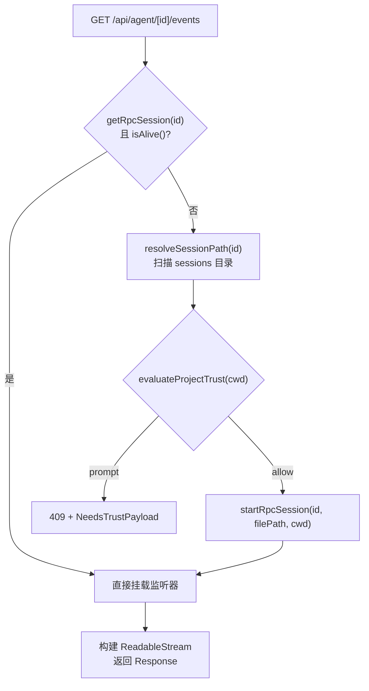
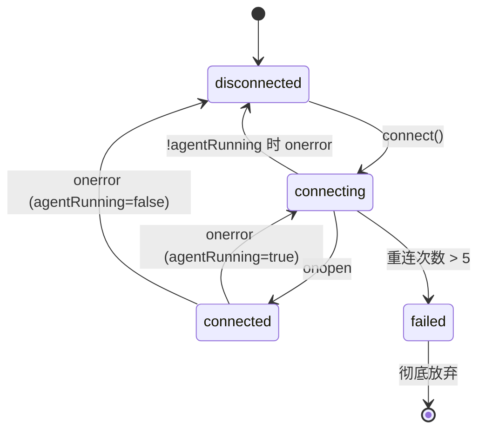
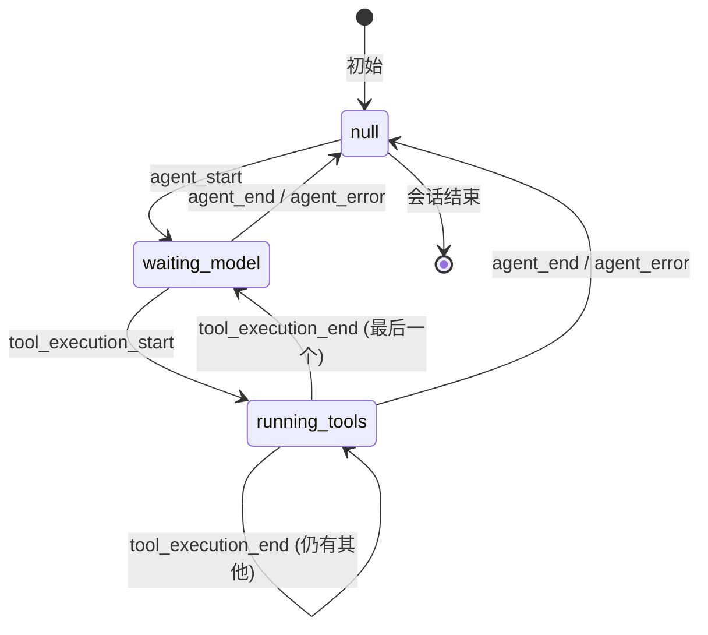
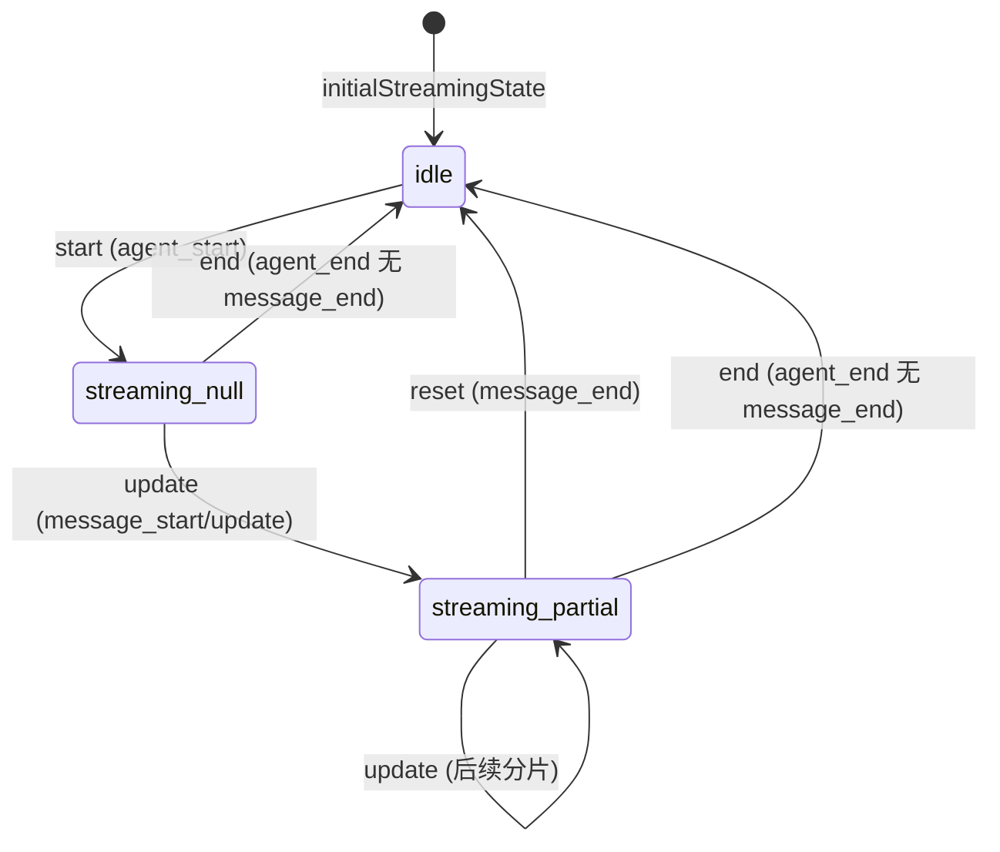

`pi-agent-desktop` 的核心交互模型建立在 **Server-Sent Events (SSE)** 之上：服务端通过持久化的 HTTP 流向客户端推送结构化事件，客户端通过确定性的状态机将事件序列转化为可渲染的 UI 状态。本文档系统性剖析从服务端事件产生、SSE 传输、客户端重连策略、事件分发、纯函数化状态映射到流式消息渲染的完整链路。

---

## 架构总览

```mermaid
flowchart TD
    subgraph Server["服务端 (Next.js API Route)"]
        SSE_Route["GET /api/agent/[id]/events\nReadableStream（服务端无 EventSource）"]
        Wrapper["AgentSessionWrapper\n订阅 pi AgentSession 事件"]
        Pi_Session["@earendil-works/pi-coding-agent\nAgentSession (内部事件总线)"]
    end

    subgraph Transport["传输层"]
        SSE_Format["data: {type, ...}\n\n\n心跳: :\n\n (30s 间隔)"]
    end

    subgraph Client["客户端 (React Hooks)"]
        Manager["AgentEventsManager\nEventSource + 指数退避重连"]
        Hook_Events["useAgentEvents\n暴露 connectEvents / connectionStatus"]
        Apply["applyAgentEvent (纯函数)\nSSE Event → UI State Patches"]
        Stream_Reducer["streamReducer\n{isStreaming, streamingMessage}"]
        Main_Hook["useAgentSession\n聚合状态、分发副作用"]
    end

    Pi_Session -->|subscribe(callback)| Wrapper
    Wrapper -->|emitEvent(event)| SSE_Route
    SSE_Route -->|ReadableStream.enqueue| SSE_Format
    SSE_Format -->|EventSource.onmessage| Manager
    Manager -->|handleAgentEvent| Hook_Events
    Hook_Events -->|handleAgentEventRef.current| Apply
    Apply -->|streamAction| Stream_Reducer
    Apply -->|其他 patches| Main_Hook
```

**核心设计原则**：

| 原则 | 实现方式 |
|------|----------|
| **类型安全** | `AgentEvent` 为判别联合，`switch(event.type)` 自动收窄，无需 `as` 断言 |
| **关注点分离** | 服务端事件类型 (`lib/rpc-manager.ts::AgentEvent`) 与客户端类型 (`agent-events-manager.ts::AgentEvent`) 物理隔离，防止跨运行时耦合 |
| **纯函数化状态映射** | `applyAgentEvent` 无副作用、可单测、可作为契约驱动测试 |
| **流式状态与提交状态分离** | `streamReducer` 仅管辖“正在流式传输的消息”；`message_end` 后消息追加到 `messages[]`，流式状态复位 |
| **健壮的生命周期管理** | 服务端 `ReadableStream` 的 `start`/`cancel` + `AbortSignal` 双重清理；客户端指数退避重连 + `expectRunning` 竞态修正 |

---

## 1. 服务端 SSE 端点

### 1.1 路由与动态渲染

```typescript
// app/api/agent/[id]/events/route.ts
export const dynamic = "force-dynamic"; // 禁用静态生成，强制每次请求执行
```

`force-dynamic` 确保每个 SSE 连接都创建独立的 `ReadableStream` 实例，避免 Next.js 缓存导致的连接复用问题。

### 1.2 会话获取与启动：快慢路径



**快路径**：会话已在内存注册表 (`globalThis.__piSessions`) 中且存活，直接复用 `AgentSessionWrapper`。

**慢路径**：需从磁盘解析 `.jsonl`、通过 Project Trust 409 握手、启动新的 `AgentSessionWrapper`。详见 [会话的两种访问模式：只读浏览与交互对话](9-hui-hua-de-liang-chong-fang-wen-mo-shi-zhi-du-liu-lan-yu-jiao-hu-dui-hua)。

Sources: [app/api/agent/[id]/events/route.ts](app/api/agent/%5Bid%5D/events/route.ts#L1-L50)

### 1.3 ReadableStream 生命周期与清理机制

服务端实现是 **`ReadableStream`**，不创建 `EventSource`。流的清理由 **共享闭包状态** 统一管理，双重路径（客户端主动取消 / 服务端 Abort 信号）汇聚到同一幂等 `cleanup()`：

```typescript
// app/api/agent/[id]/events/route.ts (简化)
let controllerRef: ReadableStreamController<Uint8Array> | null = null;
let heartbeat: ReturnType<typeof setInterval> | undefined;
let unsubscribe: (() => void) | undefined;
let cleaned = false;

const cleanup = () => {
  if (cleaned) return;
  cleaned = true;
  if (heartbeat) clearInterval(heartbeat);
  if (unsubscribe) { try { unsubscribe(); } catch { /* already unsubscribed */ } }
  if (controllerRef) { try { controllerRef.close(); } catch { /* already closed */ } }
  req.signal?.removeEventListener("abort", cleanup);
};

const stream = new ReadableStream<Uint8Array>({
  start(controller) {
    controllerRef = controller;
    encode({ type: "connected", sessionId: id }); // 首帧：连接确认
    unsubscribe = session.onEvent((event) => encode(event)); // 挂载监听
    heartbeat = setInterval(() => {
      if (controller.desiredSize === null) { cleanup(); return; } // 客户端已断开但 abort 未触发
      try {
        controller.enqueue(new TextEncoder().encode(":\n\n")); // SSE 注释行心跳
        session.keepAlive(); // 重置服务端 10min 空闲销毁定时器
      } catch { cleanup(); }
    }, 30_000);
    req.signal?.addEventListener("abort", cleanup);
  },
  cancel() { cleanup(); } // reader.cancel() / 页面关闭
});
```

**关键点**：

| 机制 | 作用 |
|------|------|
| `cleaned` 标志 | 幂等保护，防止 `start` 中的 `abort` 与 `cancel` 并发调用导致双重清理 |
| `controller.desiredSize === null` | 检测“代理静默丢弃连接”（无 FIN 包、无 abort 信号）的唯一可靠信号 |
| 心跳 `:\n\n` | SSE 标准注释行，不触发 `onmessage`，仅防止反向代理（Nginx/Cloudflare/Next.js 默认 120-150s）超时切断 |
| `session.keepAlive()` | 仅在成功 enqueue 后调用，确保“客户端真实存活”才重置空闲定时器，避免幽灵连接永久占用 Wrapper |
| `unsubscribe` 优先于 `session.destroy()` | Wrapper 销毁时先解绑监听器，再 `abort()` 内部循环，避免终止事件 (`agent_end` 等) 发送给已关闭的流 |

Sources: [app/api/agent/[id]/events/route.ts](app/api/agent/%5Bid%5D/events/route.ts#L50-L143)

### 1.4 事件编码格式

```typescript
const encode = (data: unknown) => {
  const text = `data: ${JSON.stringify(data)}\n\n`;
  controller.enqueue(new TextEncoder().encode(text));
};
```

每个事件独立帧，符合 [SSE 规范](https://html.spec.whatwg.org/multipage/server-sent-events.html)。心跳帧为 `:\n\n`（注释行）。

---

## 2. 服务端事件源：AgentSessionWrapper

`AgentSessionWrapper` (`lib/rpc-manager.ts`) 是 pi `AgentSession` 的薄适配层，职责：

1. 订阅 pi 内部事件总线 (`inner.subscribe`)
2. 将事件广播给所有 SSE 监听器 (`emitEvent`)
3. 管理生命周期（空闲销毁、优雅关闭、fork 时的会话切换）

### 2.1 事件订阅与转发

```typescript
// lib/rpc-manager.ts (AgentSessionWrapper.start() 方法中，由 startRpcSession 调用)
this.unsubscribe = this.inner.subscribe((event: AgentEvent) => {
  this.resetIdleTimer();
  if (event.type === "agent_end") {
    // LTM 观测、pendingAgentEnd 缓存、延迟发射
    this.pendingAgentEnd = event;
    return;
  }
  if (event.type === "agent_settled") {
    this.handleAgentSettled(); // 处理 follow-up 队列、codemode 切换
    return;
  }
  this.emitEvent(event); // 其余事件直接转发
});
```

**事件流向分类**：

| 事件类型 | 处理方式 | 备注 |
|----------|----------|------|
| `agent_start` / `message_start` / `message_update` / `tool_execution_*` / `extension_ui_*` / `queue_update` / `auto_retry_*` / `compaction_*` | 直接 `emitEvent` → SSE | 实时流式 |
| `follow_up_queue_update` | Wrapper 自行合成发射（`emitFollowUpQueue()`），非 pi 转发事件 | 队列变更时主动推送快照 |
| `agent_end` | 缓存为 `pendingAgentEnd`，不立即发射 | 等待 `agent_settled` 统一处理 follow-up 调度 |
| `agent_settled` | `handleAgentSettled()` → 发射 `pendingAgentEnd` + 调度下一条 follow-up | 单一排序边界 |
| `agent_error` | `emitAgentError()` → 合成 `agent_error` 事件发射 | 兜底错误通知，防止 UI 永久等待 |

Sources: [lib/rpc-manager.ts](lib/rpc-manager.ts#L200-L250)

### 2.2 空闲销毁与优雅关闭

```typescript
private resetIdleTimer(): void {
  if (this.idleTimer) clearTimeout(this.idleTimer);
  this.idleTimer = setTimeout(() => {
    this.destroy().catch((err) => console.error("Error during idle destroy:", err));
  }, 10 * 60 * 1000); // 10 分钟无活动自动销毁
}
```

`destroy()` 按严格顺序执行：

1. `unsubscribe()` — **先**解绑，防止 `abort()` 产生的终止事件发给已关闭流
2. `inner.abort()` — 终止 pi 内部 Agent 循环
3. `_uiBridge.destroy()` / `inner.extensionRunner?.emit({ type: "session_shutdown", reason: "quit" })` / `inner.dispose()`
4. 执行 `onDestroyCallbacks`（如会话注册表移除）

Sources: [lib/rpc-manager.ts](lib/rpc-manager.ts#L690-L750)

---

## 3. 客户端事件管理器：AgentEventsManager

`AgentEventsManager` (`hooks/agent-session/agent-events-manager.ts`) 封装原生 `EventSource`，提供：

- 连接状态机 (`disconnected` → `connecting` → `connected` / `failed`)
- 指数退避自动重连（最多重连 5 次：延迟 1s/2s/4s/8s/16s，30s 封顶值不可达）
- `expectRunning` 参数修正“连接发起早于 `agentRunning` 状态传播”的竞态

### 3.1 连接状态机



### 3.2 重连策略与 `expectRunning` 竞态修正

```typescript
// agent-events-manager.ts
connect(sid: string, resetAttempts = true, expectRunning?: boolean) {
  this.sid = sid;
  if (resetAttempts) this.reconnectAttempts = 0;
  // 关键：expectRunning=true 允许 connect() 同步表达“预期 agent 正在运行”
  // 这样早期 onerror 会走重连路径，而非静默断开导致 UI 卡在 "Waiting for model…"
  if (expectRunning !== undefined) this.agentRunning = expectRunning;
  // ... 创建 EventSource
}
```

**竞态场景** (`use-session-commands.ts::handleSend`)：

```typescript
// 1. 乐观更新：立即设置 agentRunning=true（use-session-commands.ts:215）
setAgentRunning(true);
// 2. 连接 SSE（同步调用；expectRunning=true 由 use-agent-events 内部硬编码传入）
connectEvents(commandTarget.sessionId); // :280
// 3. 发送 prompt 命令（await 等待完成，use-session-commands.ts:281-285）
await sendAgentCommand(commandTarget.sessionId, { type: "prompt", ... });
```

若无 `expectRunning=true`，步骤 2 创建的 `EventSource` 在 React effect 将 `agentRunning=true` 传播到 manager 之前触发 `onerror`，manager 会因 `agentRunning=false` 判定为“非预期断开”而直接 `disconnected`，UI 永久停留在等待态。`expectRunning` 让 manager“预判”流应当存在，强制走重连路径。

Sources: [hooks/agent-session/agent-events-manager.ts](hooks/agent-session/agent-events-manager.ts#L100-L170), [hooks/agent-session/use-session-commands.ts](hooks/agent-session/use-session-commands.ts#L180-L210)

### 3.3 指数退避算法

```typescript
// 第 n 次失败后的延迟：min(30000, baseDelay * 2^(n-1))
// baseDelay=1000 → 1s, 2s, 4s, 8s, 16s；reconnectAttempts > 5 即 failed（agent-events-manager.ts:147-149），
// 故实际最多重连 5 次，30s 封顶值不可达（Math.min(30000,...) 公式保留于 :154，源码注释如此写）
const delay = Math.min(30000, this.reconnectDelay * Math.pow(2, this.reconnectAttempts - 1));
this.reconnectTimer = setTimeout(() => {
  this.reconnectTimer = null;
  if (this.agentRunning && this.sid) this.connect(this.sid, false);
}, delay);
```

测试通过 `mock.timers` 驱动虚拟时钟验证，避免真实等待。

Sources: [hooks/agent-session/agent-events-manager.test.ts](hooks/agent-session/agent-events-manager.test.ts#L80-L180)

---

## 4. 客户端事件类型定义

`hooks/agent-session/agent-events-manager.ts` 定义了 **客户端专用** 的判别联合 `AgentEvent`。服务端 (`lib/rpc-manager.ts`) 使用更宽泛的 `AgentEvent { type: string; [key: string]: unknown }`，两者**刻意不共享类型**，防止跨运行时耦合。

```typescript
export type AgentEvent =
  | { type: "connected"; sessionId: string }
  | { type: "agent_start" }
  | { type: "agent_end" }
  | { type: "agent_settled" }
  | { type: "agent_error"; errorMessage: string }
  | { type: "message_start"; message: Partial<AgentMessage> }
  | { type: "message_update"; message: Partial<AgentMessage> }
  | { type: "message_end"; message: AgentMessage }
  | { type: "tool_execution_start"; toolCallId: string; toolName: string }
  | { type: "tool_execution_end"; toolCallId: string }
  | { type: "auto_retry_start"; attempt: number; maxAttempts: number; errorMessage?: string }
  | { type: "auto_retry_end" }
  | { type: "auto_compaction_start" }
  | { type: "compaction_start" }
  | { type: "auto_compaction_end"; errorMessage?: string; aborted?: boolean }
  | { type: "compaction_end"; errorMessage?: string; aborted?: boolean }
  | { type: "queue_update"; steering: readonly string[]; followUp: readonly string[] }
  | { type: "follow_up_queue_update"; revision: number; items: Array<{ id: string; message: string; attachmentCount: number; createdAt: number }> }
  | ExtensionUiRequestEvent
  | ExtensionUiNotifyEvent;
```

**设计注记**：

- `message_start` / `message_update` 携带 `Partial<AgentMessage>` — pi 实际每次发送**完整消息快照**（`MessageUpdateEvent.message: AgentMessage`），客户端整条替换；客户端类型声明为 `Partial<AgentMessage>` 只是不精确，并非增量
- `message_end` 携带完整 `AgentMessage` — 用于追加到不可变消息列表
- `tool_execution_start` 携带 `toolCallId` + `toolName` + `args`（完整参数），`tool_execution_end` 携带 `toolCallId` + `toolName` + `result` + `isError`；服务端原样转发 pi 事件（`rpc-manager.ts:226`），客户端类型只是未声明这些字段
- `follow_up_queue_update` 带 `revision` 字段，配合乐观并发控制（详见 [Follow-up Queue 与 revision 并发控制](20-follow-up-queue-yu-revision-bing-fa-kong-zhi)）

Sources: [hooks/agent-session/agent-events-manager.ts](hooks/agent-session/agent-events-manager.ts#L1-L80)

---

## 5. React 集成：useAgentEvents Hook

```typescript
// hooks/agent-session/use-agent-events.ts
export function useAgentEvents({ agentRunning }: UseAgentEventsOptions) {
  const managerRef = useRef<AgentEventsManager | null>(null);
  const handleAgentEventRef = useRef<((event: AgentEvent) => void) | null>(null);
  const [connectionStatus, setConnectionStatus] = useState<ConnectionStatus>("disconnected");

  // 单例 manager（跨渲染保持）
  if (!managerRef.current) managerRef.current = new AgentEventsManager();

  // agentRunning 变化 → manager.setAgentRunning（控制重连逻辑）
  useEffect(() => { managerRef.current?.setAgentRunning(agentRunning); }, [agentRunning]);

  // 挂载事件处理器与状态回调
  useEffect(() => {
    const manager = managerRef.current!;
    manager.setEventHandler((event) => handleAgentEventRef.current?.(event));
    manager.setStatusChangeHandler(setConnectionStatus);
    return () => { manager.setStatusChangeHandler(null); manager.cleanup(); };
  }, []);

  const connectEvents = useCallback((sid: string) => {
    managerRef.current?.connect(sid, true, true); // expectRunning=true
  }, []);

  return { handleAgentEventRef, connectEvents, connectionStatus };
}
```

**关键模式**：

- `handleAgentEventRef` 为**可变引用**，避免 `useEffect` 依赖数组变动导致重新订阅；`useAgentSession` 将 `applyAgentEvent` 赋值给该 ref
- `connectionStatus` 仅用于 UI 指示器（连接中/已连接/失败），不驱动业务逻辑

Sources: [hooks/agent-session/use-agent-events.ts](hooks/agent-session/use-agent-events.ts#L1-L51)

---

## 6. 纯函数化事件映射：applyAgentEvent

`applyAgentEvent` (`hooks/agent-session/agent-event-apply.ts`) 是整个状态流的**纯函数核心**。输入：单个 `AgentEvent` + 可选时钟；输出：结构化补丁对象 `AgentEventApplyResult`。

```typescript
export type AgentEventApplyResult = {
  agentRunning?: boolean;           // 顶层 agentRunning 状态
  phaseOp?: AgentPhaseOp;           // AgentPhase 状态机操作
  streamAction?: StreamAction;      // streamReducer 动作
  retryInfo?: RetryInfo | null;     // 自动重试信息
  isCompacting?: boolean;           // 压缩进行中
  compactError?: string | null;     // 压缩错误
  appendMessages?: AgentMessage[];  // 追加到 messages[] 的已完成消息
  effects: AgentEventSideEffect[];  // 副作用描述符（由调用方执行）
};
```

### 6.1 映射规则表

| SSE Event | agentRunning | phaseOp | streamAction | appendMessages | effects |
|-----------|--------------|---------|--------------|----------------|---------|
| `agent_start` | `true` | `set: waiting_model` | `start` | — | — |
| `message_start` / `message_update` | — | `clear` (保留 `running_tools`) | `update: normalizeToolCalls(message)` | — | — |
| `message_end` | — | `set: waiting_model` | `reset` | `[normalizeToolCalls(completed)]` | — |
| `tool_execution_start` | — | `addTool` | — | — | — |
| `tool_execution_end` | — | `removeTool` (最后一个 → `waiting_model`) | — | — | — |
| `agent_end` | `false` | `set: null` | `end` | — | `onAgentEndEvent`, `reloadSession`, `fetchAgentState`, `onAgentEnd` |
| `agent_error` | `false` | `set: null` | `end` | `[custom:agent_error]` | `consoleError` |
| `auto_retry_start` | — | — | — | — | — (设置 `retryInfo`) |
| `auto_retry_end` | — | — | — | — | — (`retryInfo=null`) |
| `compaction_start` / `auto_compaction_start` | — | — | — | — | `isCompacting=true` |
| `compaction_end` (成功：无 errorMessage 且未中止) | — | — | — | — | `isCompacting=false`, `reloadSession` |
| `compaction_end` (有 errorMessage) | — | — | — | — | `isCompacting=false`, `compactError` |
| `compaction_end` (中止且无 errorMessage) | — | — | — | — | `isCompacting=false`（既不设 `compactError`，也不 `reloadSession`） |
| `extension_ui_request` | — | — | — | — | `extensionUiRequest` |
| `extension_ui_notify` | — | — | — | — | `extensionUiNotify` |

**Phase 保护规则**：`message_update` 发出 `phaseOp: {type: "clear"}`，但 `applyPhaseOp` 会**保留** `running_tools` 状态（见下文），仅清除 `waiting_model`。这确保工具执行指示器在流式输出期间不闪烁。

Sources: [hooks/agent-session/agent-event-apply.ts](hooks/agent-session/agent-event-apply.ts#L1-L200), [hooks/agent-session/agent-event-apply.test.ts](hooks/agent-session/agent-event-apply.test.ts#L1-L120)

### 6.2 AgentPhase 子状态机

```typescript
// AgentPhase 类型与 add/removeRunningTool 定义于 agent-phase.ts；
// applyPhaseOp 定义并导出于 agent-event-apply.ts（:211-218）
export type AgentPhase =
  | { kind: "waiting_model" }
  | { kind: "running_tools"; tools: { id: string; name: string }[] }
  | null;

export function applyPhaseOp(phase: AgentPhase, op: AgentPhaseOp): AgentPhase {
  if (op.type === "set") return op.phase;
  if (op.type === "addTool") return addRunningTool(phase, op.id, op.name);
  if (op.type === "removeTool") return removeRunningTool(phase, op.id);
  // "clear"：仅清除 waiting_model，保留 running_tools（流式更新不得擦除工具指示器）
  return phase?.kind === "running_tools" ? phase : null;
}
```

状态转换图：



Sources: [hooks/agent-session/agent-phase.ts](hooks/agent-session/agent-phase.ts#L1-L18), [hooks/agent-session/agent-event-apply.ts](hooks/agent-session/agent-event-apply.ts#L120-L150)

---

## 7. 流式消息状态机：streamReducer

`streamReducer` (`hooks/agent-session/stream-state.ts`) 仅管辖 **“正在流式传输的消息”**，与已提交的 `messages[]` 完全分离。

```typescript
export interface StreamingState {
  isStreaming: boolean;
  streamingMessage: Partial<AgentMessage> | null;
}

export type StreamAction =
  | { type: "start" }
  | { type: "update"; message: Partial<AgentMessage> }
  | { type: "end" }
  | { type: "reset" };

export function streamReducer(state: StreamingState, action: StreamAction): StreamingState {
  switch (action.type) {
    case "start": return { isStreaming: true, streamingMessage: null };
    case "update": return { isStreaming: true, streamingMessage: action.message };
    case "end":
    case "reset": return initialStreamingState; // { isStreaming: false, streamingMessage: null }
  }
}
```

### 7.1 状态转换与渲染契约



**渲染层契约** (`MessageView` / `MessageList`)：

- `isStreaming === true` 且 `streamingMessage !== null` → 渲染“流式占位消息”，内容实时更新
- `isStreaming === false` → 不渲染流式占位；已完成消息已在 `messages[]` 中
- `streamingMessage` 为 `Partial<AgentMessage>`，可能仅含 `content` 增量；渲染器需容忍字段缺失

Sources: [hooks/agent-session/stream-state.ts](hooks/agent-session/stream-state.ts#L1-L32), [hooks/agent-session/stream-state.test.ts](hooks/agent-session/stream-state.test.ts#L1-L29)

---

## 8. 主 Hook 编排：useAgentSession

`useAgentSession` (`hooks/useAgentSession.ts`) 将上述所有部件串联，维护完整的会话级状态。

### 8.1 状态聚合

```typescript
// 核心状态切片
const [streamState, dispatch] = useReducer(streamReducer, initialStreamingState);
const [agentRunning, setAgentRunning] = useState(false);
const [agentPhase, setAgentPhase] = useState<AgentPhase>(null);
const [retryInfo, setRetryInfo] = useState<RetryInfo | null>(null);
const [isCompacting, setIsCompacting] = useState(false);
const [followUpQueue, setFollowUpQueue] = useState(EMPTY_FOLLOW_UP_QUEUE);
// ... 其余：contextUsage, systemPrompt, extensionUiRequest, trustPrompt 等
```

### 8.2 事件处理管线

```typescript
// useAgentSession 内部
const { handleAgentEventRef, connectEvents, connectionStatus } = useAgentEvents({ agentRunning });

// 实际处理器为 useCallback（useAgentSession.ts:353-528），渲染期直接赋值给 ref（避免 effect 重订阅）
const handleAgentEvent = useCallback((event: AgentEvent) => {
  // 0. applyAgentEvent 之前的对账：follow_up_queue_update / queue_update 队列同步、
  //    用户消息 message_end 与 pendingPrompts/pendingSteers 的 reconcile
  if (event.type === "follow_up_queue_update") acceptFollowUpQueue({ revision: event.revision, items: event.items });
  else if (event.type === "queue_update") reconcileSteeringQueue(event.steering);

  const result = applyAgentEvent(event);
  // 1. 顶层状态
  if (result.agentRunning !== undefined) setAgentRunning(result.agentRunning);
  if (result.phaseOp) setAgentPhase(prev => applyPhaseOp(prev, result.phaseOp!));
  if (result.streamAction) dispatch(result.streamAction);
  if (result.retryInfo !== undefined) setRetryInfo(result.retryInfo);
  if (result.isCompacting !== undefined) setIsCompacting(result.isCompacting);
  if (result.compactError !== undefined) setCompactError(result.compactError);
  // 2. 消息追加（同步维护 entryIds 平行数组；plan 模式下追加 assistant 文本时 setCanExecutePlan）
  if (result.appendMessages) setMessages(prev => [...prev, ...result.appendMessages!]);
  // 3. 副作用分发
  for (const effect of result.effects) {
    switch (effect.type) {
      case "reloadSession":
        if (sessionIdRef.current) loadSession(sessionIdRef.current); // 单参调用：默认 showLoading=false, includeState=false
        break;
      case "fetchAgentState": {
        // GET /api/agent/[id]（路由内部调 session.send({type:"get_state"})），解析 d.state 更新
        // contextUsage / sessionStats / systemPrompt / agentMode / followUpQueue（useAgentSession.ts:470-502）
        if (sessionIdRef.current) {
          fetch(`/api/agent/${encodeURIComponent(sessionIdRef.current)}`)
            .then((r) => r.json())
            .then((d) => { /* setContextUsage / setAuthoritativeSessionStats / setSystemPrompt / setAgentMode / acceptFollowUpQueue */ })
            .catch((err) => console.error("Agent end fetch failed:", err));
        }
        break;
      }
      case "onAgentEndEvent": onAgentEndEvent?.(); break;
      case "onAgentEnd": onAgentEnd?.(); break;
      case "consoleError": console.error("Agent error from server:", effect.message); break;
      case "extensionUiRequest": setExtensionUiRequest(effect.request); break;
      case "extensionUiNotify": setExtensionUiNotify({ message: effect.message, notifyType: effect.notifyType }); break;
    }
  }
}, [/* deps */]);
handleAgentEventRef.current = handleAgentEvent; // 渲染期直接赋值（useAgentSession.ts:529）
```

**数据流向**：

```
SSE Event (EventSource)
    ↓
AgentEventsManager.handleAgentEvent
    ↓
handleAgentEventRef.current (applyAgentEvent)
    ↓
AgentEventApplyResult (纯数据)
    ↓
useAgentSession 分发：
  ├─ setAgentRunning / setAgentPhase / dispatch(streamAction) / setRetryInfo / ...
  ├─ setMessages (appendMessages)
  └─ 副作用执行 (reloadSession, fetchAgentState, callbacks, ...)
```

### 8.3 发送命令与乐观更新

`useSessionCommands.ts::handleSend` 展示了发送端的协同：

```typescript
const handleSend = useCallback(async (message, images) => {
  if (agentRunning) return; // 客户端防抖

  const commandTarget = resolveSessionCommandTarget({...}); // 先解析目标（use-session-commands.ts:190-195）
  if (!commandTarget) return;
  if (!tryStartPromptDispatch(promptDispatchStateRef.current)) return; // 后防重入（:196）

  const clientMessageId = crypto.randomUUID();
  onPendingPromptQueued({ id: clientMessageId, message }); // 乐观 UI：立即显示用户消息
  setMessages((prev) => [...prev, userMsg]);
  setAgentRunning(true);
  setAgentPhase({ kind: "waiting_model" });
  dispatch({ type: "start" });

  // 图片内联映射（无 toApiFormat 助手），仅在有图时携带（:220-224）
  const piImages = images?.map((img) => ({
    type: "image" as const,
    data: img.data,
    mimeType: img.mimeType,
  }));

  // 关键顺序：先连 SSE (expectRunning=true)，再发 prompt（:280-285）
  connectEvents(commandTarget.sessionId);
  await sendAgentCommand(commandTarget.sessionId, {
    type: "prompt",
    message,
    ...(piImages?.length ? { images: piImages } : {}),
  });
}, [/* deps */]);
```

**顺序理由**：`connectEvents` 同步表达“预期 agent 即将运行”，修正 `AgentEventsManager` 的竞态；`sendAgentCommand` 可能在 SSE 建立前到达服务端，但服务端 `AgentSessionWrapper` 的 `prompt()` 调用是异步 fire-and-forget，事件会通过已建立的 SSE 流回传。

Sources: [hooks/useAgentSession.ts](hooks/useAgentSession.ts#L100-L250), [hooks/agent-session/use-session-commands.ts](hooks/agent-session/use-session-commands.ts#L180-L250)

---

## 9. 端到端事件流示例

用户发送 "Hello"，模型回复 "Hi there!"，无工具调用：

```mermaid
sequenceDiagram
    participant User
    participant ChatInput
    participant useSessionCommands
    participant SSE_Client as AgentEventsManager
    participant SSE_Server as /api/agent/[id]/events
    participant Wrapper as AgentSessionWrapper
    participant Pi as pi AgentSession

    User->>ChatInput: 输入 "Hello" + Enter
    ChatInput->>useSessionCommands: handleSend("Hello")
    useSessionCommands->>useSessionCommands: tryStartPromptDispatch() ✓
    useSessionCommands->>SSE_Client: connectEvents(sid)（expectRunning=true 硬编码于 use-agent-events 内部）
    SSE_Client->>SSE_Server: GET /api/agent/sid/events (EventSource)
    SSE_Server->>Wrapper: session.onEvent(listener)
    SSE_Server-->>SSE_Client: data: {type:"connected", sessionId:"sid"}\n\n
    useSessionCommands->>API: POST /api/agent/sid {type:"prompt", message:"Hello"}
    API->>Wrapper: send({type:"prompt", ...})
    Wrapper->>Pi: inner.prompt("Hello")
    Pi-->>Wrapper: agent_start
    Wrapper-->>SSE_Server: emitEvent(agent_start)
    SSE_Server-->>SSE_Client: data: {type:"agent_start"}\n\n
    SSE_Client->>useAgentSession: handleAgentEventRef(agent_start)
    useAgentSession->>useAgentSession: applyAgentEvent → {agentRunning:true, streamAction:start, phaseOp:set waiting_model}
    Pi-->>Wrapper: message_start {role:"assistant", content:[]}
    Wrapper-->>SSE_Client: data: {type:"message_start", message:{...}}\n\n
    useAgentSession: streamAction=update, phaseOp=clear → streamingMessage={role:"assistant", content:[]}
    Pi-->>Wrapper: message_update {content:[{type:"text", text:"H"}]}
    Wrapper-->>SSE_Client: data: {type:"message_update", message:{...}}\n\n
    useAgentSession: streamingMessage 更新为 "H"
    Pi-->>Wrapper: message_update {content:[{type:"text", text:"Hi"}]}
    Wrapper-->>SSE_Client: ...
    useAgentSession: streamingMessage 更新为 "Hi"
    Pi-->>Wrapper: message_update {content:[{type:"text", text:"Hi t"}]}
    ...
    Pi-->>Wrapper: message_end {完整 AssistantMessage}
    Wrapper-->>SSE_Client: data: {type:"message_end", message:{...}}\n\n
    useAgentSession: streamAction=reset, appendMessages=[完整消息] → messages[] 追加，streamingMessage 清空
    Pi-->>Wrapper: agent_end
    Wrapper-->>SSE_Client: data: {type:"agent_end"}\n\n
    useAgentSession: agentRunning=false, phase=null, effects=[onAgentEndEvent, reloadSession, fetchAgentState, onAgentEnd]
    useAgentSession->>SSE_Client: setAgentRunning(false) → effect → manager.setAgentRunning(false)
    SSE_Client->>SSE_Server: disconnect() 主动关闭 EventSource
    Note over SSE_Client,SSE_Server: 心跳仅在 agentRunning 期间保活；下一轮 handleSend 时重连
```

---

## 10. 错误处理与边界情况

### 10.1 服务端错误 → `agent_error` 事件

`AgentSessionWrapper` 捕获 pi 内部异常，合成 `agent_error` 事件发射，**不等待** `agent_end`：

```typescript
// lib/rpc-manager.ts
private emitAgentError(message: string): void {
  for (const l of this.listeners) {
    try {
      l({ type: "agent_error", errorMessage: message });
    } catch (err) {
      console.error("Error in agent_error listener:", err);
    }
  }
}

// prompt/steer/followUp catch 分支
.catch((err) => {
  console.error("pi prompt failed:", err);
  this.emitAgentError(err instanceof Error ? err.message : String(err));
});
```

客户端 `applyAgentEvent` 将其映射为：

- `agentRunning = false`
- `streamAction = end`（清除流式状态）
- `appendMessages = [{ role: "custom", customType: "agent_error", content: message, display: true }]`
- `effects = [{ type: "consoleError", message }]`

**关键**：**不发射** `onAgentEnd`/`reloadSession`，避免 UI 进入“等待 agent_end 的死循环”。

Sources: [lib/rpc-manager.ts](lib/rpc-manager.ts#L250-L280), [hooks/agent-session/agent-event-apply.ts](hooks/agent-session/agent-event-apply.ts#L50-L70)

### 10.2 网络中断与自动恢复

| 场景 | 服务端行为 | 客户端行为 |
|------|------------|------------|
| 客户端主动关闭标签页 | `cancel()` → `cleanup()` → `unsubscribe` → 10min 后 idle destroy | 无（进程结束） |
| 网络抖动（TCP 断开，无 abort） | `desiredSize === null` 检测 → `cleanup()` | `onerror` → 指数退避重连（若 `agentRunning`） |
| 反向代理超时切断 | 同上 | 同上 |
| 服务端重启/部署 | 进程退出 → `SIGTERM` → `gracefulCleanup` 等待所有 `destroy()` 完成 | 重连失败 → `failed` 状态 → UI 提示重试 |

### 10.3 并发守卫

- **服务端**：`send({type:"prompt"})` 若 `inner.isStreaming` 抛错，防止双重 Agent 循环
- **客户端**：`agentRunning` 为真时 `handleSend` 直接返回；`promptDispatchGate` 防重入

Sources: [lib/rpc-manager.ts](lib/rpc-manager.ts#L400-L420), [hooks/agent-session/prompt-dispatch-gate.ts](hooks/agent-session/prompt-dispatch-gate.ts#L1-L50)

---

## 11. 测试策略：契约驱动

项目采用 **契约驱动测试**：`reduceEvents` 辅助函数将事件序列通过 `applyAgentEvent` + `streamReducer` + `applyPhaseOp` 纯函数管线跑完，断言最终状态。

```typescript
// agent-event-apply.test.ts
function reduceEvents(events: AgentEvent[], now = 1_700_000_000_000) {
  let stream = initialStreamingState;
  let agentRunning = false;
  let phase: AgentPhase = null;
  let retryInfo = null;
  let isCompacting = false;
  let compactError = null;
  const messages = [];
  const allEffects = [];

  for (const event of events) {
    const r = applyAgentEvent(event, { now });
    if (r.agentRunning !== undefined) agentRunning = r.agentRunning;
    if (r.phaseOp) phase = applyPhaseOp(phase, r.phaseOp);
    if (r.streamAction) stream = streamReducer(stream, r.streamAction);
    if (r.retryInfo !== undefined) retryInfo = r.retryInfo;
    if (r.isCompacting !== undefined) isCompacting = r.isCompacting;
    if (r.compactError !== undefined) compactError = r.compactError;
    if (r.appendMessages) messages.push(...r.appendMessages);
    allEffects.push(...r.effects);
  }
  return { stream, agentRunning, phase, retryInfo, isCompacting, compactError, messages, allEffects };
}

test("contract: agent_start → message_update → message_end → agent_end ends cleanly", () => {
  const { stream, agentRunning, phase, messages, allEffects } = reduceEvents([
    { type: "agent_start" },
    { type: "message_start", message: { role: "assistant", content: [] } },
    { type: "message_update", message: { role: "assistant", content: [{ type: "text", text: "h" }] } },
    { type: "message_end", message: assistant },
    { type: "agent_end" },
  ]);
  assert.equal(agentRunning, false);
  assert.equal(stream.isStreaming, false);
  assert.ok(allEffects.some(e => e.type === "reloadSession"));
  // ...
});
```

**覆盖场景**：

- 正常流式完整生命周期
- `agent_error` 兜底清理
- 工具执行阶段的 `running_tools` 保护
- `message_update` 不清除 `running_tools`
- 自动重试、压缩（成功/错误/中止）的完整状态机

Sources: [hooks/agent-session/agent-event-apply.test.ts](hooks/agent-session/agent-event-apply.test.ts#L1-L150)

---

## 12. 相关页面导航

| 页面 | 关联点 |
|------|--------|
| [四层分离架构详解](6-si-ceng-fen-chi-jia-gou-xiang-jie) | SSE 处于“服务端运行时层”与“客户端状态层”的边界 |
| [AgentSession 生命周期与进程内注册表](7-agentsession-sheng-ming-zhou-qi-yu-jin-cheng-nei-zhu-ce-biao) | `AgentSessionWrapper` 的创建、注册、销毁、fork 切换 |
| [会话的两种访问模式：只读浏览与交互对话](9-hui-hua-de-liang-chong-fang-wen-mo-shi-zhi-du-liu-lan-yu-jiao-hu-dui-hua) | SSE 端点的快/慢路径、Project Trust 409 握手 |
| [streamReducer 流式消息状态机与增量渲染](23-streamreducer-liu-shi-xiao-xi-zhuang-tai-ji-yu-zeng-liang-xuan-ran) | 流式状态与虚拟化列表渲染的协同 |
| [Follow-up Queue 与 revision 并发控制](20-follow-up-queue-yu-revision-bing-fa-kong-zhi) | `follow_up_queue_update` 事件的 revision 语义 |
| [Extension UI Bridge 与异步 RPC 响应队列](17-extension-ui-bridge-yu-yi-bu-rpc-xiang-ying-dui-lie) | `extension_ui_request/notify` 事件的双向交互 |

---

## 13. 关键文件速查表

| 文件 | 职责 | 核心导出 |
|------|------|----------|
| `app/api/agent/[id]/events/route.ts` | SSE 端点、ReadableStream、心跳、清理 | `GET` handler |
| `lib/rpc-manager.ts` | `AgentSessionWrapper`、事件订阅/转发、生命周期 | `AgentSessionWrapper`, `startRpcSession`, `getRpcSession` |
| `hooks/agent-session/agent-events-manager.ts` | 客户端 `EventSource` 封装、重连、状态机 | `AgentEventsManager`, `AgentEvent`, `ConnectionStatus` |
| `hooks/agent-session/use-agent-events.ts` | React hook 暴露 manager 单例 | `useAgentEvents` |
| `hooks/agent-session/agent-event-apply.ts` | 纯函数：SSE Event → UI State Patches | `applyAgentEvent`, `applyPhaseOp`, `AgentEventApplyResult` |
| `hooks/agent-session/stream-state.ts` | 流式消息 Reducer | `streamReducer`, `initialStreamingState`, `StreamAction` |
| `hooks/agent-session/agent-phase.ts` | AgentPhase 子状态机 | `AgentPhase`, `addRunningTool`, `removeRunningTool`（`applyPhaseOp` 定义并导出于 `agent-event-apply.ts`） |
| `hooks/useAgentSession.ts` | 主 Hook，聚合所有状态、分发副作用 | `useAgentSession` |
| `hooks/agent-session/use-session-commands.ts` | 发送命令、乐观更新、SSE 连接编排 | `useSessionCommands` |

---

## 14. 总结

`pi-agent-desktop` 的 SSE 事件流体现了 **“服务端推流 + 客户端纯函数化状态映射”** 的现代实时架构模式：

1. **服务端** 以 `ReadableStream` 推 SSE 帧（**不是**服务端 `EventSource`），将 pi 内部事件总线透传；心跳 `:\n\n` 每 30s，**仅在 enqueue 成功后** `keepAlive()`；客户端才用 `EventSource`
2. **客户端** 以 `AgentEventsManager` 吸收网络不确定性（重连、竞态），向上暴露确定性事件流
3. **纯函数层** (`applyAgentEvent` + `streamReducer` + `applyPhaseOp`) 将事件序列折叠为 UI 状态，零副作用、全覆盖契约测试
4. **主 Hook** 仅负责分发补丁与执行副作用，业务逻辑完全声明化

这种分层使得流式渲染、工具执行指示、自动重试、压缩、Extension UI 等复杂交互均可在类型安全、可测试、可推理的框架内演进。
