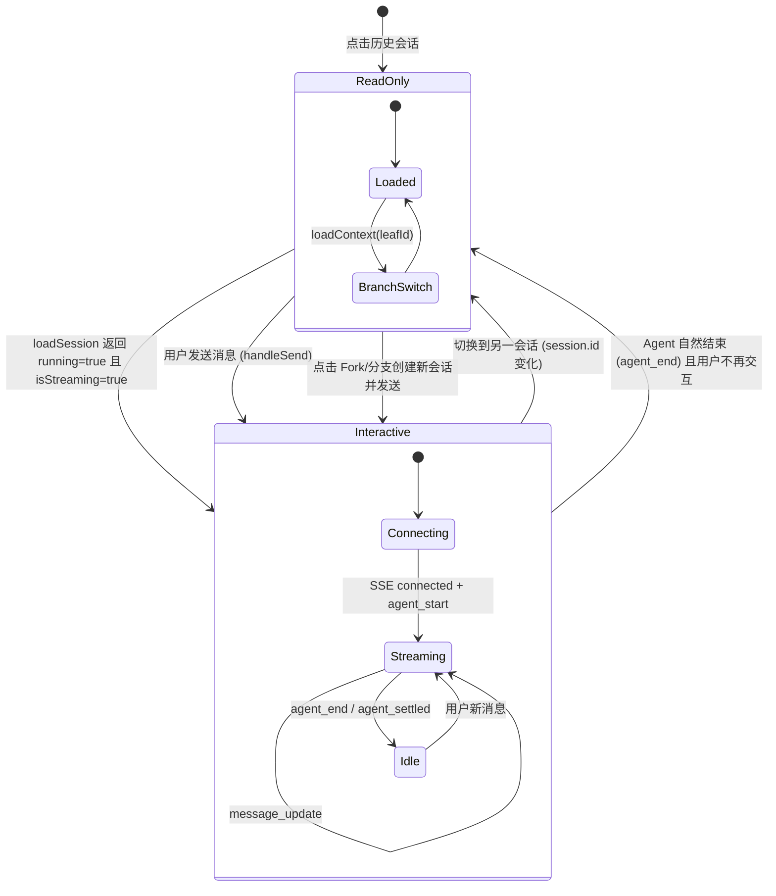
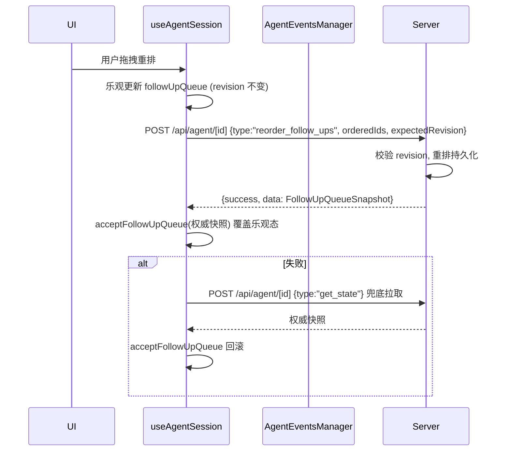

本文档详细阐述 Pi Agent Desktop 中会话的两种核心访问模式：**只读浏览** 与 **交互对话** 的架构差异、数据流向、状态机制及切换逻辑。这两种模式分别对应「历史回顾」与「实时协作」两大使用场景，在代码层面通过不同的 API 端点、不同的连接生命周期、不同的状态管理策略来实现彻底隔离。

---

## 架构概览

```mermaid
graph TB
    subgraph "只读浏览模式 Read-Only Browsing"
        A[SessionSidebar 点击会话] --> B[GET /api/sessions/[id]]
        B --> C[session-reader.ts 解析 .jsonl]
        C --> D[返回 SessionData: tree, context, messages, leafId]
        D --> E[useSessionLoader.loadSession]
        E --> F[ChatWindow 仅渲染 messages]
        F --> G[无 SSE 连接, 无 Agent 进程]
    end

    subgraph "交互对话模式 Interactive Dialogue"
        H[用户发送消息 / 恢复运行中会话] --> I[useAgentSession effect 触发]
        I --> J[loadSession includeState=true]
        J --> K[GET /api/sessions/[id]?includeState]
        K --> L[running=true 且 isStreaming=true 才升级]
        L --> M[connectEvents -> SSE /api/agent/[id]/events]
        M --> N[AgentEventsManager 建立 EventSource]
        N --> O[实时事件流: message_start/update/end, tool_execution, queue_update...]
        O --> P[handleAgentEvent -> applyAgentEvent -> 状态更新]
        P --> Q[流式渲染, Follow-up Queue, Extension UI, 思考球动画]
    end

    style A fill:#e3f2fd
    style H fill:#fff3e0
    style G fill:#fce4ec
    style Q fill:#fff3e0
```

**核心区别**：只读模式走 **HTTP 请求-响应** 拉取静态快照；交互模式在 HTTP 基础上**升级为 SSE 长连接**，并启动/恢复后台 Agent 进程（RPC wrapper）。

Sources: [app/api/sessions/[id]/route.ts](app/api/sessions/[id]/route.ts#L1-L80), [app/api/agent/[id]/events/route.ts](app/api/agent/[id]/events/route.ts#L1-L143), [hooks/agent-session/use-session-loader.ts](hooks/agent-session/use-session-loader.ts#L1-L121), [hooks/agent-session/use-agent-events.ts](hooks/agent-session/use-agent-events.ts#L1-L51)

---

## 只读浏览模式

### 触发入口

用户在 `SessionSidebar` 点击任意历史会话节点，`AppShell.handleSelectSession` 被调用，设置 `selectedSession` 状态，随后 `ChatWindow` 通过 `useAgentSession` 接收到 `session` prop，触发内部 `useEffect([session?.id])` 加载流程。

```mermaid
sequenceDiagram
    participant User
    participant SessionSidebar
    participant AppShell
    participant ChatWindow
    participant useAgentSession
    participant useSessionLoader
    participant API

    User->>SessionSidebar: 点击会话项
    SessionSidebar->>AppShell: onSelectSession(session)
    AppShell->>AppShell: setSelectedSession(session)
    AppShell->>ChatWindow: session prop 变化
    ChatWindow->>useAgentSession: session.id 变化触发 effect
    useAgentSession->>useSessionLoader: loadSession(sid, true, true)
    useSessionLoader->>API: GET /api/sessions/[id]?includeState
    API->>API: resolveSessionPath -> getSessionEntriesAsync -> buildTree/buildSessionContext
    API-->>useSessionLoader: SessionData { tree, context, leafId, agentState }
    useSessionLoader-->>useAgentSession: LoadedSessionState { agentState, contextThinkingLevel }
    useAgentSession->>useAgentSession: loadedAgentStatePatch 解析 agentState
    alt agentState.running === true 且 state.isStreaming === true
        useAgentSession->>useAgentSession: setAgentRunning(true); connectEvents(sid)
    else
        useAgentSession->>useAgentSession: 仅更新 messages, tree, leafId 等只读状态
    end
```

### 数据获取链路

1. **前端**：`useSessionLoader.loadSession(sid, showLoading, includeState)` → `fetchSession(sid, includeState)` → `GET /api/sessions/[id]?includeState`
2. **后端**：`app/api/sessions/[id]/route.ts` 的 `GET` 处理器：
   - `resolveSessionPath(id)` 解析会话文件路径（带缓存）
   - `getSessionEntriesAsync(filePath)` 读取并解析 `.jsonl` 全量条目
   - `buildTree(entries)` 构建分支树结构 `SessionTreeNode[]`
   - `getLeafId(entries)` 获取当前叶子节点 ID
   - `buildSessionContext(entries, leafId)` 生成扁平化消息列表 `AgentMessage[]` 与 `entryIds[]`
   - 若 `includeState=true`，额外调用 `getRpcSession(id)?.peekState()` 读取运行时状态（**不重置空闲计时器**）；wrapper 存活时返回 `{running:true, state}`，否则返回 `{running:false}`
3. **响应结构**：
   ```typescript
   interface SessionData {
     sessionId: string;
     filePath: string;
     info: SessionInfo | null;  // 会话元信息（name/cwd/parentSessionId 等）
     tree: SessionTreeNode[];
     leafId: string | null;
     context: {
       messages: AgentMessage[];
       entryIds: string[];
       thinkingLevel: string;
       model: { provider: string; modelId: string } | null;
     };
     agentState?: {          // includeState=true 时必返；不存活时为 {running:false}，仅 state 依存活而异
       running: boolean;
       state?: {             // peekState() 返回的只读快照
         isStreaming?: boolean;
         isCompacting?: boolean;
         contextUsage?: ...;
         sessionStats?: SessionStats | null;
         systemPrompt?: string;
         thinkingLevel?: string;
         followUpQueue?: FollowUpQueueSnapshot;
       };
     };
   }
   ```

### 状态与渲染

- `useSessionLoader` 维护 `messages`、`entryIds`、`tree`、`leafId`、`activeLeafId` 等**纯展示状态**
- `ChatWindow` 通过 `MessageList` 虚拟化列表渲染 `messages`
- `BranchNavigator` 接收 `onBranchDataChange(tree, activeLeafId, onLeafChange)` 回调，渲染分支导航 UI
- **无 `agentRunning`、无 SSE 连接、无 `streamState`、无 Follow-up Queue 实时更新**
- 用户可自由切换 `activeLeafId`（点击分支节点），触发 `loadContext(sid, leafId)` 重新拉取该分支上下文，不影响原会话文件

Sources: [app/api/sessions/[id]/route.ts](app/api/sessions/[id]/route.ts#L1-L80), [lib/session-reader.ts](lib/session-reader.ts#L1-L120), [hooks/agent-session/use-session-loader.ts](hooks/agent-session/use-session-loader.ts#L1-L121), [components/ChatWindow.tsx](components/ChatWindow.tsx#L1-L80), [hooks/useAgentSession.ts](hooks/useAgentSession.ts#L600-L750)

---

## 交互对话模式

### 触发条件

交互模式在以下任一条件满足时**自动升级**：

1. **新建会话**：`newSessionCwd !== null && session === null`（`isNew=true`），用户首次发送消息
2. **恢复流式中的会话**：`loadSession(..., includeState=true)` 返回 `agentState.running === true` **且** `state.isStreaming === true`（需二者同时满足，见 `session-lifecycle-reset.ts` 的 `loadedAgentStatePatch`；wrapper 存活但空闲时 `running=true`、`isStreaming=false`，保持只读）
3. **显式发送命令**：`handleSend`、`handleFork`、`handleCompact` 等调用 `sendAgentCommand` → `POST /api/agent/[id]`

### SSE 连接建立流程

```mermaid
sequenceDiagram
    participant useAgentSession
    participant useAgentEvents
    participant AgentEventsManager
    participant SSE_Endpoint

    useAgentSession->>useAgentEvents: connectEvents(sid)
    useAgentEvents->>AgentEventsManager: connect(sid, true, true)
    AgentEventsManager->>AgentEventsManager: setAgentRunning(true); disconnect(); setStatus("connecting")
    AgentEventsManager->>SSE_Endpoint: new EventSource(`/api/agent/${sid}/events`)
    SSE_Endpoint->>SSE_Endpoint: getRpcSession 或 startRpcSession 启动 Agent
    SSE_Endpoint-->>AgentEventsManager: SSE 流打开
    AgentEventsManager->>AgentEventsManager: onopen -> setStatus("connected"); reconnectAttempts=0
    SSE_Endpoint-->>AgentEventsManager: data: {"type":"connected","sessionId":"..."}
    AgentEventsManager->>useAgentEvents: handleAgentEvent({type:"connected"})
    useAgentEvents->>useAgentSession: handleAgentEventRef.current(event)
    useAgentSession->>useAgentSession: applyAgentEvent -> 更新 connectionStatus="connected"
```

### 后端 SSE 端点实现细节

`/api/agent/[id]/events/route.ts` 采用 **ReadableStream + 心跳机制** 实现标准 SSE：

- **快速路径**：若 `getRpcSession(id)?.isAlive()` 直接复用现有 wrapper
- **冷启动**：`resolveSessionPath` → `getHeaderAsync` 读取 cwd → `evaluateProjectTrust` 检查信任（可能返回 409） → `startRpcSession(id, filePath, cwd)` 创建新 wrapper
- **清理机制**：`cleanup()` 函数被 `start` 的 `abort` 信号与 `cancel` 双路径调用，**幂等** 关闭 heartbeat interval、移除 listener、关闭 controller
- **心跳**：30 秒间隔发送 `:\n\n` 注释行，同时调用 `session.keepAlive()` 刷新 Agent 空闲计时器；检测到 `controller.desiredSize === null`（客户端断开）主动清理

Sources: [app/api/agent/[id]/events/route.ts](app/api/agent/[id]/events/route.ts#L1-L143), [hooks/agent-session/agent-events-manager.ts](hooks/agent-session/agent-events-manager.ts#L1-L186), [hooks/agent-session/use-agent-events.ts](hooks/agent-session/use-agent-events.ts#L1-L51)

### 实时事件类型与状态机驱动

SSE 事件流中的每个 `AgentEvent` 经 `handleAgentEvent` → `applyAgentEvent` 产出 **纯状态补丁**，再由 `useAgentSession` 分发至对应 `setState`/`dispatch`：

| 事件类型 | 触发场景 | 状态影响 |
|----------|----------|----------|
| `connected` | SSE 握手成功 | `connectionStatus="connected"` |
| `agent_start` | Agent 开始处理 | `agentRunning=true`, `agentPhase={kind:"waiting_model"}` |
| `message_start/update/end` | 流式消息增量 | `streamState.streamingMessage` 累积/替换/定型 |
| `tool_execution_start/end` | 工具调用生命周期 | `streamState.toolExecutions` 追踪 |
| `queue_update` | Steering/Follow-up 队列变更 | `pendingSteersRef`、`followUpQueue` 乐观/权威同步 |
| `follow_up_queue_update` | Follow-up 权威快照 | `acceptFollowUpQueue` 替换全量 |
| `auto_retry_start/end` | 自动重试 | `retryInfo` 显示重试进度 |
| `compaction_start/end` | 上下文压缩 | `isCompacting`、`compactError` |
| `extension_ui_request/notify` | Extension UI 交互 | `extensionUiRequest`、`extensionUiNotify` 弹窗 |
| `agent_end` / `agent_settled` / `agent_error` | Agent 结束 | `agentRunning=false`，触发 `fetchAgentState` 回收最终统计 |

**关键设计**：`applyAgentEvent` 为**纯函数**，接收当前状态快照与事件，返回 `{ agentRunning, phaseOp, streamAction, retryInfo, isCompacting, compactError, appendMessages, effects[] }`，实现 **事件溯源** 与 **状态机确定性**。

Sources: [hooks/agent-session/agent-event-apply.ts](hooks/agent-session/agent-event-apply.ts), [hooks/useAgentSession.ts](hooks/useAgentSession.ts#L200-L400), [hooks/agent-session/stream-state.ts](hooks/agent-session/stream-state.ts)

### 交互模式独有能力

| 能力 | 只读模式 | 交互模式 | 实现依赖 |
|------|----------|----------|----------|
| 流式 Token 渲染 | ❌ | ✅ | `streamState` + `MessageList` 增量渲染 |
| 工具执行可视化 | ❌ | ✅ | `tool_execution_start/end` 事件 |
| Follow-up Queue 实时编辑/重排 | ❌ | ✅ | `queue_update` + `follow_up_queue_update` 双轨同步 |
| Extension UI 异步 RPC | ❌ | ✅ | `extension_ui_request` 事件 + `extension_ui_response` 命令 |
| 思考球动态动画 | ❌ | ✅ | `agentPhase` 状态驱动 `AgentThinkingOrb` |
| Agent Mode (Plan/Ask/Full) 运行时生效 | ❌ | ✅ | `agentMode` 经 `sendAgentCommand` 传递给 Agent |
| 上下文用量实时进度条 | ❌ | ✅ | `contextUsage` 来自 `peekState`/SSE 事件 |
| 会话统计 权威数据 | ❌ | ✅ | `sessionStats` 来自 Agent 进程内部累积 |

---

## 模式切换与状态隔离

### 会话切换时的彻底重置

`useAgentSession` 的核心 `useEffect([session?.id])` 在 `session` 变更时执行 **完全隔离** 的重置逻辑：

```typescript
// session-lifecycle-reset.ts
export function sessionScopedResetPatch(): SessionScopedResetPatch {
  return {
    toolPreset: "default",
    thinkingLevel: "auto",
    agentRunning: false,
    agentPhase: null,
    retryInfo: null,
    contextUsage: null,
    systemPrompt: null,
    forkingEntryId: null,
    isCompacting: false,
    compactError: null,
    currentModelOverride: null,
    pendingModel: null,
  };
}
```

重置覆盖：**所有会话级状态**，包括 `messages`、`entryIds`、`streamState`、`followUpQueue`、`pendingSteers/Prompts`、`agentMode`（回退至全局默认值）、`thinkingLevel`、`toolPreset` 等。

**防御性重挂载**：`AppShell` 同时维护 `sessionKey`，切换会话时 `setSessionKey(k => k + 1)` 导致 `ChatWindow` **整棵卸载重装**，覆盖 `useChatScroll`、`useAgentEvents` 等子 Hook 无法从 `useAgentSession` 重置的残留状态（如 `EventSource` 连接、滚动容器引用）。

### 从只读升级为交互的路径



**关键点**：
- 只读→交互升级是**单向且自动**的，无需用户显式「进入编辑模式」
- 交互→只读降级**仅发生于会话切换**，而非 Agent 结束。Agent 结束后会话仍保持 `agentRunning=false` 但 SSE 连接已断开，再次发送消息会重新 `connectEvents` 升级
- `includeState=true` 是桥梁：首次加载时同时获取静态上下文与运行时状态，避免额外轮询

Sources: [hooks/useAgentSession.ts](hooks/useAgentSession.ts#L600-L750), [hooks/agent-session/session-lifecycle-reset.ts](hooks/agent-session/session-lifecycle-reset.ts#L1-L123), [components/AppShell.tsx](components/AppShell.tsx#L150-L200)

---

## API 端点对比表

| 维度 | 只读浏览 `/api/sessions/[id]` | 交互对话 `/api/agent/[id]/events` | 交互命令 `/api/agent/[id]` |
|------|-------------------------------|-----------------------------------|----------------------------|
| **HTTP 方法** | GET | GET (SSE) | POST |
| **连接模式** | 短连接，请求-响应 | 长连接，服务端推流 | 短连接，请求-响应 |
| **认证/信任** | 仅会话存在性 | Project Trust 409 握手 | Project Trust 409 握手 |
| **Agent 进程** | 不启动，`peekState` 只读 | `startRpcSession` 启动/复用 | `startRpcSession` 启动/复用 |
| **空闲计时器** | **不重置**（peekState 设计） | `keepAlive()` 每 30s 刷新 | 随命令隐式刷新 |
| **典型调用方** | `useSessionLoader.loadSession` | `AgentEventsManager.connect` | `sendAgentCommand` (handleSend 等) |
| **响应内容** | 静态快照：tree, messages, agentState | 事件流：`AgentEvent[]` | 命令执行结果 `{success, data}` |
| **错误语义** | 404=会话不存在 | 409=需信任确认, 500=启动失败 | 409=需信任, 400=命令非法, 404=会话不存在 |
| **并发安全** | 只读，天然安全 | 单会话单连接，重连去抖 | 乐观锁 `revision` (Follow-up) |

---

## 关键实现细节深度解析

### 1. `peekState()` 与空闲计时器的设计张力

```typescript
// app/api/sessions/[id]/route.ts
if (url.searchParams.has("includeState")) {
  const rpc = getRpcSession(id);
  if (rpc?.isAlive()) {
    // peekState() 是只读的，且**不重置空闲计时器** ——
    // 轮询此端点绝不能让空闲会话永远存活。
    const state = rpc.peekState();
    agentState = { running: true, state };
  }
}
```

- **只读模式**通过 `includeState` 获取运行时快照用于 UI 指示（显示「运行中」徽标、恢复 thinking level 等）
- **交互模式**通过 SSE 心跳 `keepAlive()` 主动维持会话存活
- 两者职责分离避免了「只读浏览也能让会话永不超时」的副作用

Sources: [app/api/sessions/[id]/route.ts](app/api/sessions/[id]/route.ts#L70-L85), [lib/rpc-manager.ts](lib/rpc-manager.ts)

### 2. `latestRequestStale` 竞态守卫

只读加载链路在快速切换会话时面临「慢响应覆盖快响应」的经典竞态：

```typescript
// hooks/agent-session/use-session-loader.ts
const loadReqIdRef = useRef(0);
const loadContextReqIdRef = useRef(0);

const loadSession = useCallback(async (sid, showLoading, includeState) => {
  const stale = latestRequestStale(loadReqIdRef);  // ① 生成本次请求 ID
  const d = await fetchSession(sid, includeState);
  if (stale()) return null;                       // ② 若已有更新请求，丢弃结果
  // ... setState
}, []);
```

- `latestRequestStale` 返回闭包，捕获调用时刻的 `reqId`；后续同类调用递增 `ref.current`，旧闭包判定为 `stale() === true`
- **双守卫分离**：`loadReqIdRef` 守护 `loadSession`（全量加载），`loadContextReqIdRef` 守护 `loadContext`（分支切换上下文）
- 测试用例验证了 M3 级别的「最新请求胜出」语义

Sources: [hooks/agent-session/use-session-loader.ts](hooks/agent-session/use-session-loader.ts#L1-L50), [hooks/agent-session/use-session-loader.test.ts](hooks/agent-session/use-session-loader.test.ts#L1-L30)

### 3. 会话路径缓存与「先查后建」竞态

`resolveSessionPath` 实现了**正向缓存 + 短 TTL 负向缓存**，并处理 Fork/Clone 创建新会话时的竞态：

```typescript
// lib/session-reader.ts
if (cached.negative) {
  // 负向缓存可能过期：会话文件可能在记录 miss 后被创建 (先查后建 — fork/clone)
  // 若存在活跃 RPC wrapper，文件必然存在，丢弃负向缓存重新扫描
  if (!getLiveRpcSession(sessionId)) return null;
  state.misses.delete(sessionId);
}
await listAllSessions();  // 全量扫描刷新缓存
```

- 正向缓存：`sessionId -> filePath` 映射，存储于 `globalThis.__piSessionPathCacheState`（HMR 安全）
- 负向缓存：记录「找不到」的 sessionId 与时间戳，TTL 过期前直接返回 404
- **竞态窗口**：Fork 操作先由 `createBranchedSession` **同步写出**新 `.jsonl`，随后 `cacheSessionPath` 更新路径缓存，再 `startRpcSession` 注册 RPC wrapper（注册到 `globalThis.__piSessions`）。若此时并发 `resolveSessionPath` 命中负向缓存会误判 404 → 检测到活跃 wrapper 则放弃负向缓存回退扫描

Sources: [lib/session-reader.ts](lib/session-reader.ts#L1-L100), [lib/session-path-cache.ts](lib/session-path-cache.ts), [lib/rpc-manager.ts](lib/rpc-manager.ts)

### 4. Follow-up Queue 的双轨同步机制

交互模式下 Follow-up Queue 维护**乐观本地状态**与**权威服务端快照**双轨：



- `queue_update` 事件（Steering 变更）仅携带字符串数组，**无 revision**，用于轻量同步
- `follow_up_queue_update` 事件携带 `revision` 与完整 `items[]`，**权威覆盖**
- 乐观更新在 `handleReorderFollowUps` 中实现，失败自动回滚至上一权威版本

Sources: [hooks/useAgentSession.ts](hooks/useAgentSession.ts#L400-L550), [hooks/agent-session/use-session-commands.ts](hooks/agent-session/use-session-commands.ts#L1-L536), [lib/follow-up-queue.ts](lib/follow-up-queue.ts)

---

## 常见问题与排查指南

| 现象 | 可能原因 | 排查方向 |
|------|----------|----------|
| 点击历史会话显示「运行中」但无法交互 | `agentState.running=true` 但 SSE 未连接 | 检查 `connectEvents` 是否被 `loadedAgentStatePatch` 触发，Network 面板确认 `/events` SSE 建立 |
| 切换会话后残留上一会话的 Follow-up Queue | `sessionScopedResetPatch` 未重置 `followUpQueue` | 确认 `followUpQueueRef.current = EMPTY_FOLLOW_UP_QUEUE; setFollowUpQueue(EMPTY_FOLLOW_UP_QUEUE)` 在 effect 中执行 |
| 只读模式下频繁切换分支导致消息闪烁 | `loadContext` 竞态，旧响应覆盖新响应 | 验证 `loadContextReqIdRef` 守卫生效，`setMessages` 仅在 `!stale()` 时调用 |
| SSE 连接频繁重连 (connecting ↔ connected) | Agent 进程反复重启或心跳超时 | 检查 `rpc-manager.ts` idle timeout 配置，确认 30s 心跳 `keepAlive()` 正常发送 |
| 新建会话首条消息发送后卡在「Waiting for model」 | `agentPhase` 未从 `waiting_model` 推进 | 确认 `agent_start` 事件到达，`handleAgentEvent` 正确设置 `agentPhase={kind:"waiting_model"}`（`AgentPhase` 类型全集为 `waiting_model | running_tools`，无 executing） |

---

## 相关页面导航

- **上游依赖**：[SSE 事件流与流式状态机](8-sse-shi-jian-liu-yu-liu-shi-zhuang-tai-ji) — 详细阐述 `streamReducer` 与 `AgentEvent` 类型体系
- **下游消费**：[Agent 模式与 Ask 拦截：Plan / Ask / Full](16-agent-mo-shi-yu-ask-lan-jie-plan-ask-full) — 交互模式下 Agent Mode 的运行时行为
- **会话持久化**：[Pi 会话文件格式与 .jsonl 解析](13-pi-hui-hua-wen-jian-ge-shi-yu-jsonl-jie-xi) — 只读模式依赖的底层存储格式
- **分支机制**：[三种分支机制：Fork、会话内分支、Git Worktree Clone](14-san-chong-fen-zhi-ji-zhi-fork-hui-hua-nei-fen-zhi-git-worktree-clone) — 只读模式下的分支树导航与交互模式下的 Fork 创建
- **进程管理**：[AgentSession 生命周期与进程内注册表](7-agentsession-sheng-ming-zhou-qi-yu-jin-cheng-nei-zhu-ce-biao) — RPC wrapper 与 `globalThis.__piSessions` 注册表机制

---

## 总结

| 维度 | 只读浏览 | 交互对话 |
|------|----------|----------|
| **核心目的** | 历史回顾、分支导航、上下文检查 | 实时协作、流式生成、工具编排 |
| **数据新鲜度** | 请求时刻的静态快照 | 毫秒级事件流推送 |
| **资源占用** | 无后台进程，无长连接 | Agent 进程 + SSE 连接 + 心跳 |
| **状态权威** | 文件系统 (`.jsonl`) | Agent 进程内存状态 + 事件溯源 |
| **切换代价** | 单次 HTTP 请求 (~10-50ms) | SSE 重连 + 状态同步 (~100-500ms) |
| **适用场景** | 侧边栏浏览、分支切换、导出预览 | 发送消息、执行计划、压缩上下文、Extension UI |

**设计哲学**：**读写分离**，**按需升级**。只读模式作为零成本的默认访问路径，交互模式仅在用户表达「我要继续对话」的意图时（发送消息、恢复运行中会话）才按需启动重资源路径。这种分层架构既保证了历史浏览的流畅性，又避免了空闲会话占用后端计算资源。